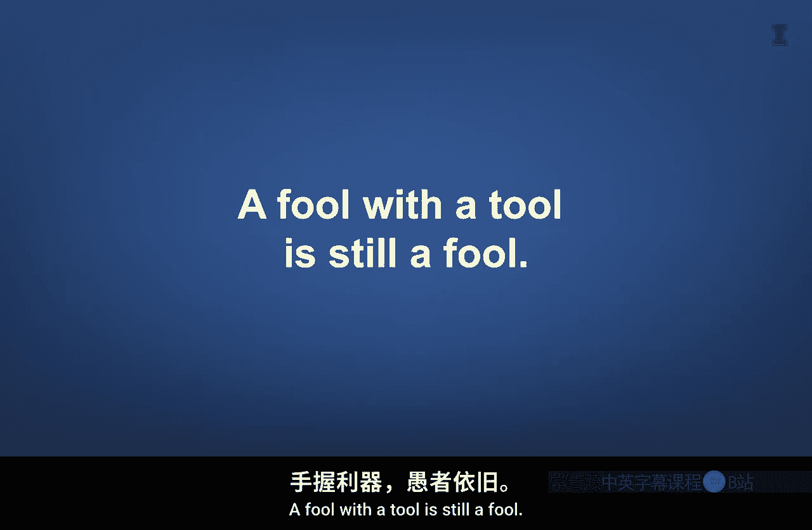
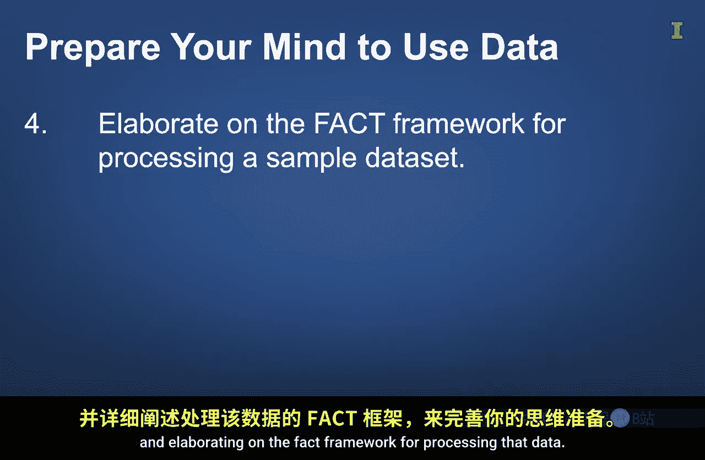

# 伊利诺伊大学【中英⚡商业分析｜Business Analytics Specialization】 p88 P88 04_第1模块-介绍 -BV1z86nB9EGz_p88-

Welcome from a beautiful school in Southern California， Occidental College。

This happens to be the location where the 44th president of the United States。

 Barack Obama started his education。 I'm a big believer in lifelong education。

 which is especially important to remain relevant in our fast changing world。As technology advances。

 it's important to keep up with the new tools， and there are many powerful software tools for performing business analytic processes。

In this set of lessons， we'll focus on the most important tool， which is your mind。

There's a memorable9 word quip that highlights the importance of your mind。

A fool with a tool is still a fool。

To illustrate this idea further， imagine what would happen if a fool had a bunch of ladders but didn't know how to use them to get over a wall。

It wouldn't matter how many ladders they had。 They would probably never make it over the wall。

On the other hand， someone one who knows how to use a ladder can not only use it to climb up and down。

 but they may come up with other creative ways to use it。By the time you finish these lessons。

 your mind should be prepared in several ways。First。

 we'll prepare your mind by sharing several short examples of questions that companies answer using data analytics and highlighting the reality that the data itself does not add value。

 but is more like a raw material that has value only after being processed correctly。Second。

 we'll prepare your mind by discussing the importance of developing a creative and analytic mindset。

Sometimes we hear those mindsets discussed as right and left brain activities。

And think that right brain activities are reserved more for the arts than the sciences。

But the reality is that curiosity and creativity are just as important in business analytics endeavoravs as the ability to think analytically。

 break down large problems into smaller pieces and follow a structured process。😊。

This is particularly because we sometimes pursue a business insight after recognizing patterns in the data。

 rather than starting with premises that are well laid out。

The ability to connect those observed patterns with business processes。

 other questions and analytic processes requires a curious and creative mind。Third。

 we will prepare your mind by emphasizing the importance of letting the data speak。

We don't want you to think that all decisions have to be made with data。

Professional judgment and intuition are still extremely important in business decisions。However。

 it is important to be open to the possibility that business analytics results will oppose your beliefs。

That is， it is important to let the data speak。Fourth。

 we will prepare your mind by introducing a sample data set and delaborating on the fact framework for processing that data。

The data set is a sample of real business data， and we want you to have some level of familiarity with that data and the questions it can answer。

We hope that you'll recognize some business analytics applications for data sets with which you may be currently working with。

We will then review the fact framework for analyzing data and elaborate on those steps to fill out a more nuanced data modeling pipeline。

Finally， we'll prepare your mind by reviewing some relevant business analytic terms and topics。

By the end of this module， we hope that you can say a fool with the data tool is still a fool that send that fool to school。

 and they'll be pretty cool。

