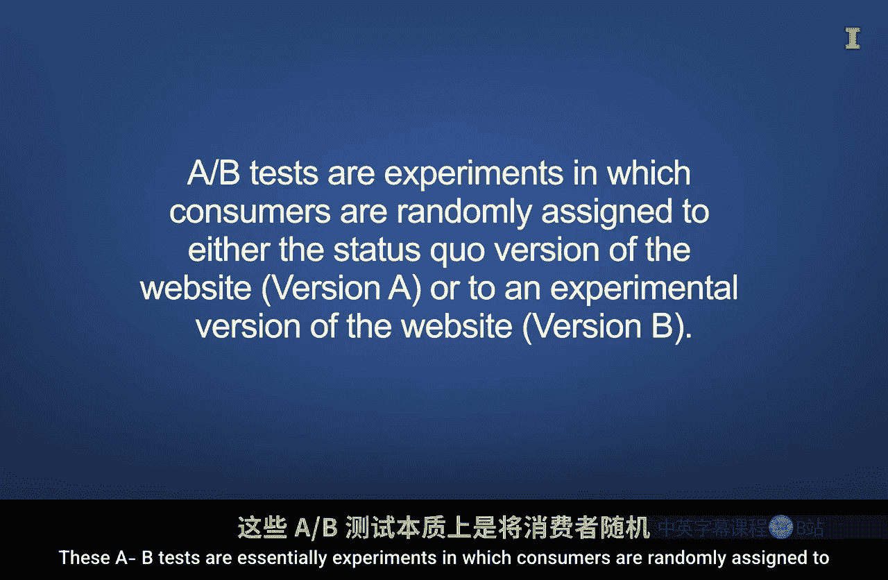
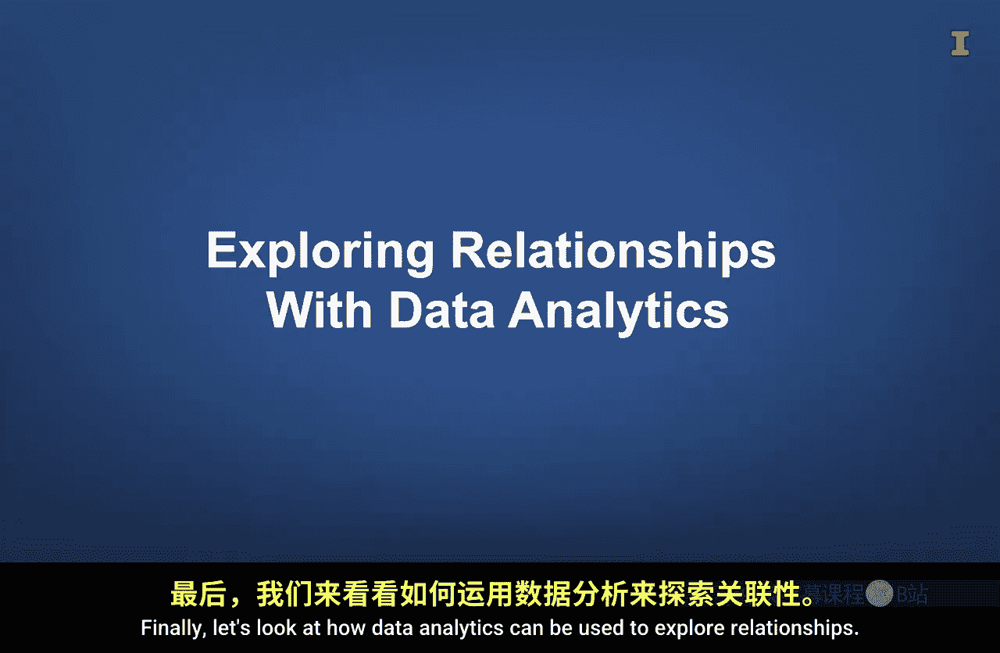

# 伊利诺伊大学【中英⚡商业分析｜Business Analytics Specialization】 p89 P89 01_将业务数据转化为业务洞察 -BV1z86nB9EGz_p89-

Welcome from Barnesstll Art Park， which is a hub for many types of artists。 In this park。

 there are some beautiful architecture， an art gallery， an art school， and some stunning landscaping。

😊，We are all blessed by those who share their creative talents with us。

I think some people who are not familiar with the artistic process think the artists simply use their instinct to almost magically create beautiful。

 valuable artwork。While there may be some creatives who can rely solely on their instincts。

 I think that most artists spent a lot of time developing their instincts and honing their techniques。

In a similar way， data is wonderful for making insightful business decisions。However。

 in my experience， some people believe that data is like fairy dust。

 they sprinkle more of it onto a problem believing that it will magically transform into a clear solution or valuable insight without any real work or understanding of the logical process。

They think that the more dust they have， the more powerful， the magic。

There may be a kernel of truth to that because certainly it is mind blowing how advanced algorithms process data to create useful models。

However， whether you're working on creating an AI model based on a lot of data or a regression model based on small amounts of data in this lesson。

 we want to emphasize that the data is more like raw materials rather than a finished good that's ready to be consumed。

Like any raw material， data must be processed using labor and machinery to convert it into a finished good of actionable insight。

We hope to provide some high level details about the process of converting data into business insights by sharing some real life stories of companies that have transformed data into insight。

As we share these stories， please pay particular attention to the effort that is used to both gather data and convert it into actionable insight。

I spoke with a biomechanist， Doctor Tyler Stanafford。

 who helps golfers improve their game by using data。

Let's hear what he has to say about how golf companies gather data and then turn that data into insight。

Yeah， so my name is Tyler Stanford， I am an associate professor of biomechanics at Utah Valley University。

 and I'm also an independent consultant for a few different golf companies where I work with them on education and kind of data analytics for their products。

You know， the biggest thing that our users want is they maybe purchase a set of these force plates is again。

 what am I looking for and what's like the data set of like the professional level golfer right everyone everyone is gearing up to move and swing like a professional golfer would they want to generate the same speeds the same distances。

And so they really want to understand what are the nuances of the data that can help their players start to move that way and so a lot of what I'm doing is kind of getting into those data sets I've been really fortunate to be able to put a lot of high levelvel players on those four plates and look at that data and start to understand what are the pieces that we want to help amateur golfers aspire to so that they can get better or even maybe what are the things we can use from an educational piece。

 how can we then turn around and inform golf coaches why it's so important and how it might influence the way a ball might fly after it's hit。

Yeah， so in terms of how the data that I gather can can help some of these companies， again。

 forced data from the standpoint of of the golf industry， it's， it's a lot of data， right。

 We produce kind of a waveform analysis of curve， right， my force plates。

 at least the ones in my lab， collect data， like 100 frames per second。 So if a golf swing is。

I don't know。 maybe a third to two thirds of a second。 That's still maybe 5 to 600 data points。

 And that's just in one dimension。 We're looking at things in three different dimensions up and down left and right front and back we're looking at rotations。

 So you can see how that data could get overwhelming really quickly。

 And so the last thing that company wants to do is sell a set of force plates to a coach and have that coach be instantly overwhelmed by the data and not know how to use it to make decisions for the golfer sitting in front of them。

 know at the end of the day， it's about golfer comes in。

 Can I use all this data to make a better informed decision that will help that golfer get better faster because they only have an hour with that golfer in front of them。

 And if they can't improve the way that they're hitting a golf ball in that hour。

 There's no way they're gonna get them to come in for multiple lessons。

 And so being able to understand the nuances of that data really clearly。

 And then be able to communicate that to these coaches where they can take some information that we provide them。

and say， okay， this is what I'm looking for in the data based on this golfer。

 and now they can make those meaningful changes that can help that golfer get better much faster than if they were trying to kind of guess。

Yeah， one of the coolest things I thinkve I've heard it described in terms of how data can help you make these correct decisions again。

 I would say this is for golfer， basketball player。

 volleyball player like find any athlete and this applies for them he kind of talks about it like if you go to a doctor and you say hey。

 here's my bottle here's my bucket of pills I'm not going run any tests on you just stick your hand in that bucket and pull out and you might get blood pressure。

 you might get cholesterol， you might get whatever it is and you just hope it works whereas being able to actually collect the data like you said allows well it allows us to be able to really get into the data。

And actually prescribe the exact specific pill they need。

 just like a doctor would run as many tests as they possibly can。

 it just allows coaches to more quickly make changes for their players。In this example。

 force plates and motion capture technology are used to gather data about how players shift their weight。

 swing their clubs， and so on。That data can then be analyzed to identify weaknesses in the golfer's swing。

 along with recommendations for specific drills that players can perform that will help them hit a ball farther and straighter。

Let's look at an example of how an engineering and manufacturing company uses data analytics to make predictions about when machines need maintenance。

In the manufacturing industry， machines are used to perform many tasks。

 but various parts of those machines wear out and need to be maintained or replaced。

 or else they'll break。Even when machines have regular maintenance schedules。

 unexpected breakdowns occur。Unexpected breakdowns carry high out of pocket costs。

 especially when one broken part on the machine causes another part of the machine to break。Moreover。

 opportunity costs are high because of the time that must be spent identifying the source of the breakdown and then repairing the broken parts。

 rather than making the product。One data driven solution is to use predictive maintenance。

Cone is an engineering company that focuses on moving people。

 especially using elevators and escalators。So if you've ever worked in a tall building and you've had to depend on an elevator to take you to your floor。

Then you may know from personal experience that there can sometimes be long delays when an elevator goes out of service。

Cone has partnered with IBM to provide 24/7 monitoring of elevator equipment using sensors that are connected to the internet。

Now， rather than waiting for customers to call in and report that an elevator has been malfunctioning。

 they can use the sensor data to create models that will predict when a part will break and then schedule repairs during a time of low usage。

In this example， effort goes into gathering the data using sensors that were strategically placed on elevator equipment to provide continuous monitoring。

The sensor data was then used to create models to predict future events。

Let's now look at an example of how data analytics can be used to effectively design websites。

Companies in the online travel agency industry tend to connect travelers with transportation。

 places to stay， places to dine and other activities。

As you may know from personal experience as a consumer。

 there's a lot to consider when planning a trip。So companies in this industry have to design a website that will provide the right amount of information while also creating a sense of urgency so that the website visitor doesn't go off to some other website to make the purchase。

That's a pretty tough balance to achieve。And there are bound to be many design opinions。

So how do you decide on the right design？Well， companies can run AB tests with various website designs and then analyze the results。

These A B tests are essentially experiments in which consumers are randomly assigned to either the status quo version of the website。

 version A。

Or to an experimental version of the website， version B。

Customer' behavior can then be quantified and analyzed to find out if the experimental version results in more desirable behavior than the status quo version。

If it does， then the experimental version becomes the new status quo。

Booking dot com is one company that takes this idea to the extreme。

 They enable every employee in their organization to run experiments。

This freedom for all employees to run experiments results in thousands of experiments being run each year。

Booking dot com has a well planned infrastructure in place to keep track of how consumer behavior is affected by each version of the website。

Even though only about 10% or so of their tests result in improved conversion。

 they learn a lot about how to fine tune their website design and increase profit。Thus。

 in this example， data must be carefully created， stored and analyzed so that booking。

 co can quickly decide whether the new version of the website should be implemented。Finally。

 let's look at how data analytics can be used to explore relationships。

Drug discovery in the pharmaceutical industry depends heavily on exploring complex relationships between proteins in the body and chemical compounds。

When you consider that there are tens of thousands of proteins in the human body that could be targeted for curing a disease and zillions of molecules in the theoretical drug space。

Identifying a potential drug to combat the disease is a mind blowing task。

If we tried to systematically go through each molecule and protein combination。

 it would take forever。However， if companies can categorize proteins。

 as well as their compounds and then compute and explore a subset of the most promising relationships。

 then that process can move much faster。Bristol Myers Squiib， a big pharma company。

 collaborated with Cys， a biotechnology company to discover effective therapeutics。

Cirs has gathered a selection of marine compounds and then applied their proprietary Atlans data mining technology to quickly identify therapeutic candidates for treating diseases。

Now in this example， data was processed to quickly find relationships that could lead to therapeutic and effective treatments。

The data was then explored to find those relationships。Again。

 please notice the importance of domain knowledge in all of these examples。

Without knowledge of the underlying business and its industry。

 businesses would not gather the right data in the first place。

 let alone analyze it and interpret the results in a way that leads to actionable insight。

In conclusion， please remember that data is just a raw material， just like paint。

 plants and concrete are raw materials of those who created this beautiful art park。

It typically takes effort to gather data and analyze it effectively。

Combining data with domain knowledge and effective data processing tools can lead to insights that can be acted upon to take businesses and organizations to new levels。

