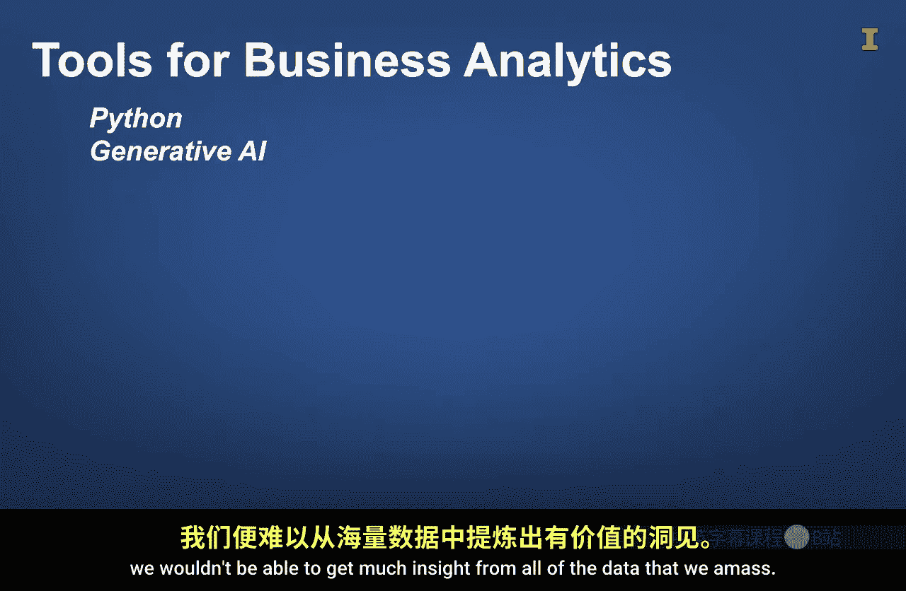

# 伊利诺伊大学【中英⚡商业分析｜Business Analytics Specialization】 p90 P90 02_你的思维是最重要的工具 -BV1z86nB9EGz_p90-

While Python and generative AI are amazing tools for business analytics。

 unless you have an effective approach for using these tools to solve problems。

 they will not do much good。So in this lesson， we want to begin by emphasizing that your mind is the most important tool。

But what can you do to unleash the power of your mind？Well。

 we want to start by discussing creativity， that's right， creativity。

 which is why we're here in front of the Barnestll Gallery Theater in Southern California。

That may seem unusual to some of you because creativity typically has connotations with artistic disciplines like painting。

 photography， or architecture。However， we think creativity is at the heart of business analytics。

Let's investigate why by first defining creativity。

The Oxford learner's dictionary defines the word creativityre as the use of skill and imagination to produce something new or to produce art。

While this definition supports the notion that creativity is something from the art domain。

It also has general application to producing something。Specifically。

 this definition of creativity mentions the idea of something new or original。

And it also indicates that creativity requires skill and imagination。Thus， when you combine skill。

 imagination and effort， you're on the path to being creative。

Creative artists such as Leonardo Da Vinci and Vincent Van Gogh are skilled at using tools and raw materials like paint brushes to apply the raw material paint。

They also use their imagination， which I suspect is heavily influenced by their domain knowledge。

 such as knowledge of the human body。Finally， they exert effort to apply their skills to convert what's in their imagination onto a canvas。

 resulting in an original painting。Now， creative business analysts are skilled at using tools like hardware software to gather and analyze their raw material data。

They also use their imagination， which is heavily influenced by their experience in business。

And they decide how to gather and analyze the data。Finally。

 they exert effort to apply the results of their data analyses and to convert the findings into actionable insight that can be communicated with others。

Therefore， we want to emphasize that business analytics requires a lot of creativity。

We hope that's good news to those of you who think that business analytics is simply memorizing rules and equations and applying the same repetitive process over and over。

Okay， we've established that creativity is an important part of business analytics。

We also want to emphasize that a creative mindset is not at odds with an analytic mindset in which you break a problem down into smaller parts and work systematically on those parts。

 such that they combine into a cohesive singular output。

I suspect that artists like Leonardo da Vinci， take an idea that is in their head and break it down into smaller parts and then work on implementing those parts in a structured。

 systematic way。For example， when painting a face， the artist may first sketch the outline of the face。

 then sketch the eyes， nose， mouth and ears all before even adding paint。Then when adding paint。

 they may paint those parts before filling in the face with colors。Similarly。

 a business analyst needs to take a business problem， break it down into smaller parts。

 and then work on implementing those parts in a structured systematic way。For example。

 when coming up with a customer segmentation strategy。

A business analyst has to decide where to get the data， how to clean up and aggregate the data。

 What metrics are most important for segmenting customers。

How many different customer segments to create， what the right algorithm is to create the customer segments and then how to interpret and communicate the results to the stakeholders in a meaningful way。

With respect to business analytics and art， achieving a creative and analytic mindset is more important than the tools and the raw materials。

A creative mindset is heavily influenced by skill， imagination and a willingness to invest effort。

In fact， a creative analytic mindset is your most important tool。

That's important to emphasize because in this course。

 our focus is really on developing your mindset while the tools are of secondary importance。

There's a wide array of tools that you can use to analyze data。

We encourage you to become familiar with and eventually even master the tools that we will focus on。

 which are Python and generative AI， both of which can be run on a personal computer。

The advancement in software and hardware makes data analytics possible， and without them。

 we wouldn't be able to get much insight from all of the data that we amass。

Just remember that while these tools are amazing， they don't create value on their own any more than lettinging a paintb next to paint and a canvas will create an original work of art。

😊，The paintbrush， paint and canvas only result in an original work of art when a skilled and imaginative artist exerts effort to systematically apply paint to a canvas。

Our goal is that by the end of this course， you will have developed foundational skills with your mindset and the software tools so that you'll be able to come up with creative solutions to many business problems。

Just like the artists who contribute to the art gallery， the landscape。

 and the buildings here at Barnstall Art Park that many people enjoy。

