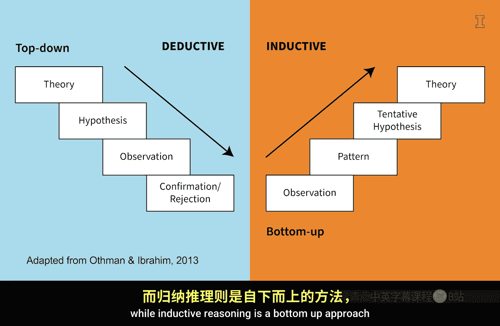
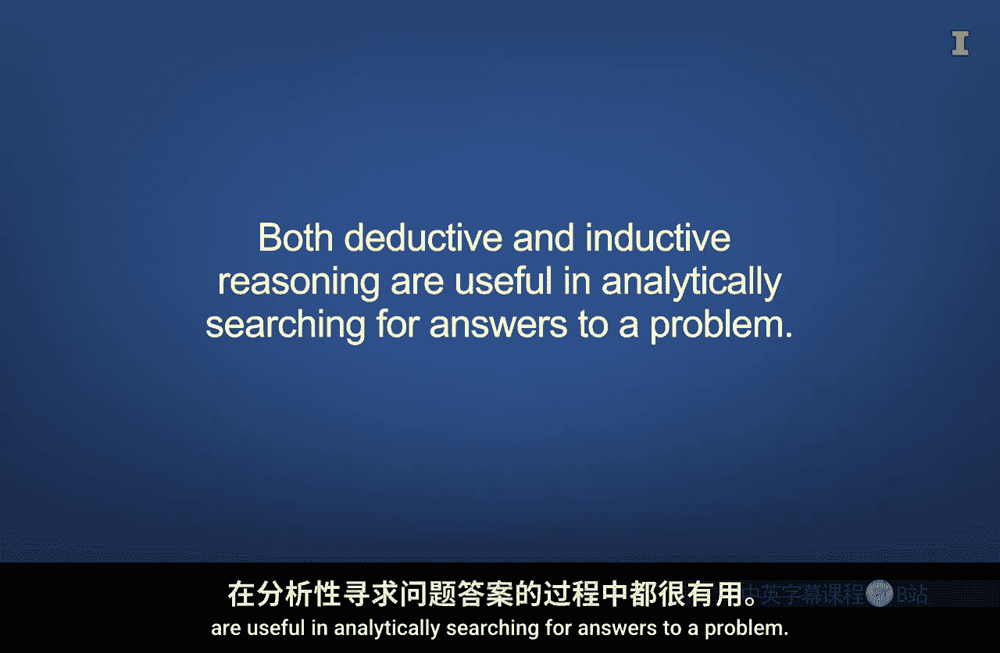

# 伊利诺伊大学【中英⚡商业分析｜Business Analytics Specialization】 p92 P92 04_分析思维：归纳与演绎推理 -BV1z86nB9EGz_p92-

The Griffith Observatory here in Southern California is an iconic site that sits above the sprawling Los Angeles metropolis。

Locationations like this help us increase our understanding of the cosmos in at least two general ways。

First， telescopes in this observatory help us observe celestial phenomenon and identify new patterns in the movements of stars。

 planets， and other objects。Second， the observatory documents the patterns and established laws。

 which can then be used to make predictions about future celestial events。In short。

 this observatory helps us use a system2 mindset to think carefully and systematically about data related to celestial events。

Let's think about how this relates to business events。

Once you've determined that a business decision is worth spending some time on。

 you should shift over to a system to mindset， the mindset in which you think carefully and methodically about the problem。

Let's consider some reasoning techniques that will be helpful when dealing with big data to logically arrive at an answer。

Two systems of reasoning that are often compared are deductive and inductive reasoning。

It's often said that deductive reasoning is a top down approach。

 starting with general rules from which you can make specific inferences。

While inductive reasoning is a bottom up approach that uses observations to create a more general rule。

We use deductive and inductive reasoning in business analytics all the time。

Deductive reasoning is used when we establish the truth of a conclusion based on the validity of the arguments。

For example， from an accounting perspective， we know that a company's assets are equal to liabilities plus owner's equity。

Therefore， if we know the value of assets and liabilities。

 then we can deduce the value of owner's equity。From a business analytics perspective。

 if a sudden drop in website traffic from a specific region is observed in web analytics data。

Deductive reasoning might involve considering potential causes like server outages in that region。

 changess in local internet infrastructure or targeted censorship。

 and then investigating each possibility。Specifically， if it was a server outage。

 then you may see that the web traffic for all users in a region stopped all of a sudden。

On the other hand， if it was targeted censorship， then you may see that web traffic stopped for a subset of the users in a region。

So deductive reasoning starts with a premise and then evaluates data to see if it supports the premise。

In contrast to deductive reasoning， when evaluating an inference using inductive reasoning。

 the premises are not intended to be valid。You may observe a pattern， and then from that pattern。

 you infer a general rule。I am standing in this barren dry。

 deserty climate next to this goblin shaped rock formation。

 What is now desert geologists believe was once oceanfront property。

The way geologists come to that conclusion is probably a good example of how inductive reasoning works。

They could have seen the lines on this rock here and come up with the notion that what caused these lines is the result of water ebbing and flowing through the area。

Now this one piece of evidence isn't enough to provide conclusive support that this was oceanfront property。

 but when they see this pattern repeated over and over dozens of times over here。

 it supports that hypothesis。Until they see evidence to suggest that this wasn't oceanfront property or until a better hypothesis presents itself to explain this pattern on the rocks。

Scientists are going to continue to believe that this was oceanfront property。

 and that belief eventually becomes a generally accepted premise upon which additional hypotheses can be built。

One example of inductive reasoning in business is the calculation of bad debt expense。

Since bad debt expense is an estimate of the amount of accounts receivable generated during a period that will never be collected。

It's often inferred from observing historical collection patterns。Specifically。

 if we observe from historical data that for each month during the last five years。

 an average of 3 per cent of accounts receivable were never collected。

 then we may establish a general rule that each month。

 the bad debt expense will amount to 3 per cent of monthly credit sales。Now。

 business analytics allows us to refine the estimate of bad debt expense。 For example。

 if we observe that bad debt expense is higher for purchases made during a certain time of the month。

 then we may be able to come up with a hypothesis that we could then confirm with additional analyses。

Both deductive and inductive reasoning are useful in analytically searching for answers to a problem。

You may start with a premise that you believe to be true and then gather data to support that it is true。

As you gather data to verify that premise， you may find some evidence to suggest that it's not always true。

In that case， you may make inferences from that pattern to generate a modified or complementary premise。

Here's an example， let's suppose that you know the sales revenue is better than expected。

As a result of that observation， you use inductive reasoning to hypothesize that it was caused by paying for advertising from social media influencers。

As you gather social media data， you find that likes and comments on social media platforms have indeed increased。

However， you also discover that your marketing manager has been paying social media channels to promote the posts。

Because it has been well established that paying extra to promote posts on social media indeed leads to an increase in sales。

You use deductive reasoning to infer that an increase in sales could have been caused by both micro influencers and the promotion of social media posts。

So now you have to try and figure out the impact of both actions。

Paarsing out the unique effect of each action is a type of problem that can be addressed by data analytic techniques and is something that will be addressed in another lesson on regression。

The takeaway is that both deductive and inductive reasoning can lead to more effective data analyses in business settings。

Deductive reasoning can lead you to gather the relevant data and to include the right variables in your analyses。

Inductive reasoning helps you recognize unexpected patterns in the data that can be used to create a more general rule which can then be applied in other contexts。

All right。That wraps up our exploration of deductive and inductive reasoning in the exciting world of business analytics。

Remember， whether you're starting with a solid theory or spotting intriguing patterns in the data。

 these logical tools are your secret weapons for making smarter data driven decisions。

These logical tools will help you in any business domain， as well as in celestial domains。

 now go forth and analyze with confidence。

