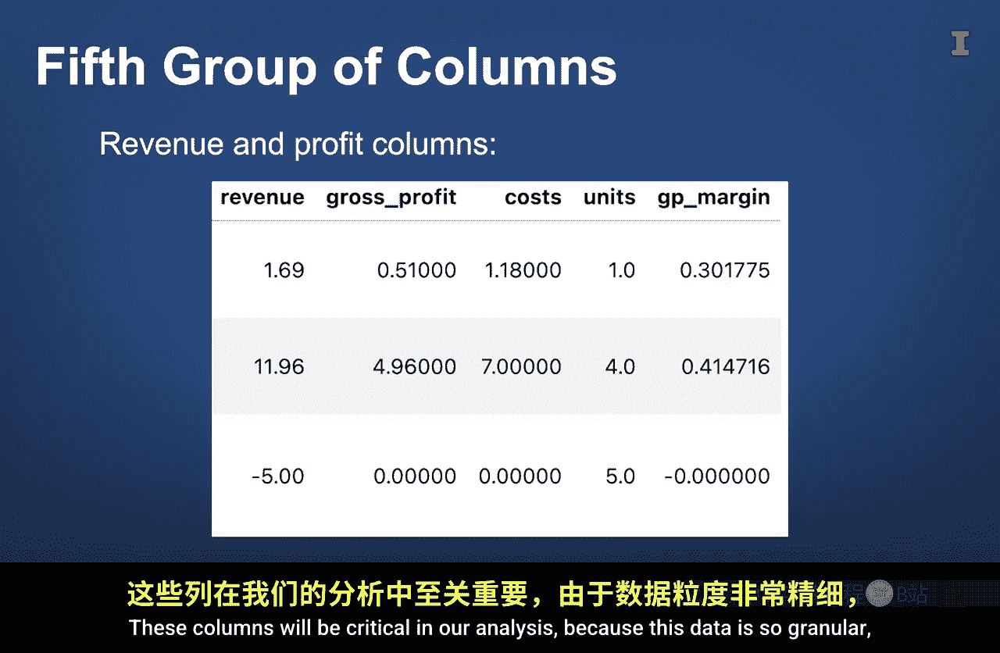

# 伊利诺伊大学【中英⚡商业分析｜Business Analytics Specialization】 p94 P94 02_课程数据集简介 -BV1z86nB9EGz_p94-

As we look around this meticulously planned community。

 it's a great reminder of how organization and detail are key to understanding complex systems。

 and that's exactly what we'll be doing in this video。Specifically， in this video。

 we're going to practice applying data analytic tools on some really cool point of sale data。

In this lesson， we want to walk through that data set so that you can mentally prepare for how to approach it。

We will refer to the data set we'll be using as the techECA data。

Because it's from a fictional company named Techca that owns over 150 convenience stores and gas stations throughout the United States。

These stores sell typical convenience store items like gas， candy， soda， chips， lottery tickets。

 and so on。While this tech of data set is pretty large， especially for Excel standards。

 it's really just a small portion of all the data that is generated。

We've narrowed it down to a sample of the data from 2023 to 2025。If we used all of the data。

 it would consist of hundreds of millions of rows and would be too much for our personal computers to handle。

Let's talk about how this tech of data set is aggregated。

Each row of this data set represents a unique product from a single transaction。

If a customer purchased two unique products in a single transaction。

 then there would be two different rows of data for that customer's transaction。Importantly。

 if a customer purchased two of the same product， then there would only be one row for that transaction。

It's also worth noting that a customer could have more than one transaction during a visit。

For example， if a customer purchased a single breakfast burto and then before leaving。

 decided to go back and get another breakfast burto for a friend or family member just a few minutes after the first transaction。

 then there would be a separate row for each transaction。Okay， so that's what the rows represent。

Let's talk about the columns。There are dozens of columns in the dataset set。

 and they can be divided into five groups。The first group is the transaction group。

These columns include a unique identifier for each row。

 the transaction number and the date of the transaction。 The second group， the customer group。

 is really just a single column， customer I D。This unique identifier is only known for customers that are loyalty rewards members。

 otherwise it is blank。The third group of columns is the product and category group。

This group of columns includes information about the product's name and how it fits into the hierarchy of products。

Specifically， all products belong to a category and all categories belong to a parent。Thus。

 the parent column has the fewest number of distinct values。

The category column has more distinct values than the parent。

 and the product column has the largest number of distinct values。

The fourth group of columns is the site group。The columns in this group include information about where the stores is located such as city。

 state， zip code and latitude longitude coordinates。To protect the actual convenience stores。

 the coordinates have been changed to match those of a nearby post office。

There's also a store ID column。Finally， the fifth group of columns is the revenue and profit group。

These columns indicate the amount of revenue and profit that are associated with each row of data。

These columns will be critical in our analysis。

Because this data is so granular， it can be aggregated at many different levels， such as by hour。

 day， month， year， customer product， category， parent。

 profitability and combinations of those characteristics。In other words。

 there are many potential business insights that can be gained from this data。

While the data has already been cleaned up quite a bit。

 we've saved some of the data preparation tasks for you to complete。

So that's an introduction to the data。You'll get to know it even further as you work on some data preparation and exploration tasks in later sessions。

Just as the carefully planned infrastructure of this community allows for smooth navigation and predictable outcomes。

Understanding the structure of this data set will enable you to navigate its complexities and uncover valuable insights。

Get ready to dive in。

