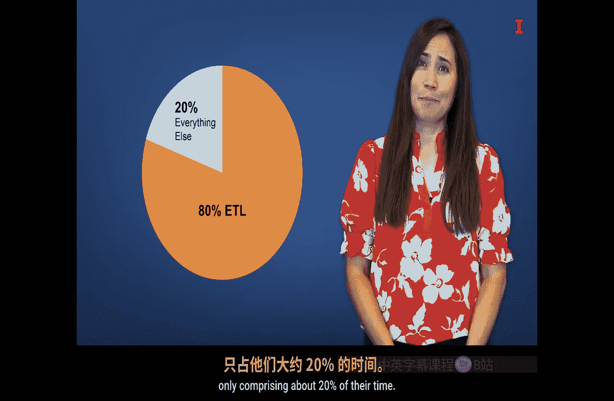
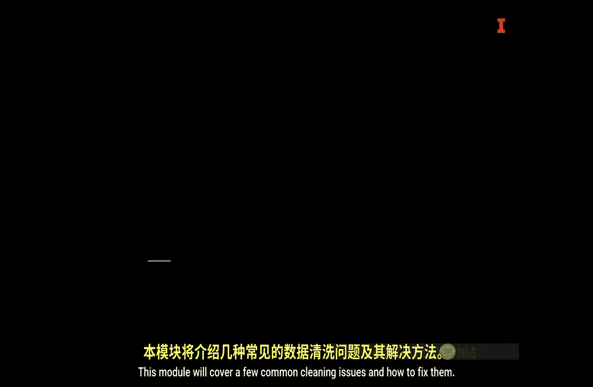
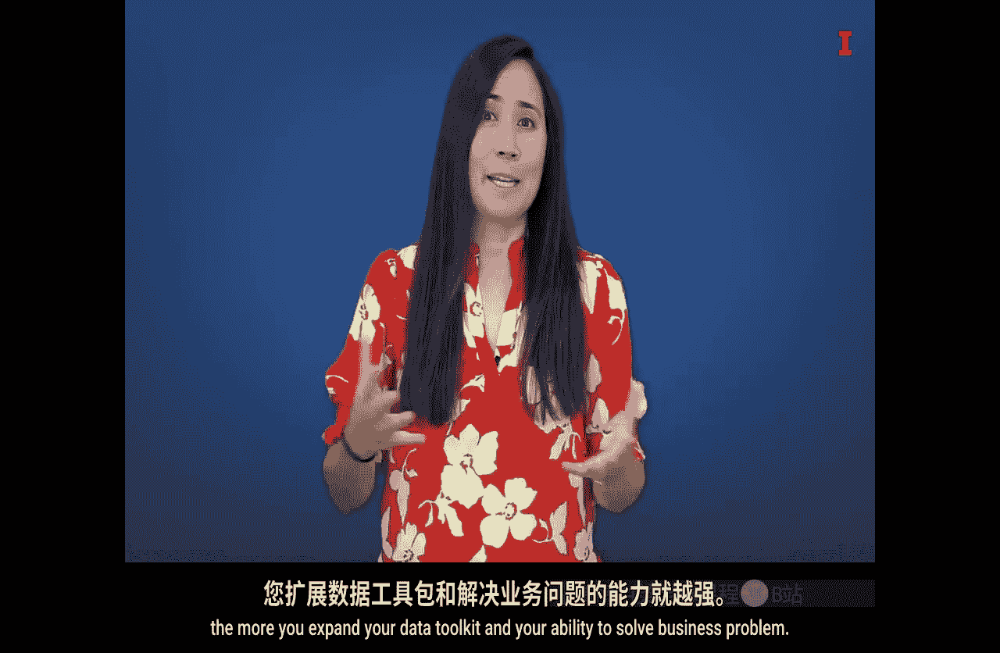

# 伊利诺伊大学【中英⚡商业分析｜Business Analytics Specialization】 p97 P97 03_第二模块-介绍 -BV1z86nB9EGz_p97-

In this module， we will explore a popular tool for data analysis and visualization。

The tool we are using in this module is Python Python is a general purpose programming language and it is one of the most popular programming languages used for data science。

For some， the idea of learning a programming language is intimidating。

 but with some effort and time and guidance， soon you'll be conducting insightful data analyses。

There are a lot of programming languages out there and while any programming language is going to take time and effort to learn。

 Python in particular prides itself on having easy to learn syntax that emphasizes readability。

 making it relatively easy for beginners to use also it's open source so it's free to use。

Because Python is a general purpose coding language。

 it can be used for all kinds of data analysis tasks。

 from gathering data to using advanced machine learning techniques to visualization and communicating findings and solutions it is a truly powerful tool。

We will be writing Python programs in Jupiter Notebook。

 which is a web based application that allows you to run Python code and view results。

Jupiter notebookbook is one of the many options out there for running Python code。Its strength。

 though， is allowing you to intersperse code with text。

 visualizations and other output from the code。In this module we will teach you how to do three main tasks。

 first we'll teach you how to download and install Python。Second， we'll teach you how to extract。

 transform， and load data or ETL using Python。Third。

 we'll perform exploratory data analyses to explore， describe， and analyze the data also called EDA。

Along the way， we will discuss a cool data that we will use for many handson examples and demonstrations Who courses could be taught on ETL and EDA。

 so we will necessarily have to do things at a pretty high level however。

 in the videos in this module we will give you enough information to start using this tool while we don't assume any prior experience with Python。

 we do encourage you to explore the online resources that are available to gain additional understanding of Python。

😊，Because Python is an open source tool there are many。

 many free sources of content to help you learn it so where is this module located in the fract framework as you can probably guess ETL and EDA fall under calculate results We already have our question and we know what data we want to use and now we want to do some analyses specifically we'll be doing exploratory analyses to do that you will need to get your data into your tool In our case this is our Jupiter notebook then we'll need to clean it so that it's viewable and has as few errors as possible。

😊，Then you want to explore what stories it can tell you and how it can help you solve your business problems or create business opportunities。

Pictures are truly worth a thousand words， so a part of exploring our data will inevitably be creating some visualizations to help you and others interact with and understand the data。

Of course， it is never， ever as easy as it all sounds。 raw data seems to always have problems。

 mistakes and messiness。 In fact， a common rule of thumb that you may have heard is 80% of a business analyst job is cleaning the data with everything else like the analysis presenting the results only comprising about 20% of their time。

😊。

This module will cover a few common cleaning issues and how to fix them。

We will also teach you several common ways to visualize the data。

What kinds of problems can this module help you with？Well。

 the techniques we discuss in this module apply to any business problem that you use data to examine。

Whenever you have data， you need to view it， you need to clean it。

 and you need to understand it before you can even begin trying to solve a business problem。

If you don't understand your data by knowing what information is in there or if your data is not clean。

 then solving a business problem with that data will be near impossible。

The data we are using is from convenience stores， it is a really rich data set so there are so many questions we can try to answer with this data。

But our focus in this module is preparing and exploring the data。

 We will touch on some potential business problems we could solve with this data， as well。😊。

We are excited for you to expand your toolkit by learning more about Python。

Data cleaning and loading and exploration are the foundation of all data analysis。

 Opening a new data set and understanding it is like unlocking a treasure chest and solving a puzzle。

 It's like peeling an onion and learning layer by layer。😊，As you go through this module， dig in。

 play with the data， the more you practice， the more you expand your data toolkit and your ability to solve business problems。

