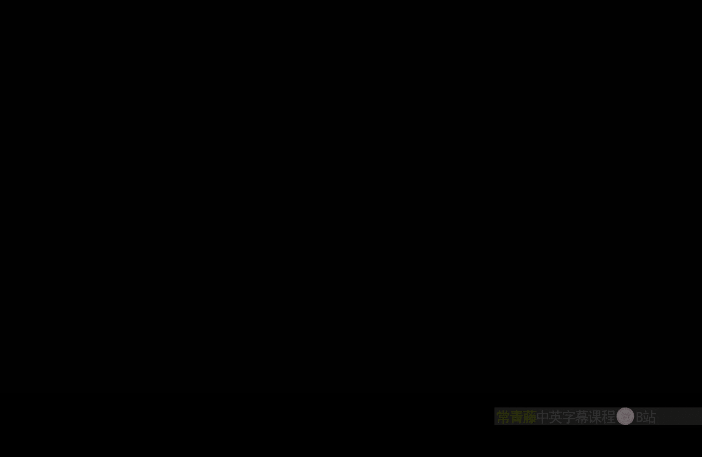
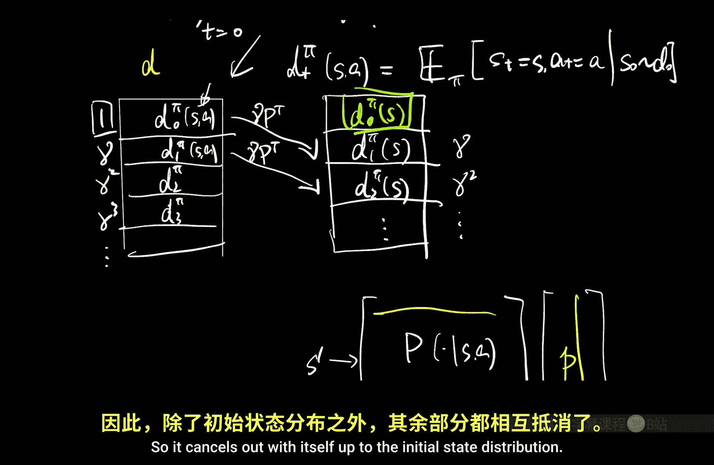
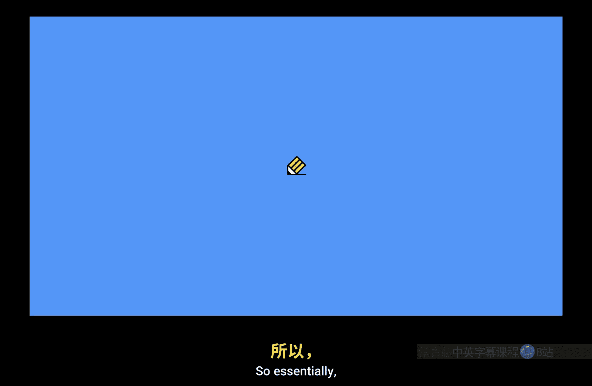
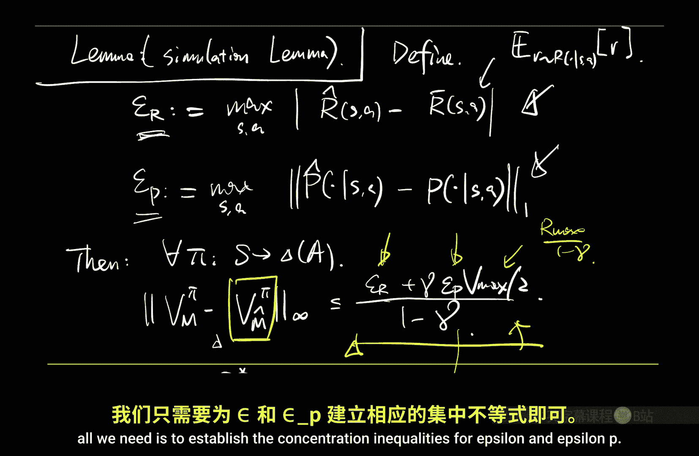
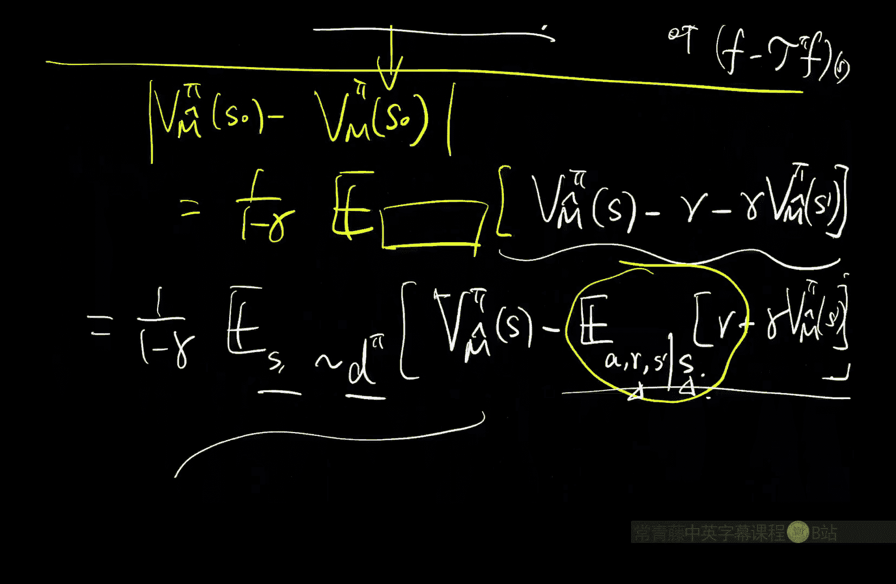
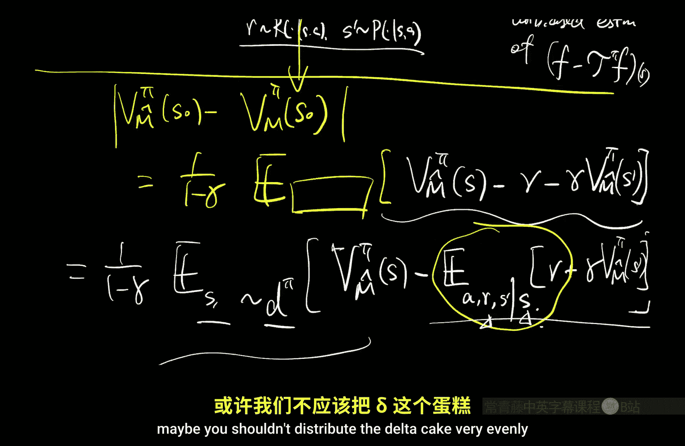
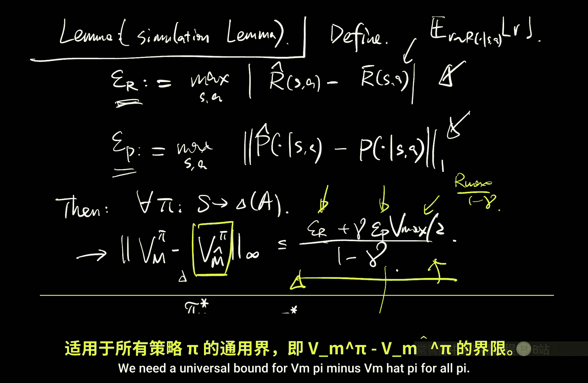
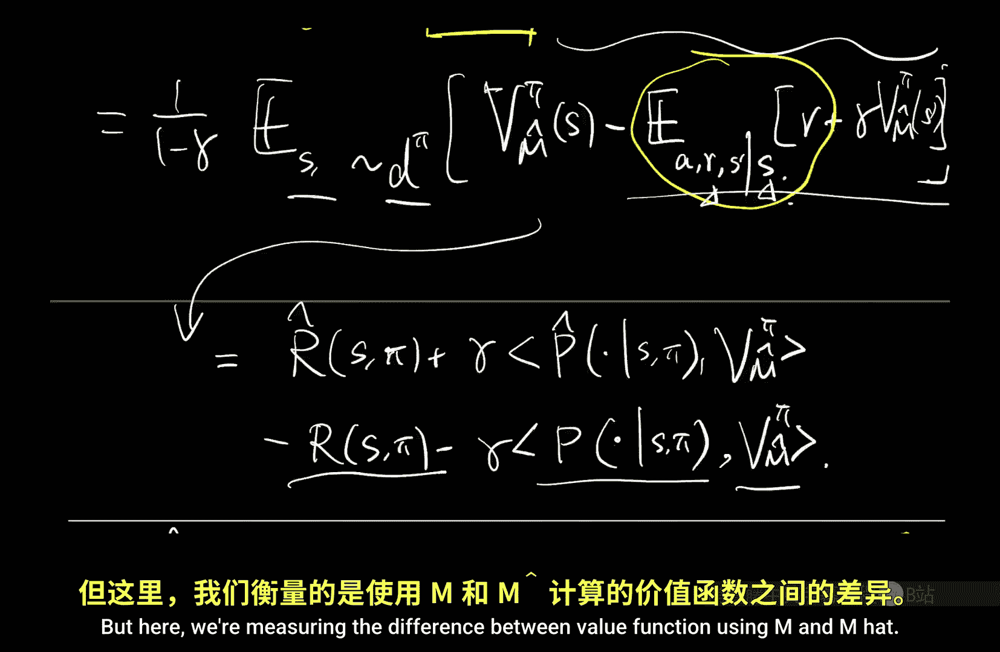
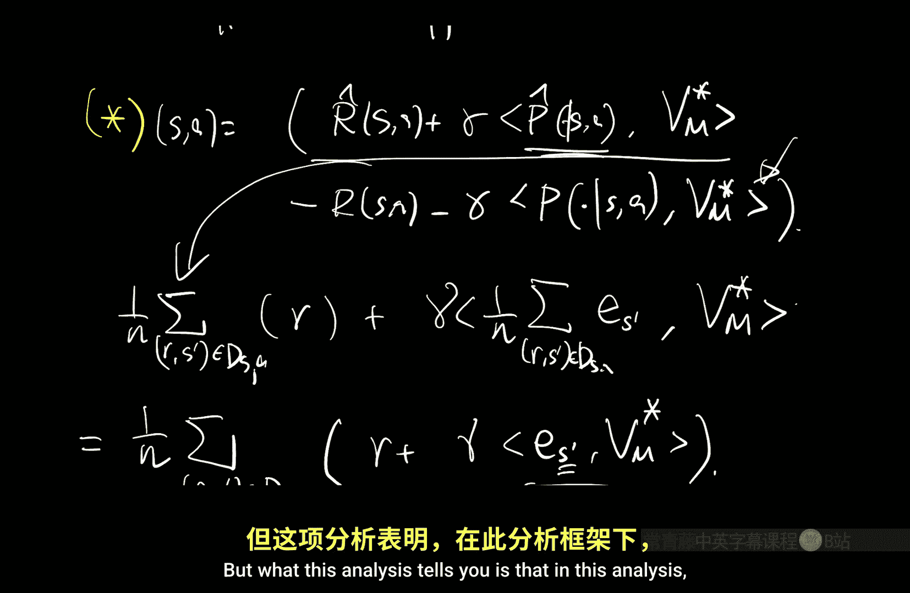

# 伊利诺伊大学【中英⚡统计强化学习｜CS542 Fall 2025, Statistical Reinforcement Learning】 p16 P16 表格分析（续）（视角2） -BV1YsZHBZEyM_p16-

Okay， so start so last time we started talking about you know， tablet analysis， right。

 So you get anT for each action pair。 you have an samples for each for the next date and reward。

 and we just build the MLE model and Ha。By just averaging the reward and looking。

 treating the empirical frequency as the state transitions。And then we just output off a policy。

 And we're interested in， you know， knowing how good this policy is when you evaluate it in the original MP。

Right， and we， we introduced this lemma called simulation Emma。

 where later we use concentration to establish Eson R Epson P。

 which is the worst case reward error and transition error over the state action space。

 in particular， transition error， is measured by L1。

 which is equivalent to total variation distance up to a constant factor， And if that were the case。

 we immediately have that， and if we treat Epson or M 3 P S given。

 we immediately have that for any policy pi its evaluation in M versus M had its actually bounded by a function of epsson R and eson P。

😊，RightAnd that immediately leads to multiply that bound by factor of 2。 We get the subopity bound。

Okay， so therefore， our jobs are then to establish thelemma and then establish Epsilon and epsilon P as a function of N through concentration n inequal。

So we did you know the classical proof over here first， where we start with VM pi minus VM headpi。

 which is the quantity we want to bound in simulation Lama and do one step bound equation expansion and then you get epsilon you you get epsilon difference And for the other term。

 you have true P dotted with true v minus like p hat dotted with v hat right So you introduce additional intermediate term to break that into two parts for one of them。

 we get p minus P hat dotted with the same value function and we use holders in quality to get the L1 norm like out of it。

 which matches our definition of epsilon P and for the remaining term。

 well this is actually the recursion term we only handle the one step error So for the recursion term。

 we get gamma times like the difference again， but you for the next time step。

 And because there's a gamma， it gives us the the1 minus。woman is gamma in the denominator。

So that was the classic proof。 And then we started talking about the modern proof that relies on this this error proagation result。

 right， So actually， nowadays， result of this form is also times times called a simulation Lama。

 because the kind of simulation Lamma that we're aware of is like a direct corridor of this when you just literally plug in you know。

 what it says is that if you have any F， that is meant to be a approximation of the true V pi V or VM pi。

 then when you use this F to form an estimate of j pi。

 which is take expectation of this F under the actual say distribution。

 is error is literally equal to a form of Belman error。

 which is you know to what extent F violates the Belma equation。

 terms like this what we call the Belman error it's literally the Belman error taking taking the expectation under the distribution。

😊，ion of the pie， which is the occupancy induced by policy pie。Right。

 and and if you compare this with what we we want to bound in simulation La。

 we want to bound you know， VM pi S， which is basically J pi right。

 the true expected return of some policy pi in the true and D PMM with S as the initial state minus。

 well， this is literally appxiating that term， but using an an arbitrary value function F。

 where F is equal to VM head pi， right， So you know， you you can immediately apply this result。

 and then get the epsson R epsson P out of it。 like immediately。

 So so essentially like the classic proof is kind of mixed the two things together。

 One is what we call error propagation the other is like actually you know。

 looking at the your approximate function and quantifies error。 So。

 but the more modern proof is like like completely separate those you know， we have a dedicated。

that handles error propagation。 and then once you plug in。

 like you like the rest is like only handling like one step errors。

 Like you don't need to worry about anything about long termness like when you handle this long one step error。

So that's what we are like last time。 And so this time we'll have two jobs。 One is to you know。

 for this alternative proof， I still need to establish this lemma for you。

 which is this more modern like simulation lemma and then we'll come back to the original analysis and then we need to establish the Eson or Eon P through concentration。

Okay， sounds good。Okay， so the salemma， so we have a you know。😊，Thelema is pretty general， right。

 because， you know， in our setup now， we have M， we have estimated MP I had。

 But for the purpose of thelemma， thelemma only consider one single MP， which is the ground shoes MP。

 right， because the J pie is defining that NP， like D pie is defining the MP。

 R N S prime is sampled from the true MP。😊，It's when we use it in these learning scenarios that will make F equal to the value function learn from the approximate MP。

 right， But for the slema， like there's no that there's no other MP。 There's only the single true MP。

So let's prove it。 And turns out that the easiest way to prove it is actually from the right hand side and then go back to the left hand side。

 So let me copy the。Right hand side。Okay， so。Let's copy this。呃。Proof。Okay， so we'll start from here。

Okay， so the first thing well do is that we have the we have one minus gamma， one of one minus gamma。

 We have discounted occupancy。 recall that discounted occupancy is just the1 minus gamma time summation T greater than one gamma t -1 D T pi right。

 So discounted occupancy is really like you look at the marginal distribution of state action pairs at each for each time step。

😊，And then look at their distribution and then do an average of those distributions with the discount factor weighting。

Okay， so then we' just actually rerite this expectation in that form。 So we have summation over T 1。

2 infinity， gamma T-1。 here I have D T pi。😊，Okay， so this is the same as the right hand side of the original equation。

😡，Okay， good。Okay， so now I'm gonna just do something just the change the name of the variable。

 which may seem inconsequential at the first glance。 But， but then I think it will be useful。

 So if I call this S T N A T。 Okay， I rename the state action pairs as S T N A。嗯。

That's actually a reasonable thing to do， because I cant imagine just the distribution of a trajectories induced by policy pi started from B 0。

 right in in the original NP。 Then I just get SD N A T from the trajectory。

 Well I know that S N A by definition， is distributed as D T pi。Right， so by writing in this way。

 like， I can treat S T N T in and A T as if they are coming from the original trajectory。Okay。

 now if that's the case， what's the name you can use for R？😡。

So that is consistent with this view that all these random variables。😡。

They are distributed in this way， but they are also equally distributed as。

 as if they are coming from the like a random， like trajectory。How you would rename R。😡，RMT， right。

 so it's pretty。But mathematically， all I'm doing for now is just like renaming variables。

 which I can always do， right， But you will see like it actually comes。

 So how you would rename S prime。😊，So， I have S。AT， so how you would rename S S prime。S T plus one。

 right， So you don't need a。Right，Because what this is telling you is that previously。

 I wrote down a join distribution of S A R S prime where S is from D P T。 when that's。

 when that's the case， this distribution is equivalent to first。drawraw trajectories。

George's trajectories from from the 0 using policy pie。 and then look at。marginalgi。Of S， T， A， T， R。

 T S T plus one。RightSo essentially I'm actually making this claim。😊，Okay， get it。So， and。

 and in fact， like what I can do is that I can do sumation T equals12 infinly gamma T -1。 Now。

 instead of writing this whole thing， I can just write expectation pi。😊，Right。

Because we use this notation extension。 I'm gonna use this notation expectation or pi to refer to what like the entire join distribution whichjecties induced from D 0。

 when you use policy pi。 So under that joint distribution， you have the random variable S1。

 A 1 R 1 S to a2 R2 and so on so forth， you have the entire join distribution over everything。

 So if you and then if you if your distribution is about something a marginal distribution of that joint distribution。

 you can just freely use the variables in that join distribution。

 So I have F S T minus R minus gamma S T plus1。😊，Okay， is this step clear？RT， yes， good。Okay。

So now this is getting interesting， right， So now， if you look at these summations， now。

 all these summations are under the same distribution so I can combine them。😊，Right。

 so I get a summation t equals 1，2。 Oh， I'm gonna push the summation inside。

 So I have expectation or pi outside。Sumation T equals one to infinity。

Gmma to the T -1 F S T minus R T minus gamma S T plus1。O。So now how do you simplifyify this？😊。

The claim is that you you like like， okay， so let's actually expand this a little bit。

 So expectation under pi。 what I would have is like， let's say the first term is like this conf is 1。

 So I have F S 1 minus- R1 minus- gamma F S 2。 This is the first term。The second term is gamma F。

 S 2 minus R 2 minus gamma F， S 3。Plus， gamma square F S3 minus R 3 minus gamma F S 4。Plus。

 global all the way to infinity。Okay， so now I claim that I've， I， I。

 you should be able to see some cancellations in this in， in， in this summation。

 There' are some very nice telescoping going on。Can can someone tell me which terms are canceling each other。

Right， so so here you have gamma S2， FS 2。Minus here you have gamma FS2。😡，Right。

So they go out and what else。 Well， this one， this one is really like in front of it。

 you have gamma square， right， So you have one factor of gamma over here。

 another factor of gamma over here is gamma square F S3， gamma square， F S 3。😊，Okay。

 and so on so forth。 So eventually， what happens is that this whole block gets cancel out。

 This whole block gets cancel out。😊，Right， so then you just need to count the remaining things。

 The first one the， the only thing that remains First， you have the F S1， right， So you have。

 you have F。Evaluated under trajectory， like， yeah， you define trajectory distribution。

 You're looking at the marginal distribution of S1 and you take expectation of F on it。

 So what's the marginal distribution of S1 under the trajectory distribution。

But that's just whatever we call the initial state distribution， right。

 we give it a name like D0 or something like that。 Like just expectation D0 S from D 0 F S。Okay。

Now that's one of the term。 what are other terms that just survive the cancellation？😡。

All the Rs in the middle， right？ So what you get is under expectation of trajectories induced by pi summation of R1 plus gamma R 2 plus gamma square R 3 plus all the way to infinity。

 What is that。😊，It's shape high， that's just the expected return of the policy。😡，Okay， minus J pi。

That's it。Okay。So。There's something very interesting about this proof， Right。

 So you see like there's this very delicate telescoping going on。😊。

Does anyone remember that we actually have seen essentially a version of this proof somewhere else？

Earlier in this course。Not performance difference that， no。So remember， like。

 so what's actually happening this， right， So it says that， okay。

 so one way to you look at it is like。If you look at the the like like okay。

 so you have variables in this column， you have variables in this column。

 like each one is distributed as here is distributed as like D1 pi D 2 pi， D 3 pi。

 D4 pi and so on so forth。 And in the original like Lama statement。

 they are mixed together to make like D pi。Right， on the right hand side。

 what you get is like you first draw random variable from the left hand from the left column in the same row。

 and then pass through the dynamics of the MP。 You get the next stated like state distribution of the next of the next time step。

Right， then you get this cancellation， you know， going on。 But eventually。

 only the initial state distribution gets left out of this cancellation。Have we seen this before？Yes。

 exactly。 right。 So if you remember in linear programming， when we talk about the dual formulation。

 we have this。😊，We have the so called Belman flow equation。Remember this one？

Like the that in the dual in the dual LP， we have this Belman flow equation that says that we prove that any discounted occupancy must satisfy this Belman flow equation and inter proof。

Did you see that we exactly use this right， So you start with the。

 you pass it through the transition dynamics of the NDP。

 basically you get all of them shipped by one time step。

 So it it cancel out with its itself up to the initial stay distribution。😡。

Okay， so essentially what we're saying over here is is the another version of。

 of the Bel mind flow equation， right， and， and the very fact that if you think about it。

 the very fact that this holds for arbitrary function F。😊。

It's essentially saying something about the distribution of the random variable over here and the distribution over the variable variable here。

 right， Because in general， if you have things like， if you have like E， PF equals E， Q，F。For any F。

 let's say you have some finite space。 and you establish that for two distribution P and Q。

 the expectation of under one distribution is always equal to the expectation on the other distribution for arbitrary function。

 What can you say about the two distributions。Okay， you say about the two distributions。

They're the same， right， because because the easiest to proof is that you just let F to be one hot on every single possible。

 like a member of the space。 Then you establish that the probabilities are equal。

 Like same here that the fact that arbitrary F and this hostse is essentially saying that the distribution of S here。

 mixed together is equal to the distribution of S over here。

 So when you write in the distributional form。 This is literally a variant of the ba my flow equation that talks about some property of D pi。

Okay，And and this is yet another like very interesting example。

 So I guess like in the LP formulation， we already see that this you know。

 value functions and occupies are dual variable to each other in the you know。

 linear programming formulation。 and here we're essentially seeing another like version of this or like that housing a more general sense。

 just in general MDP analysis， right， because if you remember， if you remember。

 when we motivate thislemma， we're saying that， oh， if F approximate v pi。

 then we know that a special case is F exactly satisfies the Belma equation。😊，Then this part is zero。

 and that will also be zero。😡，Right， so this term on the right hand side is essentially evaluating to what extent F violates the bema equation for value function。

Right， that tells you how much error it can make in terms of making the prediction at the initial state。

 So， so this is about essentially about the generalization of the Bma equation for value functions。

But when we prove it， if you look at the proof， the proof actually utilizes the bowman flow equation for D pi。

😡，So， so you see like actually， you know， to the two bama equation， one for value function。

 one for the discounted occupancy， they actually， you know。

 appear in some sense together in the slema。😊，O。So this is the， this is the proof。

 Like the proof is surprisingly simple， I think， And by the way。

 there's a variant for Q functions that will actually use a lot more later on， the Q variant。

 And I encourage you to maybe try to prove yourself afterwards for any F in RA。 So previously。

 we have the state version。 So F is a function of state。 For now。

 you have any function of any F is a function of S A。

 You can also say what is what is expectation S from the 0， A from pi F S A minus J pi。😊，Right。

 and the first term comes about is because if F were really like Q pi， this would be equal to J pi。

Right，Because Q tells you the Q pi S tells you what's the true expected return when you start from some particular starting state action pair。

 And when you want to know the expected return of the policy just in this NP。

 when you start by joining the first day from D 0 and the first action according to to Pi。Right。

And as you would expect， like similar to before， you will be able to decompose this into some form of。

 as we call it Bel error， you， S from D pi S from the D pi distribution。

Where you have FSA minus R minus F S prime。Okay， oh so here you have a R from R。

As a as prime from P S。Or you can also write this as F minus T F。 You know。

 what we call the ba error。 if you do， if you， if you do a lot of total expectation to marginalize out the reward and as prime randomness。

 you get the ba error。Okay。So。So this is the error propagation analysis。O。Okay。

 so going back to the like a big picture of trying to make do this proof， right。

 So we established the simulation Lama。 We use the simulation Lama to make the final bound。

 So how far away from a fully complete analysis。 while all we need is to establish like the concentration in qualities for Epson Epsson P。

😊。

O。So let's， let's do that。

Bound。Epson Epson P。By concentration。Okay， so let me copy。Copy this。So want you bound these and。啊。

Let me just put them here。So these are what we want to bound。

 And I will also copy how we estimate them from data。So that we can refer to them when needed。 Okay。

 so this。O。So this part， like basically in some sense， like this part， as we're doing it now。

 basically have no like essentially this is not about RL anymore。 Okay， so once we get to this part。

 this is just about estimation of some you know， estimation of some quantity from samples。Okay。

 so basically everything about that is about NDP， about the dynamics。

 about error propagation for multiple time steps and so on and so forth。😡。

We've already handled all of those aspects in the earlier analysis。 And when it comes down to this。

 this is just concentration inequalities。Okay。So， so basically。

 we have the estimation process over here， and we have the， you know， the， the。

 the error that we want to measure over here。 Okay， so we can first do the reward part。

 which should be pretty easy。 So we have that if we fix any S A with probability greater than woman as delta because we know that reward is just a bunch of。

It iss just the average of bunch of I random variables， right， real value random variables。

 So we can directly apply hub density in quality。Okay， so we get。For。

R hat of S A minus R bar of S A is upper bounded by square root 1 over2 n log2 over deelta。

 and again， like here I'm making a statement， I'm making a separate statement about the estimation event in each state actions separately。

So like what do I need to do later？😡，Un need bound， right， because you need to like swap things。

 but I'm not gonna swap things for now。 So I can already swap them for now。 Then how do I。

 How should I change the expression over here。😡，If I move with high probability in front of Fer all essay。

😡，Right， so you need to replace delta with delta divided by the number of events。

 which is number of states times number of actions， right， and then appear up over here。

But I'm not gonna do that now because we also have transition to handle。 So I'm gonna to like。

 list everything。And then we， we eventually try to divide divide the budget for everybody。

 Then we can put the right thing in the right place。Okay， so for now， I'll leave it just like this。😡。

Except that this bound is raw。 like I'm， I'm missing something。What am I missing。 so remember。

 like whenever you have ho densityncency in quality。

 it like you need to pay for the range of the random variable， so what's missing？😡，Not to， Okay。

 sorry。You need to pay for the range of the Ram bear。 Do you have an idea。 R max， right， Because we。

 we like for the MP， like part of the analysis， we didn't assume that rewards are in 0，1， right。

 So this is the thing you always need to be careful about。

 whenever you have a reverse whenever you have unmalized range。 The range always need to appear。

Right， and here's another way to think about it， like whenever you whenever you see like the range or sometimes like either R maxax or V max in your bound。

 right， Because think about it。 So suppose there's no way that this can hold without R max， right。

 Because suppose I have MP， And let's say you establish a bound like this， right。

 what if I just multiply all my random reward by factor of 2。Okay， but then the estimation。

 like everything that happens in the estimation essentially happened in exactly the same way。

 except that this error will also be blown up by a factor of  two。😡，Right。

 because the true main reward will be multiplied by 2 and my random reward。

 as well as my empirical estimation， will also be multiplied by 2。

 So the error will also be multiplied by 2。So then you still have the same thing on the right hand side。

 But if， but if I multiply this thing with enough a sufficiently large multiplier。

 I can always break the inequality。😡，Right， and so what makes the inality whole， Well。

 you have the R max over here。 So when you multiply all your rewards by a factor of two。

 like presumably like your like they can break their the previous range assumption。

 So you need to enlarge your range assumption。😡，So those multipld factors will， you know。

 be shown over here。 So then， you know， this will still hold perfectly。

 regardless of how you scale your rewards。Okay。Well， this is and， and because of that。

 And this is like for one reason， why I like to use R Mac。 So in the band literature。

 oftentimes you just do。啊。Okay， I I， I'll mention that that point a little bit later on。

 why I like to use 0 R max， R max as a bound instead of just assuming it's a factor of just to assume the reverse is upper boundunded by one。

 I'll mention that when we see the final result。Okay， so then for transition。

 now transition is trickier， right， Because transition， we say that we're， we're。

 we're just the P hat is just the empirical frequency。

 We write it as the average of a bunch of one hot vectors。Right， so essentially。

 we need some form of vector concentration in qualities。Which I haven't introduced to you。Okay。

But what I will show you now is that you can actually reduce this error to the real valued case。😡。

Like the simplest scalar concentration inality that I've told you is actually sufficient for analyzing this error。

Okay。For。For Epsilon P， again， like a fixed fixed S A will worry about Union bound later。 Okay， so。

 so here's the naive thing。Now you saying we can further fix S prime。Okay。

 so we fix S prime and we ask what's or I'm going to do S tude prime。 and we're going to ask。

 what's the error between S tude prime。S a minus P of a。Phead of Etda Prime S A。Okay。

 so if we can of bound this。So we if we compound this。

 this is essentially like the infinite norm version of the transition error。 right？

 And how do you convert between L1 norm versus L infinite norm。😊，With number of states， right。

 Because then like essentially， this is upper bound by the difference between two vector infinite norm times number of states right。

 because because L1 norm is for every element， you take the difference。

 take absolute value at them up。RightBut our infinitefin error is looking at the worst case error。😡。

So they like when you try to upper bound L1 with our infinity。

 you need to pay for the dimensionality of the vector， which is number of states。 Okay。

 so that's what you get。 So therefore， if I can get this one bounded by paying a number of states。

 I can bound the L1， right， And what， what is this one。 Well， this one turns out is P of a。

S tuta S A minus。 Well remember， this is the bunch of average， right， So one over N summation。

 you know， R and S prime from the data。 Well， because this is empirical frequency。 So the。

 so the empirical probability for particular next state as tta prime is simply the number of times S prime exactly hit S tuta prime。

😊，Right。Now you again， look at， this is scalar concentration， right。

 a bunch of I random variables take the average。 It's two millions over here。

 you measure their difference， so you get a concentration bound。Okay。Now。

 if you think about the Constitution bound you get from this， what it is is that PSA minus P hat。S a。

One norm， sorry， one norm is S times the l infinity norm like。Rude one brand。 So I'm， I mean。

 I'm ignoring all those like Delta and and constant factors。 So roughly， you get this， okay。

What turns out that this is bound is actually lose， You can improve this by a whole factor of root S。

😡，So why is this lose。 Well， think about it。 So let's say you have a distribution。 So let's。

 let's say like this is S。 And this is the the probability， right， So let's say this is the true。

 this is a true distribution P。 And what we're doing is that we're doing element wise concentration for every possible。

 you know， realization of this variable， right， we're saying that for every possible S to the prime。

 This is the true probability， which is over here。 and is empirical estimate is somewhere in between。

 you know， this thing， plus minus something small。😊，Okay。

 so then if you think about it for every single point， we established this concentration in quality。

 And eventually， what we were saying is is is that。Like as a whole distribution。

P hatt will lie within this green band。Right essentially implicit。

 we're saying that P hat can be any function within this green band。😡，Okay， but now here's the claim。

😡，Actually， the majority of the functions in this green band cannot be P hatt。In fact。

 the possible space of P hat lies a measure zero subset of this entire green band， Why is that？Yep。

 I hear the right answer。Right， because remember， both P and P hat are normalized distributions。😡。

So the area under 2 P as well under P hat must equal to 1。😡，So in the screen band。

 a lot of functions are either pointwise above P or pointwise below P。😡，That can't be the case。

 like they can't normalize。😡，So if you underestimate if your P had underestimated the probability of some state。

 it must overestimate something else somewhere else。😡。

So this tells you that you better actually treat the distribution as a whole instead of looking at each individual next stage separately。

😡，Okay， but but this goes back to the whole thing， where you asked me to treat the thing as a whole。

 well then I need like maybe vector concentration inequalities。😡，So it goes back to the。

To the original question。But let me show you that you can treat this thing as a whole。

 get a tight bound。 While still the only concentration inequ quality you need to use is the simplest possible scalar ofing。

Okay， so let's do this。 So for the purpose of an analysis， as you can see here。

 I'm just gonna call this， call it a small P。 I'm gonna call this small P hat so that I don't need to write conditional S A each type。

 because as you can see here， like these the RL aspects that these are transition probabilities。

 don't really matter。 We're just talking about how you estimate a。

 multi what is the like a categorical distribution。Okay。So， okay， so we have that。

So here is the key thing。😊，We are interested in bonding P versus P hat L1。Okay， so what is L1 norm。

 L1 norm， remember you take the absolute value for each entry， sum them up。😡，Right。

So here is an interesting way to rewrite it， this is max over U。😡，You is。Let me write in this way。

 plus -1。呃。To the S。Okay， so what I mean over here is that we're。

 I'm considering over max maximizing over a bunch of views。 and each you takes the form of。

A bunch of， so for each possible U， each element of U is either plus 1 or -1。Okay。So。

 so you can have all the combinations。 So， so the the。

 the entire possibility is like 2 to the S number of possible vectors。

Where each vector in each element， you can is either plus  one or is -1。😡，Okay。

 so the claim is that this is U transpose P minus P hat。Okay， so think about this for a moment。Right。

 so， so we can actually establish this by doing。Approve。

We can first show the right hand side is less than equal to the left hand side， right。

 Because by directly using holders inequality， you get right hand side is less than P hat L1 U infinite norm。

 right， But because you only take some value of plus -1 with the infinite norm of U。1。😡。

So this is equal to left hand side。So this shows that the right hand side can never exceed the left hand side。

 Therefore， as long as， we can show that the left hand side is achieved。This like。

 as long as you can show that for some you。This is equal to the left and side where where we're done。

What's the kind of view that makes the two sides equal？😡，Exactly， right， because you。

 you think about it， like if you have a。If you have like these two distributions， lets say this is P。

And this is P hat。Right， so this is， this is P。 this is P hat。 Well there are。

 there are they are L1 error like or TV error times 2。

 iss basically the area of the like shaded region， right。

 So essentially what you do is that you just let you you， you can do like either combination。

 for example， you can let you to be positive whenever P is greater than whenever P is above P hat and let it be negative one when the relationship reverse。

😊，Right so that's effectively taking absolute value。😡，Okay， makes sense。And by the way。

 this form essentially whats happening。Essential I'm writing。

 and if you remember we talk about holders in quality relating to the norm and dual norms right So essentially I'm writing L1 norm in its do norm form。

😡，Right， because the right hand side will also hold if I just let instead of max over these discrete set of vectors。

 I， I let it max over all possible vectors with bounded L infinitefin norm。Right。

 so that will be literally the definition of L1 norm is due to L infinitefin norm。😡。

And this equation over here is basically a slight refinement says that， oh。

 I realized that over all those continued space of L infinity boundage。

 U like the maximum is always achieved by in this discrete subset。Okay， make sense。Okay。

 so you will have that。 So therefore， let's rewrite this thing。 So， so it the so， so suffice。

To bound。You transpose P P hat。呃。For all you。Okay， so if we can for， if we can find a bound。

 if we can find a bound such that U transpose P minus P hat is always bounded by something for all you。

 then it's gonna immediately be a bound for the one。Correct。😊，Okay。So let's write on this。

 What is this， This is a。U transpose P。 Well， if you think about what does U transpose P means。

 P is a distribution。When you take the dark product between a distribution and something else。

 how can you interpret it。Expectation， right， or， or the mean of the thing you。

 you dotted with you you the the thing that you dotted with you， you treat it as a function。

 You're asking what's the mean or expectation of this function under P， right， So you have E。

You know， because here our dimension nu is S。 So I'm going to use S S from P。 You have U。 Well。

 this is the first term。And then you have U transpose P hat。 Okay， so let's write it down。 P hat is。

 what is it， Okay， R S prime in the data set。 there's one over N E S prime。Right， so this is P hat。

Okay， remember E of S prime is those like one hot vectors。And because of linearity。

 I can just put that in。 We get U transpose E S prime。What is this， Can you write it some nicer form。

 especially when you can treat you as a function。What is a vector dotted with a one hot vector？😡。

when you dont a a vector with a one hard vector， you're basically taking the certain coordinate of the first vector。

😡，Right， and especially when you treat the first vector as a function。

 this is just the E S from P U -1 over N。 We get the R D data set。U of SP。What do you do。

Of things in quality， right， So because R N S prime pairs are Id。

 So U of S prime across different sample of S primes are also I D random variables。

You're taking the average of those idea random variables， compare it to it to me。😡。

H price in quality。Okay， so。So fix U in plus minus-1 n。啊。You transpose P minus P hat。啊。Is less than。

1 over2 N lo2 over deelta。 Actually， you can probably improve a factor of two because I only need the one side of it。

 but I won't。 I won't bother with that。Okay， so now I said that I need a。In order to bound this。

 I need a bound that simultaneously holds for all use。 So what do I do。What do I do？

Union bound over use， right， therefore， with probability greater and1 minus delta for all U in the space。

 I have U transpose P minus P hat。Less than。1 over 2 n lo2 times2 to the S。We doubt。

 so you have exponential ver s over here， but you take the lo of that。😡，So basically。

 we get an ass out。😡，You still have the actual S dependence， but it's inside the square root。

When you do the L infinity norm and then translate it to L1 norm， you have S outside the square root。

Okay。By the way， by there's also like a tiny improvement you can do is like。

 it turns out that among all these U vectors， you don't have to Uni bond over all of them。

 you can exclude two particular values of U that will never have any error for you。😊，So basically。

 you only need to you about over all the remaining vectors。 What are those two special values of you。

All ones and all negative ones。 Yeah， so， but， but yeah。

 and I think you can also get rid of this too， because here are like， really， you need like here。

 you only need like a one sided version of hopefully in quality。

 If you remember the the the common hopefully quality。 we prove is actually， you have one side。

 You have another side。 Then you bound。 you multiplied that about2， right So but。

 but these are like a really minor improvement。But but actually。

 I think when this fund was first introducing R， they cipher from somewhere else。

 and you actually have this minus-2。 It makes you wonder like where does that come from。Okay， so。

 so that's it。 And when you put all of these together， you get you know， the final bound。

 If you remember this is。So basically， oh， by the way， So this is only for。Okay。

 so let's let's write down the final form of Epon or Eon P， right。

 Because now we need to union union bound over everything。 So union bound。Over everything。

 So this means。嗯。So， so， so， so here we already do did like we already did the union bound over U。

 right， So we don't like later， we don't need to care about you anymore。

 So this whole thing will be directly bound for P minus P head for L1 norm。

RightBut this is only for a single state action impaired。😡，So we still have word。

 We still have S times a reward。estimationsimation events and S times a transition estimation events。

estimation events。 if we did that， you know， if it a norm of transition and then multiply by multiply that by S。

 we will actually have S times a times S transition estimation events over here。 Okay。

 so here what I'm doing is that the final analysis。

 you want to come you about all of them into a single high probability statement。 right。

 So you have like， you think of like delta as a big cake。

 and you need to spread the cake into like all these events。😊，Right。

 and the simplest thing to do is that you do deta over to like half of delta for reward。

 half of delta for transition。 And within reward and transition， you divide them by S times a。Okay。

 and then like， you know， quantities like this for each individual as a estimation event now needs to be replaced by these quantities。

Okay， but， you know， food this is not really significant because it just blows up by some logarithmic factors of S times a。

 whereas we're already basically incurring some like， you know linear dependence。RightAnd in fact。

 by linear dependence， I'm not even referring to like， for example。

 the square root of S factor over here。 I'm referring to the fact that the end over here is the number of samples per state action pairs。

 So if you think about that， expressing that as the function of the total data points you have。

 that's kind of like a total number of data points divided by the number of state action points。

 sorry， state action pairs。So therefore， the additional logarithic blow up is kind of like not realistic and if you think about it。

Okay。The other thing I want to mention is that if you think about this， I did a delta over2。

 which is like very crude， right， so like the whole cake delta。

 I distributed equally into reward and transition。 But as you can see from the proof actually like the transition estimation in some sense seems much more important than reward right because in the final bound you have FO R。

 which is the reward error， but the transition error will be multiplied by v max like R max over1 minus gamma。

Divided by a woman is Gamma， right， Eil I only have one R maxing it。So makes you wonder like maybe。

 you know， maybe you shouldn't distribute the Delta cake like， you know。

 like very evenly across the reward event and the transition events。

Now， while certainly like improvement by being more careful about how you distribute deelta can be useful。

 in this case， it wouldn't really make a big difference anyway。 And here's a very simple argument。

 suppose I give up on reward estimation guarantee。I allocate everything to make sure that the transition are estimated accurately。

What would you get， Well， instead of deelta over two times S times A， you get deelta over S times a。

Like the bound improved by a factor of log 2。😡，Like， who cares about that， Right？ So basically。

 this tells you that eventually， when you union bound over everything。

 as long as you have constant number of estimation events， usually of distinct nature。

 just don't worry about it。 Just do things uniformly。

Because even if you do things super carefully at most， you get a constant improvement。That said when。

 like when you have a variable number of estimation events， for example， here as times a。

 this is where like you may actually need to be careful about how you distribute your your delta here。

 we still distributed equally because in our analysis。

 all state action pairs are essentially on equal footing。

 So theres no particular reason to distribute them unevenly However， in some case， if you remember。

 like when we talk about con in， I talk about this un bound over time。 and there I。

 I did the first like very simple just uniform spread the delta across all time steps。

 Well there there， theyre actually a whole literature on that。

 which literally distribute the datalta unevenly to actually achieve better bounds。Okay， so， but。

 but we're not worrying about those advanced techniques over here。 but just a comment so that。

 you know， you know that this is a saying that that there there's。

 there's sometimes some nuance in how you split the the the delta probability。O。Okay。

 so we've completed the very first full analysis of a tabular setting。 I've call it something for。

 for this course。 Let's take a super quick break and we'll finish with an alternative analysis for the tabular setting。

😊，Okay， let's resume。So so far， we already have a full analysis of the tablet case。

 I'm not showing you the final bound because you can just piece them together。 actually like。😊。

Now that we talk about it。 Let let me actually promise to talk about one thing about the final bound。

 So let me just to write it。 What does the bound look like。 Okay， so the final bound final bound。

 when you put everything together， you have a VM star minus VM pi M head star infinite norm is upper bound by with high probability。

 of course， So O tota。 So this O I actually hiring a lot of things。

 So just showing you some dependence You have square root of S V max。😊。

Over a square root of n 1 minus gamma。 So this oh hda is is hiding like， for example。

 the log one over delta term， hiding some additional log rhythm factor due to unit bounding and so on and so forth。

 So I'm only highlighting the， you know， the dependence on the variables that that I show over here。

😊，ok。😊，And， and this is where like if you remember， I said that I in RL analysis。

 especially in NP analysis， I strongly prefer to use 0 R max as the reward bound instead of 01。

And why is that？ Well， if you have 0，1 reward， what is Vmax。Sa， saidid louder。1 over1 gamma。

 right because previously R V max is just one over1 gamma times r max。 Now your RM max is1。

 So you just have one over1 is gamma。 So when you write your bound in that way。

 what you see is that you see one over one like the V maxax is gone and it combines with the one minus gamma and the denominator So you get one minus gamma square。

😡，but that's actually very misleading because you see like here。

 they are actually completely separate。😡，And you have one factor， which is Vmax。

 which is totally just because of the range of the value。😡，Right，But you like。

 so that like implicitly contains a factor of horizon，1 over woman is gamma。

 But you can have another factor of horizon over here。 one is gamma。

 This other factor of horizon is kind of like the real effect of what we call error propagation over multiple steps。

😊，And in some later analysis， we will see， sometimes you can get worse error propagation。

 which gets you something like over one is gamma square。

 So like what kind like like in different R analysis in different settings depending on the algorithm depend on proof。

 Sometimes you get linear error propagation， Sometimes you get quadratic。

 and sometimes in some other settings， like imitation or so on， sometimes you get lucky。

 you get no error propagation at all。 right， So actually like what factor of a horizon。

 you depend on in your bound， it's actually pretty important。 But if you let V max。

 if you let R max equals one， you kind of like mix all of that up in your bound。Okay。

 and another benefit to do R max is that then if you see this bound。

 So suppose I get bound of where like everything else， like。

 let's say the S dependence and one is gamma， they may have different terms。

 but pretty much you have the same structure。 but I have V max square。Like。

Like if I see a bound like this and I have literally seen bound like this when I review conference papers。

 I immediately tell the authors that your bound is wrong。😡，Why is that？Right。

 so basically you have what in physics called a dimensionality analysis that says whenever you have an equation。

 the unit on both head sides of the equation should match up。😡，And in like。

 although in machine learning a lot of times， we don't think of in terms of units， But in R。

 like clearly， reward can be is something that clearly has the interpretation of units， right。

 because you can think of reward as like， you know， dollars or， you know， whatever currency。

And the left hand side is the difference in value function and value inherentnce the unit of reward。

 So this is also dollar。 So the right hand side should also be linear in dollar。

 So you can have V max square。 Like another another very common way of the same mistake is that you can translate this into sample complex sample complexity statement。

 right， let's say I want this to be epsilon。 You figure out what is the right number samples you need。

 which is N。 So your N what depends on something like V max over epsilon times some as b， bh。

 blah times something something， something。 And I've literally seen people give give me V max cube divided by epsilon square。

😊，Like， this doesn't make sense， right， Because Amazon here takes the unit of reverse。

 V Maxax takes the unit of reverse， so their orders must always match。

And if you obtain sample complexity bound that looks like this， it must be wrong。 Okay。

 I don't even need to check your proof。Okay， so like， you know， I， I， I talk to people in， in， in。

 in our research area。 and surprisingly， few people are。

 are paying attention to this where this is like really the first order sity check you should do in your results。

And I think if you do reward boundary in 01， you actually lose this clarity and gets more prone to these kind of mistakes。

Okay。So， that's the comment。Now， we've done a full analysis。 Now， in the rest of the time。

 Ill sketch an alternative analysis， right？ So if you think about this analysis is's kind of like very natural。

 right， you say， oh， I estimate the rewards。 I estimate the transition probabilities。

 I make sure that my reward is accurate。 My transition probabilities are also accurate because like。

 you know， P had and PR close under L1 norm。 So the shape of the empirical transition probabilities。

 I estimate is pretty good。 Like roughly tracks the shape of the of the true transition probabilities。

😊，Okay， so it makes sense。 I get MDP model， which is actually pretty close to the true MDP model。

Well， what I'm going to show you next is a result that says so and if you look at the bond。

 what it says to you is that in order for this to be small。

 that is you recover the shape of the transition distribution。😡。

You need number samples per state action pair need to at least scale with number states。Right。

 because you have that square root you have that square。 you have this bound， right？ So， so here。S。

 you know， when you take the log， what S will appear here。 You have S over n。

 So you need N to be proportional to S to make sure this is small enough。Right， and this is also。

 you know， well known in density estimation that if you have a distribution supported on the space of size S。

 in order to get like a good recovery of the distribution in the， one sense。

 the number of samples you need is roughly in the， in the worst case。

 is roughly at least linearing size of the support。Okay。

But now I'm gonna show you something that may be surprising。 I'm show you that。

 So in this alternative analysis。The number of samples per state action pair I draw will be independent of the size of the state space。

Okay， so maybe like， let's say you have 100 states。

 And let's say oil trans are pretty like diffused that it has like very like it。

 it's it like it is possible to land in many many states。

 You have like this very distribution supported on pretty large support。

 And let's say I sample like 20。Like next day per action here。

There is absolutely no hope to even recover the transition distribution for each state action。

Yet we can still treat that MDP as if it were a true MDP， do planning that MDP， and we're still good。

😡，Okay。And I'll show you how that's possible。Prove。Really approved sketch。So we use the fact that。😊。

Pi M had star。 So this is the final policy we output。Right。

 so this is the optimal policy in the MDPM hat that we estimate。I want to write in this way。

 This is the greedy policy with respect to some Q function。 What Q function should I put over here。

Q star。 No， because if you have Q star， you recovered exactly the true optimal policy in the original NDP。

Of course， we don't have the Al NP。 We have the estimated NP。It's Qstar， but。Q star in M hat， right。

 So you have Q star M hat。は。Okay， and if you remember。

 we have this result that says for any F that is kind of like a Q function。

 V star minus or VM star by me M pi F is upper bounded by two times F minus Q。

 The real Q star divided by1 minus gamma。😊，And in fact。

 like we proved this as a corollary of the performance different cinema。😡，And we said that， well。

 you actually need this to complete the analysis of value。

 because evaluation only gives you approximation of Q star。

 and it tells you how this thing converges， but it doesn't directly tell you how good the approximate policy you extract it out of it is。

 And this lama， you know， completes that picture。😊，Right。

 so now because we know that pi is gradientd with respect to this。

 we can directly plug in this into this lemma， let F to be the approximate QM star。

 and that will also help us the final quantity we are interested in。So there suffices to bound。

To bound。嗯。QM hatstar minus Q M star infinitefin norm。Okay。Now。

 you see like the thing is actually different from what were bounding previously。Previous。

 what we are bounding is by simulation Lamma is。😊，Where is it？Is this， right？

 We're bounding the evaluation error between M and M M head always with respect to the same policy。

 And we actually consider all policies simultaneously。

 We need like a universal bound for VM pi minus VM head pie for all pi。

Right， but here we're measuring the difference between value function in M and M hat。

 That's the still the same， but it's not with respect to the same policy anymore， right。

 because here is the star。 star means optimality with with respect to yourself。

 So this one is actually the policy pi M hat star。 This one is the policy pi M star。

So it's different policy。 But the commonality is that they are both the optimal policy with respect to their own MP models。

Okay。So let me show you the bound。 It's actually not very difficult。 So the first。

 the first thing is that we're， well actually convert this into a form of be error。

 and I'm gonna prove it in the old way。 But it's actually also a corollary of essentially this this simulation Lama。

 Like you can look at it later on。 But let me do it。 So for any S A。

 I'm gonna upper bound this thing for any S。 We have Q M head star S A minus Q M star S A。😊，Equals。

 well， as usual， you do the actually， no， let me do the。Okay， so I'm going do just， this is a T。

M hat。Q。Oh， actually， I think I don't even need to do it per state and pairs。

 I can just directly do it。Over here， which is more convenient。Delete， Where delete。O。

So this is equal to。QM hat star。Now， I can rewrite that as the。Bmon equation， right。

 So it's the fixed point of the optman optimal operator， but defined in M hat。 So I have M hat。

 So we usually use T just a single T for the optimal operator。 And by putting an MP sub。

 We're talking about the optimal operator defined in that MP， right。

 And because Q star M hat is the optimal Q function in that MP。

 It must be a fixed point of the Belman operator in that MP。😊，Right， and minus。次。呃。

Then we have the true Q star， which is just TM QM star。Actually， I don't even think we need that now。

 so let's just do that。Okay， so we have a QM star minus。Okay， now I subtract and ad TM hats。

As you can see， like essentially， Q M star is also the fixed point of the true T， right， T M。

 But then you end up in this situation where you have。Like hat tea， hat Q minus true T， true Q。

 And as usual， you will want to introduce those bridge terms that mix up like， you know。

 either true T hat Q or hat T true Q。So while it turns out here。

 the choice is actually very important。 You can。 you need to do like the head version of T E and the true Q。

 You can do the other way around， as we'll see later。Okay， plus TM hat Q M star。Okay。So。

So this is it。 Well， actually， let me just write it as TM。 I think this also works。Okay。

So what we get is this。 Well， this is really like if you， if you just keep writing this as QM star。

 this is QM star and minus TM hat QM star。 Okay， we'll talk about it later。

 And you have the first term or the first term what do you do。

You have the same T operator applied to two different functions。And how can you handle that？So again。

 just less or equal to L infinity， L infinity。For the first difference。

 you have the even norm of the same T operator applied to two different Q functions。

And how can you handle that， What probably allows you to handle a term like this。Thiss do like。

 this is a very early property。 We learned， like inval。Contraction， right， And remember。

 like contraction， we prove it for the T E operator for like usually the true MP。 But here。

 M hat is just yet another MP。Right， that the fact that T is a contraction in the true MP。

 we call it。 Well， it also holds in whatever this other MP I hat。 So with this term。

 we get gamma Q M head star minus Q M star。Right， you see like you recover the thing you start on the left hand side so you can move things around and then divide both sides with one gama。

 So eventually， this is that essentially， this term is would control the final error。😊，Okay。So。

 so let's just write out this term carefully。 So you have， so this term is different T。

 but applied to the same queue， and it's the shouldq。😊，So this term iss called a star term。

The the the asteriskistic term is equal to， you know， we。

 we look at the particular state action pair。 So we get is R hat S A plus gamma P P head of S A dotted with in the Bel operator for the function you get you first take max over it。

 And then take expectation of it， right， But when you get Q M star taking max over that。

 just give you V star。 So VM star minus R of S A plus minus。Gmma P of S A VM star。Okay， so。

 so this is what you get for a particular station pair。 Now， Ill， I will not go into detail here。

 But if you plug in the estimation events。This is what。This is summation over one。

 the RN S prime in the data set。而。Plus， gamma。Sation。In R and S prime， in the data set。E of S prime。

Dot with VM star。Okay， and by linearity， I can basically move things around and extract out the average over data into one single thing。

 You get one over N R S prime in the S A get R plus1 over N sorry，1 over is already outside gamma。

E of S prime VM star。Okay， what is this when you have the one hard vector dot with another function。

Yeah， just the， the function evaluated at this coordinate， right。

 So you have one over N summation R S prime in the。S A R plus gamma。V am star of S prime。

What do you see。What you see is that you get the average of a bunch of Id random variables。

And guess what？The true expectation is just equal to this guy over here。

 which is essentially the true Q function。You directly do concentration over here。

And this is the only per state action constitution you do， which is on a scalar。

Sos you get the analysis。Okay， so what this says is that like when the number of samples per the action pair you get is a constant。

 like it's not really constant。 Like， like when you do the final analysis。

 it has heavier dependence on horizon because of like us using a different form。

 But it's a constant the sense that it has no dependence on the size of the stay safe space。

 stay space。 that is the the support of the distribution。 So in this case。

 there is no hope that you can cover the whole distribution。

 But with this analysis tell you that in our for the purpose of planning。

 you don't need to cover the whole distribution。If you cover the whole distribution。

 you can probably do accurate beman update for all five value functions。

 for all policies and so on so forth。 But what this analysis tells you is that like through in this analysis。

 there is only one single function， you need to be able to do。

