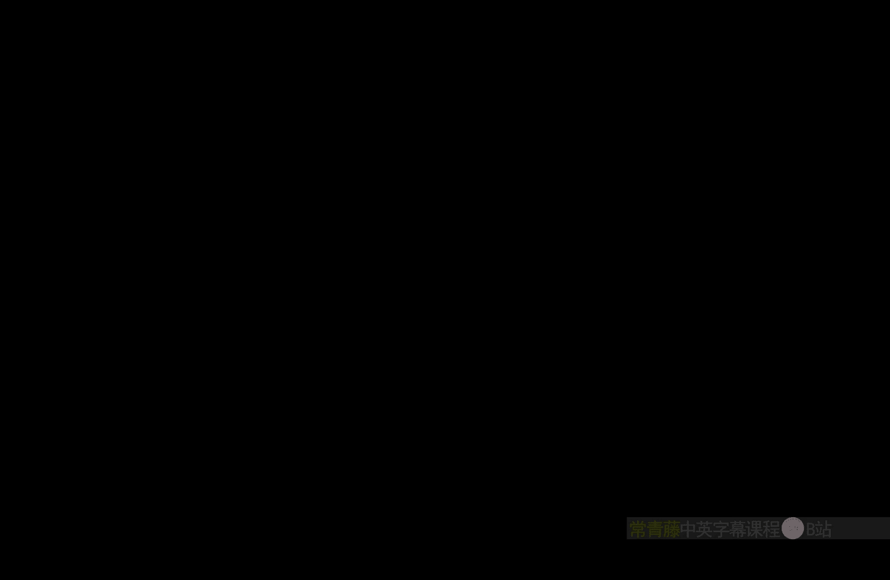
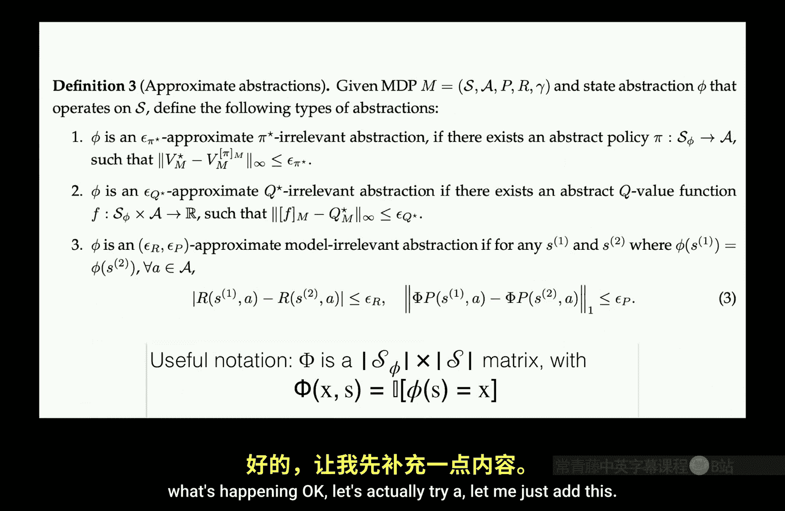
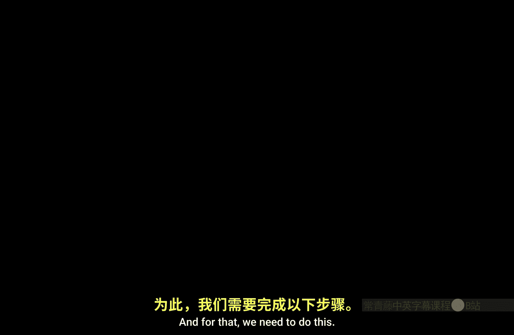
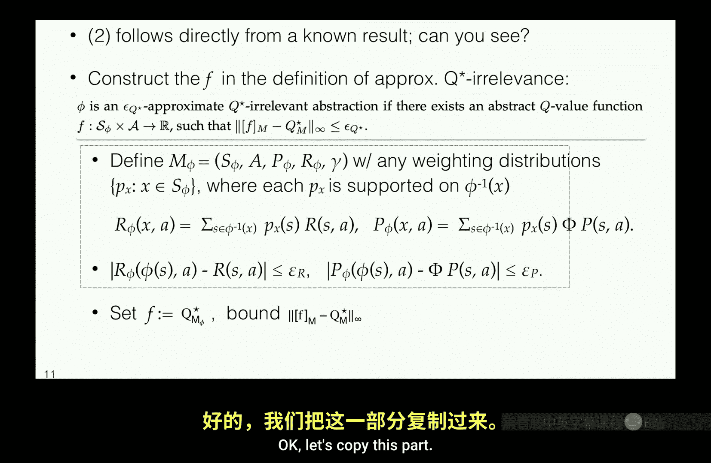
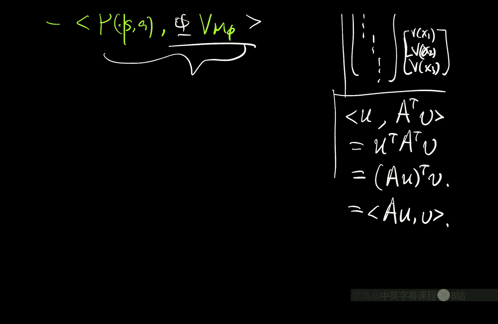

# 伊利诺伊大学【中英⚡统计强化学习｜CS542 Fall 2025, Statistical Reinforcement Learning】 p18 P18 状态抽象（视角2） -BV1YsZHBZEyM_p18-

Okay， so let's start。 So we。Last week， we finished the， the analysis for the tab case， right， and。

You know， as mentioned， I probably mentioned this before， but for a long time in R theory。

 the majority of analysis was for the tables， which create like very much gap between you know。

 the the theory and the practice were in practice。 we all know。

 like starting from around201415 is like deep R arose as a big thing。 You know， there was deep mind。

 There was avago。 There was， you know， the nature paper about superhuman performance in entire in Ontario games and so on。

 So you know。Given this big gap， like we definitely want to eventually address a complex function approximation in large and even possibly continuous state spaces and sometimes action spaces。

 So you know， for the rest few for the next few weeks。

 that's the direction we'll be going we're going in this direction of， you know。

 gradually ramping up and and eventually get in there to。

 to address large state spaces So for this week， we're gonna talk about like in an intermediate concept or the learning setting that sits between the table setting and the general function approximation。

 which is state abstracts。😊，Okay， so， you know， view from the perspective of， you know。

 function transformation， state abstractions， as we will see。

 will strike as a pretty naive and simple generalization scheme。 but it will see like it's。

 its exactly because of the simplicity that it allows us to really think like very deep about what does even mean to generalize across different states in N Ps。

 which turns out to be extremely like sophisticated and complicated question compared to， you know。

 the the， the analysis question that you can ask in supervisorvis learning。

 So I I hope and I think to some extent， this is one of the。😊，You know。

 most other R O courses wouldn't teach this part。But I think this is probably the most valuable thing you can learn from our own theory about it like。

 even if you're like focusing on the more applied side of things。Okay， so as usual， we're gonna。

 you know， consider an NP as a PR gamma。 for now， we're gonna assume like action space is still finite and。

 you know， and manageably large。 But from this extra onward， by default。

 we're gonna think of like very large state spaces。 large to the extent that you。

 you just can't even enumerate through it computationally right， think of it as you know。

 either continuous stay space or like you， you get like image input or or things of that sort。 okay。

😊，So， and therefore， like none of the tabular methods will be applicable。Okay。

 especially in the learning setting。 So， and as， as we mentioned in the introductory slides。

 it necessitates the， you know， some form of generalization。

RightSo whenever you receive data about one state， you can't just say。

 I'm going to only use that data to learn about this particular state。

 you have to generalize this knowledge to， in some sense。

 similar states to this exact state that you have seen。😡，So this is like an notion of generalization。

😡，And as I mentioned， like for， for this part of the course。

 we're gonna look at this very naive and primitive form of generalization called state abstractions。

 which is essentially like， you know， doing a aggregation or partition。

 So given the original state space is very large， let's say you just write down a partition of the state space。

😊，And within each part。 So like one one very simple example is say。

 let's say I have a continuous stay space that is some， let's say my。

 my S is RD or like a box in a bounded box within like Eucidean space RD， right。

 So I get a continuous stay space。 And the the most naive thing I can possibly do is to say， okay。

 let me just grid up the。😊，The continuous stay space。 Okay。

 and now we get a finite and small number of grids。And within each grid。

 I actually get like infinitely many states。 But I'm just gonna pretend that all of those states are to same。

Okay， and in fact， whenever I get like， whenever I get data， for example， I get data。

 like in these two different points， there are different states。

 What I'm gonna do is that I'm gonna just map these raw states to the grid I D。

And pretend that what I actually see is just the greed the grid Id as a discrete state。Okay。

 so that's like a very simple thing to do。 And the， you know， the benefit of that。

 apparently is that if you just do that naive conversion。

 you can just pretend that you're in a tabar problem。And algorithmically。

 like you' gonna just apply all tabler algorithms and and analysis。 Sorry。

 analysis doesn't apply yet。 that's what we're gonna talk about。 But in terms of algorithm， like。

 for example， like if you see a problem like this， you don't know about deep R or anything else。

 And someone just pushes you to say， oh， I need an RL solution。

 use RL to learn a policy like right now， like what else can you do。

 Well this is the simplest thing you can do， right。

 So you just like do a discretization of this state space， you get end up with in this example。

 like maybe 25 different states like or we call it abstract states And and just pretend that you have a tabler problem。

And you're just wrong tab your algorithm， and you get your policy。😡，Right， so。

 so at least it gives you something。Now。And by the way。

 that's going to be like the simplest possible algorithm we're going analyze throughout this week is this very simple algorithm that just pretend that you're actually in this reduced tabular stay space and then you know just the do the tabular scene that we have talked about last week。

O。Now， the real question here is， you know， if you just like arbitrarily grid up the the state space。

 you're just basically claiming that things like， you know。

 all these states that gets aggregate together into one you know， and what we call abstract state。

 you're claiming that their equivalent or at least similar。

 but that may not necessarily be the case for the actual NP。😡，Right， so。

 so like you're basically claiming some kind of like state similarity。

 but that may be inconsistent with what the MP， you know， is actually about。

 So we want to ask the question。 So if I just write on an arbitrary aggregation scheme or what we call a state abstraction scheme。

 this mapping feedM states to some abstract states。 is that really a good abstraction， right。

 when we aggregate states are the aggregated states like really like similar to each other。Okay。

 so one analogy that you can think of is that you can think of the analogy of this in。

 let's say supervisor name。 let's say you're doing regression is essentially what we call histogram regression where let's say you are you're fitting a curve that looks like this。

 right， And of course， you don't know exact curve。 but you get like you know for different x。

 you get different like y labels。 And the analogy of state abstraction in this case is like basically you grid up the input space into some grids。

 And within each grid， like you just treat everything to be the same。

 And if you have like multiple points in the grid within each grid。

 you just take the average of them to be your predicted label。😊，Right， and as you can see， like here。

 clearly， like， there's a very easy notion of whether you've grid up the space properly。

 that is as long as the， as long as the function， you know。It doesn't change much within that grid。

 Then your disquization is good。Right， in contrast， if the function changes a lot within that grid。

 but you're treating all of them as the same， because eventually you're just gonna output a single constant within each grid。

 right， So apparently， you're doing a terrible approximation。 you know。

 if the function changes a lot in that grid。 So whether the two inputs should be considered similar or not is very clear in the supervised learning setting。

But the question is like， what is the corresponding condition that you should stayed for RL？😡，Right。

 so in in supervised learning， we know that there's the Guangshous function。

 They have values like two inputs can be considered similar if their output values are similar。

But in our L， we don't have this thing called output value。Okay， so what shall we talk about that？😡。

Okay， so here are a a couple。Here are a couple candidate， candidate answers， right， So you can say。

 okay， maybe two days。Are really like equivalent or similar from the MDP's point of view。

 if they share the same outcome action。That's why I asked her。

Or maybe they share the same optimal value function。 They share the same optimal values。

That's another answer。 Or maybe we say that the two states are really similar。

 only if the rewards and the dynamics， the transition function。

 the transition dynamics for these two states are similar。Okay。So see like the the the。

 the saying is that in R L， because we have this very rich and flexible， you know。

 dynamical system framework， It adds a lot of layers of complexity to the seemingly。

 very simple questions that like reasonable， like， we have like layers of like different。

 reasonable answers to this question。O。And this is the kind of question where what we're going to address in these in these lectures is first。

 we're gonna formalize these intuitive sort of answer， but informal answers。

 like formalize them into mathematical precise statement。 and then we're gonna look at， you know。

 you know， when， when the abstraction you propose， you know， satisfy， you know。

 these different criteria。 What can you say about like the guarantees of the learning algorithm。O。So。

Yeah， so this is we're gonna do。 So for the， for the lecture is roughly divided into two parts。

 The first part is， as I said， I'm gonna define various notion or criteria for abstractions According to you know the ideas that I just presented。

 And then I'm gonna study their relationships。 It turns out they form actually a hierarchy。

 we' talk about that later。 And then the second half of the of the lecture， which mostly on Friday。

 We'll talk about， you know， what happens when you actually use different notions of abstractions。

 build tabular models based on them。 then output'll put a a policy。 You know。

 what can you say about that policy， Now， you know。

 point1 and 2 and  point3 are not really like strictly you know， distinct from each other。

 like when we talk about the relationship between different abstractions， we have to talk about。

 you know， what happens when you build abstract model and so on so forth。

 But that's roughly the plan。Okay， so without further sort of a， you know， over， you know。

 Shaing or or background， I'm gonna， you know， delve directly into this abstract hierarchy definition。

Okay， so given any fee。 So， so think of a fee as a mapping from S to S V， right， So in that example。

 let's say I grid it up。 then let's say the original state space is this， you know， continuous space。

 Now in this case， S fee， you can think of it as you know， each grid。 I give it a number。

 So I have abstract number 1，2，3 all the way to 9。 So S fee would be just like these9 states。😊，Right。

 so， and what I'm asking So， so the definition here is to say someone give me this S fee this。

 this fee mapping。And I'll give yeah， you know， some of these fees are good for the NP。

 Some of fees are bad for the NP， right， So I'm gonna give a list of different notions of different criteria to say this is a good mapping。

Okay， so。So the first is called pi star relevance that this corresponds to the condition that we says。

 oh， this， this abstraction is good as long as all the aggregated states share the same optimal action。

😊，Right， so mathematically， like here's one way there， there are many ways to write it down。

 But here's one way to write it， which is to say there exists a policy。

 So I'm right a optimal policy for this MP。 So pi M star。

 So I'm using subsequent M to emphasize that this is the policy， optimalti  for the original true MP。

 right， such that。Such that。 So S1， S2。You know， in the salmen is always like two states that gets map to the same abstract state。

So theyre， they're being aggregated。 Im say whenever you see two states aggregated。

 ask for their optimal action， and they always have to be the same。Okay。

 so this is a definition of high star relevance。 One slight nuance here is remember that in the MP。

 there can be multiple auto policies， right， So and。

 and here I'm just saying as you you only need to find one of the actual policies that satisfy this。

 That's good enough。Right， because otherwise， you know。

 think about a trigger NP where reward is0 or constant everywhere that every single policy is optimal。

Right， so in this trivial NP， according to the spirit of this， this criteria。

 you should be able to say that like， I should be able to aggregate all states together， right。

 because the optimal decision making in all the states are basically the same。

RightBut there are basically every single policy is a optimal policy。

 So if you require this criteria on all possible optimal policies。

 you won't be able to do any aggregation at all。😡，Right， so that's， that's why it makes sense to say。

 oh， I just need one of the opera policies to satisfy this。Okay。

 so this is so so far like what I'm going to give here is just definitions and we talk about their implications later。

😡，Okay， so the second one is what I'm， you know， alluding to is like we say， okay。

 there's another different criteria that says a fee is called Q star relevant。 If for any action。

 the optimal Q function in this NP always give the same value， whether you're in state 1 or state 2。

 as long as as as one and S two are aggregated together。Okay， so this is a different criteria。

And in general， I'm going to give like three criteria over here， and given any fee。

 it could satisfy all of them， none of them or a part of them。😡，Okay， does that make sense？Okay。

 so the last one is called a model relevance or sometimes called by simulationimulation。

 And this notion this concept or terminology of bys simulationimulation has some interesting connection to。

 you know， finite auto theory in in theoretical computer science。 But。

 but this is the idea that says， oh， I'm gonna enforce that your fee is only good if it preserves reward and transition dynamics。

😊，Okay， so the reward one is pretty simple， right， That says for any action。

 whenever you aggregate two states， their reward function must be identical。Okay。

 this should be pretty straightforward。Now， the really interesting part about bysimilulation is。

 is transition criteria。Okay， so if you follow the， the， the。

 the definition if you follow what we did for reward， the most obvious thing you do was be say， oh。

 the transition probabilities。Should be the same。S  to a， right。

 So that would be the most natural definition you would come up with。Right。

But that's not how we define by simulation。Okay， so we defined by simulation to be something much more nuanced and interesting。

 And in the next slide， we'll see you know why we define in this way instead of that way。 But here。

 what would you do is that instead of looking at the raw transition probabilities to the next states。

 you basically say， okay， I'm gonna look at from each raw state S1 and S 2， given action A。

 what's the probability that I end up in one of the next abstract states。😊，Okay， so here。

 so I'm using like in these nodes， I'm using s usually for the raw original state and x or x prime as one of the abstract state。

😡，And the transition probability from the original state action to an abstract next state is simply the summation of the raw transition probabilities for all the S primes in that aggregated next state。

😡，Okay， so think of it this way。 right， So suppose， again。

 like you have this disc discretized state space。 And let's say from this。

 this state and giving a particular action， let's say you get a cloud of。😊。

distributionistribution over raw states that is the given by the original NP。 Now， what， what this。

 what this quantity is talking about， This quantity is talking about like collapsing that distribution onto your abstraction。

 Basically， you say， okay， let's calculate how much probability of that cloud falls into each grid。

And then basically， now you get a distribution over the abstract stay space。Okay。

 and then here this criteria says you don't need to preserve the transition probabilities in the original state space。

 You only need the transition probabilities to be equal over the abstract state space。Okay。

 so this definition is a little bit of recursive if， if you think about it。

 because in order for fee to be a good abstraction， when you， you know。

 when you check whether fee is a good abstraction， you know， fee itself also goes into the。

 the criteria。So it has this interesting， recursive flavor。O。Now。

 the reason I say that this is an hierarchy is because you have this very nithereum。

 that says actually， these three criteria follows a strict order that。You know， the， the， the， the。

 the bottom one， model model relevances or called by simulationim is the most strict one。

And the top one is the most lenient and tolerant one。So any abstraction。

 if it satisfies model relevance， it must satisfy all the above。😡，If it satisfies Q star relevance。

 it must also satisfy pi star relevance。Okay， so that's why it's it's a hierarchy。 Basically。

 if you think of think of it as a， you know， if you think about the space of if you think about the space of all possible abstractions。

 this is the space of all possible abstractions， which are all possible mapping from S to some abstract to some abstract state space spaces。

 Then model relevance is the smallest circle。 And then Q star will is larger and pi star relevance is like even larger。

 You know， think of it that that way。😊，Okay。Yeah， okay so。Okay， maybe I can draw this more properly。

 something like this， right， and。Model relevance is here。Q relevancelev is here。

P star relevances here。O。So now this is something we're gonna prove later。

 But here I'm just stating it as a result。 the， the first， the the first result should be sorry。

 the second， the second arrow should be pretty obvious。 Q star relevance implies pior relevance。

 Can you just like prove that just by staring at the definitions over here。Yeah， exactly right。

 because we know that pi star is the greedy policy with respect to Q star。😡。

If your Q star within each aggregation， always share exactly the same values for all actions。

 when you gratify over them， as long as you break ties in a consistent manner。

 That is whenever there are ties within each abstract states。

 you always break ties in the same way because because that's allowed because you can pick one of the optimal policies you like。

 you can always construct an optimal policy that automatically satisfies the first one。Correct。Okay。

 so therefore this arrow is trivial。😡，Okay， so later， we'll actually prove this one。

 which is like less trivial。 But， you know， we'll leave it to a little bit later and。

 and we'll first talk a little bit more about the intuition behind these definitions and and the relationships。

Okay， any question about this slide。O。So。So， so this side。

 I want to give a little bit more intuition for why we use that very interesting cell recursive definition of。

By simulation， that is like， you know， preserve， you know， when we say you preserve the dynamics。

 why we use that more complicated version rather than this， you know。You know。

 we use this complicated version， which first collapses the distribution onto the abstract stay space and then do the comparison instead of directly comparing over the raw stay space。

 So here is a pretty good example for that。 Okay， so let's say you have MP。

 So here like you see a bunch of like nodes and arrows。

 They are different from how we did it in the introduct slides where each node means a concrete state。

 So here each node means a state variable。😊，Okay， so therefore， like。

 if you just focus on this diagram， this is just talking about a generic MDP where the arrows are think of it as something like the probability probabilistic dependence between different variables。

 And all is the saying is that the next state as a random variable depends on the action you take as a variable and the previous state as a random variable。

Okay， and each each node， each node， each variable can take on different values。Okay， so。

 so it's not like the shortest pass diagram that we see at the beginning。 Like， you know。

 this is something that you have to， you know， there are these two different graphical representations of the MP。

 Sometimes a node means a concrete state。 Sometimes it means this is a stay variable。

 So this diagram is saying nothing。 but， but that this is like a completely generic MP。Okay。

 so what I'm gonna do is that I'm gonna take an arbitrary generic MP where the states phase where the states I name it as X for reason to be clear。

 to be clear shortly。 And then I like。Artificciialally， like augmented to a bigger NP。

 where there's an obvious abstraction。 Okay， by the way， I didn't specify the reward， but， you know。

 reward is a function of state actions。 So you can draw the reward here and say reward depends on the current state and the current action。

 right。Okay， so what do I do， Well， what I'm going to do is I'm going to draw a separate markov chain on the side that evolves。

You know， in the same synchronous timets with the original MVP。Okay。

 so the state of the mark chain I call it Z and it and the mark chain is C。Okay。

So then I create this artificial new MP， whose state space S is equal to x comma Z。Okay。

And then this gives the transition probabilities of the new MP that says， oh。

 what's the probability of seeing X X prime Z prime， which is like S prime。

 given the previous date and the action， Well， according to this graphical model， clearly。

 it's just the probability of seeing X prime given X A times the transition probabilities in this Mark chain。

Okay， any questions so far？Okay， now， if you look at this big augmented NP， clearly。

 there's something redundant。 If you care about obtaining the optimal reverse。

By computing good policy， theres something that you can just totally ignore in this MP。 What is it。

Yeah， the Mark chain has nothing to do with over here， right， because that's just like， you know。

 by the way we construct it， this mark of chain is completely irrelevant。Right。

 so one of the examples I'd like to give and。I think I happened to come up with this example by myself。

 only to see later like some people in deep learning。

 like yellowqui or someone was advertising like a similar concept for example that is say， So if。

 if you're like a robot。 Okay， let's say you're cleaning a robot。 And for some reason。

 you get like camera sensor to， to know what's going on in a room。 and your。

 and your your task is to clean a room。Okay， and then， but in the room。

 let's say there's a television going on there。 And the TV is broadcasting some show and program that is very interesting。

😊，Okay， so， so the， the image on the TV， you can view it as the mark of chainang is just evolving on this home。

 But your job is to clean。 like， what really matters to you is the physical state of the room。

 not the information。 The image shown on on the TV， right， and your reward is like how tidy。

 how clean the room is。 like all of those have nothing to do with whatever that is going on there in the TV。

Right， so intuitively， you should be able to say that， okay， when I process my sensory input。

 I should be able to just completely ignore what's going on in the TV and just focus on other factors in this room in order to do my job well。

So that's like very very， very natural thinking， right now。

Forizing that idea in terms of a state abstraction。

 you can write down an abstraction that says P of S map just to x， right。

 So this is an abstraction you can write down That says whenever you give me a state that is X comma Z。

 Ill just throw away the Z factor。And only focus on X。 This is an abstraction。Right。

 and equivalently， if you think of it as a partition。

 essentially you're thinking of like or aggregation。

 you're thinking of overall all possible X Z pairs。 whenever two pairs share the same X factor。

They are considered aggregated， even if their Z factors are different。Okay。Does that make sense？Okay。

 so now， given how naively this example is constructed。

 you would think that this abstraction should obviously satisfy the notion of。

 I'm preserving the reward function as well as the dynamics of the NP， correct。And least like。

 you know， that's how I would think。Okay， however， if you evaluate this criteria。😊。

You will see that this abstraction， the seemingly perfect abstraction。

 doesn't satisfy the criteria over there。😡，Okay， so because。😡，Well， this is the probability， right。

 so。You will need to evaluate this probability for， you know， for two aggregated states。

 which means the same x， but different theses。Right， so let's say you have a Z。

I over here for I equals one or2。Okay， then you will have Z over here， Z1 or Z2。

 But because the markup chain will have different distribution over Z prime， you generally just。

End up with different raw next state probabilities。Right， like， you know。

 in that TV example that's that's asking the question if I'm in the same physical arrangement of the room。

 but the TV is currently showing two different images。

 What is the probability distribution over my next days。Right， well。

 if the TV are showing two different images， chanceances are in the next time step。

 They will also show different images because we know that TV show the TV video has some kind of。

 you know， temporal consistency and continuity。So it won't satisfy the criteria over there。😡，Okay。

 so now what abstractstruction。Right， so， you know。

 X Z1 and X Z2 cannot be aggregated under the S prime based condition。Now， what does what， what。

 what。Sorry。You know。What this does then is that it says， okay， now。

 if you claim that the TV image can be ignored， Im I'm going marginalize out that variable in the calculation of the next day distribution。

😡，Okay， so according to that， what you do， according to the by simulation is that you're gonna sum summation of this for all X prime。

 you know， for you， you pick X prime。 So okay， I'm gonna。Yeah。

 because you claim that the Z Z factor can be ignored， what the。

 what the by simulationim does is that it will take these raw transition probabilities and then marginalize the factor that you want to ignore。

Okay， so once you say sum sum over Z prime， you sum over Z prime over here。

 What do you get if you do a sum over Z prime for all possible value of Z prime。

 probably of Z prime given Z， what do you get。You get one， right， You marginalize that out。

 then you get this， which only based on x。😡，Okay， so now that will Trioli allows you to recognize that this is a good abstraction。

Okay， so this is an example that I always think of， you know， when I think about， you know。

 why do we define by simulation in this particular manner。And in fact， I think this， this diagram。

 you can actually add a few more arrows in the diagram and dropping Z is still perfectly fine under by simulation。

 Okay， so which which star， which ones you can add， Let me see。 so you can add。😊，This。Okay。

 you can also add this。And， in fact， you can even add this。Okay。

 so which means that you can actually make the， you know。

 that markov chain on the side to be completely controllable by your actions。 But， the， but。

 but the influence is one Direct is unidirectal。 It's only that your action can can influence that irrelevant factor。

 But the crucial thing is that you can see there's no arrows from right to left。

That irrelevant factor has no influence on you。 the， the， the， the really core part of your process。

 as long as that's the case， like dropping Z is still valid by simulation。

And this is something you can， you know， verify yourself。 And， in fact。

 I think after adding these arrows， this graphical representation should be completely equivalent to the。

To， to the like to the probability expression that we talk about。O。So， you know。

 think about that is like， you know， when I'm， I'm cleaning robot， I'm cleaning the room。

 like when I clean the room， I may accidentally like press on the room remote control。

 which may end up like switching the TV， you know， program。

 So it will cause something to change in this markov chain。 But it's okay。

 If all my job is to clean the room， I don't care what's going on in the TV。

 that's still completely okay。😊，O。So this is the motivation for by simulationim and。Yeah， so， so the。

 okay， this side comes a little bit late。 So this is just to say that， you know， when you think of。

Generally， like whenever you think of an abstraction， it's basically a equivalence relation， right。

 I assume you have， you should have like seen this in algebra course that satisfy reflexivity like symmetry transitivity and there are several ways that you can represent the an abstraction。

 like either as this mapping right， or really just as a partition or represent it as a equivalentence relation。

 that is if you， whenever you give me two elements in the original state space。

 as long as I can tell you whether there equivalent or not。

 and this binary relationship satisfy these three conditions。

 then that's also a way to represent the abstraction。And， you know， later on in the analysis， like。

 we're gonna like interchangeably use like these different。

 different like representations of of the abstraction mapping whenever you know， convenient。Okay， so。

Okay， I'm not go over over here。 but one thing to notice is that the the abstraction that satisfied the by simulationimulation criteria that I just give you is actually not unique。

 so。So if you look at， if you look at the this condition， for any NP。

 there's always a trivial mapping that satisfy this condition。 What is that。Identity， right。

 you don't do any aggregation at all。 Then X prime is equal to S prime。 And you whenever never。

 whenever S 1 and S 2 are are aggregated， theyre exactly the same states。

 So all these conditions are trivial satisfied。So in general， like when you have an MP， you can have。

 you can have many bysimulation mappings， right？ And one question you may ask is like， you know。

 like， is there a courseest one。That that is strictly coarser than， you know。

 all other by simulationim mapping。And I'm not going into details， but you can look up in the nose。

 And the answer is yes。 And basically， what happens is that whenever you have two by simulationims。

 you can always like create their common caring。 Basically， if。

 if an abstraction tells you S 1 is equivalent to S 2。

 and the other one tells you S 2 is equivalent to S 3， Well， you can just aggregate S 1， S 2， S 3。

 all of them together。And that will still be bysim。Okay。So， so there's that。Okay， so， you know。

 as I mentioned， this part of the lecture is not。 we're we're。

 we're not gonna focus on how you use the abstraction， but inevitably。

 we have to talk about that a little bit in order to you know， later prove our the core results were。

 we， we're aiming to prove here。 The the core result we want to prove is this one， right。

 And and this one is trivial。 And we're basically trying to prove this one as our main result result。

 And in order to prove that were actually， it's actually convenient to introduce the abstract MP model。

 which in some sense， is actually how you're gonna use the the abstraction so。So basically。

 what happens is that if you have a by simulation fee。It implicitly induce a an abstract MP model。

 which is an MP model defined over the abstract state space。Okay。

 and not only this model just conceptually exists， but it is actually the same that you will use be it in the planning setting or in the learning setting。

😡，In the planning setting， we know the NP， but maybe we want to save computational cost in planning。

 right， So in that case， if someone gives you a by simulation mapping。

 what you can do is that you can actually literally use that mapping to compute this MP and then do whatever you want。

 like dynamic programming evaluation， all these planning algorithm inside that smaller abstract NP。

Okay， and， and we show later， especially when it comes to， you know。

 how you use this this abstraction。 We're gonna show that when you do planning in the abstract NP。

 you preserve all the， all the properties of the original MP。 So it's actually legitimate to。

 to do planning in this smaller model。Okay， so， you know。

 sometimes this is all also called a model minimization。 And in the learning setting， as I said。

 if you just whenever you give the abstraction， you give the transition data from the from the original NP and you can always process that data so that it looks as if you just get tableular data from this from the abstract state space right。

 and you can just build a ME model， the tableular model， as we talked about last time， Well。

 we'll see that in a bit， but it should be pretty it will be pretty clear later。

 that as you get infinite data， the model you're learning is exactly the smaller abstract NP。😊，Okay。

 so therefore， like， you know， when you're in the learning setting。

 the SP is also very much relevant。Okay， so let's define the MP。

 And we'll see that it's actually very， obviously， you know， naturally defined。

 So this is the MDP that's defined over the abstract stay space， S V。

 So we keep the original action space。😊，We will briefly talk about how you can also do action abstraction later。

 And then you need to have this abstract reward function and abstract transition function。

 RV and PV that's operating on S V instead of the original S。Okay， and the discount factor is。

 is the same。So， so the key is basically to define the reward and transitions， right。

 and for reward function， because now we're in the abstract model。

 we need to assign a reward value for each abstract state action pair， right。

 for any X in S V and A And A。Now， what we know is that whenever an original state S gets map to this x。

 they all share exactly the same reward value。So it's only natural to just assign this value to R P of X A。

Right。And similarly， like in PV， we need to talk about what's the probability over the next abstract state given current X A。

😡，But we also know that this transition probability。

 that is you start from the raw previous state action， state action。

 and then you get the raw next state distribution。 But now you collapse that to the abstract state space。

 That collapse of distribution is always the same for all the raw state over here that gets map to the same x。

😊，Right， so， so this， this condition， this by simulation condition， which is written here。

 in exactly the same way， tells you that， well， that distribution is exactly the most natural choice for the transition in in the smaller abstract model。

O。So。I mean， generally， you have like what's really nice about this is that you。

 you can write on how you get the final data in two different ways。 And generally。

 you always get the same distribution， right So the same same the the the。

 the first way of getting data is that so you start with the original NP。

 you get a bunch of S A R S primeqs。 So here there's a requirement that the policy you use needs to be abstraction compliant。

 But for simplys say， let's say， you generate the action is like you know， uniformly randomly， okay。

Then what you can do is that this is exactly what I said。

 like how you would do it in the learning setting is that for each S and S prime。

 you compress them to a P of S and the P of S prime。Okay。

 now you get the data as if it's coming from a tableular NDP with SV as the state base， correct。Okay。

Now it turns out what。😡，Like the distribution of these twos that you get is completely equivalent to a different degenrative process where when you start with M and given by simulation fee。

 you first use the equation here to define a smaller M DPM fee。😡，Okay， and then get data from this M。

😡，While you will get exactly the same distribution。Question。Yes。

 we're talking about model relevance Ca， cause that's the most non trivial one。

 So we actually spend a lot of size just exclusively focusing on that， that， that， that abstraction。

 Yes， this is for model relevance or by simulation。😊，Okay， so， so keep in mind this model。

 because this abstract model Ms sub V， we're gonna use that a lot in the。

 in in the upcoming materials。或审。Pro。No， no， they're the same Ca， cause remember， like for。

 for different， right， because， because cause it's。

 it's asking what's the next abstract state distribution， right。

 Because that's the only reasonable thing you can ask in the abstract model。 The abstract model。

 because it's defined over S V， it doesn't even have the concept of the original states。Right。

 so therefore， when you start from S A， let's say from S 1 A and versus S 2 A。

 the original the original model tells you the raw next day distributions。

 those are distribution over S prime。 You cant even put them in the abstract model because the abstract model doesn't even recognize the concept of F prime。

 So the only thing reasonable thing you can do is to first collapse them to the abstract state space to do that marginalization。

 right， Then what once you do that marginalization。

 the by simulation condition tells you now theyre the same。Yeah， yeah， yeah。 So So this is the。

 this is the right， This is the model implied by， by simulation。 So this is a。Yeah。Okay。Okay， so。

 you know， the， the implication of by simulation further。

 what turns out that it preserves a Q star that that's exactly what we're gonna prove。

 And turns out that it， is also preserved Q pi M。Sorry， Q Q pi for any pi that is abstract compliant。

 let's talk about this after we prove the， the Q star result， okay。So， so， so roughly speaking。

 basically， what you can do is that if you have a imagine the following， right。

 So if you have a policy， and let's say I want to know is Q pi value。 Well。

 like usually you would just do policy valuation in the original MP， right。

 but if you actually have a by simulation， what you can do is that you can just first compress the model。

 then evaluate that policy in the abstract model。Okay， and then it turns out that you。

 you get exactly the same Q pi。 We'll talk about that。

 we'll talk about the Q star version in the proof。 and the pi version is similar。

 But the only thing is that here pi needs to， you know， generally， you have pi。

 The map stay to action or states to distribution of actions， right？ So it turns out that for。

 for this statement to hold you must only consider pi that can be written as some。呃。

That that chooses action distribution only based on the abstract state， right， Because otherwise。

 it doesn't even make sense to talk about running that policy in the abstract model。Right。

 because the abstract model only gives you a sequence of abstract states。

 If you have a policy that want to take different action distributions for aggregated original states。

 you can't even say， I want to run that in the abstract model。

 that that the statement doesn't make sense。 And that's the only reason why the statement is。

 is restricted to these， these kind of policies。Okay。Fin thing before we do the proof。

 So there is a pretty straightforward extension to handle action aggregation and also permutation as well。

 And and the only thing that differs between this and by simulation is basically a slight changing definition。

 pretty much all of the subsequent analysis and proofs are almost identical。 So for simplicity。

 we're not gonna consider this in the rest of the proofs。

 But we just mention this extension over here。 So this is a typical very canonical example people use。

 So this is a like grid world。 where all the gray blocks are like barriers that you can't go into。

 Okay， And if you look carefully about this map， you will see that it's actually symmetric along the diagonal line。

😊，Okay， that if you just fold it。😡，The， the the two sides of the map are identical。

Which raises the idea that， okay， so this is not a big saving。

 but at least I can save the like maybe a factor of two in state in terms of the state space。

 And maybe I can just keep the upper half。And its and basically do a like a mirror reflection whenever you try to cross the boundary。

That should a student preserve everything。And in that case， like if you think of state A and state B。

 they are completely equivalent because they they are the states that are symmetric。

 mirror symmetric across the diagonal line， right。But if you actually look at the transition dynamics and you try to verify whether it's satisfied by simulation。

 it doesn't quite work。 You can see， like if I go right。From a， I get into a free。 sorry， let。

 let's do it other way。 Let's say I go down from a。 I get into an obstacle。But if I go down from B。

 I get into a free grid。😡，Right， and those grid， like， obviously， like this。

 this grid and this grid obviously are not aggregated together。Okay， so what's going on here？

what's what's going wrong here。The action space or more concretely。So， okay。

 so this is something that I mentioned at the very beginning when。

 when we introduced the MP formulation， right， we said， okay。

 we assume that all states have the same action space。

 but never take action identities too seriously。And this is a perfect example。Right that basically。

 if you actually care about the symmetry， going down in A is semantically very different from going down in B。

So what's the right correspondence？Going down in A， what's the right counterpart for B。Going left。

Right。Now actually， like going down in a correspond to going to left to B。

 going writing A corresponds to going up in B and so on so forth。Right。

 so like this extension of by simulation called MV homomorphisms。

 All it does is say it modifies the definition of by simulation slightly to allow for action permutation。

 And also， like， you know， in state action aggregation。 So very interested。

 you can take a look at this paper， It's not very complicated。 But once you do that。

 you can recognize that， oh， like actually， you can actually aggregate A and B together。😊。

But this is actually a very good example to， to tell you that， like。

 even if you have a universal action space in this MP， you should never， by default， think that。

The same action， like in， in this， in the sense that they're symbolically the same， you know。

 it's the same symbol。Are like the same across the space space。O。Okay， so。The and it。

The so what we're gonna do is then the the major thing left is to prove the abstraction hierarchy。

 And out of laziness， I'm gonna prove the the the approximate versions。

 So previously in the definition， we enforce very strict notion of of these of those criteria。

 let's say if youre by simulation， then your reward must be exactly the same。

 if your Q star relevance， your  Q function must be exactly the same。 And of course， like， you know。

 itll be nice if you can allow for， you know， a slight amount of tolerance。 right， So。

 so basically here are the， you know， you know， the the approximate version of all the definitions。

 the previous definition can be recovered。 if you just let all the approximate parameters go to0。

 right， So the the first one says you have a you know， epsilon approximate by star relevant。

 if you can find a。😊，嗯。If you can find a policy such that if you can find a policy that that always takes the same actions within the aggregate days。

 you evaluate that policy。 what that gives you like almost VM star。 then this is。

 then this abstraction fee is you know， approximately pi star relevant。 And similarly， you know。

 you can also allow for Q star relevance to be approximate。 if you say oh。

I can find a Q function such that， basically， the Q function doesn't need to be。 So previously。

 we say that all the within the aggregated states， the Q star must be exactly the same。

 So basically here the idea is that within the aggregated states， the Q values should be similar。

 but not too different from each other。 right， you can allow for a small error。 You know。

 another way to write it is that for the， you know， within the。

Within the same aggregated within the all the states that get aggregated together。

 you can write on a single， a single value。 and like basically a constant function。

 that is a good approximation of the， for the true function。 So that's kind of like。

 the similar thing。And so for by simulation， again， it's similar， right。

 So it says whenever you have two aggregated states， previously。

 we say the reward must be exactly identical。 Now， you say you allow for a small FO R error and for transition is similar that we say the the aggregated probabilities。

 the distributions are similar。Okay， so as you notice here， we introduce a very convenient notation。

 which will use a lot later in proofs and actually simplify the proof by a lot that says given any abstraction fee。

 we can represent it in a matrix form。😊，That is S V times S。

 So it's a fat matrix where the rows correspond to the abstract states and the column correspond to the original states。

 And most of the matrix is 0。 and you only get one。

 if the row state if the if the row state is getting mapped to a， you know， sorry。

 if a column raw state is getting mapped to a row abstract state。Okay， so think of it this way。

 If you arrange the all the states and abstract stay properly。

 you would actually see a block diagonal matrix。Right。

Because because this is the index of the raw states。 These are the index of the abstract states。

 And when you see a bunch of ones， it means that these states are aggregated together。

 they are being mapped to the this abstract state。These raw states are being mapped。

 this abstract state。 These raw states are being mapped to this abstract state。Okay。

And what's really nice about this fee is that if you take the raw distribution transition distribution。

 So P1 A is the distribution of S prime。😊，Right， and if you think about what happens when you have a distribution of your next date and。

 you know， you multiply， you， you multiply it with this matrix， What happens。 Well。

 you're just looking at these entries， you multiply it。 Don't product with 1，1，1。

 So you just summing them up。Right， so basically， like whenever you get distribution over the over S。

 multiplying this matrix fee is basically doing that marginalization or collapsing operation。

 It all automatically gives you the corresponding next abstract state distribution。Okay。So therefore。

 like using this notation， the exact by simulation condition for transition can be very conveniently written as。

 you know， you have the next day transition from S 1 Well。

 collapse it by multiplying it with this matrix。😊，And it should be equal to p times P of S 2 a。Right。

 and in the approximate version， we allow for a small L1 distance between these two distributions。O。

And I， I， I reuse the symbol Epsil on Epsil P here。

 And although they are similar in nature to the Epsil E P in this table analysis。

 there are different variables。 right， So I'm just like reusing them here without making up new symbols。

Okay， so I'm gonna prove this the， the more general version of the hierarchy results。 So here and。

唔死。呃。So the， the， the more， the more general version we're gonna prove is basically to say。

 if you have a approximate by simulation。It implies that this theme must also be an approximate Q star relevant abstraction where the parameter where the abstraction。

 where the approximation error is actually small， in a sense that is controlled by these parameters right。

 and we can recover the exact result we said earlier。

 if these are0 and then we get the bound is also0。 Then we we recover the previous exact result。Okay。

 so。Let's do the proof。嗯。喂。What's happening。嗯。Okay， let's， let's actually try a。 let me just at this。

 Okay， so what we have is you know， remember， we have this fee representation of X S is equal to。

呃。Indicator of whether x equal to phi of S。Okay， and。And what we have is we have approximate。

By simulation。Which says for any S1。S2 such that they're being aggregated。We satisfy。

Franny A are of a。S1， a。Minus R of S 2， a。Itsunded by S R。And。Phi of P of S1， A minus p of P of。

As to a。Is well， this is the distributions。 we measure is our1 norm is provided by F O P， okay now。

The， and， and the claim is that basically that we have abstraction。

 which is a partition over the space space。 We know that if， if， if you。

 if it is satisfy Q star relevance， basically， it means that the Q star function is piecewise constant over that partition。

Right that that within each partition， the Q star is always the same value。 So here is approximate。

 So it's， it's only approximate version。 So write down the try to prove we need to， Well。

 we need to prove there exists F that maps。Phi of a sorry， S V to R。

And that's we'll call this a lifting operation。 So， so whenever we do lifting。

 we're lifting an object from the abstract space to the original state space。 And this operation。

 we're gonna use a lot， right， Because if you think about it。

 whenever you compute a value function or something like that in the smaller model。

 and you claim that， oh， I've recover the original Q function。Well。

 that statement by itself doesn't make sense because in the the Q function you have computed is defined over the abstract。

 smaller spacespace。And what you need when we want to recover at the end of the day is the function that's defined over the original space space。

😡，So the object we compute and the object we want at the of end of the day。

 they don't even have the same type。So you actually need to be able to convert between them。😡，Now。

 we know how to do one way， right， We know that this fee helps you to collapse a distribution from the being defined over the original state space to the abstract stay space。

But we also need to converse， which is if you compute something like a value function over the original smallerest abstract stay space。

 we need to be able to like translate that back to the original state space in order for it to be actually useful for the original NP。

 right， And the obvious thing you do is do the following， Right。

 So this is just the F of fee or let's say this is， let's say this is a Q function。😊，Okay。Right。

 so this is like the bracket sub M is what we call a lifting operation。 So if I've computed。

 let's say something like a Q function in the abstract NP。 And if I believe my abstraction is good。

 it means that I believe that the Q function in the original NP should be piecewise constant under this partition。

 right， which means that all the states that gaps to the map to the same abstract state should have the same Q value。

😊，Or what that value is。 Well， I believe that that should be the value that I've computed from the smaller model。

 So that this is how I lifted it。 right， When you ask me。

 what's the Q value of this particular state action here， I first map this S down to P of S。

 Then ask my lower dimensional value function。 what the value is。 And I just tell you， well。

 its value is， is this。Okay， and the consequence of doing this lifting is that whenever you lift the function from the lower dimension to the higher dimension。

 the original state space， you always get end up getting a piecewise constant function。Right。

 because by definition， for all the S that gets aggregated together。

 F M must have exactly the same value for all those states。Okay。

 and Q star relevance is just saying approximate version is saying there exists F such that F。

When I left it。Is a good approximation of the true Q star。In。呃。

infin norm up to some approximation air epsson Q star。 And this is a function of epsilon epson P。

 And will'll actually give you exactly this function later。

 But the point is that when epsilon and eson P goes to 0， this one should also goes to 0。😊，O。

And this is what we're going to approve。And the key thing here is to show that， you know。

 if you look at the what we need to prove， or we just say claim。Claim。Well， the。

 the key to make this claim is actually to find this function F。Right。Now。

 how do we find this function F？ Well， it turns out that the。The。

 so what we're gonna do is pretty simple。 similar to the exact case。

 what we're gonna do is to basically define an abstract model out of the approximate by and then just compute the optimal Q Q function in that abstraction。

And we're going to claim that we're just going to choose F to be that Q function。😡。

And then we do the rest of the proofs。Okay， so and for that we。

Need a。We need to do this， so。

Okay， let's copy this part。Right， so eventually the， if， if you look at the。

 the proof idea over here， eventually we're gonna to do is that we're gonna define an abstract model and fee。

And eventually， we're just gonna set F to be the Q star function in this abstract model。

 And we're gonna claim that when you lift this function。

 it's gonna be close to the original M original Q function。Okay， now。

 because here we don't have an exact by simulation。 It's only approximate。

 You can induce this very natural notion of abstract model anymore， right， Because previously。

 when you have exact by simulation， when you say， oh。

 what should be the reward for this abstract state。

 You ask all the original state that gets aggregated into this abstract state and all of them says。

 oh， it should be exactly this value and you say no problem， Let me just take that value。But here。

 because everything is approximate， they will have different opinions。Okay。

 but the good thing is that they， although they disagree， they disagree very little。So。

 so some says like， oh reward here should be 1。1。 Other says reward here should be 。9。

 They won't differ too much from each other。So all we're going to do is that we're just going to take an arbitrary average over whatever they say。

 right， So here for reward， you， you just like for each abstract state。

 you just define an arbitrary distribution P of x of S over the original states over the original states in that partition and just mix them together。

😡，And turns out that for this particular bound， this weighting scheme basically doesn't matter。

Like you can pick a point mask。 basically means that within each partition。

 you just pick any representative raw state and say， I'm gonna listen to you。Well。

 because everyone else， although they disagree， they don't disagree very much。 So after aggregation。

 my average won't disagree with everyone too much either。 So， so that's kind of fine。

 And similarly for， for for the transition probably。

 I'm gonna do something similar except except that I'm gonna use the same weighting scheme。

 So for each S A， you collapse the distribution， you get a， abstract state distribution。

 And for different states， they disagree on exactly what that distribution should be。

 but they' are pretty close to each other， I'm just gonna take an average。Okay。

So as a direct consequence。😡，You know， what you get is the following， right。

 Because the things you average together are close to each other。

 An immediate result you get is that the， the abstract reward function you get is close to any of the original reward。

For any states， the maps to F us。RightBecause you aggregate。

 you're taking average of of bunch of numbers that are close。

 So the final average should be also close to every original number。And similarly。

 you also have the same claim for transition probabilities that the abstract transition distribution is also close to the original。

 any of the original transition distribution when you collapse them onto the abstract stay space。

So this should be L1。 Okay， so those are the condition we're going to use to。

 to prove the final result。Okay， so we have a。We have five minutes left。

 So let me see if I can do this。Okay， so we're going to show this。 Okay， so， and and what is this。

 Well， so， so this is， we have two vectors over state action space。Right， so for infinite norm。

 we can just bound the difference in value for any state for any state action pair。

So we fix any SA in the original state actionian space。And we ask。

 what's the difference between F MSA minus Q M star S A。RightWhere our F is this。

 And by definition of how we do lifting， this is just the QM star of S A minus QM star。Sa。Sorry， not。

呃。Fe of essay。Right， because we choose F to be QM star QM V star。Right。

 it's the optimal value function in the smaller abstract MP。 So we just end up with this。

 Its just to plug in。 the definition of F and lifting。Okay。Now。

What we have that what is the condition that we have that bridges empty and M。What is this condition。

Right， so this， you can think of that this Eson or Eson P condition for the table analysis。

 There we're talking about the measure and difference between two。

2 MP defined over the same space space。But here we're defining a distance。

 but now between  two MP with different state spaces。Right， so one is R V。1 is R。 But nevertheless。

 we're able to define this kind of distance。Okay， so， so therefore， we want R V R， PP。

 like these quantities to show up in our proof。 Otherwise， we can't leverage this condition。

 So what can we do to make them show up in this proof。Bman equation， right。

 We've done this like a couple of times。 Whenever you see the Q star， there's no R。 There's no no P。

 While just do one step Bel expansion， you get them to show up。You get R P of Phi of S A plus gamma。

呃，PV。呃。Dot。V of S A。 Now， this should be expectation。 Then take max over the Q， right。

 But we know max max over action of Q is just a V， right， V and the star of as a function。Okay。

 and similarly， you have R of S A minus gamma P this is the real fee。Minus sorry。

 Dot with VM star as a function。Okay， so this is just like expanding the Bma equation for both quantities。

 But in， you know， two different MP。Okay， so we can already bound this， what is this？😡，Absilon R。

 right。You know， this is， this is the easy part。 Epson R plus gamma。 Okay， now， if you remember。

 like this， the， like in the table of analysis， like the rest of it is the tricky part。

 And here it gets even trickier。😊，Minus。PSA。We am。star。Right， so， so if you remember like， you know。

 how did we， like still here， we run into the issue that we want to compare P V and P。

 but they are dotted with different value functions。 What did we do before to handle this。Right。

 so you basically introduce an intermediate term that that does this kind of crossing。

So that you get kind of bridges， so we're going to do exactly that。But as you will see。

 the interesting here is that even that is not enough。😡，Okay， so， and。

 and you actually have to be pretty careful about which one you introduce here。

 So just I I just pray that I'm gonna do it correctly out of my memory。 So it should be actually， no。

 I want to introduce the。😊，你呃。I do P。P of S A。Dodwis， now here's the thing。

You can't directly introduce these like， mix them up， right。

 Because here you have a abstract distribution dot with an abstract value function。

This these are vectors of dimensionality P S V size of S V。

 So here you have vectors of dimensionality X。So you can't even mix these things up。😡，Okay。Okay， but。

 but here is what you can do。 So I can do this。 This is the original。

 like the distribution of the original state space。So here you have a shorter vector。

Which is the abstract value function。 Well， I can lift the value shorter value function to the original state space。

 so I can do VM C of and I lift that， right， I can basically take that a shorter value function。

 because I believe this should be a good approximation of the true VM star after lifting。😊。

So I lift it， then， you know， things match up。Right， and then subtract。We're out running off time。

 Sorry， I'm gonna take just two more minutes。To get， get to the key step。 Okay。

 so we get we get this。 Now， similarly， we're gonna break it into two parts for this part， you see。

 you have the same distribution， VM star minus VM V star， which you can bound them with， you know。

 QM V star， minus QM star。 So basically， this is where you start with。Right。

 so if you remember in those proofs， you get， this is the， you know。

 recursive term that eventually give you that one woman scam。Okay。

 so this part is basically the same proof。 So I won't go into Deha here。

 So the key thing is that you need to handle this。Okay， but see like here you still have that issue。

 Right， So although the value function you dealt with look like they're the same。

 but they're actually different。 One is VMP star。 One is VMP star lifted。Okay。And here is the magic。

Okay， so。So we have this term that we need to handle。Copy。Okay， we need to handle this difference。

Now， what I'm going to do is that it turns out that when you have a value function。

 lifting it can be also conveniently written as fee transpose。Okay， why is that？ if you remember。

 fee is 1，1，1，1，1，1，1，1，1， right， So something like that。

 And we say that when you dotted with a distribution。

 it marginalized out that distribution collapsellap into the abstract state space。 Well。

 what happens when you transpose is it。And multiply is with a value function， right， V of X 1。

 V of X 2， V of x 3。Well， look at this， right， when you， when you do this。Multiply this。

 you get v of x 1。 multiply this。 You get V of x 1 as again， Multiply this。 You get V of x 1 again。

So this is like basically populating this value to all the original states that gets mapped to the same object abstract state。

So this operation is is exactly the lifting operation we're talking about。Right， so that's why I can。

 I can write this lifting operation as P transpose VM's fee star。😊，Okay， sounds good。Okay， now。

This is the first thing。 The other thing is that now we get things of this form， which is you know。

 do product between a vector and。A matrix transpose another vector。Right。

So this I can write it as U transpose A transpose V。Right。And this is equal to A U transpose V。

Which is equal to A U dot with the。

So whenever you have this form where you have doll product， but there's a matrix。😡。

