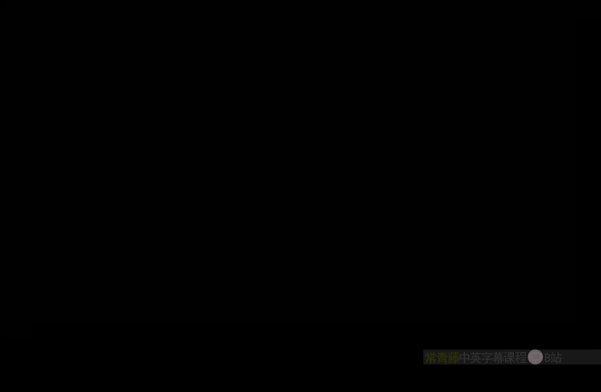
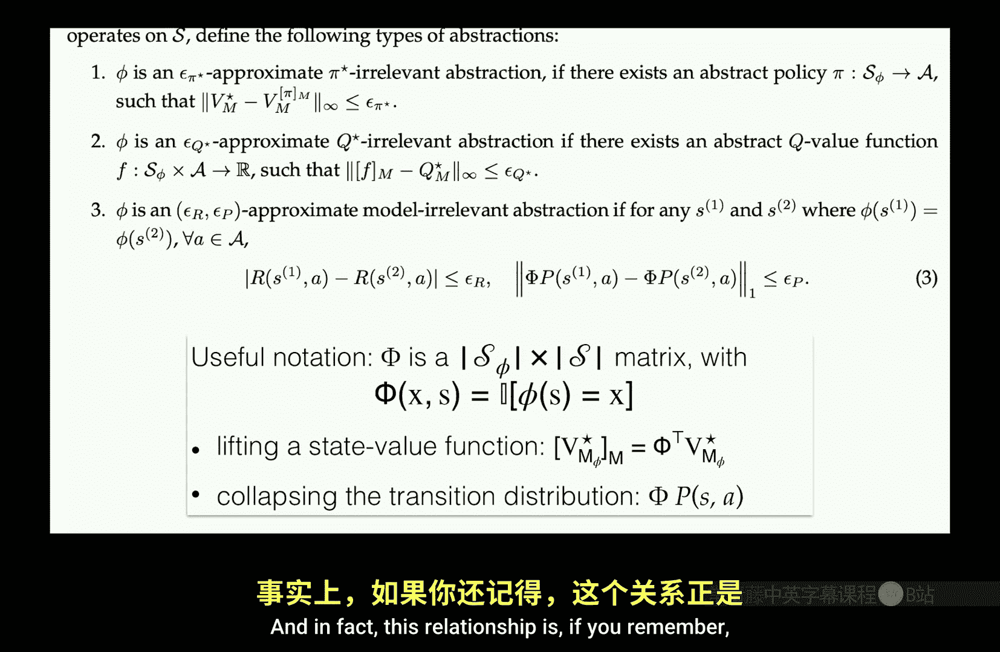
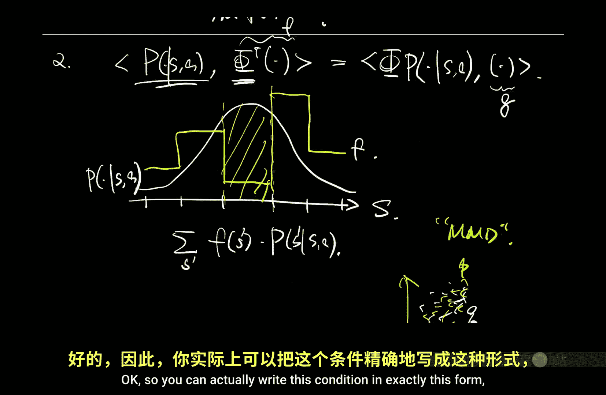
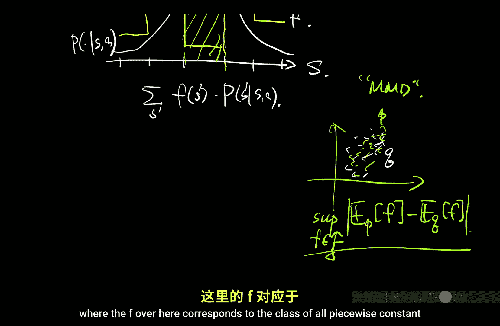
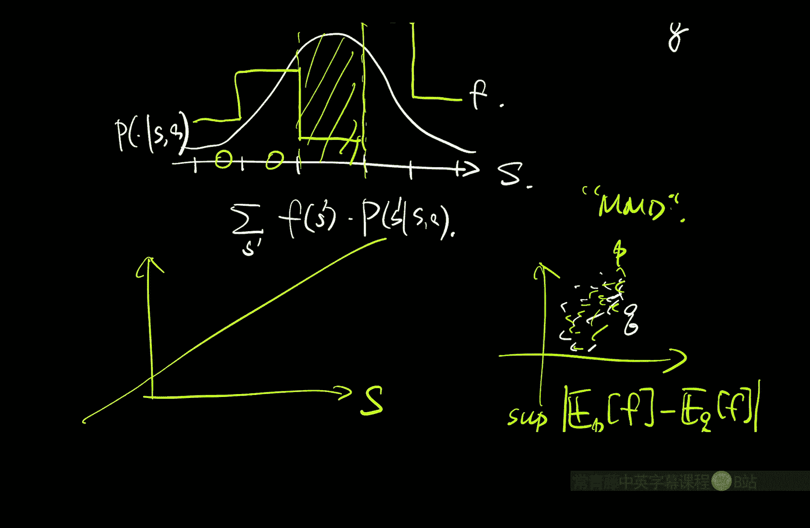
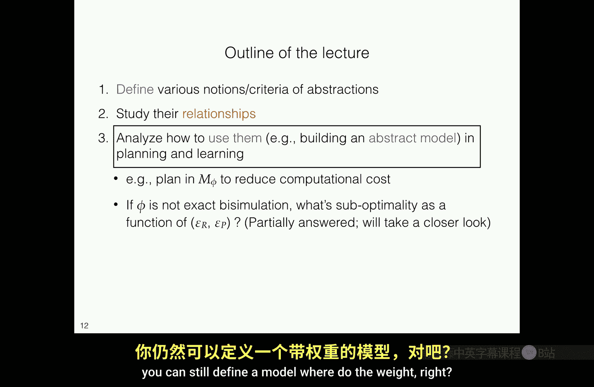
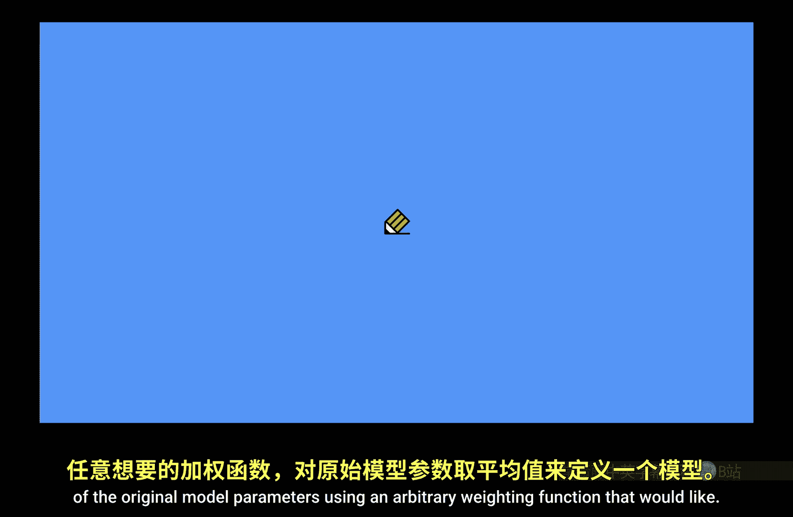
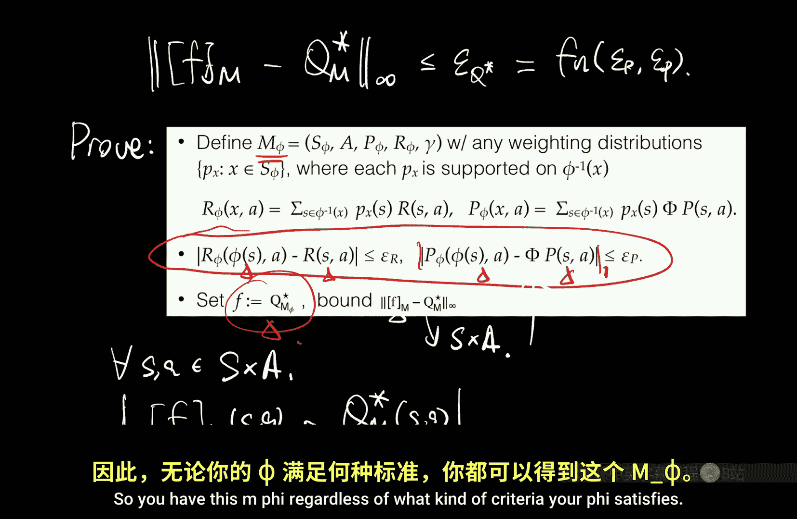
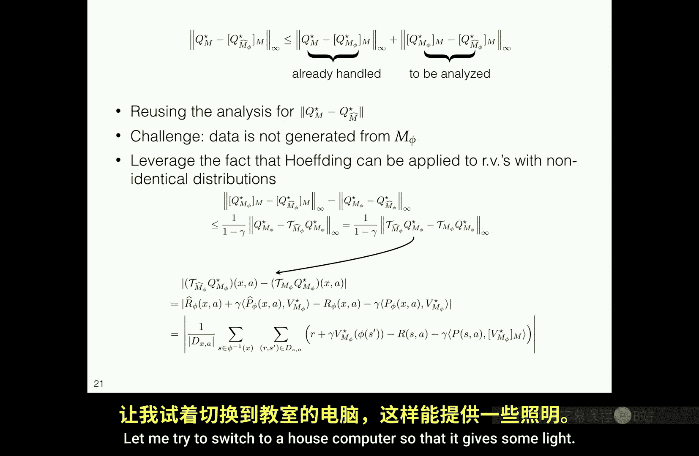
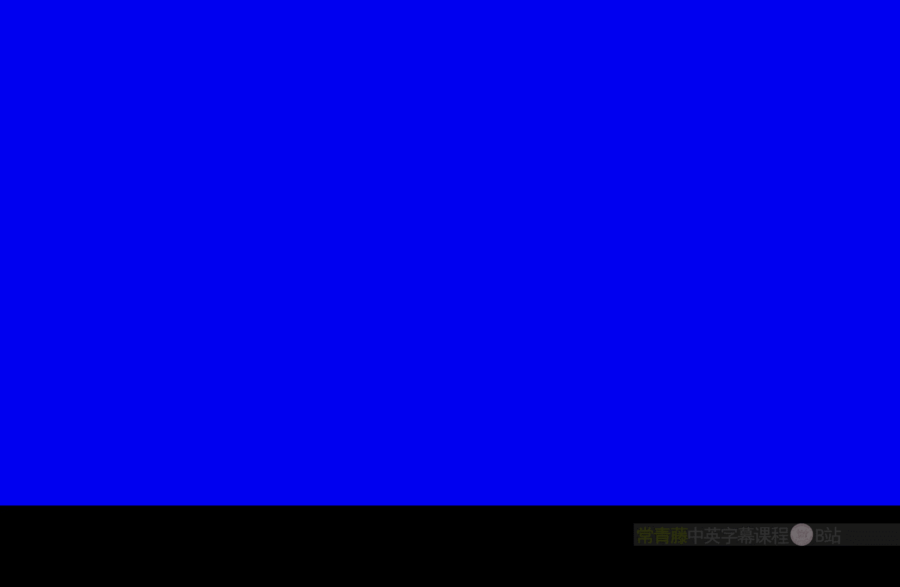

# 伊利诺伊大学【中英⚡统计强化学习｜CS542 Fall 2025, Statistical Reinforcement Learning】 p20 P20 状态抽象（续）（视角2） -BV1YsZHBZEyM_p20-

Okay， start before we start like two quick announcements。 So you you should， as you should have seen。

 homework 2 is available again， like doing roughly two weeks from now。

 like before like before Wednesday do on on a Wednesday， roughly two weeks from now。

 due before class。 And the day before that， I think that tentatively the T A will offer a T A office hour that you can come and ask questions。

 So so that's homework2。 And I think roughly around 10 days after that， around 25，26。

 the project proposal will be due。 right， So so。It's about three weeks from now。

 So now is a good time to start thinking about you know what kind of project you want to work on and and so on and start。

 And I've I've updated the project reference list with the latest papers that have come to my notice in the past year。

 So you know， take take a look at that that list and there's a pretty detailed guideline as to how do you choose the topic what's the expectation of the scope of the project and so on。

 and just to emphasize the that list is really like， you know。

 you don't really have to be restricted to that list。 But that list gives you like a sense of。

 you know what kind of papers。You know， are are good fit for the paper for， for dis course。

 And if youve picked someone that is， you know， not on the list。

 and particularly if the style and the flavor of the paper is looks like very different from the papers in that list。

 you know， those other papers like you need to have a discussion with me。 And ladies， you can。

 you can always just write it in the course project proposal。 And you know。

 when I go through the proposals， Ill take a look and let you know if if this is you know。

 may not be appropriate or like you can come to me earlier and you know。

 just have a casual discussion of whether the paper is good fit or not。Let me see。

 the other thing is that， you know， the course proposal， the project proposal is not a commitment。

 Many people change， you know， what they decide to do afterwards。

 So this is like your tentative decision and， and， and so on。 so don't， don't feel like， you know。

 whatever you put in the proposal， like， that's something that you have to do。 No。

 it's just opportunity for me to likeally check your， your， your。

 your project and give you constructive feedback。 Okay。

 any question about these logistics before we go to the course content。Okay。

So coming back to where we are on Wednesday， we introduced the， you know。

 state abstractions and the core question we're trying to answer is， you know， what are， you know。

 reasonable criteria that determine whether a given abstraction is good or not。

 And we have this hierarchy of， you know， pie star relevance  Q star relevance and model relevance slash by simulation。

 right， And we， and the first two are more or less like， you know， intuitive and， you know， somewhat。

You know， make sense。 So we focus a lot on， you know， by simulation as the， you know， as a， you know。

 why is a reasonable， why do we define in this way。 And if you remember， like， you know。

 once you define by simulation automatically it induces a very induces the model like abstract model defined over the abstract state space。

 And this model will be like super important for， you know。

 anything we will do in today's lecture so。Okay， so， and。

 and then we introduce the approximate version and this fee matrix。

 which is a convenient linear algebraic notation that allows you to do this if you remember。

 like it has two rows in the proof， One is that if you give me a distribution over the raw state space。

 multiplying that on the left with the fee matrix。 Basically does the marginalization。😊。

It collapses the distribution or you marginalize the distribution onto the abstract stay space。

Right and alternative， if you have a value function defined over the abstract model。

 which is a low dimensional vector， you multiply that with fee transpose。

It basically stretched it out into a piece piecewise constant vector in the original state space。

 right， So therefore， this fee is like very convenient that allows you to go back and forth between you know。

 between the the original state space and and abstract state space。

 and actually like these two relationships you know it tells you something more。

 right So so one thing is that you know， this is not you know。

 mathematically super rigorous or strict statement but more of like vibe。

 So if you remember like in linear programming， we mentioned that in in R， especially just in MP。

 there's this you know， general notion of duality between value function and state distributions or state action distributions right So like in linear programming。

 there is a very strict sense that theyre like know to each other。 you know in the LP sense。

 But like a more general more general。😊，Nottion of duality or kind of like a symmetry。

 You can observe it like， you know， everywhere， like even outside the， you know， LP formulation。

 like this is an example。Right， so is like， you know， fee is responsible for， you know。

 marginalizing the state distribution from original state space to abstract state space fee transpose is kind of plays the reverse role。

 But for value functions， Liing a value function from the abstract stay space to the original state space。

 Okay， and， and in fact， like this relationship is， if you remember， like， whats the key。😊。

Was the key step that we used to， to make this proof。 and which is the this very last step， right？

 So remember， we have this result that says， you know， eventually we get to this point where we。

 you know， by introducing these bridge term， we， we eventually come down to comparing the abstract。

The， the true transition distribution over here and the transition distribution in the abstract model。

 right， and they are both。Take， we're taking product with between these two distributions and like roughly speaking the same value function。

 allowing us to actually compare these two distributions， right。

 and the same value function over here is the optimal value function in the abstract model。

 however we run into an issue， right， because here we have the you know。

 that abstract value function itself， whose dimensionality is the number of abstract states。

 But over here， we have the like lifted version of the value function itself， right， So like。

 although we know that underlying it's the same value function。

 But just the in terms of mathematical expression， there's still not this quite the same object。

And what do we do over here？😡，What was the key step that we did so that we make sure that now we get exactly the same value function。

Right， so so we， we， we introduced this result that says that if you have a dot product in the form of U dot with a transpose V。

 you can always move this a to the other part of the dot product。Up to your t force。Right。

 so then you can throw this over here， which does two things at the same time。

 One is that now you get exactly the same value function， right。

 So then you can just take the difference between the piece。 right。

 The other thing is that like up there， you have the。P P。

 which is a distribution over the abstract space。 Here you have P。

 which is the distribution over the original state space。 They are not comparable， right。

 But when you multiply fi on here， it does the marginalization。

 which give you a distribution over the abstract state space。

 And now the two things are perfectly comparable。Okay。So。Well， before we move on today。

 I want to give you a little more insight about this proof and or like， or in some sense。

 it's actually a alternative proof。 but， but also it proves a even stronger result。 to give you some。

 some some， you know， more intuition as to you know， why we're able to prove this。 Okay。

 so so we're gonna consider the case of the perfect abstraction， which is like， you know。

 epsson R eson P equals 0， which is like exact by simulation。😊， so when you have exact by simulation。

By simulation。So what we know is that for any S1 and S 2， such that P of S1 is equal to P of S2。

 You know， whenever you have two identical Oh sorry， when you have two states that the abstract。

 the abstract says you should aggregate them together， we have that for any A， R of S 1。

 A is equal to R of S 2， A。And the state distributions。Well， we know that they're not equal。

 but theyre equal after marginalizing onto the abstract space space。

 which we can represent just by the， you know， the fee matrix， right。Okay， so。So， and。

 and if you remember， like the goal is to prove that this。You know。

 we can induce a abstract model very naturally from this abstraction。

 And when you do planning in the abstract model， it produces essentially the same Q star function。

 right， So it produces a Q star function in the abstract model。

 And you lift that Q star function to the original state space that is exactly the original Q star function。

 right， So that's the thing we want to prove。😊，Okay， so， and what we proved on Wednesday was。

 you know。Approximate like even more general notion that is allowing for some approximation parameters。

Okay， so for the exact version， here's an alternative proof about something something that is stronger。

 So， you know， eventually we want to say something about Q star， right， And in the previous。

 in the previous proof， we kind of like ignore how you actually compute Q star and just think of like conceptually that whenever you give me NP。

 the Q star is well defined。😊，However， like， suppose I give you MP and says， like， you know。

 actually compute Q star for me。 like what， what， what algorithm them do you know that can do that。

Valu duration， right， So， and then that's it like less's do value duration， right， so。Actually。

 let me do do this following。 So value duration。 Well。

 there's the obvious thing that you can do in the true NP， which is that you can。Start with any F0。

 right， and then you get F1。Let me write this way。F0， F1， which is just a T F0， and you get F2。呃。

Which is T F 1， and you get F 3， which is just T F 2 and so on so forth。 right， So and just keep it。

 And eventually you get a， you know， informally speaking， if I get infinity， I just get Q star。

 right， and to disambiate。 I'm gonna put the sub M over there to make sure that this means it's the Q star in the original N DP。

 And probably I should also put a M over here to make it clear that all these operators are defined in the original N DP。

O。Now， here's a different way I can think about it。😡，So first thing， what's the requirement on F 0。

 Do we remember。what kind of F0 that you can pick。Like pretty much anything， right。

 as long as it's bounded， right， that that gives you bounded range between F 0 and Q star that that that that that difference is like not too ridiculous。

 Any F 0 works。Right， so therefore here I'm gonna choose something that is like。

 I'm gonna choose a and， and because eventually we want to prove the equivalence between QM star and。

 you know， something else， which is like the Q star in the abstract model and then lift， right。

 So So， so therefore， like we're not really running this algorithm， right。

 we're actually using this procedure to actually make a， a proof。 So。

 so this procedure is kind of like only conceptual It， it's running in our analysis， not。

 not that we're actually running this algorithm。 So we can basically choose this F0 arbitrarily。😊。

To our favor。Right， so here's what I'm going to choose。And essentially。

 what I'm going to do is to show you that。😊，By simulation not only preserves the Q star and in fact。

 also Q pi for that matter。It actually。P reproduces exactly the value duration， You know。

 the trace of the valuation algorithm。Okay， so in the sense that if you run valuation in M。Like。

 we know that eventually it will converge to QM V star， which after lifting is equal to QM star。

 So in some， in some sense， in the limit， it converges to the same function。

That's what we proved before。 But here what I'm going to tell you is that not only the end result is the same。

 the entire iteration。Its also completely identical。Okay， so here's what we're going to do。

 So we're going choose G 0 to be an arbitrary function over the。Over the abstract。Stay action space。

Right， so it's it's a， it's a function that maps abstract state and action to real number。

 And let's say you have an arbitrary bounded function G0 here。And in order to。

Establish the correspondence。So here I have an arbitrary function， G0。 And as you can imagine。

 what I'm going to do is that I'm going get G1， which is equal to TM C。G0。And I get G2。

 which is TM V， G1 and so on so forth。 right， And eventually， I get G infinity， which is QM V。

QM V star。Okay， so in order to establish the equivalence， how should I choose F 0。Yeah。

 you just like cause， cause the initialization is up to you。 We can choose the arbitrarily。

 And since we want to establish that there the the not only the end result。

 but the entire process intermediate process are equivalent。

 we definitely want to align the initialization， right， So apparently。

 what we're gonna do is that this F 0 is just gonna choose to be G0 lifted。

So if you remember like the lifting operation here， like you know g0 lifted after lifting。

 you get function over the original state space and this is just equal to G0 phi of S a。😊，Right。

 so then obviously， we synchronized their initialization。

And then it suffices to basically establish that if you look at any pair function。

This function is always the lifted version of this function。Okay。

 then we just get the the entire equivalentence。Right and。Now。

 what you know is that basically you only need to show that for initialization。Right。

 because the initialization， we put no constraint as to how you choose this G 0。

 So this is basically just an arbitrary function over the abstract state action space。

 If this step works， which means that， which means that this is the lifted version of this。

That in the second time step， again， we just get an arbitrary function over here and it's lifted version over there right。

 And just by applying the same result again， we'll get that this will be a less lifted version of this。

 This will be a lifted version of this， and so on so forth。Okay。

 so we only need to approve it for the first step because because G0 was chosen， like arbitrarily。

Okay。Okay， so， so the the proof。So or clay。😊，Claim is that。呃TM。F 0 is the。A lifted version of。呃。

TMV G0。Right， so， and to prove that， we can start on the right hand side。 We have TM V G0。And。

So this is a function of S。 So the left hand side is also function of S。 So we value the S。

 So this is equal to TM P G0 p of S A， which is equal to。😊，You by definition， R fee of。

APhi of S A plus gamma。A P P of Phi of S。哎。O。Fear of us。A dotted with the。嗯。What was it The。

 you know， G0 is a。G0 is a Q function over the abstract state space。

 We're gonna call use V sub G for the， you know， V sub G。For like taking max over actions。

 we sub G of x。 So this is a value function over the abstract state space is equal to max over a G of X A。

😊，Right， so this tab is just expanding the definition of theman automatic operator in the abstract model。

Okay。Now。Because of how the abstract model parameters are defined。 If you remember。

 how do you define R fee of C of S A， Well， we know that for all the S that gets map to the same C of S。

 R of S A are always the same。 So we let this same to be just R of S A， right， So immediately。

 we have。By this step is。This is the definition of by simulation， R of S A plus gamma。

 But the same thing， this is a Phi of P of S A， right， V G。Okay。

 and R of S A plus gamma will do that same thing。 But here we're actually doing the other way around。

 right， So， so because we start with the， you know， abstract version， eventually。

 we want to prove that it's equal to the original version。 So we start with the V in front of P。

 And what we do we do now。😊，You， you throw it to the other side， right。

 So you get a P of S A P transpose V G。Right。O， R of S A。D， okay。P of S A。 Now， what we have here。

 you have the true reward word plus gamma， the true P。 So basically， you get something like the the。

 the， the elements of the true B operator。Right， so the true operator。 So T M。

 like all the key elements of TM are appearing， right， But eventually you want to have F 0。

But instead here we have， oh like this is G0。 So this is G 0， G0， G0。 Okay， but we have g 0 here。

 but were we we， we have a condition， right， we assume that， you know。

 essentially this is approved by induction。 that in the previous round， therere in synchron。

 they're in synchronization。😊，Right， so therefore， we know that basically the lifted version of。

 you know， V G0， which is like， you know， the max over action G0， is's basically like， you know。

 F 0 max over actions， right， So you basically have。😊，You have this， right。

 So this is basically directly coming from the， the induction property that in the previous round。

 G 0 and F 0 are basically the same function up to lifting。Okay， and what you add， well。

 this is just TM F0。Okay。Okay， so， so this is like maybe a cleaner proof。

 And it also proves something stronger that says。When you have by simulation。

 it actually reproduces the， the entire sequence of functions you get invaleration。

 not only the end result。Okay， so that's the first comment。 And as an alternative proof。So this is a。

也不要看。Here。Proof。4。The exact case。Okay， so this is the first comment。😊，And the second common is that。

You know， if， if you look at the the。Like the key step is like again， over here。Right， that。

That's P of SA。Dotted with， you know， fee transpose something is equal to。The P of S A。You know。

 something， right， So this is the key step。Now， what we can do is that we can actually visualize this and then see what's actually going on。

 right， So what， what this really going on is that what you're trying to do is that you have a distribution。

 just the distribution of states。 right， So the transition probabilities。

 So let's say for visualization purposes， let's assume that the X axis is the states。 And for now。

 I'm just gonna pretend that it's， it's continuous。 Okay， And let's say you have a distribution。

 which is like P of S。😊，Okay， now what you， what you're doing is that you're taking。

The dollar product between that。And a function， right？ But what's the， what's the。Like。

 it's not any function。Like， what's the kind of properties you have for。

 for the function that you're taking do product with。Well， no， no， no， fake。Okay。

 so I think you're talking about this function over here， right。

 So this function is an arbitrary function。 So， so first， this host for any function dot over here。

 And this function is a lower dimensional。 It has dimensionality。

 which is the number of abstract states。😊，But what I'm talking about is over here， right。

 So this is still a function over the original stay space。Right， but what kind of like， but。

 but you can't put an arbitrary function over here。

 What's the kind of constraint or the properties of the function that appears in this particular place。

Right， so， okay， so maybe one way to invoke the dilemma is that you can just put an arbitrary function over here。

 It'll induce a function over here。😡，Now， I'm asking you to do the other way around。

 So write a dilemma in a way such that you can choose an arbitrary function that satises certain properties over here。

 and that will induce the function over here。 So what kind of constraint are you gonna to put on the function that you can pick over here。

Yes， invertible in some sense。 But you know， we have a particular like way to describe it。

It's Pwise constant， right， So we have this fee。😡，This fee， remember。

 this fee is a matrix that essentially describes data abstract structure， right。

 So let's say that abstractstruction is， in this case， is a。Is a like a grid in the stage space。

 right， So what kind of function are we taking expectation with， Well。

 it must be a piece wise constant function。That looks like this。Right。

 so this is the function that you're taking a dog product or expectation with。Correct， like this is。

 this is， if， if， if I call this G and if I call this F， well， this is the F function。

RightSo basically， like you can put an arbitrary piecewise constant function F over here。

 then there is a corresponding like compressed version of it of G over here。😡。

RightNow what this slemma really is saying？😡，What。在唐。Theta， what is theta。Phi， okay， yeah。

 So it says that when you calculate the expectation of this function under this distribution。

Well the details of this distribution is density basically doesn't matter， right。

 Like because like eventually what you do is you do summation over s F of s， the probability sorry。

 maybe I do S prime， S prime of S A， right， but however， within each grid within each grid。

 F is always the same value。So what you can do。Well， in that grid， you can push the summation inside。

Right， first calculate like， you know， for example， for this particular grid。

 How can I do this summation or integral instead， Right， So basically， I can first calculate。

The area over here。Right， and just use the that， the， the。

 that area to directly multiply the height of the F function over here。Right， that's the same thing。

Right， well， that's basically that algebraic factor over there。Right， that。And。Right。

 and what and what the the proof over here is saying basically is that， you know。You know，Okay。

 so so basically like if the other thing is that if you want to show the the equivalence between the sorry over here。

 the equivalence between the abstract transitions and the true transition probabilities。

 you want to make sure that they dotted with a piecewise with a piecewise constant function I guess it's a little earlier and and then like you can like you can you can show this equivalence。

 if you dotted with an arbitrary f that is a complex function over your original state space。

 the behavior of the abstract model and the behavior of the true the true model will be actually different。

 However， you know， for the purpose of you know， the thing we want to prove that Q star is preserved as well as the entire entire process of valuation is preserved you realize that by induction you never have to care about you know the behavior。

of the true Ba operator to any function that is not piecewise constant。Right。

 because here by initialization， we first choose it to be pwise constant。

 And if the equivalence holds up， the next function is still Pwise constant and so on so forth。

 So at the end of the day， the only function we need to， you know， take care of。😊。

Our piecewise constant functions。 And as long as we can show that the。

 the abstract Bel operator and the true Bel operator you know， behave equivalently towards these。

 you know， towards these when when they try to update these piecewise constant functions then。Okay。

So， so this is a point。 And by the way， like there's something deeper over here。

 which there are similar insights on this topic in other areas of machine learning。 For example。

 if you look at distribution testing， density estimation and and so on you may。

 you may have run into something called like， you know， maximum， you know。

 there is something called M And D。Right， so in general， you have you there。

 there's this sub area in machine learning or statistics called a distribution distribution testing or like where like you have two distributions。

Like in general， the most naive form is a two sample test question where you have one distribution。

 you have another distribution。 You have to tell whether they're the same。Okay。

 and chances are for either both or at least one of those distributions。

 you don't have exactly the density distribution。 All you have are samples。😡，Okay， so let's say。

 let's say you are in L 2。 R 2。 And let's say you have one distribution that looks like this。

 You get a bunch of samples from it。 You have another distribution that looks like this。 Okay。

 so these are the samples they are mixed together。 Can you tell like。

 are they exactly the same distribution or not。😊，Okay， can can you tell from， let's say。

 a reasonably large finite sample。Or even like， you know， as your sample goes to infinity。In general。

 you can't tell， okay， like， although they are like missed it together。

 you never know like maybe like they are actually have tiny difference。

 Like maybe the white only can be sampled from this area and the green can only be sampled from this area。

 And there is like non overlap over like tiny minuscule overlap over there。 So in general。

 when you have a large space to like when the underlying space is very large you basically cannot tell whether two distributions are identical without any additional assumptions just from samples。

Okay， so， but what do people do in distribution testing， right？ So there are two things。

 Two things you can do。 One is you make parametric assumptions， right。

 say let's say I assume that both of them are Gaussian。

 Then I can just estimate the mean and various。 And if the mean or various are close enough。

 I know that theyre， you know， roughly the same。 or I can actually bound their k dirgs or I bound their total variation so on so forth。

 That's the one thing you can do。 But that imposes additional assumptions and prior knowledge。

 You require prior knowledge on the parametric form of the of the distributions。

 But theres a second thing you can do。And this is related to MMMD。

 or what call integral prometric IPM， which is to say， okay， maybe in downstream use cases。

 I never need to know whether they're exactly the same or their TV， you know， distance。

 total variation distance， right， maybe downstream when I use these distributions。

 All I want to know is the expectation of some functions。On these distributions。 Okay。

 so that's the only way I'm gonna use these distributions。So in those cases。

 whether two distributions are the same or how close they are can basically reduce to an easier question as to。

 you know， is the。Is the， you know， if I have P， like， if I have P and I have a Q。

Then it goes to the question of， is P and Q， Are they gonna give me the same expectation for a family of test functions or in modern terms。

 discriminators。That we're interested in。 So typically， you have soup over F。And， you know。

 for those who grow up in the deep learning era， like。

 you may recognize that the underlying philosophy is also kind of like similar to， you know。

 generative a networks like Gs。 it's kind of like a similar flavor。 right， And， and basically， you。

 you make the problem less ambitious。 Did you say， I don't now。

 I don't care about whether they're exactly the same。

 or what's the exact distance between those distribution。

 I only care whether they can give me the same expectation for a family of functions。

 And I measure their distance using this form。 This is。

 this form is literally called IM integral probably metric。 okay。😊，Now。

 if you look at a distribution testing when they talk about when they teach these kind of materials。

 there's a very natural question as to， you know， like， how do you choose that F。Right， and in fact。

 you， you run into these problems in very practical problems。 Like， for example。

 you can have a prompt based image generation。And people can do， you know， model selection or like。

 try to compare model performance， right？ So there's。

 I don't remember with this C I C I with the name of that score。

 like C IF or like there's a particular score people compute。

 which is basically like some main metric of， of the distribution of images that that you generate。

 you compare that to the to， to to to the the images you generate from with the training images。

 So you can show that that's basically a form of IM。😊，Right， so， but。

 but there's always a question you， how do you choose that， that function class， Like。

 what is the function that you actually care about， But if you study in the。

 in the context of like distribution testing， the textbook answer is always it depends on downstream use cases。

So it's like within the framework of distribution testing。

 they can never tell you exactly what f class you should use。😡，Okay， so。

 and this is like one of the reasons I really love like， you know。

 reinforce learning as a particular， you know， very general and comprehensive framework because R L gives you like and to end goal。

 Like eventually， you have to come up with a good policy。

 or you have to evaluate the policy like very well， And if you look at this analysis。

 basically it tells you that within the state abstraction framework。

 There is a particular function family of functions。

 which is the family of like piecewise constant functions。

 that is actually relevant for comparing distributions。 right， And and you know。

 I really don't care about the details of your distribution within each piecewise constant region And I only need you to get the summation you know。

 correct over here。😊，Okay， so。And and in particular， like if you think about how were。

 how we're doing this， right， So if， if you think about this， this condition。

 this condition is essentially a IPM condition right。

 That says the two distribution to next day distributions from different state action pairs are。

 they're not exactly the same。 but they are equivalent， They can't be distinguished。

When you look at them， when you test them under piecewise constant functions。Okay。

 so you can actually write this in write this condition in exactly this form where the F over here correspond to the class of all piecewise constant functions defined over this abstraction over this partition of the state space given by the abstraction。

😊。

Okay， so that's kind of， you know， a little bit of a connection over here。Sorry。Like， locally。

You can be not takes that。Like， not only， not exactly the same， you can be wildly different。

 It doesn't matter。Right， like you can， you can have one distribution that look like this。

 Another distribution that maybe look like， you know， like， look like this。

 like as long as there sum is the same within each grid， within each partition。

 The two distributions are considered identical for downstream purposes， right。

 So what's really nice about R is that it actually gives you that downstream application。

 What the downstream application is that we're gonna use these in dynamic programming。

 We're gonna use these things inval。 and in evaluation。

 there are certain functions you need to take care of。 you need to care about。 And those are the。

 you know， turns out that for， for here is you only need to care about the Pwise constant functions。

😊，Okay， so there's that comment over here。As a final comment。What this analysis tells you is that。

To think about abstractions， there are also like two very different views of thinking about it。

 One is that you can think of it as， you know， I first have the original。

 I have the original So basically like essentially like。

 look at this diagram and think of the two routes like the top row and the bottom row， right。

 So the like most of our analysis so far is thinking about the bottom row where we think of oh。

 I have an abstraction。 I have the original state space。 I compress it to the small， smaller。

 lower dimensional abstract stay space。 And I always like try to reason in the abstract stay space。😊。

Now， it turns out that for the proof and so on， like that we're trying to do。

 I'm not fully expanding over here， but there is a alternative view that you can think of that is basically thinking in terms of the top row where you don't even talk about the notion of abstract states and instead you talk about the corresponding properties defined in the original state space。

 such as being piecewise constant。Okay， so as we will see later。

 when it comes to general function approximation， you know， we can。

 we can there's a different view of there。 So here's the question。 Which view do you think is。

Better generalizes to the more general case when you use neural S and and things like that。

 when you have large state space， The abstract model view or thinking of structural properties of functions like P was constant in the original state space。

Okay， good guess。 Well it turns out that is the opposite。😊。

So it's only that when you have this abstraction that partition the state space。

 then you get this notion of abstract states that's very clearly defined。 right， Now。

 think about something slightly more general。 Like。

 let's say we use the linear function approximation to model the value function。Okay， so， you know。

 like， like here， when you grid things up and do piecewise constant functions。

 you can very clearly say， oh， this is one state。 This is another abstract state and so on so forth。

 But if you use a linear function approximation， Let's say this is state or state action space and say。

 oh， I model my function as a linear line And that the scope of the linear line can change。

 Can you still point to。😊，This thing and say， like， you know， which states am I aggregating together。

 It says， oh， like， if have two points that are super clear， like maybe their。

 their values are relatively clear as so and so forth。Right so， as it turns out， as I will see later。

 when we goes to， you know， more general function approximation。

 this view of like thinking of like the lower dimensional abstract model becomes very difficult to generalize。

 But this view of like， you know， thinking about structural properties of the function over the original state space is something that we can still do you know。

 when it comes to general function approximation。And these two views also represent like two sub areasas that both have influence in reinforcement learning。

 right， So if you remember like in the very beginning， when we have the introductory slides。

 we have a site from David server that says like the RL is the intersection of many。

 many different things。 right So this view， this approach of thinking about like a lower dimensional model you know definitely have this like symbolic flavor right it is actually a represented sub representationpresentation of what someone may call like old school AI which think of like model minimization。

 Think of symbolic reasoning， Think of planning search and so on so forth。

 but this like as you can see， like but thinking mainly in the original state space and thinking of like like piecewise constant and so on properties of the function space is like in some sense。

 like more machine learning， more model machine learning statistics and so on。

 And so RL is also this very you know， like I would say like very amazing。😊，Fra and。

 an area where like these all these things， you know。

 come together and you have like a nice discussion and a communication exchange of ideas between different sub areas。

 But you know， graduallyly will move away from these like more symbolic approaches。 but you know。

 go to the more general， more， more general formulations。😊，Okay， so that's for this。

For this particular proof。U。Okay， so。

That summarizes the stuff over here。And。In the rest of the time， I will。

 I guess it won't have a lot of time， but I will briefly comment talk about the the second one。

 which is， you know， what happens when you build an abstract model with different notions of abstractions and try to use them in in terms of producing a neural after policy。

Right， so there's a and and the key thing is that there's an obvious tradeoff。

 that is if whatever fee you use as long as it does some kind of aggregation。

 you can always compress fee into some model and fee， you know， and， and。

 and then you have a smaller model。 and you can do planning in a smaller model。

 which clearly has reduced cost because the number states there is smaller， right， And remember。

 like not only if you're given exact by simulation fee， you can come up with the model like this。

 but we also said， like in the proof of the approximate case。

 even if you only have an approximate by simulationimulation。

 like you can still like define that kind of model，😊，And we can review that， so。You。

 you can still define a model where do we， Right， right。

 So we can still define a model by just taking the average of the original model parameters using arbitrary weighting function that would like。

Right， and the argument there was that， oh， if the S1 and F here are not too large。

 the aggregated states have very similar， although different， but very similar reward functions。

 When we aggregate them and take average， the average is not gonna be far away from any of of the original rewards。

Now， know that。This， although we are， we were operating under the assumption that Eon and EO PR is small。

 nothing prevents you from just giving this definition， regardless of how bad appson and X O PR。

So given an arbitrary abstractstruction， maybe it's a terrible。

Abstraction under the criteria of by simulation。 we can still define this empty。

 and we can still do planning in it。Okay， so， and in particular。

 the one of the questions well be interested in is to say what like here so far。

 we've been focusing on by simulation。 But what about the other two notions of abstraction， right。

 We have Q star relevance。 We have pi star relevance。 What if we're given a Q star relevance。

 which in general， may have terrible approximation parameters under by simulationim。

 But we here to find this model and do planning。 What's gonna happen。Okay。

 so that's the kind of questions we're going to answer next。😡，So。Okay， so， you know， like， you。

 you have， you have this M fee， regardless of， you know。

 like what kind of criteria fee satisfies you can just playing in it and output put a policy。

 And I can ask， you know， how good that policy is。 First of all， if fee is not exact assimilation。

 how sub optimalti that policy is with mostly answer this question well just review that quickly afterwards。

 And more generally， like， you know， what if fee is only approximate Q star relevant right。

 or even like price star relevant and so on。

Okay， and there's the learning setting question that we answer。Okay。

 so so this slide is basically the the result that we already know。So。So。

 so this result over here like the result on the side is basically a direct artery of what we get so far of what we have proved so far。

 right， Because what we have proved is that。What we proved is QM P lifted minus QM star infinite is upper bounded by 2 Epson R plus。

Gmma epsilon P V max divided1 minus gamma。Okay， so。

 so this is what we proved in the approximate version。 you know， on Wednesday， okay， now。From here。

 what can you How there's a。Sorry， actually， it's not a factor of two here。 There's no two here。

 but rather there's a。To here。So from that result， how can you directly get a bound on this quantity。

 which is to say how good your policy pi M V star is when you use it in the original stage in the original NP。

There there is a result that we introduced previously that can directly translate this bound into this bound。

Can someone remember， what was that result？The key is that， like， you need to ask like， you know。

 what's this policy， Right， So this is the policy。 You first get the optimal policy in the original sort of in the abstract model。

 and then you lift it， right， And then you get a policy in the original state space that you can actually implement and deploy in the true MP。

 And you ask how good it is。 How sub it is。 What the're thing to know is thatop。The。

 the thing to notice is that this policy is basically the greedy policy with respect to。

This function over here。Right， so it's， it's the greedy。

 it's the greedy policy with respect to the Q star function in the abstract model。So。

 so what kind of result can you use to induce a bound from a bound on the difference between Q stars to the bound on the sub automatic of the induced degree policy。

Anyone？Right， so there there's this bound that says if you have F minus Q star is bounded by some epsilon。

 then pi F sub mile bound is2 epsilon divided by one minus gamma。 right， So there's this。

 And it was a direct query of the performance difference La。Right， so here basically previously。

 what we established is that the abstract Q star function is a good approximation of the true Q function。

 So the corresponding greedy policy must also be near optimal。😊，Okay， so well。

 it turns out that you can actually improve it And and basically the underlying idea is that if you remember in the table analysis。

 have we actually have two different kind of proofs。

 One is to prove that you can actually universally like your your your approximate model either you know learned from data。

 or here is compressed through an abstraction， can universally evaluate all policies very well。

 right， And then you turn the evaluation error to decision loss。

 So that's if you remember like in the in the table analysis。

 that's the analysis that has slightly worse dependence on the number of states in sample complexity。

 but has better dependence in terms of horizon right and at the end of the table analysis also talked about another another result that says you only need to focus on how do you learn the backup of the v star function。

 you don't。😊，To evaluate all the V pie for all pi， right。

 So there you get saving for dependence number of states， but you pay worse dependence on horizon。

 right， So basically， this result of here is taking the second route， right， But。

 but here it turns out that you can take the first route。

 And because here we're not really in a learning setting， you don't need to pay the actual， you know。

 dependence on S。 So you get a net saving in the， in the horizon。Okay， so not go into detail here。

 If you're like， you know， interested， you can go back and take a look and also compare it to the table analysis we did。

Okay， so。You know， okay。So here is the really interesting thing。 Okay， so as I said， like we。

 we probably focus too much on by simulation， and we ignore the other things。

 So what about pi star relevance。😊，Right， so， and in fact， instead of approximation。

 let's even just think about exact sorry， a Q star relevance。 Let's think about exact the。

 the the exact version。 That is， we have an abstractstruction。Where Q star。

 the only thing we know is that Q star is piecewise constant under the abstraction。

There's nothing else we know about the like， there's no other properties we know about this。

 this abstractstruction。Now， this abstraction in general can be a terrible biosimulation。 Okay， it。

 it may violate the by simulationimulation criteria like。Like， super terribly。But nevertheless。

 we can still build this model and V。And do planning in it。 Like。

 do we expect good result coming out of this。Planning procedure。Okay， no， right。

 Because like here is the。Here is the analogy that I often use。 Like what。

 what is a Q star relevant an abstraction。 Well， it's an abstraction that tells you any two states can be aggregated if the long term re optimal return is the same。

Right， so let's say you you're a person in a state like you're like a。

 let's say a trader like doing trading stock market。 And like， let's say in the long run。

 in one year， you can make， you know， whatever， like you know，10000 or whatever。

 I just making up a number。 And you have another state， which is like， maybe you can be like。

 you know， fishing on the sea。 And over a year， you can like capture like amount of fish that sells for $10000。

And what this abstraction says that just because both of you can earn $10000， the states should be。

 can be aggregated。 And not only that， it's actually building this abstract model that can actually average together the immediate reward function。

 as well as the transition probabilities。Right， and if you think about what that model says。

 that model says that， like， essentially like， oh， if you， if you。

 if you're a trader in a stock market， you， you try to sell something and I'm gonna predict what's gonna happen next day。

 Well next day， half of the probability， you stay in the trade trading market and sold your stock market and this happened with half of the probability。

 you randomly jump onto the sea And now you're in the middle of fishing。😊，Right。

You actually get a ridiculous model like that。So， so that's what I mean here。

 iss like the transitions and rewards basically make absolutely no sense If you build an abstract model out of Qi relevant abstractstruction。

And。The magical thing here is that planning in that model actually works。Okay， so。So this is。

 I would say， if you。If I would rank theoretical results in reinforcement learning。

 according to how counterintuitive they are， among all pieces of knowledge and results I know of R L。

 I would rank this as number one。So this is something I would say I've almost never really internalized it like at an intuitive intuitive level because of the reasoning I just gave。

 right， it's like like it makes no sense， but it works。

 Like what the're saying is that you build that nonsense model。 do planning in that nonsense model。

 get the Q star function， Li it to your original stage space。 Yes。

 you get the good approximation of the original Q star。😊，Now。

 you do get of little bit of degradation， right， because Epon Q star over here is the measure of。

 you know， is the approximation error that says if you find the best approximation of Q M star in that piecewise constant function space。

 What's the best approximation error you can get。 Its Epson Q star。 right。

 But if you do planning in this way， you don't get a function that is as good as that。

 you suffer a like， you know， factor of a horizon degradation。 But nevertheless， it， it still works。

😊，Okay so。嗯。Let's walk through the proofs briefly and see what's going on。 Okay， so。

 and for simplicity， I'm gonna do the Q star the the exact case， which is Eppsson  Q star equals 0。

 which means that the true Q star is exactly piecewise constant under the given abstraction。 Okay。

 so the key here is that if you look at any two states that are being aggregated。😊。

What you can verify is the following。Right， so you start from the middle that says Q star S1 A equals  Q star F S S2 A。

 This is the definition of Q star relevance， correct。Now。

 you do Belman you do Bel equation to expand both one time step。 right。

 So you get R plus gamma VM star， right， because the， the true Belman update is you know。

 max over a sorry， max over a Q star， but max over a Q star is just V star。Right。

 so on the right hand side， you also have this。So what this is saying is that。You know。

 previous okay， let's keep going， okay so。So what we're trying to prove over here is basically that if you look at the very beginning at the very end。

 So here I'm introducing the reverse operation of lifting。

 where because I know Q M stars is piece wise constant。

 like V is basically getting its compressed version。Right。

 if I have a piecewise constant function of the original state space。

 I can write down the corresponding function in the， in the abstract state space。Okay。

 so then that function， I can measure。 I can look at whether this satisfies the Belma equation。

 Belma automatically equation in the abstract model。😊，Right， so this is what I'm doing。

 What I'm showing is that this function is the fixed point。 right， So you get this function。

 you get this function It the fixed point of the bowman operator in the abstract model。😊，Right。

 and we know that Belmont operator only has one fixed point。 What is that fixed point。

It's the Q star。 It' the Q star of that NP， right， So the only fixed point of TM V is QM V star。

Which means that QM star V is equal to QM V star。O。And let's look at the proof briefly， right。

 So what you first get is that R P just do by definition， right， So you have a function over here。

 You want to apply the Belman update operator in the abstract model。

 So you just record the definition of the R P and do a max over the actions。 You still get this。

 okay。😊，So far， so far， this is just a definition。And then this is how we define the RFV and PP operator in the abstract model。

 right， So you look at all the states that gets aggregated together。And just do like an average。

 like an arbitrary， like average over the original reward parameters。

 as well as the collapse state distributions。Correct。Okay， now see here is the key and and， and here。

 like we're doing the same thing again。 So here you first have compression。 But here there's a fee。

 When you throw fee over here， that's lifting。 So that lifting and compression like cancel out with each other。

 right， So you get VMV。😊，Right，See， here's the key thing。In this proof。

The only thing that you apply the true B operator on。

Is the true value function in the original statement for the original MDP。

You don't invoke the dominant operator on any other function。Right。

 and the Q star relevance tells you that although the。

 the reward and transitions that you aggregate together， they are vastly different。

 And if you give it an arbitrary function， including an arbitrary piecewise constant function。Likely。

 you will produce widely different results。Nevertheless。

 there is one function that if you give to both of them， they always produce the same output。

 What that function is VM star。O， and in this proof， we only need to like， you know。

 apply them to VM star。Because here you just get Qar。😡，Right， and now I'm doing a aggregation of， of。

 of Q star。 But by the very definition of Q star relevance for all the states that you aggregate together。

 Q star is the same value。So you just get， you get， you get the Q star。Okay。So。

I guess we'll have a chance to revisit this when we talk about running general function transformation。

 And what's really happening is that， you know， when you view it from the point of view of general function transformation。

 really all these algorithm like you know， learning with abstractions can be viewed as what we call a like you know you're essentially doing an approximate version of Belman update where every time you do an update and you do a projection。

 Every time you do an update， you do a projection and there's something very special about abstractions that general function approximation doesn't have。

 that is the fact that you can define this corresponding m model， which gives you contraction。😊。

Right， because if you remember if you think about this logic over here。

 the key property we're using is that TMP has only has a unique fixed point。

Is the Q star in the abstract model。 wherere actually like this whole proof only holds， you know。

 when that property is， you know， you know， we， we， we utilize that， that property。

 like very critically in this proof。And as we will see later。

 when you use general function approximation， you can do you know Q learning with neural net and so on so forth。

 You can define the counterpart of TM， like TM V， Although you don't have abstract model。

 But there is a counterpart of this operator that you can define for them。

But this operator over there may not have a unique fixed point。 So。

 so this is a property that is very special about abstraction。 As soon as you go not。

 you don't even need to go to nearness。 even when you go to linear function approximation。

 the counterpart of this operator no longer is guaranteed to have a unique fixed point。

 So the proof over here will just break apart。So in some sense， like。

 this is the really thing that is like very special about abstraction。

 The previous proof about byim that has a very， very natural extension to general function approximation。

 whether you use a linear， like， you know， neuro acid or whatever you can generalize to there。

 This proof doesn't generalize。 So this is like the。

 the thing that is really special about abstraction。😊，Okay， any questions so far？Well。

 if you ask me any question about the intuition here， I can't give you like， there' is only mass。

 There's no intuition on this slide。Okay， but， but I hope you like， you know。

 one theme that you should be seeing that is very common in this entire section about state obstructions is that。

In the analysis， when you think about the， the the， the operator， right。

 So when you think about operators， well abstraction is about like deciding whether states should be aggregated or not。

 right， And when you decide whether they can be aggregated or not。

 we're mostly looking at the reward function and their transition probabilities。Right。

 and those things mainly are manifested in the Belman operators， right， because T F of S1。

 A is basically like you reward for S1 A plus transition probabilities of S 1 A dotted with whatever function F you're given。

 So essentially， a lot of the， you know， the criteria where they can。

 we can write up over here can be viewed as asking and especially how they are manifested in the proof can be can be viewed as asking the question。

 Oh， for these two different states when you do the Belman backup do you get the same result for S1 versus S2。

😊，Right， and， and the key thing here that I hope you realize is that like the really key thing here is like。

 like， what kind of function F do you use to check this condition， right， in by simulation。

 this says that， oh， please don't check all possible function。 If you check all possible function。

 youll recover that most naive definition that says reward must be exactly the same。

 but also the raw transition probabilities should be exactly the same。

 But we show that that's not necessary。 Like， that's an overly restrictive definition。

 So in by simulation， it says that you don't need to check all function F。

 it suffices to check F that is piecewise constant in in fee。😊。

The Qes are relevant proof says that you don't even need to do that。 Just check。F you quote Q star。

And that also works。Okay， so， so this is maybe another way of thinking about this。Okay， so。Okay。

 so there's a more general proof that works for the more general case。 We're not going over here， so。

That's。So this is a quick recap of what we talk about。

 We have we define a hierarchy and you know and we have this theorem。 that says。

 you know one implies the other。 If you are model relevant or by simulation。

 It always implies Q star relevance。 if you're  Q star relevant， it always implies pi star relevance。

 And And one of the key things we mention here or concept we introduced here is that given an arbitrary fee。

 you can always define this abstract model M。 And mostly we're thinking about what happens when you're planning M and then lift it back lift your solution back to the original state space。

 And the question is can you preserve the Q star can preserve Q pi。

 can you get a know near optimal policy and so on。😊，Right， and actually。

 this is the thing we talk about。 And I'll briefly talk about learning， right， So so far。

 all we talk about is planning。 we haven't talked about learning at all。 And as you can imagine。

 you know， when we do the tableular analysis you know before we get a sample complexity where the number of samples we need at least scale linearly with number of states。

 right， So that's another reason why you don't want the tableular learning scheme for complex problems that is not only computationally。

 you can't afford to enumerator of the states。 but also the sample complexity wise。

 you can't afford to pay a number of samples that scales with number of states， right。

 because there you need n samples per state action pair So the total sample size is n times number of states times number of actions。

Right， so one clear benefit that you can imagine when using abstraction is that basically you can pretend that you're actually learning in that abstract model where the number of say is much smaller。

 You're actually dealing with that abstract say space。Now， when it comes to you know。

 actual analysis。like what you do is， is basically exactly like you。

 you pretend that you're actually working with that smaller tableular state space， right。

 So previously， we have DS SA， which is for every state action pair， we have N samples。

 And it turns out that when the number of samples are uneven in the analysis。

 what happens is that you will need to pay for like the。

 the smallest the number of samples you get across the entire state action space， okay。😊，Now。

 for abstract， what you can do is that you can basically aggregate all the state action pairs like D X A。

 So X is an abstract state。 So you put together all the data points that coming out of states that that are being aggregated。

 So essentially， per abstract state action pair， you get more samples。

 you get this sample aggregation effect。 And in the analysis， instead of paying for the， you know。

 n or the minimal number of samples per state action pair。

 you pay for the minimal number of samples per abstract state action pair。Right， and， you know。

 as usual， like there are， there are several ways you can analyze it。

 whether you do universal evaluation overall pi or you directly try to bound QM star minus Q M head star。

 which saves you factors in dependence on the size of the safe space。

 This is what we talk about in the tableular setting。 So there is a， you know。

A few combination of different analysis you do that give you different dependence， different results。

 But here we're gonna briefly， you know， sketch what happens when you take the second round when you try to bomb this。

 right so。So one thing you can do is to say， okay， let's say， actually， you， you know。

 in terms of the algorithm， what I'm gonna do is I'm gonna build a。

 like user the data to build a approximate version of M V。Right， so that's literally what you do。

 Like if you don't know if you're given fee， you're given some state action reward next state to boost。

 What you can do is that you can first compress the S and S prime into fee as an fee of S prime。

Now you pretend that you're working with M and you're trying to estimate that M， right。

 And then just do like a tabular estimation of M。Okay， so we can call that empty hat。Right。

 and eventually you just do planning in that model。Right。

 so eventually you get Q star in the approximate M M had fee， right。

 And if you can bound this quantity， which is compare a selected version to the original Q star。

 then the policy grided with respect to it is immediately in your optimal right by that result。

 we just talk about that。 If you can approximate the true Q star。It's happening。Oops， okay。

 let's let's let it be。 Okay， so you can get a near off phone policy， right， So。

 so now when it comes to boundariess， we can use the M。You know， basically。

 the model you would get if you use the abstraction， but get infinite amount of data。

 Use that as a bridge。😡，Right， so to use triular in quality to decompose this error into Q M star minus the。

 you know， the infinite data abstract models Q function versus this term。So if you think about it。

 this is essentially kind of a bias variance trade off or instance learning theory terms。

 we typically like， cause it's not strictly biased。

 So typically like more property term is like there is an approximation error term that even if you have infinite amount of data。

 it doesn't vanish， right， because when you have infinite amount of data like M had will just converge to M。

Right， so this term will always remain。 So this is kind of like the， you know， clum the like biaser。

 But it really is like approximation error。Right， and。

 and this analysis is what we have done so far in the in today's course or also including on Wednesday。

 right， So we totally handle this part。 So the only thing is this part is basically， well。

 I've been estimating M using data， right？ And I want to know how my Q star converge to the Q star of M。

 So if you think about this analysis， essentially， here。😊，You like basically up to this lifting。

 which you can also just get rid of because of the infinite norm。 Basically， there's。

 there's no row of M over here， right， So none of these quantity have anything to do with M。

Because both like your ground truth now becomes M。So then basically roughly speaking。

 you can use the previous analysis for tableular setting where you here for the purpose of bonding this term。

 you treat M as if it were the ground truth model。And then you just do like repeat the tab analysis。

 Then you can bomb this term。 So this term will be like the various term where you should have like one over square root of n rate where n is equal to like。

 you know， per number of samples per abstract state action pair that goes to 0 when you have you know。

 infinite amount of data。Right， and， and here， like generally， you can see a， you know， you know。

 buy variance trade off in terms of the granularity of the， your abstraction。 in general。

 if you have a finer abstraction， like intuitively， like this term should be smaller， right。

 Because if you make it like the finest， which is just make it identity。

 you don't do any aggregation， then this term is 0。And if you do a very coarse aggregation。

 generally your abstract will be lossy， right but here so this term prefers generally speaking finer V。

 but this term will generally prefer coarser V because when you have very coarse aggregation。

 you get the benefit of getting more samples per the action pair。Right， so and that will be better。

 So in general， like you can see this kind of trade off through this decomposition。Okay。

 so ands some like details about the concentrationequalities and the only subtle thing here is that you are like so here this is the kind of like sorry scalar value concentration。

 we talk about at the end of the table analysis and the only different thing here is that we're actually mixing together data from different state action pair。

 right for each state action pair， the data points you get our I But when you merge data sets for different state action pairs。

 you get reward and next samples that are independently distributed。

 but they' are not necessarily identically distributed right But nevertheless you still mix them together and hope that they convert they concentrate。

 And it turns out that something totally like hub density inality can handle the more general version of hub density in quality。

 only require independent random variables， it doesn't even require identical。Attributions。

So most of the analysis we talk about in the table setting still apply here。Okay。

 so that's a rough sketch。 And this is the end of the abstraction section。

 And so I think we're finally ready。 next week， we'll start talking about general function approximation。

 okay。😊，And that's it for today。Oops， thats completely dark。 what's happening？嗯。

Let me try to switch to house computer so that it gives some light。

哦，OK。Oh， so the sensor over there， okay。

O， yeah， sure是。Oh， it which。Yeah， yeah。Let you can point over here。It should be。 Yeah， okay。

I got because we go through this part really， yeah， Yeah， right right。 I got a little messy my。

 So where does computation error comes。 Then there's no computational error， right here。

 like things are pretty much very every， like the entire like the entire point of using abstraction is that it' computationally trivial。

RightBecause youre just whether it's learning or so previously we talk about the table analysis。

 even in learning like computational it trivial， because you just estimate the NP and then just do planning like or whatever in thatP Well right。

 So I'm not accounting for that。 I'm basically like for sample compress results。

 I'm assuming that for example， if you do I don't consider that final little bit of error that remains I just assume that you run it know。

 let's say infinite number of iterations， because that's all computation。

 So here I'm focusing on statistical errors So actually later in the general setting。

 We're actually gonna study a more essentially a generalization of this where we're actually gonna literally do finite number of approximate steps where you actually see the you get term like gamma to the K is the number of you get So if you want to account for that here is' pretty easy like。

😊，You just have an extraer。Ice，Yeah。So I see like actually like， it's gonna be easy。

 right you can say here， you just get some function F。

 which is your let's see which is the final Q function you produce after finite number of variations And then for this composition。

 It just add one more term， which is F minus this one。

 And that difference is just literally focusing on what happens when you plan in M had fee。

 It has nothing to do with M。 It has nothing to do with M fee。

 It's literally just about M had fee as if it were the ground truth model。

 and you're doing a purely computational planning task in there。

 you can just bring whatever analysis we did at the very beginning of the course and put that over here。

 Then that's why it just give you one extra term。😊，Like orthogonal。 Yeah， it's complete orthogonal。

 right， So that's also the kind of deing I'm trying to do here， right， because here is like。

 this is the approximation mission error we analyze for these two classes。

 This one is kind of like estimation mission error。

 But like it's also it's orthogonal to the question of whether the abstraction is good for M or not。

It's just about whether。My data estimated abstract model。😡。

