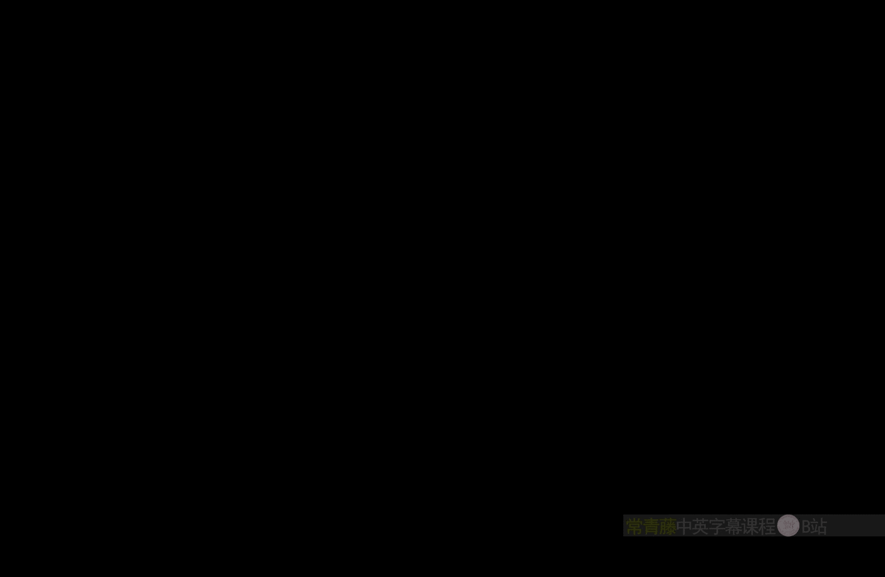
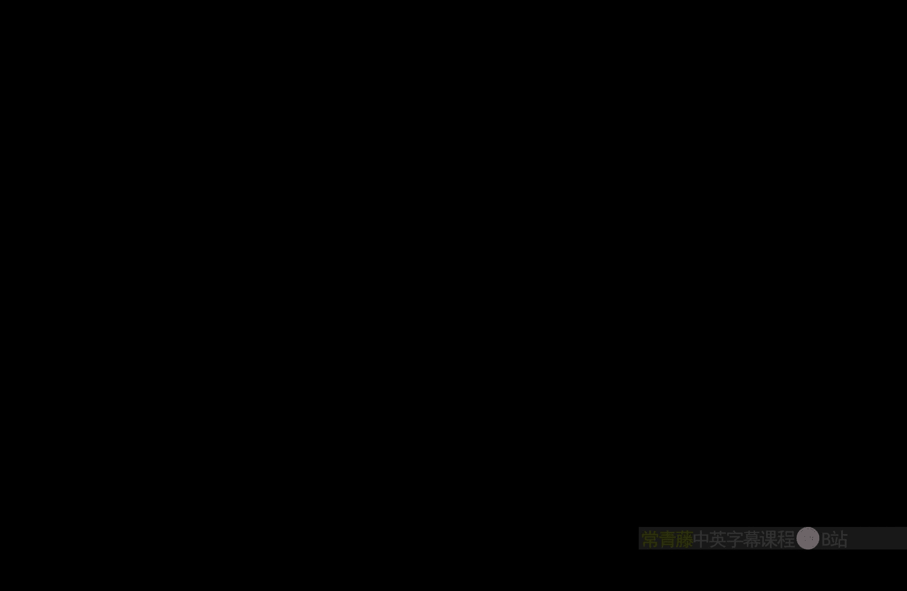
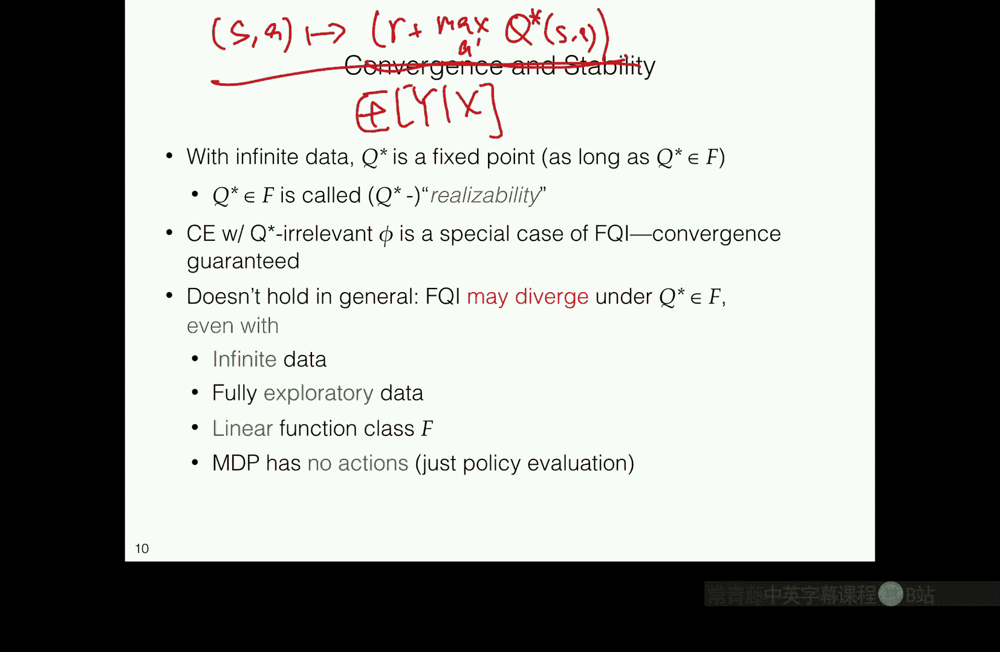

# 伊利诺伊大学【中英⚡统计强化学习｜CS542 Fall 2025, Statistical Reinforcement Learning】 p22 P22 拟合Q算法（视角2） -BV1YsZHBZEyM_p22-

O， let's start。So。I think homework。 then homework2 will be due next Wednesday， right。

 And there should be another T A office hour before that。 and thatll be re。

 that will be announced shortly。 probably， probably on Tuesday。 if I remember it correctly。

 I have to check with the T A on that， okay， so。

对。Its happening。Okay， cool so。Eventually， as I promised many times。

 we're getting to the point where we can actually now study how do you do RL with function approximation。

O， so呃。You know， we started with the tabular case。 Now we started looking into large safe spaces and considered the most naive and you know。

 preliminary form of generalization in the form of state abstractstructions。Okay， and as we said。

 like abstraction is like like， it's the most trivial form of generalization that， you know。

 its counterpart in supervised learning is something that no one would use， right。

 Like at least like youd do something like linear regression， so。Like， you know， as I said。

 there are many advances in supervised little machine learning， You know。

 all the way starting from neural network， linear linear regression to kernel machines to then。

 you know， random forests。 And then we' being in the deep learning era for like very long。

 So we're so used to， you know， use deep neural networks to approximate functions。 The question is。

 like， can we actually leverage whatever advances there is in supervised learning and just like bring its power to reinforcement learning。

 right， So what really want over here is a kind of reduction。😊。

That we want to reduce R L to supervisorvis learning in a sense that like we。

 we want to formulate R L so that we， we reduce it to a kind of problem that looks like， you know。

 classification or regression or things like that。 Then we say， okay。

 then we can just treat that as a black box。 And you can use whatever your favorite supervisor learning tools to solve that。

Okay， so。And to show you how to do it， one way。You know， so。

 so here's a like very brief derivation of how you can do that， right。

 So we're going back to the classic value algorithm。 And if you remember， that's for you know。

 approximating Q star。 you start with any function F 0。 like you repeatedly apply the bow operator。😊。

And after many iterations it will convertver to Q start， right， And if you get you star。

 you get you can extract a year algorithm policy from it。 And similarly。

 if you replace T with the T pi， the policy specific operator， if you iterate many times。

 you get Q pi that helps you evaluate and given policy。 right。

 So like these evaluationeration and its variance are the most basic foundational hour foundation we have you know。

 in the in the planning setting。Okay， now， so， so here's the idea。

 So here what I'm doing is that I'm， So I， I first write down the Belmon operator， right。

 So in the first round， the first in the first equation， which is just， you know。

 reward next date and then so okay， so。😊，Like， theres a couple of things。 So， first of all。

 the most familiar form of Belmon operator is probably this one， right。

 R of S A plus gamma expectation as prime given from PA max over a prime F S prime。

So this is the most familiar form of Baman operator。

 Well the first time is that it's equivalent to the row over here。Right。

Because by the linear of expectation， you can just take expectation of the reward and， you know。

 the next state， the F of S prime， that term， like the second term separately。

 And for the reward term， is the expectation is really just the expected reward for the current the action pair。

 right So I mean， if you want， you can say R is the reward distribution。

 And R bar is the average reward。 That's a little detail。 And for the second term。😊。

It's literally like expectation of Max a prime F S prime a prime with respect to what distribution。

 Well， this distribution over here， right， so it's just saying that the reward and next date。

 these distributions， like， you know， you don't， you don't really need to talk about their interactions and because you're taking expectation of their sum。

 So that's separate， okay。Now， in the second。So I rewrite it even further。 Okay， now into this line。

Okay， so why is that？ Well， so here all I'm saying is that。You have。

 so on the right hand side in the second line in the second line， we have four things。

 We have S A R S Pri， right， So they happen to be the kind of transition two that you will get from data。

Correct。RightSo if you remember all the way starting from the tableular setting， we say， oh， like。

 what kind of data do you have， Well， for each state action pair。

 we draw some random reward and random next states And our our data point。

 like the minimal unit of data point A is S A R S prime。Right。

 and in the abstraction case still like， you know， that way， we we， we process that data， you know。

 map the states to abstract state and so on so forth。

 But our original data point always takes the form of S A R S prime。

 And that's also gonna be the case for large state spaces， right， So when you roll out of trajectory。

 you see a lot of state action， reward， state action reward， state action reward。

 you can always extract these what we call a transition two point from them。 know， given a state。

 given action， I see a reward， I see a next state。😊，Right。Now。

 what's really nice is that you can actually write down the right hand side in this conditional expectation for。

😊，Right， because as long as so here's the thing。 So here in this expectation。Okay。

 so you can only define a conditional distribution。

 usually only when you have a joint distribution over over all the random variables， right。

 So if I have a joint distribution over all the random variables。

 I can always like define the conditional expectation， the conditional expectation out of it。

Right but here， so you know。Like if I have to be super rigorous。

 then here on the sub of this expectation， I should specify the drone distribution of S A R S prime。

 but I'm not doing it river here。😡，For the reason that as long as your data are generated by this NP。

 regardless of what kind of policy you use to generate that data， we know that RN S prime。

 given SA literally always follows the distribution in the previous one。😡，Right。

 so like what kind of what kind of policy you use to generate the to generate the data or like you use that protocol we mentioned earlier that you just query each essay a couple times and get your samples。

 R NS S prime given S always follows exactly the same conditional distribution。

 which is the distribution in the previous line。Okay。So therefore， I can just write in this way。

 And without even specifying a join distribution over S A R Spir。Okay， so this。

 this works basically for， for anything as long as your data comes from the MP， this always hold。

Okay。So now what this thing tells us right， so what this thing tells us is that。😡。

Every iteration in valuationeration， essentially， we want to approximate。

A conventional expectation function。O。And this condition expectation is， you know。

 with respect to the randomness over SA S prime。Okay， now。Now， here's the question， right。

 So if you actually make it really， you know， abstract， you can say S A is X。

 and everything here inside the expectation。 which， by the way。

 this is sometimes called the empirical be update because the true be update， you know。

 involves average reward and expectation with with the re to transitions。 But here。

 this term is essentially a random draw that is an unbied estimate of that term。 So so therefore。

 this term is sometimes called the empirical be update。 So if you treat this as the y。

 then really what we want to do is that we actually every run， we want to know the function F of x。

 whose value is equal to expectation of y given x。😊。

And because we have data in the form of SARS prime。😡，So both these are given to us， right， So say。

 I can just get get them from data。In this term， because Fk -1 is just the previous iteration。

 the function in the previous iteration of validationeration algorithm。 So I know that。

RN S prime is coming from data， so I can just plug R RN S prime into this expressionion and get the Y label。

😡，Right， and what's the final piece。 Well， the final piece says that like， you know， if you get X。

 Y pairs， you want to get a function that approximate E of y given x， What do you do。😡。

You do square answer question。Right in the sense that。Al。

 we go again and go back one step in the sense that if you say overall possible functions。Such that。

You want to minimize F x minus y。Square， right？So you have a bunch of X， Y pairs。

 And that' you have the expectation。 The distribution is with respect to certain distribution over X Y pairs。

 overall possible functions， you w to have， you look， you look at whatever F。

 such as F X minus Y square is。You know， the this loss function is minimized with that function。

Which function achieves the minimum over here。Well， it's condition citation。

 It's literally this function over here。 Right？ Okay， so， you know， if。

 if this is not immediate to you like。That's I would say like if you take。

 if you have taken a class that touches on regression， this should be the。

Like if you have any take away from it， this should be it， right？In general， when you have a。

 let's say you have an X， Y jointly distributed according to distribution P。

 So all expectation will be according to P。 So I will admit that later。

 So if you have F of x minus Y square。Right， what is that， Well， you can write it as expectation。

 I'm gonna emit P F of x minus E。Y given x。嗯。Plus EY given X。Mus。Y square。Right？Now。

 you can expand that。 This is equal to expectation。 You first have a term， F X minus。E of y given x。

Square。Plus， E of。Y given x。Minus y square。Minus plus 2。呃。F of x minus E， Y given x。Times。一。

Y given x。I asked why。Right， so you just expand the square over here。 Now。

 what you should realize is that this final term should equal to 0。Right。

 because they eventually were so like。This thing over here。😡，You can， eventually。

 we're gonna take expectation then marginalize out both x and y's randomness。

 But we can first take in the expectation over x first。Right， cause we can do like sorry。

 We can first marginalize our why first， we can do a lot of total expectation。 so we can do like E。

Of this。Givenive an X。Right， so we can do。Right， right， right， right。 Okay。 So we can do that first。

 because then the that X will be marginalized out by the outside expectation。Right。

 and when you take when conditional X X becomes a deterministic variable， right， essentially。

 for the purpose of this con expectation over here。 So F of x is deterministic。E， Y given x。

 This is just the function of x because y has been marginalized out in the E， right。

 So this is also determinacy。EY given an access to deterministic。 So the only randomness is why。

And you're taking a expectation given x。 So you get E Y given x， right， So this term becomes 0。O。So。

 this term just completely goes away。Now the only remaining terms are these two terms。😡，Right。

 do you have a。You have the first term， which is F x minus E y given x。

 And the second term is y minus E Y given x squared。And you realize that like。Like。

 which term can you influence。By choosing different predictions F， which term can you influence。

Only the first term， right， The second term doesn't depend on math。So what's the second term。

 Well the second term is what we call the inherent noise in the label。Right， that is。

 there is certain amount of noise in the Y that is just unpredictable from X， right， So， for example。

 if you have the simplest linear regression model， like Y is equal to x transpose theta star for some true parameter theta plus some absolutepsil。

 right， where absolutely some I D random noise。Now， when you try to predict y from x。

 you can't know epsilon Epsilon is like added later on， it's random， it's unpredictable。😡。

RightSo this term over here basically correspond to the various of a。😡，O。

Now you can't minimize the first term， like what's the optimal choice of F that minimizes the first term？

😡，E Y given x， right， and you can minimize entry to 0。😡，So this is the part that is actually。

 you know， sometimes refer to as the excess excess risk that that this is the part that you can actually minimize。

 This is the part you can do nothing about。 This is an inherent label noise。Okay。So， and。

 and therefore， like because of this， if you say I I try to do minimization of of square loss。

 And if your function space is expressive enough， that it contains this function。

 then you're gonna try to approximate。RightBecause that function will be at least like when you have enough data。

 that's the function that will make get your loss to nearly 0。O。Any question about this？Okay， so。

If we have that， we will know that， so。Now， applying that result in the R setting。

 the story goes like follows with no valid is a good algorithm for approximate Q star or even Q pi。

 So the Q pi star is very similar。 Okay， so and then Val can be written as ineration of this algorithm essentially。

 we're trying to approximate a， what we're trying to get a conditional expectation function。

And further， this conditional expectation involves random variables that we can see from data。

And that't actually， the condition expectation， you know。

 the conditional distribution of R N S prime doesn't really depend on， you know。

 your distribution of S A。 So you can basically use arbitrary， you know， amount。

 like whatever your data distribution is， we can always use that。

 The condition expectation doesn't change。Okay。So。And that's what we' gonna do。 Okay。

 we're gonna like try to approximate each iteration of validiteration using a squared loss regression。

Okay， so that gives us the fi iteration algorithm， which， by the way。

 if you implement this algorithm。 So this is a bash algorithm。 So， okay。

 so let let's first describe the algorithm， right， So similar to Val。

 it will produce a sequence of functions， F 0， F1， F 2， F3， F 4， and so on so forth。😊，Right。

 and in each duration， you get the previous function， FK -1。

You plug it or so here I guess I'm using T to index the iteration。 That's fine。

 So the previous iteration， you get function F T -1。

 You plug it over here to create this regression label。😊，Right。

 so F T -1 in the previous e is a function。 But once you plug in over here， it。

 it give you a single real value。For each data point， SA S prime。😡，Correct。Okay。

 so you have this label， you have SA， and you're just like， you know。😡。

Search over some function space over here that minimizes the empirical loss， right。

 So the empirical loss is for each data point， you calculate this error。

 squaret it and take a summation over your dataset。😡，Okay。Now this function space。

 so here like this is a very like simplified。😡，Abstract description of supervised learning。

 where we assume you're doing， you know what we call empirical risk miniization， right。

 We're assuming that you're just over some function class。

 you're trying to minimize the like you can call this like training error。

 So in the in the lecture where we talk about generalization error bounds for supervised learning。

 We talk about something like this Right， This is like this is very abstract if you want。

 like you can add regularization or do other things or consider how you actually implement this by SD。

 And you know， what kind of F do you use here。 Like F can correspond to a neural net as so on and so forth。

 But But this is like， you know， more of like a very black box in abstract way。

 just to describe like， I want to solve a supervised learning regression problem。

 I don't care how you solve it， Please just solve it very well。 if you can do that。😊。

Then I'm gonna call this black box you give me that solves any supervisor learning regression problem very well。

 I'm gonna call it many times because to run that， I need to do many durationerations。 In each it。

 I'm gonna call that black box to solve a regression problem。 I get a new function。

 I plug the new function back to this expression to get a new label。 So the X never changes。

 But the Y keeps changing。Right， so then get a new data set。

 and then throw that into your back box and say， please solve this new regression problem for me。

 I get another function。 I repeat。Okay， so this gives you like fit cur。😡，And， although。

 and for those who have some exposure to reinforcement learning， especially supply side。

 like you may not immediately recognize this algorithm。 But I would say that if like。

If you implement the ins。 So basically， you can think of this algorithm as like two level， Right。

 So at a higher level， we're doing this like approximate valuation。For each。

 how do we do it while we solve the least square regression。But in practice。

 how do you solve a least square regression， especially when you have like something like when you try to use something in your net。

 What do you do。How do you actually implement a square loss regression。谁？Well， no。

 that's the loss function。 Like， I'm saying like what exact algorithm I going to use。You you do SD。

 right， You do stochastic gradient descent。 Okay， so if now you can actually， let's say。

 throw stochastic gradient descent on this thing。 And what do you get while you get the famous cure learning algorithm。

Okay， and if you actually use deep neural net over over here that correspond to this function space。

 you just recover what's known as the Q it。Okay， so therefore like this is really like， you know。

 one of the most And， and if we don't really want to study like the aspect of， you know。

 how do you actually solve this regression very well， But we want to really understand， you know。

 like that that's at a lower level。 But really want to understand at a higher level， like， you know。

 you know， what what if you have certain guarantee for solving the lower level supervised learning regression problem for which like existing learning theory give us like pretty good understanding。

 but want to understand like how those guarantees。Give you something about， you know。

 the overall RL problem。 Well， that's the， the kind of analysis we're gonna， we're gonna to do。

 you know， this and next week。Okay。And furthermore， I don't know if I have the。Actually。

 so the other thing is that。While you may feel that this is a new algorithm。

 or it turns out that we have， we have actually seen its。Special cases。Okay， so， for example。

 you can let this function in space F to be the space of all possible functions over C action pairs over the C action space。

By assuming that the state action space is finite and discrete。Okay， so it turns out what this。

 what this algorithm does literally becomes first estimate the tableular model。

 as we mentioned in the tableular analysis。 and then each iteration over here。

 literally correspond to running evaluationeration in that tableular model。Okay。

 and theres a similar like there's a even slight extension of that。

 If F corresponds to all piecewise constant functions induced by some state abstraction fee。

 then FQI correspond to value in the estimated abstract model。Okay， so， so all these algorithms。

 so in the previous two lectures， when we talk about abstraction and you know。

 earlier tableular analysis， we ignore how you actually solve for policy in those estimated models。

 right， But if you say， okay， I'm gonna solve that using Valiteration。 Well。

 all of the things we have talked about basically become a special case of this single algorithm that actually allows you to generalize to arbitrary function approximation schemes。

😊，Okay， so let's actually just look at a special K。 look at how that works。 So。

 so this is kind of like a little bit of a proof for the more general claim that if you use it with an abstraction。

 then like if you use it with piecewise function piecewise constant function spaces。

 it correspond to doing planning in the abstract model estimated from data。😊，Right。

 so why is that the case， Well， as you can see here， So this is just the， you remember。

 these are the def like straightforward definition of the parameters of the estimated abstract model。

Right， so the idea being that， you know， you estimated abstract model。

 which is defined over the abstract state action space。 So you like this reward and transition。

 they take X， which is the abstract state as input right， and what is the what is this reward。

 Well you look at all the data points that come from you know， like any state action pair。

 which whose， whose state gets mapped to this abstract state right。

 and you take it always and you hit all the reward， take that average。

 that that that is your estimation。Right， similarly。Over here， again， like you。

 you take all the next date from any D Like if you remember， we have this D X A。

 This is like the larger data set， which is the union over all S。Such that it gets map to X DS S A。

 right， And for each S prime， you， you you project it to P of S prime。 you get the abstract next day。

 And then you just look at this the empirical frequency you get over there。Right。Now。

 if we use valid as the learning planning algorithm。

 we initialize some G0 over the abstract state action space and then try to do。

 try to do validation over there where each round we use the Belman operator defined by the abstract model。

Right。Now， this is like writing down， right， So in in。

 you do reward plus the door product between the abstract transition as a distribution over next over abstract states。

 And this is just V G T -1 of x is defined as just you know， gridified over the actions G T -1 X A。

Right。Okay， and then， you know， we've， we've done this a couple of times， you know。

Whenever you have the these parameters estimate from data。

 you can actually write them down as the average from data， right， So you have one over。

The number of data points in an abstract state action pair。You know。

 some over all these reward next states。Well you get R。

 which is just correspond to the average reward MP P， you have the E of P of S prime over here。Right。

 and do product was the gratified version of G T -1。Okay， and then， you know， you just get this。Okay。

 so this is over here。😊，那呃。You know， we've shown a similar result before in the in the abstraction case。

 but， but here is a slightly different result that we want to show that this procedure is equivalent to running fitted it。

 which just talked about over piecewise constant function class。

 So there's there's a similar procedure over here， where you say， okay， if I initialize any。

 so basically， I say， okay， if I take any function。

 F T -1 from the previous run that it is pwise constant。

 And let's say that correspond to the G T -1 over here。 then I do a fitted it update。

 Well I should get exactly like F T correspond to G T。😊，Right， so。Now， I guess I。

 I won't go into super detail here。 but eventually， like you， you get like a similar expression here。

 Let me see。 What's the。呃。Fresh as equal。What's the。Let me see呃。As the S initialize any function as。

Okay， I see。 I see。 Okay。 So I I see what's going。 So actually。

 I'm doing this proof the other way wrong。 So what I'm doing is that I'm。

 so here what I'm doing is I'm literally defining。😊，I'm defining F T equals G T。

 the lifted version of G T， right， So these G T are the value functions you get in the abstract model。

 So these are， you know， those lower dimensional value functions。

And I'm just defining their like stretcheded version in the original space space。 I call them FT。😡。

Okay， so， so here F T are literally just this evaluation。 And for each function， I stress them out。

 Okay， then I write down the relationship between G T and G T-1 in the form of what's the relationship between F T and F T -1。

Okay， and so you basically just copy the thing over here。

 But just instead of everything where you have GT， you have G T -1， try replacing them with FT。

 FT -1。😡，Okay， then you eventually get this expression。😊，Okay。

 so what you get is r plus so what you get is for each for each data point。

 you have reward plus gamma， you know， max over a prime F T minus-1 S prime a prime。

Then what you do is that for each abstract state， you look at all those data points and look at these like labels and you take the average。

😡，Okay， and that is your prediction for a particular situation action pair。Now。

 it turns out that what does this correspond to， Well。

 this kind of average essentially is a projection onto a regression onto the the Pwise custom function class。

So in the SAstadt， if you think about it。If you have a。So if you have a。

So if youre let's say you have one dimensional regression problem， this is x， this is y。

 and you get a bunch of data point。😡，As you get all these data points。

 so let's say these are the XY points you have。And now I'm saying， okay。

 please do a regression over a piecewise constant function class。 Okay。

 so let's say I have a particular partition over the a space。😊，So within each partition。

 you can only predict a single constant value。Okay。

 so what is the function that minimizes the squared loss， the main squared error。So it's the average。

 right， first of all， you can choose the value in each being separately， right， So therefore。

 when you try to， like theyre completely independent， they don't have any like dependence。

 So we can basically choose the prediction value for each being separately。Now， for each being。

 your error is basically the difference between all the ys that you see in the data that falls into this being。

Like， like。This difference， this difference， this difference， the square of all of them。

RightYou're trying to find a single value that has the least sum of squares to all the y values that falls into this bin。

😡，Right， what's that value。If you have a bunch of numbers。

 you want a single number that has the smallest square distance。To all， you know。

 when you sum over all those points， what should be the best number。Is the average， right。

 like if you have a。X 1 to X N。 And you ask， what is x minus X I square summation。

 And you want to mean over x。 What the minimum is the average。Right， so therefore。

 like if you do this regression over the piecewise constant function class。

 which you you should do is that for each being， you look at all the wises， take the average。

 and that should， that should be a prediction。 Right， And that's exactly what we're doing over here。

 Right， So each being here correspond to an abstract state。 You look at all the y labels over here。

 you take the average。Right， so what so the overall story over here is that we first write down the valuation。

 the abstract model。Rewrite that as how you get function over the original stay space to another function in the original stay space。

😡，It takes this form， which is like taking average of the labels in the bangs。

 And we can integrate that as you know， solving least square regression over piecewise constant function class。

Okay， so this is just to show you that， you know， like the abstraction stuff and the tableular stuff we've studied before is all just special case of FQI for。

 you know， choosing certain function spaces。😊，Okay， but now that you know。

 this more general framework， you are， of course， no longer limited to， you know。

 these very simple and primitive function spaces anymore。 You can choose linear。

 You can choose whatever like deep neuralness， everything is allowed here。Right， okay， so。Okay。

 so this is FQI， right。Okay， so as I mentioned， like this is a simplification over you know。

 how regression works。 We're just assuming empirical risk miniization that you can exactly do the optimization。

 Of course， like in practice or in more sophisticated analysis。

 you can account for optimizationization error， you know。

 better generalization by regularization and so on so forth。 But nevertheless。

 once you see how we do the analysis over here， the extension to those aspects should be pretty straightforward。

 And we're not really like looking at those like super carefully Like what we're interested。

 as I mentioned， is we we get the standard form of guarantee for supervised learning regression over here。

 Then we ask ourselves how can we translate that guarantee for the final RL objective that we care about right。

 So speaking of R objective what do we care about， what we care about approximating Q star as a function。

 But more importantly， we care that the resulting policy that we extract from the our approximation of Q star。

😊，Is really a good policy。So that's our goal。😡，Okay， okay。

 so this is this is what I mentioned earlier， right。

 so that what happens when you try to do stochastic when when you don't think of the inner each regression as like just black box that you can just assume empiricalization。

 but rather ask， you know， how do I actually implement this algorithm， you know， you know， in code。

 right， then you will say， okay， let's try to do stochastic gradient descent。 right？

 So what would you do well， you know that in stochastic gradient descent， this is very easy， right。

 So you have if you have F X minus y square， or each time you draw， draw a data point index I。

 So each at each point at each S GD iteration， you look at this stochastic。😊。

Which is that this is an unbiased estimation of your population loss， right。

 So you just take gradient with respect to that。 right， So really。

 you're taking the gradient with respect to the theta that parameters your prediction。

 your predict your predict F。Right， so just take gradient of that。 And by chain rule。

 you first have two in the front。 are you have two times this and then take the gradient of the inside。

 right， But inside the gradient， Y I has no dependence on theta。 So Y I just goes away。

 So you just have this。 right， So this is the standard storcchastic gradient of the rule for regression。

Right， so we're just plug that， plugging that into the formula over here。

 So what you get is well what you get is just the this is， this is like F。

 this is F X minus y times gradient of F X。Right？Like the， the most dangerous thing。Okay。Now嗯。

Wass really like， there's a very subtle thing over here。 So if you actually look at。So， okay。

 so like。You know， if you look at some de paper， they will actually claim that。You know， RL。

 especially like， you know， Q learning or TD is about optimize this function。 this loss function。

 minus R minus gamma max over a prime F theta。This？Square expectation。O。

Is that equivalent to what we write over here？😡，So you write down this loss function and you say。

 I do gradient de on that。Versus this gradient update procedure。Are they equivalent？And by the way。

 this， this expression and the claim that。Like， you know， Q learning and， you know。

 TD and so on is about minimize this objective is pretty common in D paperss。Right。

 so if you actually， like what happens when you actually run S GD on this one， right？

 So what happens is that first， every time you random draw a state action reward next day to pool。

 So you get rid of the expectation， you now just focus on individual loss， right。

 Then you need to differentiate this guy， right， So you still have a square。

 So what you do by chain Ru， you first have two times this whole thing。

 Well this whole thing does appear， right， It just literally this thing， right。

 Then gradient of inside。😊，Right， the gradient inside first， you have gradient of this term， Okay。

 gradient of this term over here， correct。 But this guy also depends on theta。

So you do also need to like， if you really think youre optizing this objective。

 you should also take gradient on this guy。 But this doesn't show up over here。Right。

 so that's the difference because here， if you， if you。

 if you look at why we don't have this gradient， that is because we're actually。

 we know that we're actually solving a regression problem。 And in this regression， you know。

 you're predicting y from X and you're only changing F theta。 You're treating the label as fixed。

You don't treat label as something that is affected by your model parameter， right。

 So your model parameter can only affect F theta of x。 It cannot affect Y。😡。

Even though here here the y value is constructed by our learn function from the previous innovation。

😡，Okay， so in order to， you know， in order to make that clear， right。

 So sometimes people will write something like， you know， stop grad， like meaning stop gradient。

For this target term。 or like instead of theta， you， you write something like theta minus。

 which correspond to like a frozen version of earlier theta that is not meant to be differentiated。

Right，So in this loss function。 So in that case， like when when you do SGD。

 you know that this is the only thing that will be affected by theta。

 And this is the only thing you should take gradient with respect to。Okay。

And thiss also like is really important is that if youll remember the whole value algorithm。

 it's an iterative algorithm。😡，And inside for each it。

 you're solving least square regression where there's a well definedfin objective。 But overall。

 it's iterative。 It's not your common， you know， having a loss function and you just minimize over it。

 Like the majority of standard machine learning works in the form of you just write on a loss function and just minimize it。

 like estimate the loss from data and you minimize it from data。 Well， unfortunately， like， you know。

 all these dynamic programming based R algorithm， TD Q learning， they don't work that way。

 And if someone tells you that you can write on a nice loss function and we' just minimize that。

 They're wrong。Okay， so if you see this name and paper like like if you're reviewing for conferences。

 you'll see this kind of claim all all the time。 please。

 please point that out and tell the authors they raw。😊，Okay。Yep。Best for。And do was schastic grading。

嗯了。In one value iteration that corresponds to like multiple。 Yeah yeah， yeah， right。 So yeah。

 I think you're right。So there is something interesting about that。 So Ill mention that。 So， the。

 okay， so if you actually implement FQ I here very， very in a religious manner， what you should do。

 right， should， what you should do is that， as you just said， you should run many。

 you should first freeze F T -1。😊，Right， or in modern， like DL terminologies。

 you should freeze the old network Theta minus。 That network is only responsible for generating these labels。

RightAnd when you update your data， you're updating a different data over here。 right。

 So then that correspond to solving this regression。 whose label is this guy right， And you run many。

 many， many SGD updates。Like， ideally， until conversionvergence。Then you can claim that， oh。

 my latest f theta would be a good approximation of the Belman update of F theta minus。😡。

And that will complete one iteration evaluationeration。 You stop there。 and now your latest data。

 You will use that to override the theta minus。 So you update your theta minus to your new data。

 And then get a fresh copy of the that is now you're updating that one。

 you still freeze the theta minus， you do that again。 you wait for convergence。

 then you claim that you complete another iteration of of evaluationeration。 right。

 So that's the way you like in principle， the way you should do it。 Now back in the days。

 when set B wrote their textbook What they really want is that So this kind of algorithm。

 we call them like sometimes called it them epoch algorithm or phase algorithm。

 because your algorithm is clearly divided into all these different you know epos， right。

 where each epoc correspond to one iteration in evaluationeration。😊，Back in the days like， you know。

 second Barle， like， they really wanted like a seamless algorithm that doesn't have any like phasing it。

Okay， so what they propose is to say， well， every time when you do SD a single update。

 you immediately update this datata minus to your latest data。😡，Okay， so like。

 as you can imagine and they show that， actually， this is fine。

 especially if you have a tableular representation that still converges。

 And this is the old stochastic approximation analysis for tableular Q learning。

 which oftentimes is treated as a very fundamental part of R theory recordscourse。

 which I'm not covering over here， So， but what's really interesting is that now in the area of D。

 people find that when you use that trick。 the nice thing about that is that you don't have any phase anymore。

 you just constantly update your theta。 And then， you know。

 every time you do a small update to the theta， you then use theta to override the theta minus over here。

😊，Okay， so， but they people figure out that in D， when if you do that。

 training becomes extremely unstable。Okay， and reasons I will actually talk about the reason a little bit later。

 just in this set of size。 Okay， so what people do， what people say， oh， actually， you know what。

 It seems like we can use this trick to freeze data minus for a while。

 Don't update it and do a lot of updates to get a new data。And then after a while。

 use the new the to override the theta minus。And in DQM papers。

 there's a even name for it is called a target using target networks。

But if you actually derive everything from F Q I， youll see that that's。

 that's the way that you should do it。 Like that's the default way to do it。 Like， you know， so。

 and this is why， you know， like in this course， you see like I I'm actually。

 I didn't introduce Q learning at all early on。 but I actually introduced it as the SD implementation of F Q I。

 And actually， you know， if you introduce in that way。

 youll see that the the the trick of using target network iss actually the most the natural thing to do。

😊，Okay。You so in S GD， there is no， I mean， S D， you have many ways of doing that。 Like， for example。

 like if you do it in the like， again， like the most religious way of doing SGD is every time you sample without replacement data point。

 So in that case， you don't have this notion of using all the data points because every time youre just sampling from the entire pool of data。

 But in practice， oftentimes you also do this what you do is that you take all the data point。

 you shuffle them。Right， and， and then just go over that。 So， but。

 but the thing is that if you wait really to convergence， like every epoch takes too long。

So basically， what what is actually done in practice is kind of like an intermediate point between the two extremes that talk about。

 One extreme is wait for convers and then update your the， update your theta minus。

 The other one is like immediate update， which is the canonical like you know。

 old school Q learning in practice somewhere in between。 you update for a while。

 but not really until like to the convergence of this。

 but not also not just immediately do the update after you know a few gradient updates。

 and then you do the update。Okay。So。Okay， so now。Now we're getting to the interesting part， right。

 that we're actually talking about stability and know convergence。

 which is what this course should care about。😊，Okay， so。So okay。

 so there's something if you remember， like， you know。

 when we talk about theveeration in the tabular setting。

 the very first sanity check we did was to say， okay， if you ever get to Q star exactly。😊。

Like applying the Belman operator will not will keep you at Qstar。Right。

 so that Q star is actually a fixed thing simply because Q star is a fixed point of the abandon operator。

 So that's like sanity share。So here we actually get a similar s chat that if you ever get to Q star。

 right， So if in your duration， ever you get to Q star。

 which implicitly is assuming this socalled reliabilityizability assumption that your value function class。

 your function class F can represent Q star right， because each duration。

 you're actually ping out some function in your function class。😡，And if you think about it。

 like in in terms of coding， in terms of actual implication。

 that is because you're never actually representing the whole function at all， right， So you're like。

 for example， if you use neural networks， every duration。

 your function is represented by the neural network parameters。So at any duration。

 the only kind of function you can represent are those functions that correspond to certain neural network parameters。

Right， so therefore， if you by simply saying the sentence， oh， as some it T。

 I have F T equals  Q star。 Well that's assuming  Q star is in your function class。 right， So。

 you know， for now， let's say we are happy with that assumption。😊，Okay。

 then we can ask if you ever run into Q star。 And let's say I have infinite amount data。

 Do I stay in Q star。Okay， so the answer is yes， right。

 Because now you're like you're solving the regression of R plus max a prime。

 So here they should be F T -1。 But we're assuming that you're already at Q star， right。Well， but。

 well， but， but this regression， the E E of y given X， which is just the right hand side。

 contextual expectation of the right hand side， given S A。 Well， that's just Q star。Right。

 so therefore， if your function class includes Q star。

 Well Q star is the one that will give you the perfect prediction。

 the best possible prediction for this regression problem。 So when you do argument。

 if we don't consider tie breakinging， assuming that there's no ties， then you will pick Q star。😊。

Okay， so that's something good， right， So that's something reassuring that says once you get your Q star。

 at least if you have infinite amount of data， you will stay within Q star。O。Now， okay。

 so it turns out the， the other thing that you have convergence， which is really nice。

 And you will see like this is actually a very exception is， is's an exception case。

 this is not the norm。 Okay， so one thing we know from the abstraction lectures is that。😊，Like。

 we have this notion of Q star relevant abstractstruction， right， Now。

 if you translate that into the language of， you know， function space over the original state space。

 that's simply saying that we have piecewise function。

 piecewise constant function class that can represent  Q star。That's it。Right， so essentially。

 Q star relevant abstractions correspond to realizable piecewise constant function class。Okay。

 and we also showed in a previous slide that when you run50 Q duration in that function space。

 it correspond to value duration in the estimated abstract model。😊，Right， so like there's a  one，2。

1 correspondence there。And we know that valuation in the abstract model。

 Well because that's a well defined MDP， it will converge just by the standard convergence analysis of you know。

 the in the planning setting， right， So therefore， like fit cur with Q star relevant abstraction again。

 if you have infinite normal data， it will also converge to Q star。Okay， that's something again。

 like pretty nice。 It's， it it's reassuring。So the question is can we extend it to general， right。

 can we say， oh， as long as you have functioned class F that captures Q star。😡。

FQI should converge to Q star when you have infinite amount of data。😡，Right。

 so that's the thing we want to prove That will be the more， be the nice。

 more general results that will subsume these claims as sort of a， you know。

 sub claims or special cases。Okay。Well， unfortunately， that's not true。Okay， so FQI。

 if you use more general function approximation， even as simple as linear。It can diverge， okay。

 and can diverge with all the like nicest the possible assumptions you can imagine。Okay。

 so it divrgge， like you can assume your function class。

 So here is linear can exactly represent Q star。That's fine。 You can assume that。

You can assume you have anet data。😡，You can assume you have food exploratory data， right。

 So by exploratory， I mean， like， you can assume that you have a nonze portion of data from every single state action pair。

Okay， and as you can assume linear。 further， you can assume that this well see the counter example。

 the linear class is one dimensional。😊，It's not even like due to like high dimensional annaally or something。

 It's one dimensional linear class。Okay， and actually， like the counter example will see。

 it actually has no ashes。 So which means that this is not even about policy optimizationization。

 If you like there is a variant of this， right， So if you remember you know。

 we have the evaluation for solving Q star， but we also said that you can also have a variant where you apply the bottom policy specific above operator and I will converge to Q pi right。

 So similarly， fit the Q this algorithm， if you change the mass over a here to just choosing a certain policy。

 this procedure will eventually approximate Q pi Okay and that algorithm will suffer exactly the same issue over here。

 because the counter example will see has no ashes。

 So whether you're doing policy evaluation or policy optimization。

 the algorithm becomes the same in this simple counter example。😊，So it's not about like， you know。

 policyization is somehow more difficult than policy valuation。 They are just like， all screwed up。

Okay， so this is an example。 I'm not going to DL here。 You can check out this a little later。

 but I'll give an example that I think is more intuitive in the next slide。

 although not as strong as this one， for example， it doesn't really use linear function approximation。

 But just to say a little bit about this example。 So this is a trigger example。

 where you only have two states。 And this state。 And and it has deterministic transition。 as I said。

 there's no action or there's only one action。 So from this state， you take an action you go to here。

 the reward is 0 from this state， the only action is a self loop， you also get zero。

 So what's the true value function in this MP。😊，It is0 everywhere， right， And。

 and it doesn't matter whether you're talking about Q pi or V pi or it's you know。

 Q Q star or V star。 All of them are0， right， because the reward are 0 everywhere。So therefore， like。

 you can use like， so this F X 1 over here。 So this is the feature， right。

 So this is really a feature of X X 1 and p of X 2。 So basically。

 you can basically set those features to be arbitrary because you can always select the linear coefficient to be 0。

Then you can perfectly represent the ground truth value function， correct。Right， so。

 and then it just chooses the feature are like pretty arbitrarily like chooses the feature here to be one to be2。

 but it doesn't matter because， you know the the the true coefficient you're supposed to learn is just the 0 because one times 0 is 0。

2 times 0 is also 0。Okay， and then what it does is that it basically write down the fitted Q update rule with there's a little bit of a trick over here。

 You assume that there's like。I think I think roughly it's like one third data from x1 and two thirds of data from x 2。

 So the weight between them is like  one versus 2。Okay， but still， like， as I said。

 you have data from every single state。 And here， like because there's no stochasticity。

 So essentially it's like you have infinite amount of data。Right， basically。

 you're not really bothered by， know， any kind of noise or what whatnot。Okay。

And what it shows is that you can write an update rule that eventually shows that if you start with some theta that is now0。

 And if you have your discount factor greater than a certain constant。

 like this fitta Q or like you can say， in a policy evaluation case。

 this algorithm is a version of TD or temporal difference learning。

 the TD update rule will actually make theta grow gross to infinity exponentially fast。😊，Okay。So。

W whichch means that you can't really hope for the nice。

 like conjecture that we just mentioned earlier that， oh， if I have F， if I have an F class。

 they can perfectly represent like Q star or Q pi。 if that's what I want to learn。

 then fit a Q with infinite data will converse to that。 No。

 that won't happen because of counter examples like this。So later， we'll see， you know， like。

 you know， from theory point of view， we'll need to introduce additional assumptions。

 Otherwise we can't eradicate any guarantee。 So at least these kind of counter of examples motivate the need for additional assumptions。

 But for now in the rest of today， what I really want to show you is like to help you understand。

 you know， what's really going on here。 like why it seems like we've made the nicest possible assumptions and why this that still doesn't work。

Okay， so to show that， I think for me。This other example is much more insightful than the classical construction。

 although the the result is here is weaker。 Also， I'm kind of like doing a little bit of switch that for now。

 I'm gonna temporarily think of finite horizon problem without the sound factor like， you know。

 finite horizon， fix the lens you know， problem where you actually need to do dynamic programming from the end to the。

 to to， to from the end to the beginning。😊，Okay， so but I want explain， you know， briefly。

 you know what what what what does the variant of Fiq iteration look like in finite horizons in this example。

 And then we'll see， you know how that goes wrong。 you know。

 if you remember like in the very beginning， I I've mentioned。

 especially when we look at the proof of， right， So we gave a convergence proof of without using contraction by interpreting FQ I sorry。

 by interpreting valuation as approxiating a finite horizon problem。 right， So I think from there。

 you should you should be able to see that you know。

 infinitefin horizon discounted and finite horizon problems are not that different。

 And sometimes like whenever it's convenient， I often go back and forth between these to slightly different settings。

 know， whenever like depend on whichever one give us more intuitive insights。😊，Okay。

 so here is like a synchronst possible problem you can think of。 So you have a chain of states。

 Again， like there's only one action and transition is deterministic。 You start from 1。 you go to 2。

3，4 all the way to 10。 There is no reward in between。 And at the very end。

 you get a beno half reward。 That is the reward is random， you tos a coin。 If it has， you get one。

 If it tells you get 0。 That's it。Okay， so now and there's no discount factor。

 like this is a final horizon problem。 After that， it terminates。 Okay。

 so you can still ask the question， what's the value function for each， for each state。

 which means like what's the expected total reward from their on words that you can get。

 What's the value function here。Is 0。5 everywhere， right， because at any stage， you ask。

 what do you think the total rewarding expectation youll get from their own wordss， You say， oh。

 well， at the end， I get half， That's it。 right， So the reward is is half， half， half， half half。

 like you know the value function is equals 0。5 on every single state。😡，Okay。So now。

 now let's mimic the version of fi it in this final horizon problem。 right， So， first。

 so first of all， no， I'm not giving you can actually write on like the general。

 like algorithm the description for that。 I'm not doing that。 but I'm giving an example。

 And hopefully you can already see how FI works here and why it makes sense。😊，Okay， so， so here。

 what is your data set look like， right？ So data set we know that is in the MB case is just transition to bos S A R S prime。

 And here， because there's only one action， I'm just oting that action。 So I have S R S prime。 right。

 So your data will look like， oh， I mean， state 1。 like， I take the only action。 again，0 reward。

 I get you state 2。😊，Right， and state 2 goes to space 3 and so on so forth。

 And the only like interesting data is like at the very end in state 10。

 sometimes you get a reward  one， sometimes you get a reward 0。 But after that。

 the episode terminates， right， So this is your data point。Okay， so now how does duration works。

 right， So we know that FiQ equation becomes essentially mimics valuation and valuation in finite horizon problem is basically this backward induction dynamic programming。

 right， You look at the very end， you just solve the reward function。

 just maximize the immediate reward function， you go back one time step and so on so forth。 right。

 So if you if you recall how we did the finite horizon interpretation， valuation。

 that's literally what's going on there。 So the same thing here。

 So here we don't even have action maximization。 We just need to predict long term reward。😊。

So in the first iteration， basically， we're at the very last time set， right。

 we're just asking the question， what's the expected value for stay 10。Well， say 10。

 there's only one time step， there's an immediate reward。

 So what you should do is that you should just average all those rewards， right？😡，Okay。

 and let's say you get a lot of data so that your estimate is pretty accurate， like 0。

501 or something okay。Now you go backward one times step， backward in direction， right。

 you're in state 9， you have 9，0，10。Its like， I make state9。

 the only action give me zero reward and lead me to stay 10。😡，Right， and what's the。

 what's the principle of particular duration， right， Fi duration says that you should turn that。

 So this is a like RL data point。 That's about state transition。

You should turn that into a regression data point that has， you know， that that has state action。

 There's no action。 So state， and then the label is a onbi not necessarily on bias。

 but a good at a stochastic estimate of the long term value， right？

 So what should do is that basically you ask， okay， if I know what's the value of state 10。

I can just combine that with the immediate reward here。

 and some of them will be a good estimate will be unbiased estimate for the value of 9。Right。

 I don't know exactly the value of state 10。 I also don't know an ambi I I also don't have unbi sample from it。

 but I've learned this value in the previous iteration。Right。

 like it may be like it may not be on biased。 It may not be entirely correct。

 but hopefully my previous solution is reasonably good。 That is a good approximation。

 which is indeed the case here。Right， so sum them up。

 This will be my label that I should predict from state 9。

RightAnd then here you need to solve a regression。 Basically， in a more complex problem。

 first of all， at each time step， you have many different states， right， not only one state。

 And for each state， you get like you get a state and label， state label， state label。

 and then youll do a regression that says， oh try to extract some features from the state at this level and try to predict these real value labels。

Right， and if I can't minimize them exactly， I'll try to find a prediction and then minimizes the square error。

 But here， like because the problem is so simple， well there's just like one label is I just choose。

 I just predict that label。Right and so on and so forth， right。

 you propagate all the way to the beginning。And this is very accurate。 Right。

 So here we're already like considering a finite sample case because we assume that you have a lot of data。

 but not， not infinity。 So at the very end， your prediction is pretty accurate， but not too bad。

 And you essentially propagate your prediction all the way to the beginning。Okay。Okay。

 so you see like this is。I would call this works， right， this actually works。😡，Now。

 you will see that the reason it works here is because we're actually not using function pro。

 So this is essentially what happens in the tabar setting。 And we know that in the taber setting。

 everything works。Okay， so here is how things go wrong。Okay， so what I need to do is that basically。

 I know that I can only break things if I introduce function approximation。Right， but here。

 like at each level， there's only one state。 So how do you actually， you know。

 do function prorbation there， right， So that's kind of like weird because like usually the way we think about it is that function proation is primarily designed for generalization over huge。

 enormous function spaces。 So when you only have one state at each level， like function like。

 I don't even know how to do function proation to begin with。😊，Right？So in this case。

 we really need to do。 remember， we're actually trying to create a theoretical counter example。

 right， So really， we want to extract a certain mathematical feature of function approximation。

 So what does that mean， Well， so really function approximation says that。😊，Every iteration。

 I need to choose some F T from my function class F。

 which is generally a subset of all possible functions。 right， So really here， like one。😊。

Mathematical feature function transformation is saying that。

There is the space of all possible functions over the state action space。

 That's kind of like the tabler function space。 You're not allowed to choose any function from that。

I will give you a particular subset of those functions， and you can only choose from my subset。

Right so if you think about it， that's another way to talk about function approximation。😡，Right。

And if you think about that way， then you can actually talk about the function approximation meaningfully。

 even in this kind of like very weird and bizarre like， you know， small space space setting。

Which is to say， like for each state， right， in the tableular setting， I'm allowing to。

 I'm I allow you to make arbitrary prediction， right。

 because when you average all those like ones and zeros that of the random rewards。

 eventually you end up with some number。 That is between like 01。 But， but you， you can per。

 you can report anything。But here now， to mimic the restriction of function approximation。

 I'm going to impose restriction on you。 For example， at the very last step for state 10。

 I say you can either report 。5 or you can report 。501。 You can't report any other number。😡，Okay。

 so this is kind of like a way to mimic function approximation。Right， and by including 05。

 which is the correct value function， I'm actually essentially ensuring that my function class is realizable。

Okay， now， in that case， for example， let's say my average is some other number。

 Let's say my average is from my reward。 My empirical average is 0。52。Like。

 which one should you choose。You should choose 0。1， right 0。501， right， Because basically。

 you're choosing whichever number that has the least squared error to all the rewards you see in the data。

😡，Right， so think about it。 that's like we're basically now starting to really like implement FQI faithfully。

 right， So you can only choose between these numbers。 There's a regression target over there。 Well。

 you just， for each number， you look at is is squared error with respect to all the data points and you pick it the one that has this least error。

😡，Right， and this like very simple case where you just have a。When you only have one state。

 it turns out that it should be pretty intuitive that you should choose the predictionition that is basically close to the empirical me。

😡，Right， whichever error that whichever number that is close to the empirical mean。

 you should choose that number。 Okay， so in this case， let's say an and okay， so， so there's that。

 Now now I'm gonna tell you how I design this function space。

 Now you can see like in for state number 9， I say， okay， you can't report anything。

 You can only choose between two numbers。 Either 0。5 or 0。502。Okay， because I've included 。5。

 I'm still realizable， right， I'm， I'm， I'm， I'm， I'm giving you the correct answer as one of the options。

 You can't blame me for saying that I didn't allow you to choose the correct answer。

 I tell you that the correct answer is over there。 You can choose it。And the next one。

 you always have the correct answer 0。5， but the alternative I'm giving to you is 0。504。😡。

Any guess of how I'm choosing the numbers in the second row？😡，Yes。

 so I'm choosing the second row so that the gap between the top and bottom row is growing exponential。

😡，All the way to the beginning。Okay， so now let's say how things work， right， So again。

 let's say use the the same data set。 and let's say the empirical average happens to be 0。501， right。

 and， and okay， then you choose 。501。 Well， in fact， if you get any number that is above 。501。

 you always choose 0。501， because that's the closer 1。 right， So if if and because 。5 and 。

501 is' like really close。 So roughly speaking， even if you look at a random data set。

 the chance of choosing 。5 versus 0。501 is roughly have have。

And it we willll see that as long as here you choose 0。501， your algorithm entirely fails。😡，Okay。

 so one事。O。So in the second phase， okay， so now you say 9，0，10， right。

 And we convert this RL transition tuple into a regression data point where we plug the stay 10 into the function we have learned in the previous it。

 we get this。Now you see the problem right so previously I would like to just report that the value for state 9 is 。

501。😡，But here， because of function approximation， I say， oh。

 this function is not in your function space。 You have to choose something in your function space。

Which one do you choose？Well， the like the， basically， you should look at the loss， right。

 So the loss is basically the difference between the label and your production。So those two。

 they have equal distance。Right so by tie breaking， I could very well choose4 times 02。And in fact。

 like， I don't really need to rely on this a tie breaking。

 If I just manipulate the numbers a little bit， I can make sure that you。

 for sure choose is the latter one， right， That would just make the numbers a look a little bit。

 a little bit more ugly。 So I'm just doing this way。Okay， so I up choose 0502， okay？Well。

 you can see it， right， because for state number 8， you run into the same problem。 I want to report。

502， but I'm not allowed to。 I can only choose between either the correct answer or some answer that is even further away。

😡，Well， they look just。Similarly wrong to me。 So I end up choosing the even more wrong answer。

And so on and so forth， eventually， you get to the initial prediction whose error is kind of like exponentially large。

Right， like maybe to。嗯。Another way we can say it is like if we want our initial prediction to be absolutely accurate。

😡，Like the accuracy over here should be accurate to an arrow of like epsilon divided by 2 to the H。

Right， which means that if you want this algorithm to give you a really accurate prediction at the initial state。

 the amount of data you need will be exponential in the horizon。Okay。So。You know， it's a different。

 like， as I said， like compared to the this example， it's a different claim。 right。

 So here this is not a sample complexity statement。 It's about having infinite data。

 but your algorithm diverges， but it also diverges exponentially。 So here， this is a claim that， oh。

 actually， if you have infinite amount of data。 it will still work。

 But as long as you have finite amount of data the sample complexity。

 you get an accurate initial prediction will be exponentially in horizon。 right。

 So it's a different claim。 But the underlying mathematical mechanism for why things go wrong are connected。

 if not like know， the same thing。😊，Okay， so do you see like， where is the problem。Okay。

 I'll briefly mention the problem。 And then we can， So we're realizable。

 We give you the correct answer as one of the choices。 You could always choose that， right。

So the really problem over here is that， as you can see。Because valuation。

Is doing andphi the Q is running that erasure， right。

 And then each step is we're calling a supervisorvised learning article trying to solve a regression problem for us。

 right， So， so therefore， what you really need is that for each regression problem。

 you really want to solve that very accurately。Right， but each in each regression problem。

 the true label is not defined by Q star。 The true label is defined by whatever previous iterations function。

So that's in what define find a new regression problem。 And the best predictor for that problem is。

The best predictor for that problem is the Bel update for that problem。 Right， So。

 so for the let's see。If we， right， So， so each version you have this regression problem。

 What's the best predict for that。 What the best predict is T F K-1。Right， so you need this function。

😡，Is if only when your function space contains this function， you can say that， oh。

 I'm going to solve this regression problem really， really nicely。😡。

Right if your function space doesn't contain good approximation of this function。

 you will solve that regression problem very reported。😡。

And then your entire FQI procedure will deviate from what valuation would do。😡。

Because valuation will output this function as its next function。Right。So， so therefore。

 like this tells you that， you know， if you want FQI to succeed。😡。

Merely containing Q star is simply not enough。Right， and based on this intuition， that says。

 we actually want our function space to be expressive enough so that we can solve every single intermediate regression problem really nicely。

 People introduce this assumption。😊，Called a Bel completeance or Belman closure。

 So this assumption was introduced， I think， as early as 2005。 But for over 15 like roughly 15 years。

 no one picked it up。 So we actually popularized this condition in 2019 paper，2018。

 I don't remember But since then， know R theory has seen much growth and this assumption has become like mainstream assumption that you basically see either this or it's almost everywhere。

 like in almost every single paper with function approximation， you will see this assumption。

 It's called Belman complainance or closure。 right。

 So essentially like the reason we need this is because for any f in F。 Well。

 essentially because we say for every previous situation， we end up with F T-1。

 Well what do we know about that function。 Well that function is some function in the function space。

 right， And that defines this regression problem。 FQ I needs to solve。

 What's the best predictor for solving that regression problem。 Well it's T T-1。😊，Right。

 so we say that that regression is well specified。 So we need this function to be in the function class。

Now， if you read this， it reads like a closure property that says the function space is closed。

Under abel update。You pick any member in the function space， do a development update。

 It still stays within the function class。You know， hence， sometimes it's called a closure property。

 Belmon closure。O。Okay， so that's it for today。 And we'll continue next week。So so sorry。

Previous slideled。This one previous。Yeah。We have。Several。Rightい。Wai， wait wait。

 where do you want to go。 So， So there are several assumptions。 And you say even you hold on。

 where is it， Let me find it。Yeah， yeah here。 yeah。

 So you mentioned that even if we use skin function Yeah yeah because this example is just trivially linear your function approximation it seems like you are talking about。

When the function gets too complex。It's not even complex right It's actually the problem is function space being simple is actually its the problem this is notive enough right。

 right right Yes right for example， like the ugly extreme is like if you're the table if you use the tableular function space basically you fall back to tablet or Q learning we know things work there right because。

😊。

