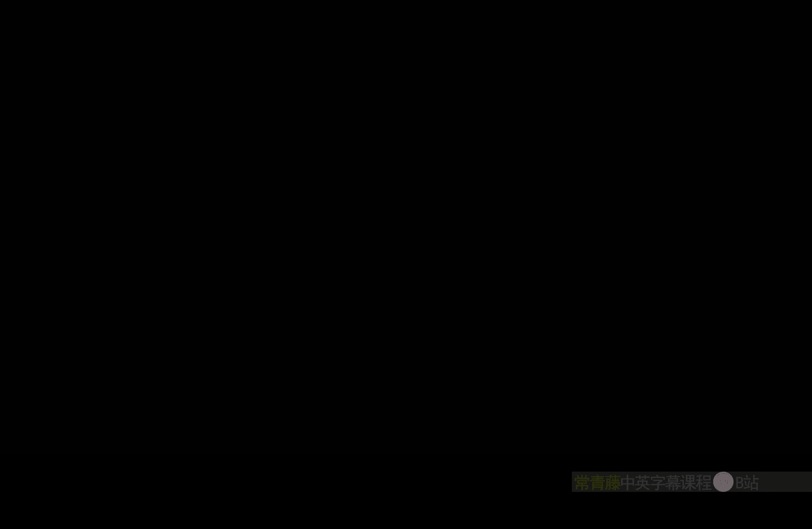
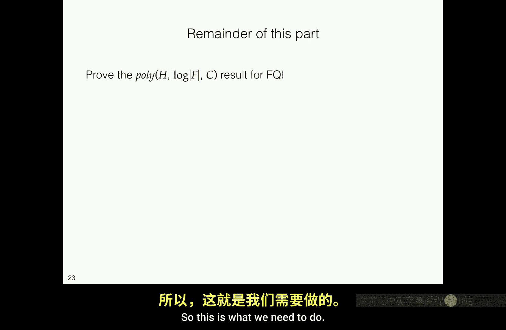
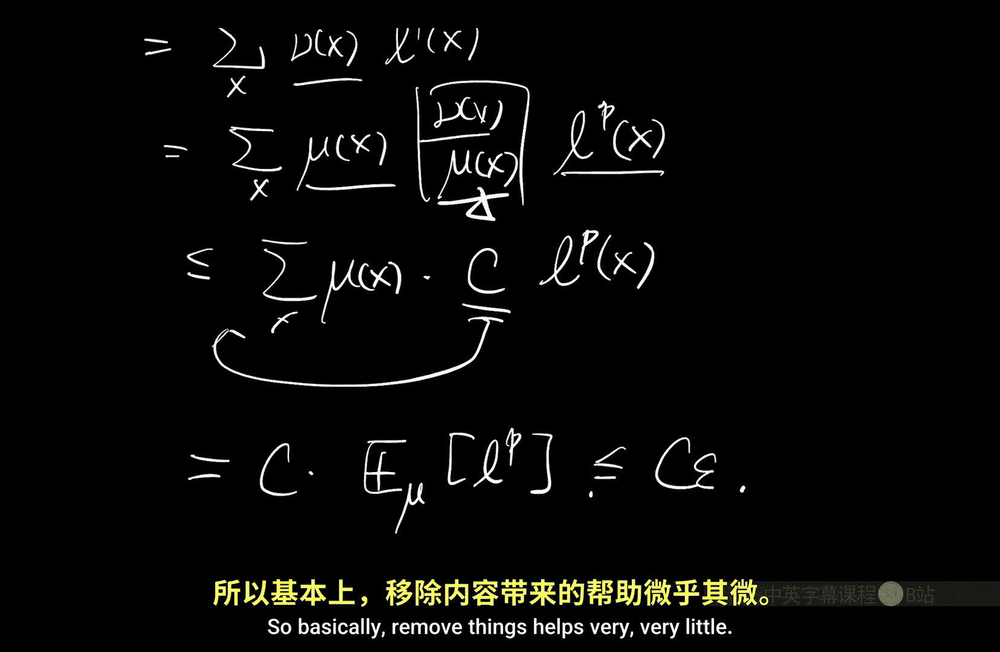

# 伊利诺伊大学【中英⚡统计强化学习｜CS542 Fall 2025, Statistical Reinforcement Learning】 p24 P24 拟合Q算法（续）（视角2） -BV1YsZHBZEyM_p24-

Okay， let's start。 So homework 3， right， was just released。

 Then you all should have a received canvas notification email。 Okay。

 and And let's continue where we were last week。 we， we talk about FQI。

 which is one of the most a very representative algorithm。 you know， if you like。That that。

 that is a good prototype to， is a good prototype to， to。

 to sort of study theoretically where the insights would apply to many dynamic programming based algorithm that people use in practice。

 such as Q learning， TD， D Q， N and all of these。Okay， so whenever you。Like。

 like in in empirical and deep parallel， you were hear of these terms like using the so-called bootsstr targets that refers to the fact that you use essentially refers to the fact that you use your current estimate to create these regression labels。

 right， you don't have a fixed regression label label。

 but rather use your current estimate to you know， create one。 and。

 and youre like then regressioning onto that。 Okay， anyway， so last week。

 we talk about the FQI algorithm。 And then we talk about is convergence that unfortunately。

 it has it can diverge even with exact reizability， infinitefin data， fully exploratory data。

 linear function class and just the policy evaluation。

And we it this example that sort of mimics function approximation。 And we see where things go wrong。

 right， So the key idea is that really， like FQ I is running a sequence of regression problems。

In order to mimic like the true value iteration， right， But then for each regression problem。

 your regression target or the ground choose prediction。

 the best possible predictor is the Belman update of the previous iteration of the function。Right。

 and that function。Right， so， so， you know， so basically， it's this function， right。

 So when you have F K -1， you use that to set up the label and you run this regression。

You would wish that your function class can represent that function。

 which is the true Belman update to that function。Now when your function class cannot represent that one。

 you're like。Your iteration， if your goal is to mimic that iteration， then that iteration fails。

Right，Because you're like， eventually you're gonna spit out some function in your function class。

 And like this function is not in your function class。 So you can never actually closely mimic value。

Right， and we see like that doesn't mean that the algorithm will fail or is guaranteed to fail。

 In fact， we'll see special cases later， but。But， but like， but we see like kind of example that。

 you know， it does fail sometimes， even under pretty strong assumptions。Right。

 and then so that's why， you know， for from now on and， you know。

 in the modern R theory literature for analyzing these algorithm for large in large state spaces。

 typically you will need these B completeness assumption。 right， So for any app in the class。

 you do a be update is still in the in the function class。And this is basically to guarantee that。

 like for each regression problem， you're solving your function class is always well specified。 that。

 you know， we said that， you know， each regression problem， you're predicting some， some y from x。

 right， So here our X is S A， R Y is R plus gamma max a prime。 you know。

 F K-1 and S prime is on so forth， right， So you have this regression problem。 And basically。

 what does it mean for your function class to be well specified， Well， you want to。

 you want to be sure that。😊，This is the optimal predictor。 Right。

 So we did that sort of a kind of a decomposition。 like last week。

 if you remember that whenever you run square regression。

 you can always decompose your loss as the sum between inherent label noise。

 that is something that is irreducible， right？ plus basically the distance to this optimal predictor。

😊，Right， so the best you can do is to learn this out form predictor。 And surely you will want。

 you want this function to be in your function class。

 or at least your function class should approximately capture that。😊。

And if you assume that assumption in the context of fitta Q。

 basically you get this Bel completeiness assumption。😊，Okay， so that's one thing。

Another sort of a way to understand why things could go wrong is that if you。

 if you look at what FQI does， right， So you have the。Yeah， you have the FQI algorithm， right。

 So whenever you do a regression， as we talk about， this can be written as like， if you actually。

 if you actually look at the expected loss。If you actually look at the expected loss。

Is equal to basically expectation。 F minus T F T -1。Square plus like somely noise， right。

 So you do that decomposition， right， And， and then when you do in general。

 when your function class does not contain the optimal predict， which is。Which is this guy， right。

 then， but still you're trying to approximately like minimize that， minimize that the first term。

 right， you're， basically， you're， you're still trying to find the best approximation of that function within your function class。

Okay， so that operation that you find the best approximation of something within like a limited class can be viewed as some kind of projection。

😊，Okay， because in general， if you think about。呃，后来。So this is a projection operator。So basically。

 because like if you geometrically， if you think about what does projection mean， right。

 So when you have a like vector or a point， what does it mean to project onto a space or a subspace。

 right， So basically， like when you projection， basically you're saying within all the vectors。

 red vectors。 that is within this given space。 I'm going to find one that has the least distance from you know。

 whatever you're trying to project right， So that's one interpretation of this projection operation。

 And as you can see， like we're basically doing the same thing， right。

 within all the functions that I can represent within my function class。

 I'm trying to find one that is approximately closest to the true button backup。

 So that's a projection operation。 Now， one thing about projection that is usually that is typically like a good thing is that projection generally is it's not necessarily a contraction。

 but it's a non expansion。 in the sense that if you have two different。😊。

Two different original points，Right， so you have two different original points。

 Let's say you both project them onto the same subspace using the same distance measure。

 Then what happens is that the distance will not in increase。Okay。

 so this would be most obvious if let's say you actually just simply rotate the coordinate system so that let's say。

 let's say the subspace you're projecting onto is just like， let's say the X。

 Y axis with like Z always equal to 0。 right， So when you do the projection， Basically。

 you're just removing the Z coordinates。Right， but like， like this project， like the。

 the usual project we're familiar with， this is projecting according to Euclidean distance， right。

 So what is the Euclidean distance， Well you just take the difference on each coordinate。

 square them and sum them up， right， and take square root。Right。

 but when you just remove the Z coordinate， your distance， just， you know。

 you just drop a term in the Euclidean distance， right。

 So Euclidean distance can never become becomes larger after this projection。So， so this is like。

 if you think about this is similar to the notion of contraction。

 or if you extend the notion of contraction， This is a contraction with a coefficient one， right。

 But usually we only call it a contraction when the contraction coefficient is less than one。

 which means that you're guaranteed to bring points closer。

So here is the sort of seemingly like contradiction。 that is。

 we know that T is a contraction with coefficient gamma， which is less than one。Now。

 when you compose it with another operator， which does not expand。

 or it seems like when you combine them together， they should still give you a contraction。Okay。

 there's。Does， does anyone know like what's going wrong here。

But the the actual problem is that when you compose them and treat the here what we call the projected element operator。

 which is essentially what you get。 If you run F I with infinite amount of data。

 this operator as a whole can be an expansion。 right， That's what's causing， for example。

 that exponential divergence we see in those counter examplesles。Okay， so it's definitely like this。

 this combined operator is definitely a。Not a contraction。However， with we just had the argument。

 right。 So if you have a， like， if you have a contraction and you compose it with a non expansion。

 it should still be a contraction。RightAnd in fact， you can actually prove it somewhat。 like。

 for example， if you have A and B。 let's say one of them is a contraction and the other。

 let's say B is a contraction。 A is a non expansion。 Then you can say， okay， let's apply them to F。

 right， and versus B F prime。 and we measure at a distance。 Well。

 this is less than or equal to we know a is a nonex， right。

 So when you have two different things and you apply a to them。

 then the distance should not increase， right， So you have B F minus B F prime。

 And then you use the fact that， for example， if B is gamma contraction。

 you get F minus F right So so therefore， if you have non like the general result is that if you have a different operators。

 that each has their contraction coefficients。 when you compose them。

 you can just multiply those coefficients together。😊，Right。

 so that will give you the final contraction coefficient。 So why does。

 why does this result doesn't apply here。Does anyone see the problem。So who， who， who is saying。

Because of art， no， are you mean reward or。No， it has nothing to do with reward。Okay。

 let me ask you again。 So I intentionally write things pretty vaguely over here by just writing some norm。

Can someone remind me， wish under wish norm is Belman operator a contraction。It's infinite norm。

 right， but here when we're doing projection， what kind of distance we're using。😡，Well。

 we're it's not exactly Euclidean， but it's close。 We'll see it like basically these kind of squares。

 iss kind of like weighted to norm。 It's a weighted version of Euclidean。

 If you have finite state action action spaces。 And if your data distribution is uniform iss basically Euclidean up to like a scaling factor。

 right， So， so， but， but your intuition is right， that this is something that is more similar to Euclidean。

 actually we will exactly define the corresponding norm here。

 maybe not today or either today or Friday， but it's not how infinity， right。

 So the proof that I just gave you that。😊，That since come contraction coefficients compose nicely。

 This only works if your operators are contractions under the same distance measure。

So the problem here is the mismatch in the norms under which there are contractions。Okay， so the。

 the， the projection， which is implicit in algorithms like Fi Q or any dynamic programming or TD like algorithm that uses square losses is using an L2 like projection。

 So it's con it's now expansion under L2， but it could be expansion under L infinity。

And the T operator is only contraction under L infinity。 Okay， so we compose them together。

 Nothing can be said。Okay， now here is something interesting that gets connects to our previous results。

 So there are some special function classes F such that projection is actually L infinity non expansion。

😊，Okay。So there's already some hint on the slide。 But can you guess when you're doing regression。

 or when， when you're just， let's say you have some data it's not even data， right。

 So you have a function， okay。And you say， okay， I'm gonna do projection onto some function space by saying。

 I want to find of whatever function there in that space that is closest to me。By some kind of。

 you know， weighted square error， like， for example， like expectation。

 S A is following some distribution mu F minus， right， So you treat this as a distance measure。

 This is essentially the distance measure that you know， F Q I uses， right， you， you。

 you find like for whatever F you want to project。 you find F prime in the function class such that the square distance is like the smallest under some。

 you know， data distribution。😊，Okay， so there are special function classes of F such that this this projection operator is actually L infinity contraction instead of L 2。

😊，Pizzized costa， exactly。Okay， because like， see like what piecewise constant does， right。

 So if you have， when you're projecting something onto a piecewise constant。Right。

 so what you do is that， let's say you have this grid up， like， you know， you know， aggregations。

 And let's say you have an arbitrary function， right， But when you project， basically。

 you're doing some kind of like weighted average within each grid。Right。

 when you have another function， you're also doing a weighted average。

Right and and using exactly the same ways within each grid。Right， and when you do L infinity。

 basically， you just need to look at each grid separately， right， But the L infinity。

 like when you measure the distance between the original functions。

 you're looking at what's their maximum difference， right， But after projection。

 the L infinity error is basically like these average value is what's their difference。

 And it's very easy to show that when you take weighted average。

 the difference cannot be larger than， you know， the original maximum difference。Okay。

 so this is one way to understand that very counterintuitive result we mentioned earlier that when you use Q star relevant abstractions。

 even if your model gives you nonsense abstract dynamics， it still， you know， converges and。

 and gives very good guarantees。 Well， this is one of the reasons。

That whenever is piece wise constant， this projection， like the regression related projection。

 actually turns out to be an L infinity contraction， non expansion。

 So then that composes with the Bel operator very， very nicely。😊，Okay。

 so we'll see another like a special case later on。

 I think that will be on Friday where there are some special cases where the。

 the norms of these two the norms under which these two operators are contraction and nonex actually match with each other。

 And， and that also Es stable stable result and guarantees。 But not for now。😊，Okay， so。So this is。

 we're talking about you know， why in general， you can fail and the necessity of not necessity。

 but at least it motivates introducing this assumption。Okay。

 so one interesting fact is that if you have a finite class。

 you don't need to separately assume realizability。 That is your function class can capture Q star。

 The spellman completeness itself already suffices。😊，That is， if you have this assumption。

 you will immediatelyly get that Q star is in the function class。Can people see why。For Q star。😡。

But that， well， I think you're using a circular argument。 You're saying， well。

 if Q star is in the function class is spellman update is in the function class。 So dis satisfy this。

 Now， we're doing the other way around。 Like， we don't have Q star F to begin with。

 All we have is this assumption。 But we want to show that this implies that Q star is in F。😊。

So you can't use the fact that Q star like， you can't use the fact that Q star is the fixed point of T to。

 to prove anything。Yeah， yeah， right。 So basically。

 what happens is that you can conceptually run valuation， right， if you start with any F。

 if T F A is in F， well you can treat T F as the F here。Then what T squared F is in F。T cube a F。

Right， so basically， you start with any EF， you apply the above operator arbitrary number of times。

 That function should still stay within the function class。

 What happens when you apply the operator infinite number of times。You get Q star， right。

 because this is conceptual evaluation。 We're not really running any an algorithm。

 It's just using that idea of the algorithm to， to prove the existence of。

 of Q star membership of Q star in the function class。Okay， now to actually write it properly， like。

 you know， the rigorous math would look like something because you can't like， like。

 if you think about it， like these things， if you're。

If a sequence of function all belong to a function class without making some assumption like compactness and and all of these assumption on the function class in general。

 you can't get that the limit is in the function class。 Okay， so like。

 if you actually want to prove this rigorous。 you have to be a little bit like， you know， careful。

 But for finite class， one thing you can do is to say， okay， I can get an arbitrary function， like。

 I can get a function that is in the function class。

 and arbitrary close to Q star because I can just like raise up the number of like iterations I use。

😊，Right， and then you can prove by contradiction。 Let's say， okay。

 let's say there's no Q star is not in the class。 but this is a finite class。

 So I just find the best approximation of Q star。 Then that guy will have a certain distance to Q star under L infinity error。

Right。But then like by doing this with enough number of iterations。

 I can prove that there always exists a function that can be arbitrarily close to Q star。Actually。

 lower than the best error that I just assumed。 Well， that caused a contradiction。

 So it must follow that， You know， true Q star is in the function class。Okay， just that， you know。

 like in this class， I think I've been pretty hand waving about like taking like limit to infinities。

 for example， And， and sometimes this is justified。 for example。

 when we talk about the sum of you know， whenever we talk about sum of discounted rewards。

 you know some of you know， gamma to the gamma to the T， like P pie to the T， all these quantities。

 I just handwa all of those。 those are pretty easy， because you know that when。

 when you have these like exponentially decay discounting， you have very nice and strong like。

 you know， convergence properties， you know， from callus so on。 But but so I've been hand waving。

 But you know， when you actually write these proofs， you actually have to be， you know。

 rigorous and careful。😊，Okay。Okay。And here is another interesting fact。 And this is， in fact。

 your next homework question。If we actually focus on function class F， that is piecewise constant。

Baman complainness is equivalent to bys simulationimulation。Okay， so in this slide。

 we actually considered like like essentially， you will see that whatever we learned over here actually have all their correspond like counterparts in the state abstractstruction setting。

Okay， so this is left as a homeworkr question for you to actually figure out。Okay。And in fact。

 if you remember， like we， we essentially proved some kind of like like。

 or at least something related to this， right， So we proved that when you have by simulation。

 doing running value in the abstract model is equivalent to runningval in the original model up to lifting。

😊，Right， and how do we prove that， We say， oh， if you start with the arbitrary function in the abstract model。

 you do either one Val number here， or you can lift it and then do do a valid。

 Well basically by simulation， what it gives you is that after one it。

 the resulting function is still piecewise constant。😊。

Precisely because of the by simulation conditions。 So basically， that gives you the one direction。

 That is when you have by simulation， the resulting function class is beman complete。

 That is actually the easier。 the easy side of this proof。 The other side is a little bit trickier。

 but， but that's left for you to figure out， okay。Okay， so。嗯。

The other thing is that it's not true that even if you add the Bel completeness assumption。

 that the algorithm will empirically converge。 Okay， so that's not necessarily the case。 So here。

 I guess the word converge is misused and abused in the literature and it could be different things。

 So， for example， like whenever your algorithm has like say finite sample guarantee that says like when the number of data goes to infinity or when the amount of computation goes to infinity。

 you get the right result， oftentimes we call that convergence， right。

 But here I'm not talking about that kind of convergence， I'm talking about like， for example， like。

 when we do planning， when we doeration， like when we run infinite number of iterations。

 we know that you will converge to something right。

 and it happens to be the case that something is the right answer。

 But at least you reach a stable solution。Right， and in previously， when we see the counter example。

 when you only have a realizability， but without government completeness， you can actually diverge。

Right， so here by converge， I mean， actually a very basic。

 pretty like the seemingly pretty basic requirement。 that is when you run fitta queue。

 like on data for， you know， a lot of iterations， at least it becomes numerically stable。

 And eventually， when you run infinite number of iterations， it。

 it gives you something that is like a fixed answer。O。

 it turns out that it doesn't even necessarily do that。Okay， however， if you have bump completeness。

 it's guaranteed that when you have enough number evaluationerations。

 the result will be reasonably close to the， to the， you know， the true Q star。 even if the。

 the numerical solution you get is still iscillating。 Okay， so that can still happen。Okay。Okay， so。

 you know， this is basically back to this example when it kind of illustrate like how completeness fix this issue。

 Right， So like previously， we have all these like error amplification， exponentialonation over time。

 But if you require say， I need completeness。 Well， what it means like in this example is to say。

 I'm gonna pretend that whatever you can possibly predict at the next time step。

 I'm gonna pretend that is gonna， is the ground truth。And then I will say， okay， if。

 if that's the ground truth， which should I predict at the current time step。 Okay。

 so that those kind of functions I need to be able to express in my function class， right， So。

 for example， at for at this time step， if you can either report。5 or  point6 to 8。

 So these are candidate Fs in your function class。😊，Right， and I say， okay。

 let's do Belman backup or Bel update of these functions。 One step for， you know， earlier， right。

 And here because， because transition is deterministic and there's no intermediate reward。

 There's no discounting When you do Belman back is basically copying the value of whatever you predict that the next time step。

Right， so therefore。It requires that， you know， if， if you。Sorry。So if you have B complains。

 itll be required that if you can predict like whatever number over here。

 I should also be able to predict whatever number in the previous time set。Right，And as you can see。

 if， if that's the case for whatever time step， when you do that， you know。

 when you do the regression， at least in this time step， error will not amplify at all。😡，Right。

 so you won't have that， you know， like previously。

 the reason air error amplifies is that you can only choose between these two guys and they look equally bad when you have the run answer for the next time step。

So you may end up choosing like an even more wrong answer。Right。

 so it turns out like what happens over here is that you want to pretend the wrong answer you have for the time step。

 Next time step， as if it were the correct answer， you see whatever I've learned over there。

 I know it may be wrong。 But let me pretend that it's correct。 And ask myself， which should long。

 what long term value should I predict at the earlier time step， Even if my prediction over here is。

 is not a ground truth。 I'd rather predict that one。Okay， because that avoids error amplification。

Okay， so this is how now Belman Company is。Helps you。Right， but on the other hand。

 like this complete this assumption is a。You know， if you compare it to what。

 what we're used to in standard supervised learning， right。

 Supervised learning is like almost like compared to this is way more straightforward， right。

 So you want to learn a function。 Well， your function class better express that function。

 That's it like basically， like straight up realizability or it's a approximate version is the best you can hope for。

 the the， the， the strongest thing that you ever need。Right， and what like typically。

 we don't really appreciate that。 But， but a bunch of things we're really used to doing machine learning are are really like connected to that。

 right， For example， whenever you're underfitting in， let's say you're。

 you're underfitting in a supervised learning problem。 What do you do。What do you do。

You increase number of parameters or you use a richer function class， right。

 Give your neural net more layers， give your neural net like wider， like， you know， larger width。

 right， Because you know that when you， you like when you view that from the view of function class。

 it basically means that you're using a strictly larger function space， right。

 like it's not get if you're lucky， you can maybe capture the true function over here。

 you reduce underfitting。 But at least it doesn't hurt right in terms of expressivity power。

But here is the weird thing， if you require be completeness。

 that kind of common sense knowledge we're so used to in supervised learning no longer host here。😡。

Right， because in the finite horizon setting， as we're not talking finite horizon。

 But let's say in the discounted setting， you just have one function class， right。

 because we're requiring this closure assumption， right。

 So if your function class doesn't satisfy the closure assumption， you say， okay。

 why not why not let's try to increase it and make it bigger。Okay。

 that doesn't necessarily help when it can actually hurt。 because when you use a。Let's say， the the。

You know， for this relevant complete assumption。 Well， when you use a richer function class， Yes。

 you capture these guys better for the Fs in the old class。 But you also increase this one， too。😊。

So now you have some new functions that says， okay， please also realize my TF。😡，Okay， so in general。

 you get this non mono autoousity。 That is when you have a function class。 that actually。

 there is very simple counter examples you can show where you can have a smaller class that satisfy B completeness。

 Or as you can imagine， let's say， let's just add a new arbitrary function to it。😊，Okay。

 now that new function T F needs to be realized， but it may not be in the class。Now。

 yourbel convenience is broken。Okay， so you have this non monotonity。 So which， which causes many。

 you know， problems。 Like， for example， like if， if you know you're underfitting。

 if you know that your function class is not expressive enough。

 it's not even completely true that you can simply increase your function class。

 and that is guaranteed to help。Okay， and as we will see later。

 I don't know how much of you watch the the talk when I was away。

 but the difficulty in offline model selection in R is also closely tied to this problem。O。So。

As we see， like a lot of the， okay， and and this part is actually like expanded version of like when I quickly went over in the talk。

 But， but let's go over here anyway。 So as we have seen here so far。

 almost all the difficulties and troubles we've had with Fi Q is due to its iter iterative nature。

Right， because it， you know， doing this， you know， iteratively。

 And now in the function approximation setting， you can just do bump an update。

 which is a nice contraction。 You need to inject these， you know， projections which correspond to。

 you know， regression onto a given function space that can cause all kind of divergence instability and so on。

 So， and， and furthermore， we talk about this like， you know， it's。

 it's not like like standard machine learning where you just have a fixed objective function。

 you estimate from data and just minimize it。😊，Okay， so it's not like that。

 So if we can write down a fixed objective function for learning value functions， thatll be great。

 right， because that will solve all of these problems。 because if you have optimization。

 then while you just please optimize it， right， And at least like when you're not optimizing it。

 you can just see that your objective function is not doing well。

 Maybe you can restart or whatever using your optimization trick， you at least you， you， you。

 you don't， you don't run to in run to run into these conversionvergence issues。😊，Okay。

 so here's the alternative， which is to say， let's try to write down an objective function。

 And a very natural one is this beman error， right。

 because we know that F is the fixed point of Q star is the fixed point of beman operator。 That is。

 if F equals T F。😊，This holds on every single state action here。 It must imply that F equals  Q star。

So it's very natural to say， okay， how about we just check whether a candidate function to what extent it violates the Belma equation。

Let's turn that into a loss function。😡，And then minimize that。😡，Sounds great， right？

So well we still have to define what this norm is， but let's develop a little bit further。Okay， so。

 so here's the thing right？ So while whatever you do， you have to do it based on the data。

 it has to scale to large stay spaces， which is the focus you know， in this section， right。

 So therefore， like whenever you're measuring distance， Well。

 forget about like infinite norm and so on。 right， So likely you will still use something like the square loss。

 you know， expectation of square square error on data， something like that。

 which is much more data friendly and， and then also friendly to large stay spaces。

 So let's try that， right， But the other thing is that you don't have the true be update， right。

 because the true be update requires knowledge of the transition probabilities and the reward function。

 mostly the transition probabilities， which of course， we don't know。😊，Right。

 but we do know is that this you know， what we call empirical phenomenon map date。

This is an unbiased estimate of TM。Right， so maybe you can just use that。 Right， So。

 so this is maybe like the best。Effort you can do to come up with something that try to estimate this guy based on data。

Right， so F correspond to F here。 This is the onbi estimate of T F squared that。

 And this is your loss function。And if you remember。

 this is basically the loss function we talked about last time where you say， okay。

 when you actually properly implement FQ I， you need a stop gradient over here。Right。

 and that sub gradient is what causes like like the， the， that this hosting is not a like。

Single well defined objective function， because every time your F updates， you know。

 your objective function also updates， right， But here， essentially。

 this is saying that I'm gonna pass gradient both over here and over here。RightSo what's going wrong？

Or what can possibly go wrong。Okay， so let me just tell you the answer。

 So what you can do is that you do exactly that kind of error decomposition as we did before， right。

 You just pretend this is y， this is X， right， You decompose F X minus y square into F minus the best possible predictor based on S square plus this part is corresponding to like inherent label noise。

😊，RightSo this part is the randomness due to random reward and random next state that you could not have predicted when you only know S and A。

Right when when when you only know S and A and trying to make a prediction from there。

 the best possible prediction you can have is expectation of y given X， right。

 which is which is the true Bel update。O。Now， as you can see， so this loss， the。

 the first line is the loss that you can easily estimate from data， right。

 It can be decomposed into the sum of two terms where the first time is exactly what we want。Right。

 it's the difference between F and T F。It's the vi。

 It's a good measure of violation of bomb error on the data distribution。Okay， so this one is nice。😡。

Nat， is a weighted too normal， we'll define that later。But this one is problematic。

Because we have an extra term。😡，Now， remember， like in supervised learning。

 we also have this extra term， that inherent label noise， right， So it's y minus， you know。

 in supervised learning， like this term corresponds to y minus E， Y given x square expectation。

But in supervised learning， we never run into this problem。 We ignore that。 Why is O。

 is it okay to ignore that one。😡，Like in supervised learning， like in regression。

 you have this conclusion that basically the inherent label noise doesn't matter。

Like when you just minimize the square loss as a whole。

 you're essentially also minimizing the distance between your F and the optimal predict。

 which is expectation of Y given x。Why is that。这。Noise is 0 min。 No， like， so here， basically。

 whatever noise Y is there in the data by comparing it to the conditional expectation is's always 0 min。

 Its not the0 main problem。 Like this guy， this guy minus this。 This is also 0 me。

It's not a zero main problem。So in supervisorvised learning。

 you can just minimize the total square loss as a whole。 right， You don't need to care about to say。

 oh， there's part of my loss that correspond to inherent label noise。Actually。

 I would like to get rid of it。 No， you don't want。 you don't need to get rid of it。

 Opimizing the whole is equivalent to optimizing the distance to the best predictor。

So what's the why can we do that over there。Right， so because that term ancient wise learning。

 like why is fixed and y is more importantly independent of your predictor F。😡，Right。

 so when were optimizing， what are we optimizing， We're basically choosing different predicts F。

But whatever app you choose， that inherable noise doesn't change。😡。

So it's a constant in the optimization objective。So whether you have it there or not having it over there。

 it doesn't matter。 We can just， you know， forget about it。Right？Now why things go wrong here？😡，Well。

 this Y depends on your F。😡，I see， like， this is the key problem。 Like， because this guy plays the。

 plays the role of y， right， But Y has F in it。 When you choose different F the。

This extra term is not constant with respect to your model parameter， like to。

 to the parameters you' are optimizing。😡，RightSo only when it's a constant， then you can see， oh。

 minimizing that， which I can estimate from data， is equivalent to minimizing this guy。

 which is what I actually care about。😡，But now this term is no longer constant。

 so you can't ignore it。😡，Okay， and in fact， if you look at this behavior， like。

 like they actually really want like flat F because then when you have， because this term。

 apart from reward randomness， the major thing that's causing trouble is the randomness of the variance of F with respect to the next state transition randomness。

So if your F is relatively flat， this term will also be will be small。

 but that doesn't mean that your F is actually good。 Your F is， you know， close to Q R。

 It could very well be that QR will have this term， basically 0， but it can have a pretty large。

 like second term。That's okay。 Like that's， that's the solution we want。

 But if you minimize the sum of these two terms as a whole。

 you're not really choosing Q star as your optimum solution。Okay。Now。

 there is one setting where this is not an issue。 This is the setting where when have deterministic transitions。

Okay， so if you have deter transitions， then there's the reward error。

 but the reward part basically doesn't matter because see， like the reward doesn't depend on F。

So the reward error part pretty much behaves very similar to the supervisor learning setting。

 So you don't need to worry about that。 Really， the thing is that you want to like， if。

 if S prime is deterministic， then like， you don't really have this trouble anymore。

 And it it's actually okay to like， minimize like the bone error， like estimated from data。Okay。

Now in the stoastic general stochastic setting， there are workarounds of this issue。

What around number one。It's called double sampling。 And， in fact。

 it's precisely because of this work round that gives name to this issue。 Nowadays。

 when we refer to this issue， we often call it the the double sampling problem or the double sampling issue。

 Okay， the the reason is that when it was first identified when the issue was first identified in thing was 1995 or 96。

 the paper proposes double sampling as a solution。Okay， so what it does is to say， okay。

 for every S A that I see in the data， I request two I I D copies of R N S prime from the same as A pair。

Okay， so， I'll give you the solution and we see what it does。 right， So previously。

 we only have one copy。 What we do is that we take the F difference between F and the empirical button update and square it。

😊，RightNow that square， you can expand it to the same times the thing itself。Right。

 now that we have a second copy。 What it does is that you。

 you use one copy over here and use a different copy over here。

So what it does is that by using two independent copies， you basically eliminate the second term。

Okay， and， and this is something that actually， people also do in supervisorvis learning。

 So this is what I learned from people like， you know， back into the haze where like。😊。

Like before the era of large language models， when you want to get some label data in supervised learning。

 what do you do。You send， you set up tasks on Amazon mechanicalical Turk。Okay。

 so basically you send to human labelers and， and human try to label your supervised learning tasks。

 Okay， but。We know that for some task， like， you know， humans are not perfect。 They make errors。

Right， so maybe there's a task that should be。Perfectly solvable。 But like。

 maybe human will make errors。Now， how do I know how， like how much， how do I know like。

 how much error are there。Right， so heres what people do on mechanical kindical Turk。 That is。

 let's say I'm doing image classification for a small portion of my data。

 I will send the same image to two different people。Right， so basically， that's getting like。

 if you use supervised learning analogy。呃， 하루。What happens is that previously generally you just have X and Y pairs。

 right， image label， image label， image label， What you now do is that you say for the same image。

 I ask two different people。 And mathematically， you can model that essay say。

 I'm drawing to I D wise condition on the same X。Right， and what's nice about it。 Well， like what。

 like， it really helps answer like a very critical question when you run supervised learning， right。

 So suppose you run deep learning and you get a 95% accuracy on your data。😊，Okay。

 there's still 5% accuracy loss。How do you know， And in general， you never know。

 How do you know that 5% is still room for improvement that you can actually hit like 100%。😡。

Or that 5% error is human random labeling error that is irreducible。Okay， so basically。

 it's like when you did do that decomposition， like we said regression。

 but like a similar decomposition holds for classification， too， like you， you。

 you can basically decompose your error into those two terms。Well， like， you know the total error。

 you've observed that on hold out validation data， But you don't know how that decomposes into those two terms。

 Is it that your predictor is not good enough yet， or is it like， that's just like label noise。Right？

By doing this， you can tell that， right， Because what you can do is that for whatever your current predictor is F。

 you can do F， X， Y time， sorry。Times F， X minus y prime。Okay， so when we take expectation of that。

 what you can do is that you can first condition on X。😡，And then law of total expectationedation。

 take expectation marginalize out X outside， right， So when you condition on x。

 everything that is the function of x is deterministic。 So F X is deterministic。

 F X is deterministic and Y and Y prime are independent， given X。

So when there are independent random variables。😡，Expectation of product is product of expectation。

 So you can take expectation of them given X separately。 So both of them give you E Y given X。

 So you immediately get E。F x minus E Y given x。And we say that this is the best possible predictor you can get。

😡，RightSo therefore， like this error that you measured immediately tells you like the true error of your predictor。

😡，It basically get rid of that inor label oyster。😡，And it's a similar story over here。😡。

By doing like two independent copies by exactly the same math。

 you can show that the expectation of this loss is exactly equal to the true bemanaire。Now。

 the problem of this is， of course， you can only get two copies if you have a simulator。Okay。

 so if you're running R， like on some。Like real data。 you can't do this。 And even in a simulator。

 and this is getting down to a big rabbit hole， like。

 I would claim that and a lot of people gloss over this issue。

 I would claim that no one really knows what's the right way to reset to a state。 Okay。

 so that's a bold claim。 And if you are interested， you can ask me afterwards。 I wrote a。

 I wrote a paper that I tried and never got published。 it's。

 it's a very weird issue and get to some philosophical level of things。

 but it also has some practical implications。 but I'm not going to for details here。

 so this is the first workaround and there's a second workaround。😡。

That doesn't require recess or double sampling。Okay， so the second workaround is more ugly。

 which is to say， okay， we know that this second term is annoying。

Let's just estimate it and get rid of it。Okay， let's estimate the second term。

 subtract it from the left hand side of the equation， which is wokeane estimate。 and we're good。

 right， Now， what's the second term， Well， the second term is basically， what。

 we said that this is the label noise。 okay， I'll just give the result over here。

 So what you do is that you use a different function class G。 and try to do the regression over here。

 right， So you can see if you see it， this G is essentially trying to do a fitted Q update。😊，Okay。

 however， instead of actually doing update like in Fi Q， we care about the arguing of this thing。

 right， We just care about what this function is because it's supposed to mimic the true Belman update。

But here we don't care about the argument， we care about the main value。😡。

Because when you're making your best possible prediction， this guy G is equal to T F。

RightBecause in this regression， your best predict is TF。So when G is ETF。

 well that's just the seconder。😡，Okay。So then you can subtract this from the first logs。😡，Right。

 but then this whole thing over here is a well defined loss function for F。

 So you still need to minimize over F in front of it。And when you write down the whole thing。

 expand the whole thing。 You have min over F。 You have minus M over G。

 So it's actually M over F max over G。 So it's actually a mini max objective function。Okay。

 and what it does is essentially it explicitly estimates this term and subtract it from the biased estimation of B error。

Okay， so， so this is the writing it down in the form where M of F max over G gets pulled outside。

 It looks monstrous。 It， indeed is。 Okay， and this is pretty crazy。嗯。So。But now like if， if you。

 let's think about， you know， what kind of condition do we need， right。

 So we introduced this second function class。 So we have the first function class F that is whose。

 whose work is just to trying to represent Q star。😊，Right， so we say， like at the minimum。

 you need a realizability in that first function class。

 because eventually you're gonna spit out a function in that function class and you want it to be Q star。

 right， So at least you need real for that。But now we have the second function， right。

 We have the second function class G， right， What's is job， Well。

 is job is to do this regression really well so that you can actually get to the base error rate。

 right， So get the best possible rate， which is equal to the inherent label noise。

what's the requirement on this G class？😡，Well， this G class should be well specified for this regression problem。

And which means you want G to be T F。 So T F better lies in the G class。Right。

 so you end up with this。Assumption that G needs to contain T F for all F。Okay， so what。

 what does this remind you。But what what condition we talked about for fiQ。Comleness， right。

 So complainness also has this for all F。 I want to capture T F， right and。And， in fact。

 if you let G equals F， let's say you use the same function class for both rows。 What you get。

 you get exactly Bel components。Right， for any EF， I need T EF to stay in my functioning class。Okay。

So this is a like very different angle。 But like somehow。

 like we take a completely different approach。 We try to write on a consistent objective function that you can minimize for R L for learning value functions based on transition data。

 And we try to analyze， you know， under what condition is the estimation。

 like a good consistent estimation of the bow error。 We end up like getting bow completes again。😊，O。

Okay。So。You know。I think the， the plan is that we're gonna， you know， motivate something。

 motivate all the。 So okay， so the plan is that on Friday we'll do the analysis。 actually， you know。

 you haven't seen。Long proofs for a while。 So we'll do that on Friday。 But like， as you can imagine。

 to analyze such a general setting of large safe space function approximation will make like some assumptions。

😊，Right， and this in the past lecture in particular today。

 the whole point is that I'll actually help motivate those assumptions， put them in perspective。

 instead of like you expand those assumptions， you know， in front of you， right。

's like if you read a theory that like start with 10 assumptions that and the paper doesn't actually interpret any of them。

 you probably like immediately get lost right， So like and the whole discussion so far。

 like part of the purpose， is to motivate the about complete assumption， which will make later on。😊。

In on Friday in Friday's analysis。But it turns out in order to do， you know， generally。

 like in R L with function approximation， you know， R L in these like very general settings。

 typically， you need two very different types of assumptions。 Okay， one is you know。

 assumption on function class， which which we just made complete。Okay， now， again。

 like if you think about it， in supervisor only， it's simpler。 you just assume realability， right。

 And sometimes you can even be agnostic。 You don't even need to assume realability。

 but realability would it be enough。Right， and in a standard learning theory result， for example。

 the one we did back with Uni bound and and， and so on。

 you also need the control the statistical capacity of the function class。 right。

 If your function class is finite， you want its log cordality to be small。 If it' continues。

 you want it like V dimension and so on so forth to be small。

 we will also need that for this function class。 So that's the same。😊。

But then in a standard supervised learning setting， you don't need any other assumptions。

 You're done。 You can already go ahead and， and do your analysis。And that， like。

 that in like review is like a key difference between supervised learning N R。 Okay， so in R。

 we're not done yet。We still need to make a big assumption， but it's completely irrelevant。

 not not completely。 But so far， at first level， it has nothing to do with the function class。

 Can you guess what kind of assumption we do do need to make。Okay， so to remind everyone。

 So we're trying to analyze the， we could analyze that algorithm。

 but really what we try to analyze is the fi duration algorithm。Right， so。Right。

 so something like that， right， So you give me a bunch of data。

 The data is state action reward next day two holes。 And I have a function class。

 Now I'm happy to assume that my function class satisfies by my completeness。

 Now I'm gonna run this algorithm。 And I want to give a good guarantee for this algorithm。😊。

So where do you think。Are we missing assumptions。Data， right？ So in R real， like。

 that's the key difference。 You have this problem of data exploratoryiness， right？ Imagine。

 like as an extreme case。OrR data have their SA coming from exactly the same state action pair。😡。

That's a useless data set， right， What， what use it， What， how is the data good， if I only。

 it only tells me knowledge about a single state action here。 I need like some kind of exploration。

Right， so in the。In the tabtular setting， how did we enforce an exploratory data set。

What kind of data， what form of data did we assume there。Even split， right， So in the table setting。

 we require that you have even a relatively uniform number of samples per state action pair。Right。

 and we said that， okay， because of that， the sample complex in the tab setting。

 if you follow that framework， will at least grow linearly with the number of states because at least I minimally。

 I need one data point per state action pair。You can't do that anymore。Okay， sorry。

 you can't do that anymore because now we have extra large， even possibly continuous stay spaces。

You can't even afford to get a single data point。 every single state action here。 And， in fact。

 when you have these like very large， continuous state spaces。

 and let's say your MP is sufficiently stochastic。 chances are you can draw a very large data set。

 and you won't see exactly the same state twice。Every state is going to be unique。And， and in fact。

 even if they're unique， the total set subset of states they cover will be essentially a tiny portion。

 if not a measure 0 set of the entire state action space。What can you do？Right。And here's the thing。

 So， so clearly， we need some assumption。 Sorry， let's get to the part。 So clearly， we get。

 we need assumption on data。Right， in particular， the data distribution。

 how it covers the state space and so on and so forth。Right， so we want like， furthermore。

 like basically an extension of the idea that the data is looks like what we have in the tab setting。

 that it covers the entire state state action space。Okay。But what， what could it possibly mean， Like。

 how can we actually formulate that idea mathematically。😡，Right， for example。

 what tabar we know is relatively uniform over state space for abstraction。

 like it suffices if you have a uniform over the abstract state space because we actually aggregate data within each abstract state。

 So you want that every abstract state get enough， like， you know samples。😊，Right， but what could。

 what could it possibly mean， we really have large safe spaces and you have function approximation。

Okay， like， and one idea， people often come with us immediately。

 and especially like if you kind of people like。I would say come from a more like a cculus is background。

 You say， okay， how about let's assume that the state space is continues。 Let's say it's RD。

 And let's say our data distribution is like， say， a uniform。

 like relatively uniform density from that RD。😊，Okay。

 and I will tell you that without additional very strong assumption， for example。

 the smoothness of your dynamics over that space or something like that。

 that assumption is completely useless。Okay， so that's。

 and I remember we had a discussion after class。 It would say like， you know。

 when you have continue like， when you think about R L， think of it in this。You know。

 continues and you know， this kind of mindset is the wrong thing to think about it。

 if you think about it。 like we start with the planning setting。 when we're doing planning。

 were like you know， think about these like Mps state transition。 essentially it's a graph。

 Like really， you want to think of it is as a graph structure。

 which is like what's really important is like which kind of dynamics in this MP and which state are reachable。

 which are not and so on so it's just a brief intuition。 Okay。

 so here I'll just straight give you the definition。 Okay。

 so this assumption on data is it has a weird name that's get used less and less。

 somehow like early days mus and like made of this term called conability。

 Like who knows what that means。 nowadays we use a more general term called coverage。 Okay。

 so basically what you need。 So here is the idea。 so what you do is that so the X axis is schematic illustration of。

😊，St action space。 of course， it can be like really high dimensional。

 But here I'm just pretending that it's just one dimensional。 And you have your data distribution。

 So here for simplicityimp， let's assume that you， we。

 we have this simple data generation protocol say for every data point。

 I draw S A from some distribution mu and then we get the R and S prime from it。 Okay。

 so for a lot of settings like you can basically， if your analysis work in the setting when your data is trajectories。

 there are like different techniques they can use to basically do the same kind of analysis。

 even if you have more realistic data generation protocols。 Okay。

 so then this mu distribution over the state action space basically describes the quality of your data。

😊，And what you wanted to be。 Well， so here is what you wanted to be。 Okay。

 so what you do is that you pick any policy that you could end up outputting in your5Q algorithm。

 You know， like you can quantify that。 But for now， let's just say for any policy。

 you can then run this policy in the MP and look at its discounted occupancy。And in fact。

 we actually need， depending on the detailed algorithm and analysis tools。

 sometimes we need to look at this T step occupancy distribution。 If you remember。

 which is something like DT pi， right， So which means that you have a initial state distribution that you care about。

 And in fact， like this is important， like when we define this。

 your initial state distribution is important， because eventually。

 we're only gonna prove optimality with respect to that initial state distribution， right。

 because as you can imagine， when you have large state basiss。

 we said that anything that is infinite norm is not gonna work， right。

 unless with like very strong assumptions in the general case， it will never work。Right。

You can't guarantee that you don't make any mistake for every single state in the enormous state space。

 right， But previously， when we showed the optimality and everything。

 we all have like infinite norm guarantees。So that's not gonna work anymore。 So instead。

 we're gonna do is say， okay， we say that we're gonna have a particular initial state distribution。

And we only care about getting near optimal results under that initial state distribution。Okay。

 and then when we define coverage， when we say， okay， what kind of data do we need。

 we're gonna talk about coverage under that initial say distribution。Okay。

 so basically you have that initial state distribution， D 0。 and you run any policy pi for T step。

 You arrive at this T step， you know， occupancy distribution。 Okay， and roughly speaking。

 what you really want is that your data provides good coverage over the data distribution。Okay。

 and precisely what coverage means， well， what you do is that you can pick any SA。😡。

And then measure the ratio between the two densities。Okay， so basically， you say， okay。

 there will be some state action pairs where D T pi has a very large probability or probability density。

 But my data have put a relatively small probability density or probably mass over there。Okay。

 but that's okay。 as long as the ratio between them is not too large。

So the thing you want to avoid is that there will be some states that D T Pi wants to visit with very high probability。

 but it basically doesn't show up in your data。Okay， so as you can imagine。

 if you don't have any information about that state。

 you basically have no way to really know how well you know， how good pie is。Right。

 because for one thing， you wouldn't know like what kind of reward you would get in that state。Right。

 so basically， you cant then like just based on the data you have。

 you can't really form a good estimate of how good pie is。And if that's not possible。

 how can you reliably compare this candidate policy with other policies。Right。Okay。So， you know。

 more precisely like you can say， you can do。Max over S A like D T pi S A mu S A。

 And you assume that this quantity is less than C for any time step for any pi。

 So there are a lot of ways to relax this assumption。

 you actually explore some of them in the homework。 But for simplicity in class。

 We're gonna use like this very， you know， primitive version of， you know。

 naive version of this assumption。😊，O。So another thing I want to emphasize is that， you know。

 nowadays a lot of people are interested in L O Ms and in the context of R L， like， you know。

 there's R HF and4 L Ms。 And some of these coverage concepts become actually very relevant。

 for example， I'll give you an example。 So you know， probably a lot of you know that in R HF。

 you have the care regularization term， which says that when you start with a pretrain model and you do R L on it trying to improve it to on like。

 you know， a new specific task or do you do alignment。

You use categorreization to make sure that your model doesn't deviate too much from the original model。

😡，Okay， so one way to interprett it is also to make sure that your so what happens is like。

 for example， if youre doingH have， essentially either implicitly or explicitly。

 you have a reward function which is trained often based on data coming from the responses sampled from the base model。

😡，Okay， and because of that， your reward is mostly only accurate under the base model's response distribution。

 And if you've like updated your model to be so far away from the base model in that region。

 your reward model is not going to be accurate anymore。😡，Okay， so therefore。

 what you would want is that you like， for that reason， you also want your model。

 your your new policy to stay not far away from the base model。😡，Okay， and now most people think。

 and I think 90% of the people in the in the community think that the K L regularization is an effective way of doing that。

Turs out it's not okay， in theory it's not。 Well， in theory。

 you need to control these kind of things because， cause this kind of essentially like， you know。

 out of distribution generalization is exactly what this notion of coverage captures K regularization is the wrong mathematical quantity to。

 to study and to characterize， you know， you know， when when you have a， when you have a model。

 when have a reward model that is only a good underserv distribution and you。

 you gradually shift out of that distribution， you want to like， you know study， you know。

 how far can you go， Well， you need coverage。 You don't need k。Okay。

 so my my student Audrey Huang and a bunch of collaborators in MSR。

 They have a recent paper that I think I listed in the project reference that exactly， you know。

 theoretical discuss why K L is the wrong thing to do。

 Why something like this or is refined version actually gives you more guarantees。

 And we have follow up paper that actually try to mimic some of that through like inference time alignment。

😊，Okay， so so theres that。😊，Anyway， ignore the last sentence。 So we'll talk about like。

 well actually later give some examples。 And， in fact。

 you will see some examples in your homework where， like。

 you can say that where you will find examples where this， this quantity is probably small。

 even when you have extra large space space。O。So呃。You know， but， but for now， like。

 let me make a brief comment how it actually unifies with some of our previous analysis， right。

 So previously， if you remember， like， let's go back to the tableular setting， right。

 So we said that in tableular setting。 What we assume is that you have n data points per the action pair。

😊，Right， and eventually we have a result that is like， you know， one over a root M b， b， b， b， right。

 But N here is the number of data points per state action pair。Okay。

 so now let's try to write it differently， Right， Let's replace N with the total number of data points we have。

 So let's say we call that N。So one need to change。Like， it shouldn't be just n， right。

 You should like it should like this， this expression should still equal to one over small n。

 So what additional terms do you need do you need to add in order for this expression to be equal to one over small n。

You add number of states and actions on the numerator， right， S times a， right。

 square root like S times a over N。 N is like a total number of samples。😊，O， now。

It turns out later you will see like what our guarantee you will see in fitted Q takes the form of n over like the C parameter。

 like times blah bh，lah something else。😡，Okay， so this is the kind of guarantee we'll be able to establish on Friday。

Do you see the。Relationship。です。S times a here is basically playing the role of C， why。

 because in the tableular setting， because we assume the fully uniform distribution， essentially。

 our mu is just the uniform density。 So the properly mass for each selection pair is one over S times a。

Right， and we didn't really make any additional assumption the dynamics of the NDB or anything。

 So we don't really know what DT Pi could look like。But it's just the probability distribution。

 So if any of it like for distribution is probably mass on any single point， cannot exceed one。Right。

 so in that case， you can have a very crude upper bound on the coverage parameter。

 which is exactly S times a。Okay， so this is what you get， right。

 So basically like we're basically reintropreting some of the results we had in the tableular setting。

 like in this sort of new， more general framework。 And its indeed much more general general and comes completely subsum what we have before。

 because， you know， you can raw a queue over the tableular function class with that uniform data。

 it recovers you know， the， you know， what we did in the tablet setting。 So， so the results。

 the guarantees you know， should coincide with each other。 And indeed， like， you know。

 this is what you get。😊，Okay。So this is what we need to do。

 But let me first give you a quick result to as a sort of precursor to further illustrate why we need why we need the。

 the， the， the the， you know， why we measure。

Why we measure coverage in this particular form。 Okay， so to write it in a more general form。

 let's say we have new and new。 Both are distribution over somespace X。Okay。

 and let's say we have some function。 F， I guess F is not a good function。 Let's say， let's say L。

 you know， this represents some kind of loss function where L x is greater than equal to 0 for any x equal to 0。

Okay， and then we say。we know is that expectation。Under mu。L of x。Is。Less than absolute。Okay。

 so this is what what we know。 or more generally， we can say L P。 Let's say L to the to the P。

 for example， L， you can say， you can imagine this L could be that I have some predict I learned some predictor and it's distance to the。

 you know， best possible predictor is error is L of X。 for， for each input X。 Okay。

 and this P could be like two。 So then this is like a square loss on the data distribution on my data distribution。

😊，Okay， now what coverage essentially helps you answer is the question， if I know this。

 what can I say about the behavior of the laws？Our different distribution。Okay。So as you can see。

 like this is what I mentioned， is like essentially， this is like the kind of thing we study R L。

 like a very central bitdding R is very similar to， you know。

 the socalled out of distribution generalization in supervised learning right， or distribution shift。

 But in supervised learning， those are like you know， extension settings， you you know。

 deliberately study， But in R L， as you will see in analysis。

 distribution shift and out of distribution generalization is everywhere is inherent。 It's native。

 Its the very core of the whole R formulation。Okay， so let me quickly do this for you。

 And let's do a， a simple。So for simplicity， I'm going to assume x is finite。😊。

To make the point simple。 So we， we can just start with this， which is summation over x nu of x。

 So the probably mass LP of x。Right， so this is equal summation of x。 Eventually。

 this is the condition I have。 So the condition I have has the new distribution。

 so I can introduce the mu distribution so that I can later relate it to an， you know。

 the condition I have。 So I have new of x over new of x。 Okay， you already see this one shows up。😊。

Right， so I have LP of X。Okay， so this is upper bounded by。 Well。

 this is non negative because this is probably distribution。 This weight is also non negative。

 The loss to the power of P。 I guess P doesn't isn't important here， but just some loss。

 I also assumed it's non negative。 Okay， so this is actually important。

 Only non negative functions can be transferred under the coverage assumption for this reason。

 So I can just replace this term with is upper bound C。O， so muu of x times C LP of x。Okay。

 take C out。 This is equal to C times expectationation under mu L P。Okay。So now like。

 if you turn that into like norms， for example， you actually care about the square root。

 or typically which you do is that you would do like one over P， then。Then like eventually， like。

 you also do like a1 over P here， which is why like previously when I show you， like the。

 the result looks like a square root C over N。 And that's because we're using like a square loss。

 So we're like the kind of norm we're doing is always like L2 norm， two norm related。

 So so we're gonna actually have a one over square root over here。😊，O。That's it。

 And we'll leave all the difficult analysis to Friday， okay。That's it。

actually I was about to ask that whether we can really fool the assumption of about sea'cause it's a distribution and if normal。

 we can just remove the overly temper points。 and then we can just。

What do you mean by remove the like， for example， we the data set has a Well， so okay。

 so this is not a。So a few things。 One is this is not an assumption on the actual data set。

 It's the assumption on the distribution from which you draw the data set。Yeah， okay， right。

 So it's because we assume that your data comes from。 you have a distribution。 Like。

 think of it as more of like a continuous thing。 You draw some S pairs。

 every time you draw S pair from that continuous distribution。 And then for that S A pair。

 you get R and S prime。 Okay， that's first thing。 And second， you said something like， oh。

 you want to remove things in the data。 that that doesn't matter。 Like this。

 this one is one way It's okay to for your data to have extra things that D T like D I doesn't visit。

It it's only one way。 It's only that whatever D P wants to visit， you want to have it in the data。

So in some sense， like data is like like the more， the better。 So remove things， I mean。

Like remove things after you renormize things， you can increase probably elsewhere just ever so slightly。

 It doesn't really help address major issues。 So basically， remove things helps very， very little。

 Like you want to add things that are relevant。 But， but the data is just that。

