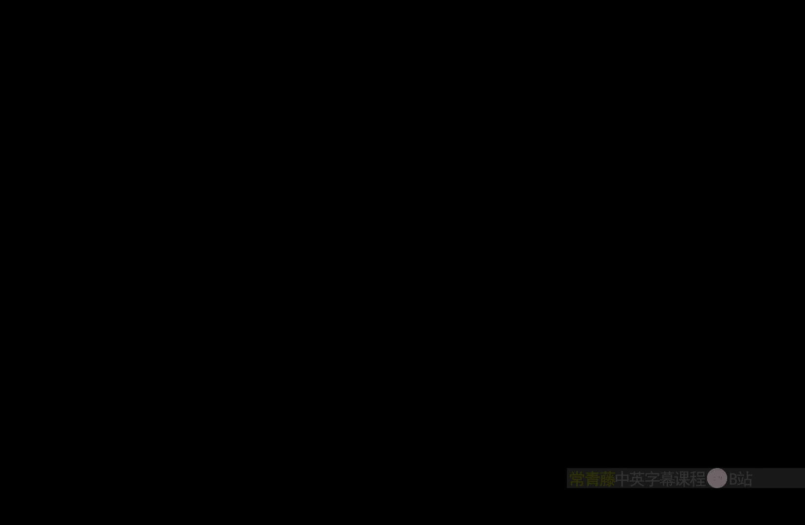
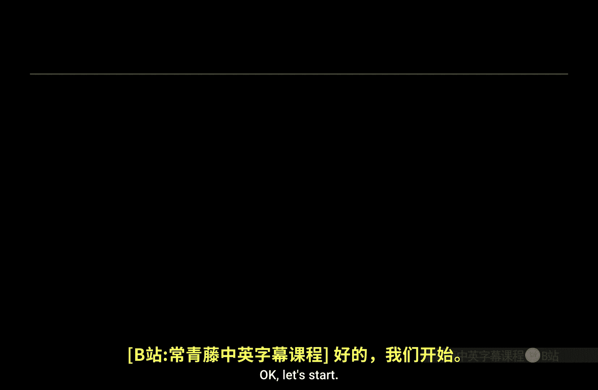
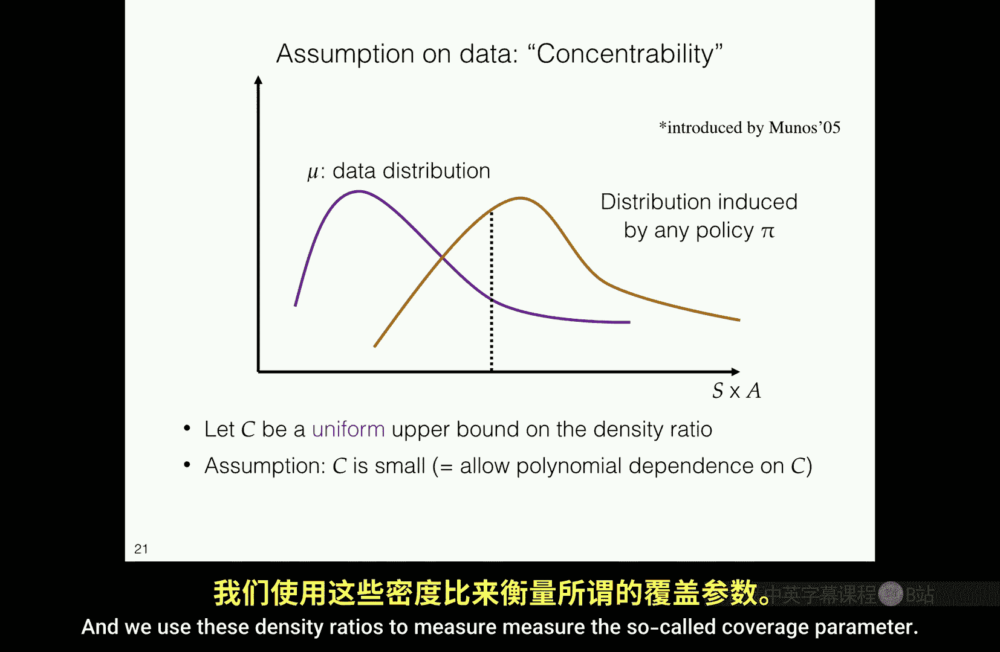
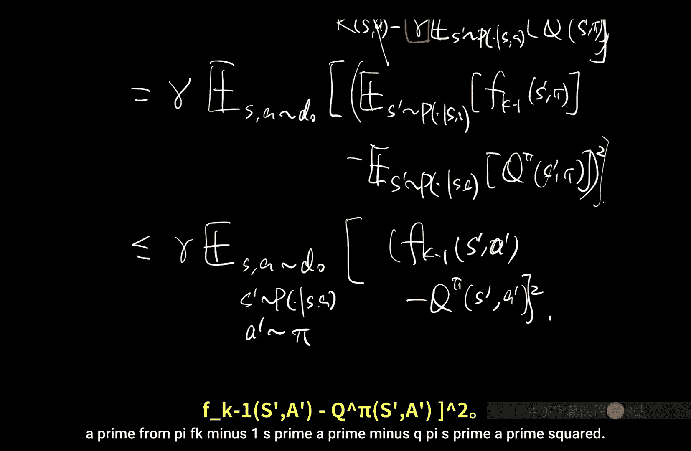
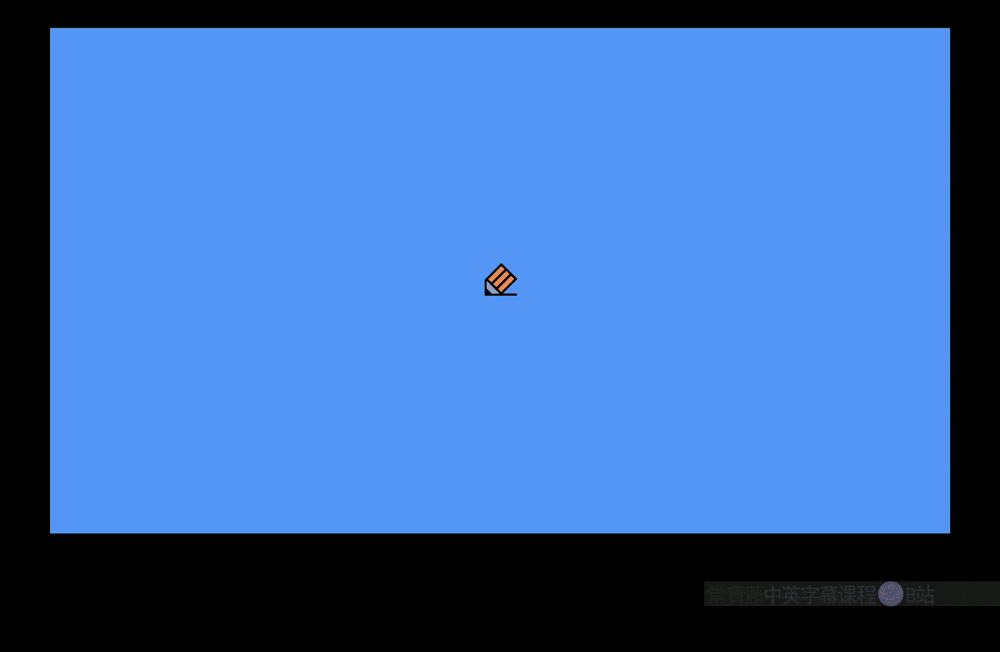
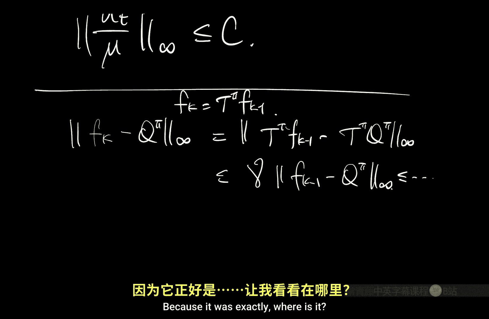
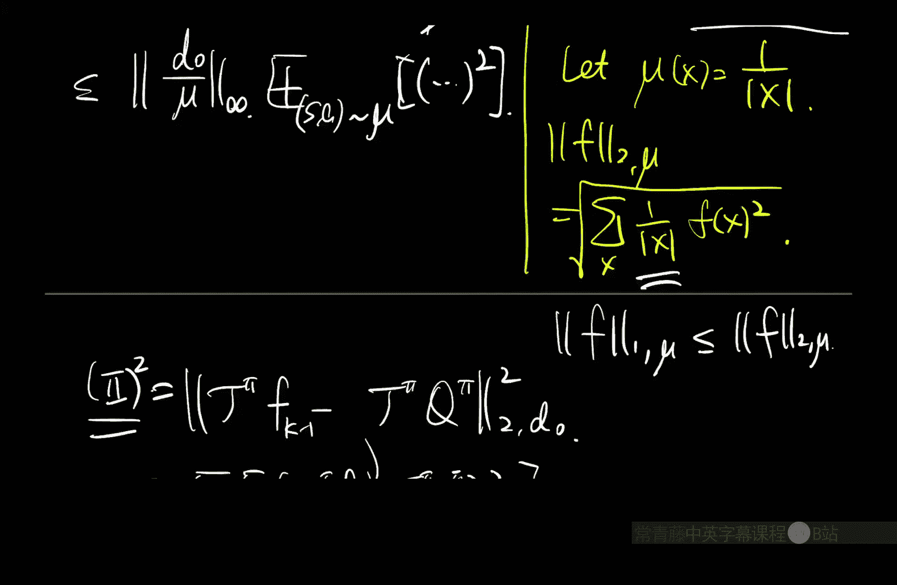
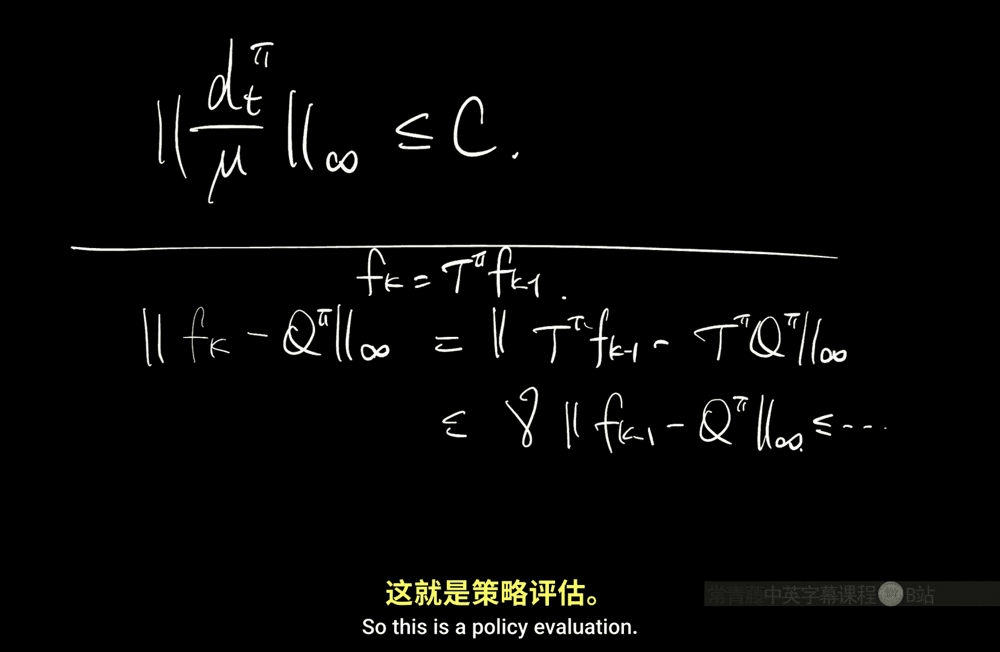
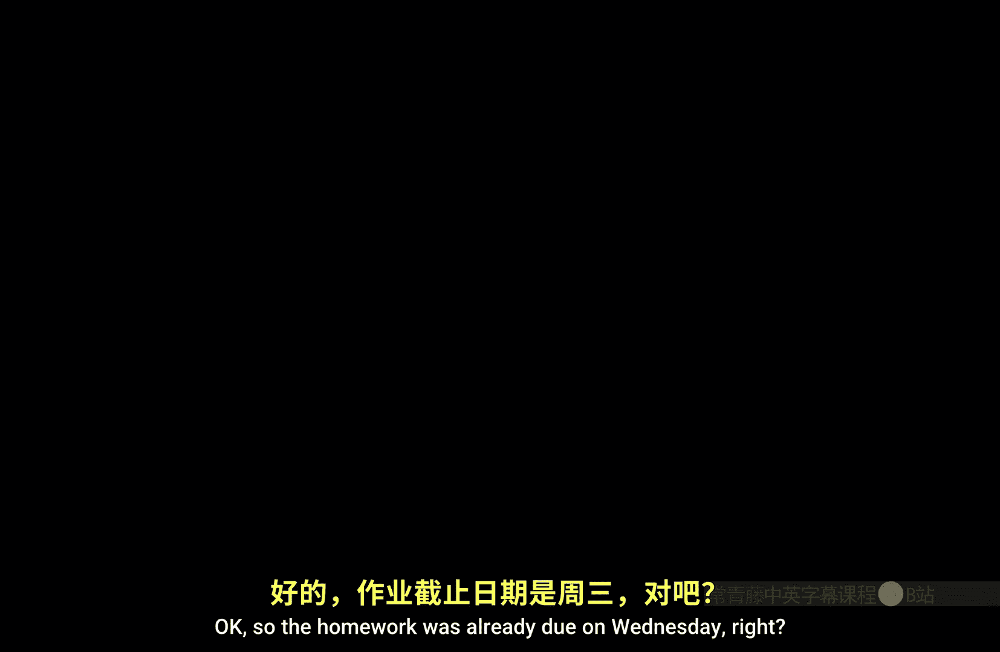
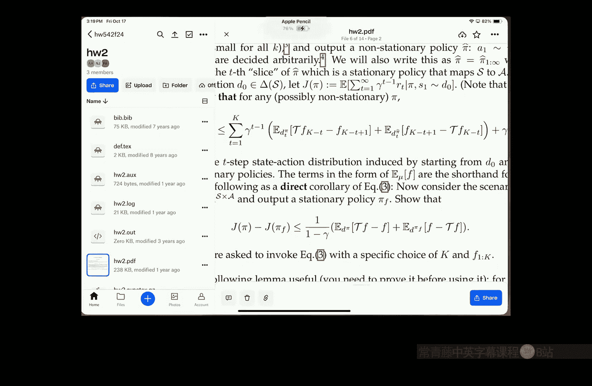

# 伊利诺伊大学【中英⚡统计强化学习｜CS542 Fall 2025, Statistical Reinforcement Learning】 p26 P26 误差传播（视角2） -BV1YsZHBZEyM_p26-

Okay， let's start so。

You know， just to briefly recap what we talked about last time， right， So we had the discussion。

 you know， we start with like physical evolution as a you know。

 very general algorithm that allows you to approximate better functions such as Q star or variant for Q pi。

 And then we discuss this convergence you know， diveerge and which necessitate or motivate the assumption of B completeness。

 And at the very last， we talk a little bit about， okay， then we talk about， you know。

 what if you change the algorithm trying to minimize the socal B error the the estimation of ba error。

 and we talk about this double sampling issue which is why you can have like very nice and easy objective function for R。

 you know， either you have iterative algorithm that has all kinds of instability or you have like crazy mini max that still like in optimization。

 very hard to handle。😊，Okay， so。So a lot of these was to motivate the B completeiness assumption。

 And then we had the last assumption or really like the， the other assumption on the data。

 we mentioned that data really need to be distributed you know。

 you really need some what we call a coverage assumption on how the data covers the， the。

 the occupancies induced by， you know， different policies。

And we use these like density ratios to measure the measure measure the， the， you know。

 the the socal coverage parameter。 And we did a brief derivation last time just to show you。

 you know， how can you use these， like， what was the purpose of having me is like kind of coverage coefficient。

 right， So the key is basically saying that if you have any loss or lost the power P or something like that。

 that is a non negative function over some space。 And let's say somehow you've control the loss to have。

Small to you somehow you found a solution that has small loss on a certain distribution。

 Then you can actually generalize to a different distribution。

 As long as that distribution is covered by your original distribution。Right。

 so these coverage parameters， they are particularly essentially designed to handle distribution shift and out of distribution generalization。

Okay， and if you， if you think about it， the the kind of idea is that if you。

 if you look at these derivations， right， So we。Like， eventually， you get to the， you know。

 the mu is your original distribution。 right， This is where you have controlled the loss。

 So basically， if you think about loss， right， So it's the expectation of the loss on on the original distribution。

 which you can viewed it as you know， the summation over the loss for each individual X times the probability of x。

Right， so so the kind of intuition is that if this expectation is small。Then roughly speaking。

 you really can have individual loss that is like super， super large， right。

 Because all the loss is non negative。 And when you sum them when you send them up with mu as the weight。

 you get a finite number， like Epsil。Right， so you can have like a positive minus cancellations or anything like that。

 Like， they all have to be like small to some degree， right， But the only thing that like， you know。

 how， but， but how can you make a so。Okay， maybe， maybe to think about， think about it in this way。

 right， So we know that say expectation under mu。 So Ill just write sum X mu of X。

 L of X is less than absolute。 Okay， I want to consider very worst case scenarios。

Where I want to make。The expectation of L under this different distribution new as large as possible。

Okay。How can I， how can that be a case， Right？ So really， like your first idea is like， okay。

 let's make L as large as possible。Right， but then you realize that this is impossible。

 If L is like homogeneous， right If L is a constant， then it's the same value everywhere。

 and that and， and then， you know， the mu just， you， you can just move L outside of the summation。

 Then L is just absolute。😡，Everywhere。Right， then this expectation is also what。Excellent， right。

 because because I say L is a constant， right， So now you realize that if L is a constant。

 you can make it behave very poorly on a different distribution。 right， So therefore， what's the。

 what's the choice。 Like， what can you do that。Like you。

 you want to have an L that behaves like very drastically， right。

 So it maybe it shoot to very high value somewhere。

 but it has like very low value somewhere else in order to obey the first constraint。Right？So。

 you know， if you think about the worst worst case， if you don't have any coverage assumptions。

 what can you do， Well， you can basically find a single x where like。

 let's say L of x is equal to epsilon over mu of x。

 right So you concentrate all your all your error onto a single point right。

 and the loss is like0 everywhere else。😡，Right， and then if， and in particular。

 you also need to be the case that。Alright， let me think about it。 So。

 and so loss will be super large for that particular point， right。

 Then what you really want is that you want this loss to contribute a lot。To the loss under。Right。

 so how do you do it， We will say， okay， let me find a distribution new where you put all is probably mass on this single point。

RightThen you can just put a one here。😡，Right， so that that is like pretty much like the best way to。

So， assuming that your mu distribution already covers everywhere， right。

 Because if your mu doesn't cover everywhere， you can basically find an x that mu assign 0 probably on it and shoot L to infinity。

 right， So that's， that's an even more trivial way of making things unbounded under new。

 But suppose mu is already， you know， covering everywhere。 But you can still do this， right。

 You can find a single x like maybe mu at its minimum。And let L to be absoluteps over mu， right？

 And because mu is like a probability， which is And if x space is very large in general。

 this number can be very， very， very small。 If you have continuous space， like this is density。

 like this， again， choose to infinity。 And then you make new， like super large probability on this X。

 then you get a huge loss。Right， but if you look at how you create that loss， which you see， Well。

 you see that you multiply that with。New of x。Right。

 so then if you have this kind of assumption that says new over mu is bounded， Well。

 the guarantee is that whatever act you look into。New never put much more probability than mut us。

So you can never create these very degene situations that allows you to shoot loss。 Like。

 you can have very large loss。 But even if the loss on X is very large， let's say， as much as this。

It will still contribute very little to the overall expectation of new。

 because new also put a proportional probability on that single x。Right， so therefore。

 like like if you look at this construction iss actually the ratio between new and mu that actually matters。

 So if this ratio is bounded， like there， there's no way that you can just create these very de general situations where you concentrate all the laws onto a single point that mu put very little probability on。

 But new put a lot of probability on。Right， that but when you have this bounded ratio。

 it basically says that， no， that's not gonna happen。 So therefore。

 your loss for under a different distribution will be bounded。O。Now。

We will see then in the proof that how we're gonna use it。 And as I mentioned， in the proof。

 you will see that R L is really fundamentally about distribution shift and out of distribution generalization。

Okay， so what're gonna do today is we're gonna do two proofs， you know。

 with slightly of different algorithms and you know。

 two proof style to that they give different name size。

So the proof first proof we do is to analyze the variant of the algorithm that we talk about fit Q direction。

 We're gonna talk about is policy evaluation version， sometimes known as Fi Q evaluation or FQ E。

 So that this one， what it does is that you want to learn Q pi。From some function class F。

In order for you to do what we call our policy evaluation， right， So remember。

 the policy evaluation task is to say someone gives you a policy。 You want to know how good it is。

Right， so in the planning setting， we talk about， you know。

 how can you solve for V Pi and Q pi just by matrix inversion。

 or you can also use valuation type algorithm to do that。So by the same logic as FQI。

 you can also just change the algorithm a little bit to， to to， to solve for Q pi。

 So the algorithm as follows。 So we have this。And， and Cupies our loading target。 We have our data。

 And as usual， it's the transition tus。You know， a bag of transition tus。

 we assume S A sampled from some mu， which is the data distribution of the state action space。

 and then reward an S prime coming from the NP。O。Now。呃。You know， similar to the， you know。

 when you approximate  for Q star， we also need a version of B completeiness here。

 But the version of completeiness is that for all F and F。We need the。

The policy specific button update to still lie within the function class。Right。Okay， then。

In terms of the algorithm。So this is data， this is function approximation assumption。😊，The algorithm。

 now， for the purpose of the analysis， it will be convenient you to write the algorithm in this way。

 So you can write a data dependent loss as this one over D summation of S A R， S prime in D。

F of S A minus R minus F。Sorry。Pri， let me use a different color。F prime。F prime。As prime pi square。

 right， So as you remember， like for fitted Q， you just change pi to max of reactions。Right。

 but when you're doing policy evaluation， you just use the。

 you just set action according to a particular policy pie。

Because that's exactly the difference between the Belman operator for Q star versus Belman operator for Qpi。

Right， so if you choose a particular policy over here， you're trying to evaluate a policy。

 If you choose greedy action over here， you're trying to approximate Q star。

So now here were first analyze the the FQE algorithm， which which is like simpler。

 We'll analyze the Q star version later。😊，Okay， so。

 and the reason I write down this regression function is because then it allows us to very easily express the the algorithm。

 So the algorithm is， well， we can define this。😊，Define。Well， essentially。

 algorithm tries to approximate the Belman update with the help of this function class， right。

 So therefore I write it as T， let's say T pi， but sub F。

 meaning I'm using function class with a head， meaning that I'm using the data。

 which is defining an F prime。Is Ar。F in the function class。第一。F。啊。Right then。

Then the algorithm is simply。 initialitize any f0 in the function class。Then for each iteration。嗯。

You do， let me see。You do them for。K equals 1，2， blah， blah， blah to some big K。 You have F K gets。你。

operatorator F K minus1。Right， so if you think about it， this is essentially how these you know。

 fitted Q algorithm works。 You have your previous iteration of the algorithm。

 iteration of the function， F K minus1。😊，You。You plug it over here， which goes over here。

 which goes over there。 So you use this function to set up the regression target for a new round of regression。

Right， okay question。Yes， there should be a gamma。 Yes， discount factor。 good catch， right， So you。

So， so this function goes here， which means it goes here， which means it goes over here。 right。

 So you use this previous function to set up the regression target and then software regression。

Right， and the predictor you get out of this regression becomes your next iteration of the function。

 You repeat it again and again again again。Right， and this， this loss function is a nice， you know。

 notation。 now， it contains two functions。 The second function is which value function do you use to set up the regression labels。

😊，The first one is your current predictor。O。So， and， and the argument of that is defined as the。

 you know， the， the， the sort of our approximation of the Obama operator。Right。

 because you give me F prime。 F prime goes over here。 An F come out。 is a mapping from a function。

 a guess approximate value function to another approximate value function， right。

 just like in evaluation。😊，And in fact， as we will see。

 under Bel companies we can indeed show that this operator is in some sense。

 a good approximation of the true T pi applied to F p。😊，Okay， so this is the algorithm。😡，Now， for。嗯。

Okay， so we have that。So the first thing we're going to do is。嗯。Okay， so the as usual。

 if you remember how most of our analysis。Have， you know， what they look like。

 typicallyy our analysis are split into two parts， right， So first is concentration。

And then there's error propagation。Right， so we're gonna do the same here。

 Like in tableular analysis。 If you remember， the first we did is that we will first establish that the estimated reward and estimated transitions are close to the true reward and close to the true transition up up up to those appson R Epson P parameters。

 And then we consider error propagation， how they affect the final planning result。😊，Right。

 so here we're going to do the same。 We're first going to do concentration。Okay。

 so the concentration goal is to show that。Let me see。For。

The goal is to show that for any F prime in the function class， we want to bond。

Expectation under the data distribution。呃。T pi F prime。Minus T hat pi F prime square。

Is bound by some statistical error term。 So we'll， we'll， we。

 we'll see like what this term look like。 But this is the goal of the， but this is the goal of the。呃。

Of the concentration analysis。Okay。So to show that。啊。You know， unfortunately。

 we have to introduce even more notation。So define。😊。

So the first thing that will be useful to find is that we're gonna define the population version of our loss function。

 Right， So previously， we have this LD FF prime。 So this is the， you know。

 empirical loss that we actually observe on data。😊，So it' would be nice to actually， you know。

 consider a condition like a population version of that， which is， you know， pretty straightforward。

 just S A from mu F S A minus R minus F prime S pi forgetting the discount factor square expectation。

 right， So basically， take this and then take the true expectation with respect to the data distribution。

😊，Okay。嗯。Okay， so we define that。And the other thing is。The other thing that will be super useful。

 and it will be really key to our analysis is to define this notion of now， actually， let let's。

 let's do that later。 So for now， let's just work with this one。 Okay， then。😊。

So the first key observation is that。嗯。Let me see。呃。This thing， which we want to bound。

Can be written as。L mu。Let me see。So we have this。T F P hat。F prime。Dot with have prime。Minus M mu。

T pi， F prime。Okay， so why is that the case briefly explain， right， So， so basically like， okay。

 so so far in this decomposition， everything is exactly expectation， right。

 We're not really considering anything about like data， anything that is you know。

 related to the data distribution， everything happens in the true expectation， right， Now。

 recall that we have this de decomposition last time that I emphasize a couple of times。

 that when we do a regression。😊，The square loss can be decomposed as expectation of F X minus E。

 Y given x。Square plus expectation， Y minus E， Y given x square。Right。

 so this is for whatever predictor you have， it's true square loss on the， you know， true data。

 true distribution can be decomposed as is distance to the optimal predictor squared plus the inherent label noise。

Right， we， we have seen this like many times。 like， hopefully you， you now remember this。

 So essentially we do the same decomposition， right， So if you sorry， this should be like equal。

 This should be like minus。Okay， so basically， now you can look at this term， right？

 So if you look at this term， this loss is just this， right， If you remember， we can treat this as x。

 this as y， right， So then it exactly fits this term of F X minus y squared on some data distribution。

Correct， then we can do exactly the same decomposition， right， So what you。

 what you get is that you get two terms。One is， so basically the key thing you need to know is that what is the true expectation of y given x。

Right， so in our case， what's the true expectation of reward plus gamma F prime of S prime pi given S。

 What is that。What is the true conditional expectation of reward plus next value。It's not airpri。

It certainly involves like more than F prime。Right， so， okay， let me write it more formally。

 So in order to match this， we want to know。 So E Y given X in our setting is expectation。😊。

Reward plus gamma F， S prime， F prime pi， given S a。What is this。Okay， so think about it。

 What is E R given S。 Well， that's just the true like mean reward function， right。

 R of S A plus gamma。 Well， here you have a conditional expectation of F prime under what distribution under the distribution of S prime given S A。

 What is that distribution。How is S prime distributed condition on S。It's not D high。

It's transition probabilities， right， so。This is just the mean reward。Plus。

 gamma expectation as prime sample from P of S。F S prime pi。 Now， what is this guy。What is this guy？

Is not K pi。 Well， I mean， this is like like， it should remind you of K pi because Q pi would be its fixed point。

 If this is K pi， then Hosein would be Q pi。 So what is this guy。 What do you call it。Sorry。No， no。

 no， so。Okay， so this whole thing is a function of S。Right。

 so it's certainly not F prime of S because F prime over is over here is a function of S is F prime applied to S prime pi。

What do you call the whole thing as a function of SA？No， it's it's not。T P F right。

 so this is the Belman operator。This is T pi F prime。Esay， right， when you do validation。

 you're always doing these kind of updates。Right。So that's why you have so therefore。

 this square loss， which is over here， is decomposing to two terms。Sorry。Two terms。

 The first term is whatever this function is。 So this function plays the role of F in this decomposition is distance to the。

 you know， to the conditional expectation function， right？ So this is this term。Right。

 so the other term is the inherenther label noise， which is。Thisister。Right。

 because you're we're like overall， we're always using F prime to set up the regression target。

 And then we put in the true predictor， the best predictor in the place of F。

 Then the whole thing is the。her， inherenther noster。我我的这。Why is it negative， Oh， Because the like。

Like the way to apply this composition is that this guy over here plays the role of this。Right。

 so it's equal to the sum of like those two terms。Okay， so this is like a square。 essentially。

 this is the， the square loss the composition。Okay， so now。Now， what's really nice is that what it。

 what it does is that it translates this distance measure that we care about。 We say， oh， our。Like。

 essentially， this regression based approximation of bowan operator is actually a very good。😊。

A very good approximation of the true Belman backup， the true Bel operator。

 when it is supplied to any function F prime in our function class， right。

 So that distance is what we want to measure。 And by this decomposition。

 we translate that into a form that is related to the expected loss you know。

 of the actual loss that we actually minimize。😊，Right？O。So once we have that。

What you can say is that then you can do know concentration。So。

What you can do is that you can say for all F and F prime。😡，You can do LD。F。F prime minus L mu F。

F prime is。Bounded by some。You know， I'll put Epom Prime over here。Okay。

 so how do you establish this or you can just do like half day。Right， because。

 because for any fixed F and fixed F prime， what do you get well。The， the loss， ready fixed F。

Fixed the F prime。You just get the average of bunch of 50 random variables。Right。

So therefore fixed F and F prime， the LDE should concentrate to。It's true expectation。Right。

 and if I need to union bound， I can union bound over both F and F prime so that I can claim that everything。

 you know， regardless of like what function you choose is you have is always bounded， right so that。

You know， you can calculate the corresponding Epsilon Prime using like hope in quality。O， now。

Just a little comment。 That'll give you a slow rate of one over epsilon to the one over end to the quarter。

 There's more advanced analysis， but I'm not going over here using bird sizeizing quality to sharpen that to the standard rate。

 one over square root of it。 But I'm ignoring that and doing a more naive analysis for now。Okay。

 so once we know that's the case now we immediately have using the decomposition we just have， right。

 So expectation under mu。😊，T had pi F， F prime minus T pi F prime。Square。

 we show that this is equal to L mu of F， sorry。T， F p F prime。呃。Have。Prime。Minus L mu。呃。T pi。

 F prime。Have fun。So this is thecomposition which I showed。😡，Okay， so。Then because of the。

 this union bound that we， we show that LD and L view is uniformly close regardless of what kind of functions you plug in。

 you can immediately change all the muse to these。T F pi F prime。Have prime minus L D。T pi F prime。

F prime plus 2 epsilon prime。Because you can just change this to this， you pay another an Eon Prime。

 change this to this， youll pay another Epson Prime。😡，Right。Well。

 what's a little bit tricky here is that you need to verify that like in this line。

 all these four functions are coming from the function class F。

RightNow the F prime is coming from the function class F。This one is our algorithms output。

 It's surely coming from F because we' when we do regression。

 we're finding the best predictor within our function class F， right。

 So this one is certainly a member of the function class F。😊，How about this one？

Is this one in our function class？Why you you not。Yes， you have Bel completeness， right。

 Bel completeness tells you that for any F prime in the function class is true。

 Bel update is also in the function class。 So that's what we assume the Bel complete。

 So this guy also come from the function class。 That's why you can change from L used to L Ds。😊。

Right。And then this is to Epson prime， right， Because why， Because you know。

 what our algorithm does each time when it。Thus this approximation of the Ba operator is basically doing an argument over this empirical loss function。

So whatever guy it chooses over here。😡，It should have less。

 It has a lower empirical loss than any other member in the function class。Right。So。And， you know。

 crucially， we use the fact that again， that this is this is in the function class。Right。

 by bound complains。 So therefore， when we， when we are minimizing this loss function。

 we have considered all different functions， including this one。

 But we decided to choose choose potentially something else because that one has lower noise。

 have have lower loss， lower loss。 right， So therefore。

 the loss difference is non negative non positive。😊，Okay， so then we end up with two Epson Prime。

Okay， and this is our E stand。O。So what we have is like really this subrouting， what it。

 what it tells you is that whenever you do a fitic regression on a you know。

 on your data distribution for whatever whatever， you know， target。

 whatever target function you plug in to you know set up a regression problem。

The function we get out of it。Is always a good approximation of the true Bel update to that function。

Okay， but what do we mean by good approximation， Well， we're measuring how。

 how well you approximate by this particular error measure， right？

 And the reason is that we're actually measuring everything， you know， because we。

 we've done regression on the distribution mu， you know， you know。

 which from which we've drawn our data。So whenever we measure， you know， closeness， were。

 we should always measure according to our data distribution new。Okay。So， you know， if you。

 if you want to think about it， like pictorially， like just in a simple regression problem， right。

 supposeose you have this regression problem where you have a。Let's say this is the true function。

 Okay， and you have a lot of data points。Right， and let's say you've done regression。

 then your regression， your regression function， depend on the data randomness may look something like this。

😊，Right， but as you can see， like， it will be mostly accurate in the region where you have a lot of data。

 because if you're actually very inaccurate over here， your loss will actually be very large。However。

 there is no guarantee that you can have very little error out of the distribution。Right。

 because even if you are very accurate over here， just by a small perturbation here。

 like you can have very large errors somewhere else。Right。So therefore， when you say， okay。

 I claim that after running a regression， the learned function。

 which is like one of either these green lines， it should be close to the white line。Well。

 you can say like if they are closed under our infinite norm， there's no way that you can claim that。

😡，But one way， one distance measure you can you， you can use to make that claim is to say。

 let's measure their distance。 You know， under whatever distribution I， I've。

 I've run the regression now。That always works。😡，Okay。

 and the analysis I've shown you like is not really specific to R。

 It's basically just essentially repeating like the analysis for an arbitrary least square regression problem。

Okay， like if you repeat the same proceed， like， you know， same steps。

 you can basically end up claiming that as long as you can realize the optimal predictor for this regression problem。

 your learn function will be close to the optimal predictor。

 but only under your training distribution。O。So that's that's what we need。 And then it goes to。

It goes to the error provocationation analysis。 So we haven't talked about the coverage assumption。

 but we'll actually see what kind of coverage assumption we need as we do the analysis， okay。

So for all policy evaluation， people have different， you know， you can have different goals。

 but a typical task is that we may want to use Q， like， let's say after we do many iterations。

 we get F， FK， right， So we basically say， okay， FK maybe is a good approximation of Q pi。Right。

That's what we hope for。And so， for example， you can say， okay， let's measure their distance。

And let's say under some D 0 distribution。 And you see why I measure it under D 0。 This is the。啊。

You know， for now， let， let's say D 0 is just an arbitrary distribution over state action pairs。Okay。

And it would say， okay， we want to know whether we can control this guy。Okay， so again。

 like this is again， a measure of how well my function is approximating the true Qpi。Right。

 and as I mentioned， like， you know， a couple of times， back in the tableular setting。

 we had L infinity result。 Now， forget about them。 There's no way without additional strong assumptions。

 No way you can get like strong result that like L infinity。

 Every kind of approximation result will be distribution specific， right。

 it'll be like an average case approximation。 And it matters what distribution you measure the distance of between functions under。

Okay， so let's say we want to analyze want to this， this thing。

 And it will see that the kind of coverage assumption we need will fall very nicely out of this。

 this analysis。Okay， so what do you do， Well， so here， similar to what we have in the。Before。

So we have T T pi Q pi。 Now， by the definition of our algorithm， we can write。FK as。You know。

You know， our like regression based approximation of the Bum operator applied to the previous iteration of the function。

 correct， Like that， that's the definition of our algorithm。Okay。

 now we say that this guy is gonna be a good approximation of the true tea pi applied to the same function。

Okay， so to continue the analysis， what are you going to do。And subtract， yes， and subtract what。

Right， so here， like you see， like here we have the typical situation。 You have two operators。

They are somewhat close， right， We establish they are somewhat close。

 but only when they apply to the same function。And now we have two different functions。

 What do you do。You have different operators， different functions。 You want to add a subtract。Right。

 right right。 So what you want to do is that you want to。

You want to introduce like some kind of cross term， right， So S A from D 0。

T F pi had F K minus-1 minus T pi of F K minus-1。Plus， T pi F K -1。Minus T pi Q pi squared。Okay， oh。

 sorry， it should be。嗯。Like， for now， it's just equal， right， because I'm plus minus。Okay。

 now what you really want is that you want to essentially， like similar to our previous proof。

 What you really want is that you want to break this into now the this term and then this term。Right。

 and then this term， you know， you actually will say how to do that。 But for now。

 it's a little bit difficult to do that。Because of the square。Right。

 because if you want to break them into this square plus this square。

 you have an actual like clusterer。And that's kind of like difficult to handle。

 So here's what we're going to do。What we're going to do is that we're going to add a square root over here。

😡，Add a square root over here。嗯。And will temporarily delete this one。Now， whats very important。

 And this is another， you know， fundamental result we're going introduce over here。

 So we can we can define this as FK minus Q pi or whatever function you put in there。

 like the difference between two functions。Square the0。2 D 0。 Okay， so basically what， okay。

 So because we are taking square roots。 So the square goes away。 So it turns out that。

Whenever you have two functions or just just a single function。

 you take its arbitrary raise it to the power P， take an expectation and then take the one over P power。

 Okay， so which is what we're doing over here as a special case P equals 2。 This is actually a norm。

Okay， in general， it's actually a semi norm。 But the difference between semi norm and norm is just whether0 norm means the function is 0。

 which is basically irrelevant to us。 So I'm gonna ignore the and just call it a norm。Okay， so。

 but this norm is what we typically call a weighted norm。Okay， it's。

I'll first show why it's useful over here。 And then we can， we can see you know。

 and now provide some intuition for why， you know， why this is a norm and how it's related to different kinds of norm that we know。

 Okay， and because this is a norm， we can just write this as the norm between。😊。

T had pi F F K -1 minus T pi。Q派。呃。Well， we're gonna add and subtract that。 right。

 So we have T pi F K -1 plus T pi F K -1 minus T pi Q pi2 D 0 norm。Okay。Now。

 ignore the fact that we have invented some fancy new norm here。 Just say this is some norm。

 So if this is some norm， how can you break things apart。Triangular in quality， right。

 And this is exactly why you want norm and you want a square root。 Okay。

 so this is a less than or equal to。T， F pi had F K -1 minus T pi F K-1。The same norm， plus。

T pi F K minus1 minus T pi Q pi the same norm。Okay， now before we go any further。

 let's talk a little bit about this。This norm。 Okay， so in general。

 what we're doing over here is define a new norm that says if you have any function F。You have P。

 let's say you have a immune norm。 So what defines this norm is our two parameters。 One is a P。

 which is a number。 So this is similar to the kind of， you know。

 norm that we' are familiar with L 1 norm， L 2 norm， L infinite norm， and so on， right。

 So P can be any of these numbers。But it also takes another parameter。

 which is a distribution or sometimes referred to as a weight。😡，Okay， so， and the typical definition。

 as I mentioned， you raise the norm to the power of P。

 And this is just the expectation under mu F to the power of P， right？ And if you look at the norm。

 it's the right hand side， then take the raise it to the power of one over P again。Okay。

 so sometimes this is referred to as a functional norm because in general。

 like you can define norm for these things， even if the underlying space is continuous。Right。

 and your F is generally a function。Now， I really want to to。I want you to actually look at this。

There this this norm and， and see how it's related to， for example， let's say we do two norm。

Then2 mu is equal to square root expectation of mu F squared。Right。Now， how is it related to。

 for example， our familiar to norm。Well， what you can do is that you can just say let me consider the underlying space to be to be finite。

 and we can let mu to be uniform。Right， then you will see that basically it recovers the familiar euclidean norm up to some very important caveats。

 So let mu to be， let's say mu of x equals one over the size of the underlying space。

 So I have a uniform distribution， right？ Now what you see is that And then here you can treat F as a vector。

 as we have always been doing in this class。 Then the norm is what the norm is。

Sumation over x mu of x is just one over x， then F of x squared。Okay， and then square root。So。

How is this relate， like if we treat F as a vector， what is the typical notion。

 typical definition of two norm。😡，Without one relax。Right， so therefore。

 you can see like it's basically the usual two norm up to a like dimension， dependent vector， right。

 Because the number back， when you treat F as a vector is basically the dimensionality of this vector。

Now， when you only consider a single norm like two norm， this seems to have no implication。

 but what's really important is that so this in quality we won't be immediately using over here。

 but generally it super important， you have that F1 norm。😡，Is。Bounded by2 norm。Okay。

 but what's the relationship with the usual one versus2 norm。It's the other way around， right。

 So the easiest way to remember is that for P norm， you can just consider the extremes。

 So like one versus infinity， right， L Infinity norm is taking the largest the number。

 L1 norm is sum up all the numbers together。 So the sum should always be higher。

So the usual norm is monoton in P， but it's the smaller。 P when P is smaller， the norm is larger。

 But here is the other way around。When when the P is larger for the same distribution。

 you have a higher norm。And what's the reason， Well。

 the reason is that if you look at is precisely because you normalize by the number of， of。

 of items or the the coordinates。 So essentially if you think about this norm。

 when you have a vector， it's looking at some kind of average size of the coordinate。Right。

 so therefore， like when you go to infinity， what that's still going be taking the infinite norm is still going to be the largest。

But as you become， as you reduce P， you're still taking， you're always taking some of average。

 But the smaller P， the less you emphasize on those like， you know， large items， right， Like。

 like this one is essentially what This one is essentially a rhythmic mean is upper bounded by quadratic mean。

Right， so that's why you have the flip of things。And this is why， like， you know。

 when you have large， very large state spaces， use function approximation and you have to introduce norm to enable these like。

 you know triangular in qualitiesalities， It's very nice to use these functional norms instead of the usual norms。

 because functional norms is normalized by dimensionia。

 It's talking about the average size of your function， your loss， you know， average over all x。

 right， So it doesn't have this dimension dependence anymore。 because if you use the usual norm。

 let's say two norm， where you pick up things like factors of size of the state space。😊，Of course。

 you want to avoid that。😡，But using these things， you know， you know。

 the very easy thing to look at why it's like independent of the size of a space is that you can actually write it as a straightforward expectation。

Right， so if， if F has bounded range， well this whole thing is surely bounded in a way that is independent of the size of the safe space。

And that's why， you know， this is very important。 And if you do any kind of machine learning that talks about how your learn function is close to the true function。

 Well， this norm is your friend。Okay。And， and， in fact， this， you know。

 one way to use this inequality is to say that， okay， I mean， as an example。

 which we didn't do over here， let's say what I'm actually caring about is to use that to make prediction of。

Of the。Performance of the policy under the initial state distribution。 right。

 So I have S from D 0 and Q pi S pi， right， because the expectation of Q pi under the initial stay distribution is just the true performance of the policy under that initial say distribution。

 right， and using F K， I can also make a prediction and the difference will be， you know。

 the my prediction error。Right， so if I want to bound this， well， I can are pro bound it by。D 0。

 I can push the absolute value inside。Then this turns out can be written as FK minus Q pi。

1 D 0 times pi。 So D 0 times pi is just referring to the state action distribution where you draw S from D 0 action from pi。

Right， because this thing exactly fits our definition of this functional P norm。Right。

 the functional P norm with P equals1。Right， but once you have that， you can just less than equal to。

You can just immediately raise this to two。Right because of that monotonity。

 like weighted out one norm is upper bounded by weighted out to norm， not lower bounded by。Right。

 so then you get you here。And again， when you go from one to two。

 just think of it as the weighted version of arisic me is bounded by quadratic me。😡，Right。

 so the higher order mean is always larger。ok。😊，So， now。Okay， so now we get to this point。😡。

Now we get this term。Well， this term will remember， this is just the the expectation of this whole。

 Okay， So let's say we， we tackle the separately。 We have one and 2。 Okay， so what is one， Well。

 temporarily， We're gonna rewrite it back to the。Original form。 So we have the expectation of bh， bh。

 blah or less squared square。 So this whole thing square under S from D 0。Right， so。

 so number one square is this。 right， We're right in the back in the expectation of loss square 4。

Okay， now what we know from the concentration analysis is that。😡，Exactly these two functions。

 because we can just select F prime to be F K -1。RightAnd exactly these two functions。

 their square expectation is small under the data distribution。Okay。So。So what happens is that here。

We want to control a certain function， which is the difference between those two guys is square under D 0 distribution。

 What we have is expectation as a from mu。Of these。Two things。

Exactly the same two things square under the data distribution。What helps you translate between them。

What kind of additional assumption do you need to introduce so that you can translate between them。

Right， you need a coverage。Right， you need the D 0 distribution to have appeared in your data。

Your data needs to provide coverage over this。😡，Right， so one way to write it concisely is。

You can write T T 0 over mu infinitefin norm is， as bounded。Right，Because。

 because this is basically equivalent to put like a number C over here where C is an upper bound of the zero S over mu of S for any essay。

Okay， so this is the kind of coverage forever and where we use it。Right。

 and you see like this is exactly where like distribution shift happens， right。

 we've controlled the loss under the mu distribution or data distribution。 But when we evaluate， say。

 we're interested in controlling you know， how well we approximate Qpi under some distribution D0。

 then in the analysis， the D0 will show up and it is required that this D0。

 only visit states that we have seen in a probabilistic sense in our data。Okay， so this is where you。

 you do the conversion。 And this conversion， just to remind everybody is。You know， exactly using the。

 the， the result over here。Right， so as I was saying， like it's exactly like something square。

 And then you convert between them。Okay。Now。呃。Now， that's not the end of the story， right。

 So you still have number two over here。Okay， so let's look at number  two。 So number two is。

Number two is a T pi F。Mus。F what， let me see F K -1 Okay， K minus-1 minus T pi Q pi2 D 0。O。

Let's actually square it as well。😊，And rewrite it back。 So this is where you see， like。

 well go back and forth between the norm form and the expectation square form。

So you still have the same thing squared under SA from the D0 distribution。Now。

 it's T pi some F K minus1 minus T pi Q pi。Okay， now we're going to expand it。 We have S。D0。

You can have R of S A plus gamma expectation as prime P， A。F k minus-1 S prime pi。Minus RA minus。

Gamma expectation as prime。PSA。Q pi S prime pi。Square。

So here I'm just expanding the definition of T pi。 So here we have both true T pi。

 so to give us the true reward and the true transition distribution over next states。

So the reward casuals。The gamma can be pulled out。So we end up having。Gamma expectation。

 S A from D 0。Expectation of。S prime from P of S。F k -1 S prime pi。Minus。Explicationation as prime。

PFA。Q pi S prime pi。Square。Okay。Now， the next step。This is less than or equal to。

 I claim that it's S A from B 0， S prime pro。S a， a prime from pi。

FK-1 S prime a prime minus Q pi S prime a prime。Square。

Okay， so why is that the case， Well see in the， sorry。Wait， what's happening。Oh， I lost。

Oh， don't tell me this is happening。

Suddenly， all my nose is gone。 Oh， okay， nice back。 good。 Okay， so in the first line。

 what you have is that you have the essay。 So here is the same distribution， right and。Now。

 the difference between the functions is at the next time step。Is regarding S prime and pi。

 So this is the next S distribution。 And what you see is that they actually all。

 the S prime a prime also follow exactly the same distribution。Right。So basically， but basically。

 what happens is that you first do some kind of marginalization， take some expectation。

 take the difference then square。😡，But here what I'm doing is that I'm actually pushing that square to the innermost。

 I'm doing expectation outside。😡，So this is still like basically a kind of cautious words。 right。

 one way to see it is that you can fix a particular S A， You know， treat S A as fixed， not as random。

 Now， the only thing that is random is S prime。And pi， like the， the， the randoms of a， right。

 So there you just have the difference between expectation square。

 So here is the square difference expectation of difference square。Right， by Kwars。

 like this one is always larger。Okay。Now， what's really interesting is that now you see。

 so here this difference is only a function of S prime and a prime， right？😡。

Although the whole randomness involves S A S primeme a。So essay actually， doesn't matter。

All we need to know is the what's the， what's the sort of marginal distribution over S prime a prime。

😡，Right？Well， it turns out that we actually have a good way to describe this， right， So we。

 if essay is drawn from some initial distribution and we draw the S prime and then draw the second action or also。

 according to policy pi， what do we call this S prime a prime distribution。😊，Yeah。

 we have some kind of or。Maybe it it depends on how you index things。 like typically。

 I want although I call this D 0， I call this the first time step。 So this is really like D1 pi。

 then you get this like D2 pi。 But， you know， you get the idea。 So this is， you know。

 when we have a name for it， this is just gamma expectation S prime a prime sample from D 2 pi。

And F K minus-1 S prime a prime minus Q pi S prime a prime。Square。Okay。Right。

 so see like what happens is now。😡，You continue from there， but notice。

You have the difference between FK -1 and Q pi under some distribution， okay。Gmma square， yes， great。

 great cache。 And that square。 like because here we've squared the second term。

 that square will go like become gamma again when you take the square root in the， in。

 in the original analysis。 Yeah， so gamma square， gamma square， yes， great cache， okay。😊。

But now you see like what you end up with is the difference between FK minus-1 minus Q pi measured under some distribution over the action pairs。

😡，Okay， so what happens？Well， that's exactly like the kind of thing we started with， right。

 We started with FK minus Q pi measured under some arbitrary D 0 distribution。Right。

 now you get the same thing except that here K becomes K -1， but Q pi is still the same。

 and then this distribution changed。So just repeat the same thing again。Okay。

 but now here's the interesting thing。 when you， when you repeat that again。

And then when you get to the point where you need to pay this coverage coefficient。

 now you need a different coverage assumption。Now， you need to cover the second step distribution induced by policy pi。

😡，Right， and then go to the end。You get， get to the next time step。 It goes to K-2。

 You run this analysis again here， you need to cover the third。

 third time step distribution of policy pi。And so and so forth。Okay， and then， you know。

 all the way to K， all the way to K， when K goes to 0。

 you get a residual term that is proportional gamma to the K。

 which is resemblance to the residual term you get in valuation。

 when you only do finite number of iterations and， you know， stop stop there。

 you have a gamma to the K residual term。Right， so， but if you go through this analysis。

 you will see that the coverage assumption you need is something like D T pi over a mu。

 If the norm is up bound by C。 and this is the kind of assumption you need。Right。

 so you have some initial state distribution D0。 you， you' are interested in。

You're using that to measure the difference between your final function and the true Q pi。

And you say， oh， I want that air to be small。What kind of coverage assumptions do I need， Well。

 I need that using that initial state distribution and using the policy I'm trying to evaluate。

Induce the different T step distributions。And then I require that my data provides coverage for each of those T step distributions。

And this is the kind of coverage assumption you need。Okay。

 and there are various ways to sort of improve that assumption。 And as I said， like。

 you explore some of it in the homework。 But that's the， the kind of big picture。Okay， get it。Okay。

 and， and see here is the thing。 Like， and this is， if you look at this analysis。

 you will know why when we do these kind of analysis in R。

 sometimes we refer to that as error propagation。Right， that is。

 especially if you do this kind of analysis。 What happens is that you start from your error。

 the measure， the the distribution that that you actually use to measure the measure the final error between value functions。

 But what you have is really， how well you approximate each step of valuation。 right。

 So then in your in your proof in your analysis， the distribution will unfold like the occupancy of the policy pi one step after one step and after one step。

 And each step you pay an instantaneous error。Right， and， you know， like informally。

 sometimes like for this particular analysis， we say that， you know， in the system。

 error propagates according to the dynamics of the MP under policy pie。

Referring to the fact that we're paying error on DT Pi for each time step T。

 And then we translate that to our data distribution， using coverage assumptions。Okay。

So that that's sort of the key here。And as another comment。If you look at this proof。

 a lot of it should remind you of the kind of proof we did in the tableular setting。Right。

 like even for evaluation， like in evaluation， like what we do。 Well， inval we do is， you know。

 in in the standard valuation， what we did is like， so F K is just a true T pi F K -1， right。

 So we do F minus- infinity is equal to T pi F K-1 T pi Q pi infinity。 And we use the fact that it。

 this is contraction， Q pi infinity and so right， So it was much easier。 But。😊，But， but it was like。

 it was like this。And if you look at this proof， a lot of it。

 like you should like spot similar components in our proof， right， So for example， in our proof。

 we also have this T pi F K minus1 minus T pi Q pi， right， because it was exactly。

Where is it， Like in the second in the。

Wai， I can't find it。 Okay， so， so it's over here， right。T pi FK minus1M minusT派q派。Right。

 but previously， like， this is where you see it， right， previously。

 because in the finite in the tabular setting， we can afford to use this very crude L infinitefinity norm。

 which you can use here。 But Lfin norm， like， get rid of all the messiness about distributions and give us contraction。

😊，But here， when we measure things under certain distributions。

 we don't get exact contraction anymore。 But you see。

 we still get something that looks like contraction， right。

 So here we get T pi F K minus y minus T pi Q pi measured under2 D 0 under some D0 distribution。Now。

 the second term， if you look。Look at how we analyze it。 Eventually， what you get is。You know。

 you get a difference between F K -1 minus Q pi， which is similar to what we did before。

 You have a gamma discount factor in front that looks like gamma contraction， right。

 because eventually， as I said， you take square root。 So this gamma square becomes gamma。

 So it's very similar to gamma contraction。 But here it's not exactly a contraction。Why。

 because the distribution has shifted。So in the previous time tab， you start from D 0。

 which is the first time the action distribution。 I call it D1 pi。 So here you get D2 pi。😊。

So it's kind of like contraction， except that。Like， the distribution has shifted。

And this gets back to a comment I left last time。 I was saying。

 So if you remember for when you do these TD or these dynamic programming based algorithms。

 we know that they generally diverge， right？ And I said that the reason you diverge is because。

Although regression is a non expansion， it's only non expansion under like this particular norm。Okay。

 but the Belman operator， which is what the second term is analyzing。😡。

Is only a gamma contraction under Lfin norm。 It's not a contraction under， you know， this， this。

 like distribution weighted norm。RightBecause whatever distribution you put in on the left hand side。

 on the right hand side， you will get a gamma， but the distribution will be shifted。😡。

So that's another way to understand the mismatch between the between the the norms。Previously。

 we say， oh， the T operator or T pie operator is gamma contraction under an afinity。

 but the regression is not contraction under an afinity。 So here you view it other way around。

 You see， okay， let's try to make everything contraction under the weighted norm。 Okay。

 regression is。Now expansion under this data weighted norm。 Well， unfortunately。

 the bottom operator is not because whatever data distribution you give to it。

 or whatever distribution you give to it， it is shifts。😡，Okay， there shift the distribution。

 But there is an interesting， like side result you can obtain from it。 That is。In what case。

Is the distribution like before and after you do this analysis the same。

So there are some special case where if you start with with D 0 and you pass it through the dynamics。

 you also get the same distribution as D0。 What do you call those distributions。

There are stational distributions， right， or invari distributions to the markov chain induced by the policy pie。

 So that's actually a known result。 That is， even if you use function approximation without B completeness。

If you learn the value， let's say you do of policy evaluation。

 But if your training distribution is an invariant distribution to the target policy。

 you want to evaluate， things don't blow up。 Well， precisely because of this reason。 Because now， if。

 if this the zero after passing through this， you still get the same distribution。

 then before this and after this， you get exactly the same norm。So now is a Gaba contraction。

And this is why， like， if you listen to people like Rich Sutton， he will。

 He has this famous terminology， says all those instbilities， divergence， he calls it deadly tried。

 Okay， like the reason it says he says。RO becomes instable and problematic when three things come together。

1 is bootst， Borap target， which refers to dynamic programming style algorithms。 Okay。

 we'll see actually， in next week， there are other family of algorithms that doesn't suffer from this。

 But for everything that is related to dynamic programming evaluation， Well。

 that's one source of the problem。The second source is function approximation， right。

 Because in theular， we didn't have this problem at all。 Reason B， inar。

 we have essentially we have domain completeness for free， right。

 But in the general function approximation setting， you don't necessarily have domain completeness。

 Okay， and guess what's the third， The third is of policyiness。 That is when your data。

 like especially when you're trying to evaluate the policy when your data distribution has nothing to do or。

Like， like doesn't really， isn't really closely related to the target policy you want't evaluate。

Then you have these kind of distribution shifts happening。Right。

 but if you remove any one of these issues。You don't have any problem， right。

 So if you remove function approximation， you're back to the tablet or setting。

 You're good because you get government company and is for free。If you don't use Botrap target。

 for example， you just row out the Montejecteries， as you will see next week， you're also good。😡。

Or if your data distribution is invariant to the policy you won't evaluate， This is a much subtle。

 more subtle special case。 You're also good。 Even yeah， you， you， you， you。

 you can still get good conversions。Okay。So， this is。Policy evaluation。 Now。

 I'm spending longer than I expected。 But let me briefly talk about。

I guess use two minutes to talk about the actual fitted Q。Analysis。And as it turns out。呃。Actually。

 most of the work is what you have done in your homework。Let me see where is it。Okay。Okay， so。

So the homework has is already was already due on Wednesday， right。

And。I not。Okay， so you were asked to do this ridiculous， like lemma。

 And I hope like this is still that you still remember， right？ So， well。

 if you notice what this dilemma does is that it's exactly the analysis for FQ I。😊，Okay。

 so what the sallema says that if you have a。It's assuming that youre doing an approximate version of FQ I。

 That is FK is only approximation of T F K -1， but not exactly the same， right。

 So for the purpose of FQ I， you can just let F K to be the output of FQI。Okay。

Then it says like after K eras。😡，You you output the greedity policy。And here is like pi。

 you can choose it， choose it as pi star。 You compare it to the alpha policy。

 And this is how well you're doing under some initial state distribution。Right。

 and what the slema tells you is that， well， you can decompose that performance error。To的。

The sort of these kind of error under two different distributions is a little hard to see over here。

 So let's get a larger， right？ So the first thing to notice is that what are these terms。

 Well these terms are just asking how well your next iteration of the function is approximating the true Bel update of the previous iteration of the function。

Right， so that's exactly the kind of error we have seen in the FQ E analysis。

 The same kind of analysis holds for FQI。 It's almost identical analysis。Okay。

 but what's really important is that we know that you can control the square of these errors under the data distribution。

And what these analysis tell you is that in order to bound the final performance。

What kind of target distributions you should aim at。

 And that will tell you what kind of coverage assumptions you will need。Right。

 so you will see that here you need to cover two kinds of distributions D C pi and DT pi had where pi is the policy compare with。

 which is like pi star。😡，So your data should cover the T step distributions induced by the optimal policy。

But also， it also need to the TS distribution of the policy you actually produce。😡，Okay。

 and because we don't know what kind of policy you can produce。So if you take a， you know。

 conservative approach and just say， let's relax it to all kinds of policies。

 you recover the kind of conditions we mentioned， you know， in on Wednesday， right。

 we require that our data provides good coverage over the T step distribution of any policy that we might output。

If we have that kind of assumptions and we've controlled these kind of one step kind of Bel update errors under the data distribution。

 we can translate that error to these qualities， you know， by paying the coverage coefficient。

 and this lemma immediately tells us that the final policy we output is near optimal under the initial stay distribution。

Okay， so basically combining this error de composition Lama with the concentration analysis we just introduced。

 you immediately extend the analysis to FQ I。😊，And that's it for this part。And。This。

 this is maybe the hardest lecture in a while。 I guarantee you that things won't be that hard for a while。

 and there'll be something that is even more difficult。 But okay。

 at least you don't need to worry about it for now。 Okay， that's it。 Yeah， thanks for coming。

都来给你来。62 for the。