# 伊利诺伊大学【中英⚡统计强化学习｜CS542 Fall 2025, Statistical Reinforcement Learning】 p28 P28 重要性采样（视角2） -BV1YsZHBZEyM_p28-

Okay， let's start， so。This week， well willll talk about a sort of standalone topic。

 And then I think next week， either Wednesday or Friday。

 will switch to like the last like big chunk of main topics of on Ar after that， okay， so。

So this week， we'll talk about important sampling and， and then it， it goes to policy gradient， so。

The to give a little bit of motivation， what are， you know。The， the， the kind of question we're。

 we're trying to ask， especially the use of important sampling is this， you know， for。

 for background background。Of hollow。You know。This is called a policy evaluation problem， or O， P， E。

Okay， so the O E problem is like we essentially have seen this problem。

 That is you want to estimate the performance of a given policy。

 but using data collected from different policy。Right， so， you know。

 whenever you run into a problem like this， this is called a policy evaluation or sometimes called a policy estimation and so on or O P E problem。

why， why do we need that， right？ So we'll see you later， Like， you know。

 actually in our training in various situations， you wont run into that。 But more importantly。

 if you， if you use RL for any sort of like real world task。

 where the environment is not just the simulators you know。

 that is sitting in in the computer you would really want to do this， right。

 So because when you do supervised learning， right， what do you like for actual。

 you know real world project， what do you need to do， Well。

 it's not just about running a training algorithm， right。

 So you actually also need to test the solution you found the classifier。

 the particular you found hold out data and test data to tell people how good it actually is know。

 to give people a sense of， you know， how to actually behave when you deploy the learn classifier in the real system。

Right， but he supervises learning。 This is really easy to do by just simply hold on validation。

 Like you just need to separate data。 The only thing you need to care about is hold on validation。

 which is。sorry， is overfitting that and， And if you split the data into training and validation and test and each data set is independent of each other。

 then you， you know， avoid these like overfitting issues。 and then you're good。Okay， but in our L。

 like things are much more different， right， So because here we， you know。After youre run training。

 you get a policy， right， How do you know if that policy is actually good。

You would want to know what would happen when you actually run that policy。How can I get that？Okay。

 so if you have a， and let me tell you like how it is done in current research， right， Well。

99% of the current research works with simulator。Even if their ultimate goal is to say。

 I want this to be applicable to some real world task。😡，When we publish research papers。

 we do all the experiments in the simulator。So whenever you need to do either hyperparmeter tuning or try to。

 you know， show to people that， oh， my method actually works。

 What you do is they just take the policy you learned write in the simulator and show you that it looks good。

Okay， so that's the only thing we do。But if you think about it， like when you actually run it。

 let's say you have a problem。 for example， you want to optimize the decision for online recommendation systems or you want to optimize some kind of operations in medical systems。

 the real system is like， you know， either that online platform or the real system is like the patient。

Okay， you can't just go and say， I want to run my policy on you。 even like， maybe my policy is bad。

 Maybe it'll cause harm。 Maybe it has all kind of side effects。 I don't know。 I want to find it out。

 So please let me run that policy on you。 No， no one is gonna allow you to do that。Right， so。

 but if you like， think about the supervisor learning paradigm， What you should do。

 Well people would say， okay， you do machine learning， right， So show me evidence based on data。Okay。

 so then you ask like what kind of data I have。 Well， I have the pre collecteded data， right。

 for example， the the the hospital has shared with me the the medical record of， you know。

 how the patient has been created before and what kind of outcomes， you know。

 and that's what I use for training。 So maybe I split that data into， you know。

 different chunks like training validation test just as supervised learning。

 But now to answer the question， right， So I need to use a whole data set to help me answer the question。

 Well， this， the data set is taken by it is collected by you know。

 taking actions according to how current doctors operate right， So you can think of that as a policy。

But now I want to know that I have this new algorithm you know， learned new policy。

 What would happen when I run that policy。😡，O。Now， we already have an algorithm for doing that。

 Can someone tell me what algorithm like how you would solve this algorithm solve this problem。

 right， So you have， you have data， let's say trajectories。Let's see。 S1， A 1。Or one。As。H， A， H， R。

 H。Where let's say A T is sampled from some what we call pi B， like some behavior policy。

I want to know， want to know。You know， what is J Pi for some target policy pi。 What can you do。

So among the algorithm we have talked about， actually。

 we just talked about an algorithm last week that can help you answer this question。😡。

What can you do？You will， you need some additional assumption， like function approximation， whatever。

 You can assume all of those。我 can you do。Give me one algorithm that can handle this situation。

Anyone。Yeah， fitta Q right because we， we say that fitta Q， for the most part。

 we talk about the version of fitta Q that is used to approximate Q star。

 So that will give you a near optimal policy if it's done right， right， when your function class。

 satisfy completeness when you have enough data that。

 you know exceeds the know so that you don't overfi with your function class and so on and so forth。

 But we also said that if you just change the action selection operator from max to a certain。

 you know， you know， choose the action according to certain policy pi， it becomes policy evaluation。

 right， it'll help you learn Q pi。 And once you know Q pi， J pi is just Q pi， you know。

 just plugging the initial distribution into Q pi。😊，Right so you can get that。Now。

 what's the problem with that， Well the problem is that if youre run fitta queue。

 you need a function class。😡，Right， so for you， you also need a function class to。

 for you to mimic value rational。Okay， but， you know， if you think about supervised learning。

 you only need function class or in the modern days when everyone is using entrepreneur networks。

 the function class basically correspond to the design of new architecture， right。

 So you only need that for training。 You never need that for rev validation。

You never need that for testing。😡，Like during validation and testing。

 the validation and testing procedures themselves should be fully hyperpar free。Right。

 because then you can objectively evaluate and compare different learned classifiers and predictors。

 right？ And even like sometimes like you have a， okay， so otherwise。

 like if you need additional function approximation assumption for the validation procedure。

 just by using different function classes， that that may give you different answers。 like which。

 which version of the answer do you believe。😊，Right， for example， let's say if。

 if I use a particular neural network， I run a queue to tell me how good a policy is。

 And then I get an answer， oh， it's the， the return is 100。

 I changed the neural architecture architecture。 Now it tells me it's 200。

A change to another architecture tells me is 50。😡，Which one do I believe？You can't believe in。

 like none of them。Okay， so， you know， one potential use， as we will see later， probably， you know。

 we actually see an example in these kind of scenarios is that。There。You know。

 this seems to be a like problem that is， you know， impossible to solve， right。

 because this is kind of like saying that well， when I collect data。

 I've always taken the action left。And now I've come up with a new policy that says that you you should actually always take right。

And I want to tell you， based on what you see in the data， what's going to happen when I take action。

 right？😡，Okay， so， you know， that seems like you， you just can't answer that question。 right。

 So definitely like you need some assumptions and and so on， but。

But important sampling is a framework that allows you to answer these you know。

 so called of policy evaluation questions in un by manner without introducing additional function approximation assumptions。

 Okay， so this is very different from the kind of algorithm we've seen， for example。

 solving the same problem with like fit Q or you need Bel complete。

 you like and and and realability in Bel completeness。

 which basically like when you face a real problem。

 you can't verify you never know whether your function class， satisfy those assumptions。Right， so。

 okay， so， so this is kind of like the sort of a quick background。 And let's。

 let's look into what important sampling actually does。

So to actually introduce important sampling will step away a little bit from the RL context for a bit and think about some。

 you， you know， really fundamental questions in Monte Carlo estimation。 Okay， so。

 so here the goal is pretty simple。 We want to estimate。

Some expectation over x sample from some distribution and P of F of x。Okay， so。In this part， no Rl。

 like just of every simple question like this。😡，Okay， so you have a distribution P over some space X。

 It could be continues， could be very large。 before the purpose of like simple proofs。

 we're gonna assume this is a finite， but it can be like very， very large。 You have some function F。

 real value function also defined over the space。 Okay， you want to know this expectation。😊，Okay， so。

 and there are a couple of things you can do。 One is that you can just do the integral or do the sum。

 right， But first， that requires full knowledge。 So let's say， you know the function。 Okay。

 so F is known。F is always no， okay？Now， if you want to just calculate this by just sum overall x。

 P of x， F of x。That also require full knowledge of P。

 which well see in some situation may not be always available。But even if it is available。

 if the x space is very large， this integral， this sum can be extremely computationally expensive。

Right， so。Well， here's one thing you can do。 So， so where。

I'll just say P is a distribution over some space X。

 and F is a real value function that maps X to real numbers， okay。嗯。Okay， so。

 but instead what you can do。 Well， you can do the Monte car， right， So suppose I have data X1， X 2。

 blah， blah， blah， X， N that are sampled I I D from P。 Okay， so suppose I give you these。

 How can you form an estimate of that expectation。Yeah， just the empirical mean， right。

 So like this should be really forward。 So the estimate is。嗯。

Just one n summation over I equals 1 to N F of X I。Right， so this is the Monte Carto estimation。😡。

Okay， can someone tell me， how would you like。Provide a guarantee for the error of the estimation as。

 you know， how， how the error shrinks as en growths。Ha density quality， right。

 Like as long as you have F being like bounded。Like you get hard things inality。Right。

 and this is the mon car like， you know， like we've used the hub quality like numerous times。

 But this is like a you know， a very， like minimal example that shows you the power of Monte car。

 right， because you normally if you think of like， you know， trying to estimate that quantity。

 you will say， oh， actually I need to enumerate over the whole a space that will be huge。

 And I want I do it from data， you know， like if I only have like a small number of data points。

 there's no way that my data actually recovers the full distribution， right。

 especially when the support when the space is very large。

 But Hoton tells you that it doesn't matter， right， like like this end。

 the number of data points you need， in order to achieve a certain a accurate estimate。

 is independent of the size， the dimensionality， the complexity of the underlying space。

 your underlying space can be extremely high dimensional， It doesn't matter。

 Like we still have concentration。Okay。So now。But of course， this is too easy。😡，Now。

 let me give you a harder problem。嗯。What if。呃。So and in fact， like。

For most of the estimators we'll be talking about in this section， it always takes the form of。

Take the average of some function of each data point。So。So therefore， from now on， like， for example。

 for this Monte carlo estimator， I'm just gonna write it as F of X x sample from P with the understanding that whenever you see this。

 what it should do is that you're plugging each data point into this expression and take its average。

Okay， does that make sense？😡，So later， like when I， like， like。

 later when I run into a similar situation， I only write this instead of writing， you know。

 the average of some function of X I。Okay， good。Okay， so now， now here's the harder problem。

 What if and this is like， you know， you will see like this starts to give you the like look somewhat similar to the motivating scenario where okay。

 so for you know， if you think about Mon car Roman。 This is basically like。

 I want to know the expected return for certain policy。 Well， I can just roll out。

 roll out that policy from the initial state。 I just roll out multiple trarejectories。

 I sum up all the rewards in each trajectoryre and take the average。

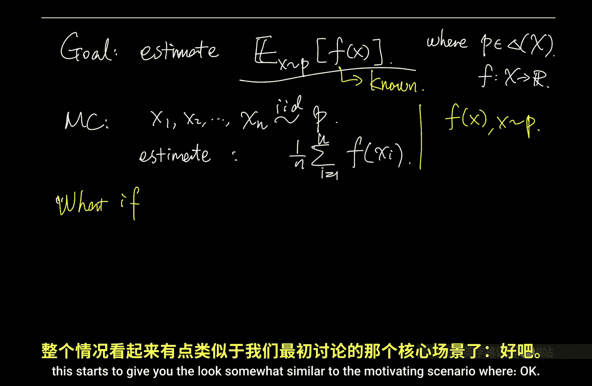

So that's the Monte Carro estimation。😡，Okay， and as this analysis shows， like。

 we just use hoing and we immediately have control over how accurate the estimate is。Right。

 but then we， we are now in this of policy valuation problem。

 which means that you don't get to row out the trajectories using the policy。 you want to evaluate。😡。

But instead， you can roll out the trarejectories using like or you can use previous data。😡，Which are。

Probably traasories rolled out using a different policy， right， So basically。

 there is a distribution mismatch。

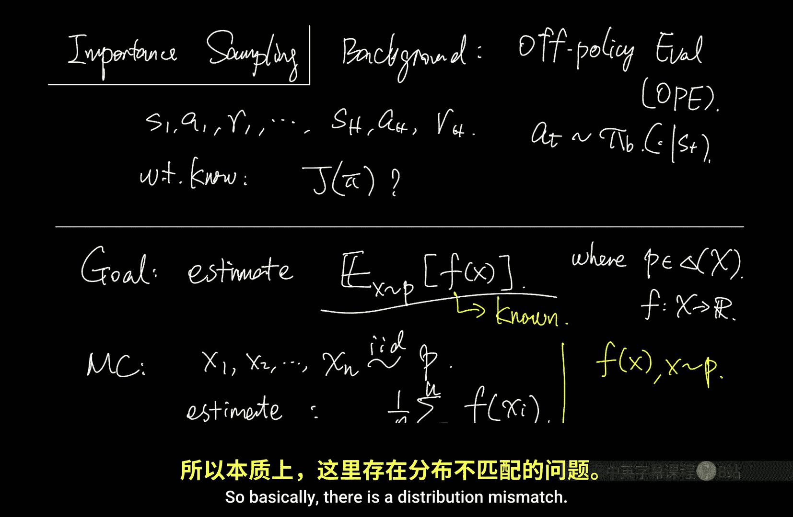

Now， back to this， like a more like abstract formulation。 we can pose like。

 we can abstract the problem as follows。 That is， instead of like these kind of data。

Instead of like this kind of data， which， you know， in R L， we can call it like on policy data。

 right， we only have like so called off policy data， which is like we have X 1， X 2 and X， N。

 I I D from some Q distribution that is different from P that we want。Okay。So。Then the question is。

 can we do something that extends the Monte Carro estimator。Right， so what we want is that basically。

 if Q equals P。We would want our estimator to basically fall back to Monte Carlo。😡。

But when P is different from Q。We want something that， you know。

 behaves in a somewhat similar fashion。And that allows us to， you know， estimate the expectation R P。

 although our samples are from Q。😡。

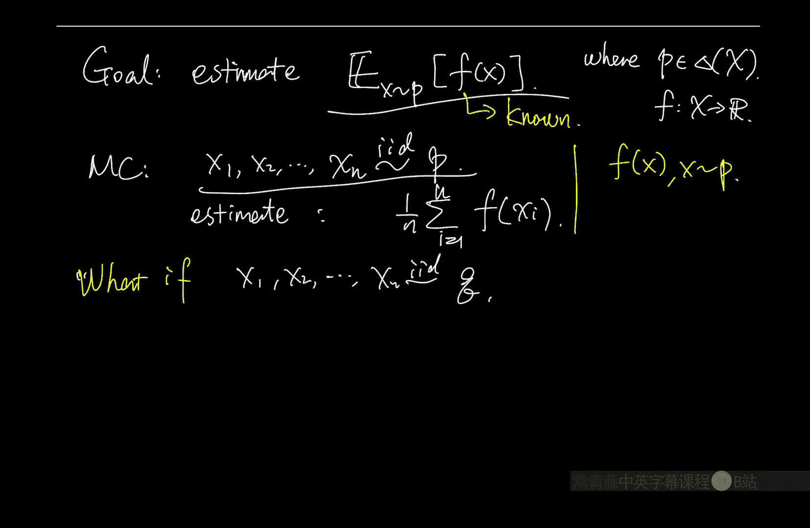

Okay， so what is the most the basic form of important sampling。

 Well it actually turns out to be very simple。So the estimate， you know。

 I'm gonna write in this form， right， So the estimator is F of x。 Okay， X from Q， right， So。

 of course， it's not gonna be that because this would be an on bias estimate of the expectation or Q。

Right， so therefore， we need a correction term。So， Q of x。P of x。Okay。

 so this is the important sampling estimator。 Now， remember， I'm writing in that form。 So basically。

 what you really need to do is that you get all these samples from Q。

 plugging each X into this expression and take their average。 This is your final estimate。Okay。So。

Now， because of this expression is just the function of each individual data point。

 when you take their average。 The average will concentrate to their main。 you know。

 as long as this whole thing is bounded。Right， so we can still use hub in quality to control that。

 But here note that boundness not only is different by F itself， but also depends on this ratio。

 This is called importance weight， importance ratio。 like it has many different names。

 We'll talk about its boundness later， okay。But， but there is another question， right。

 The more fundamental question。 We know this one concentrates to its mean， but what is mean， right？

 So what we really need to show is that it's mean the expected value is actually what we want to estimate。

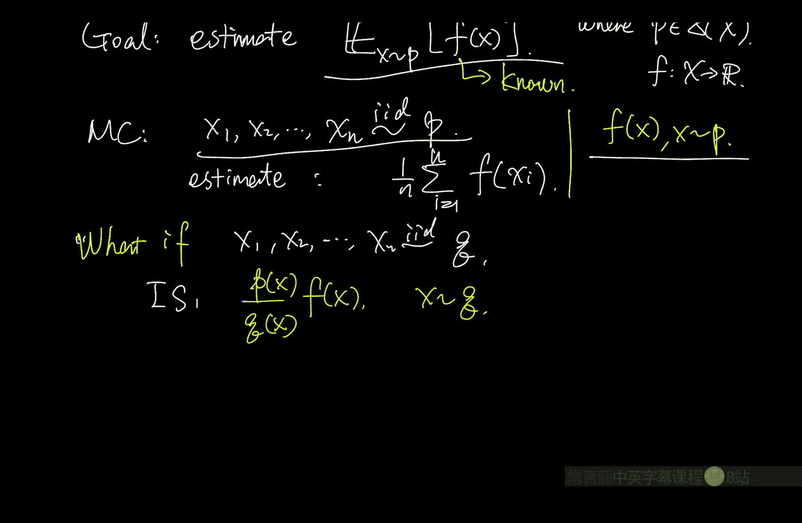

Okay， so that's the key key thing here。 So want to approve。呃。Prove。Of arm。Wness。Okay。

 so how do we improve on business， Well， we basically take the expectation of this estimator under the distribution that we have data。

 And we want to show that is' equal to the final thing we want to estimate。

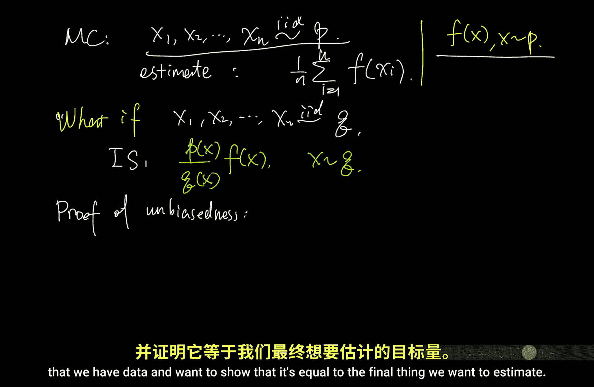

Right， so what we have is expectation。 Well， what kind of data we have， We have data from Q， right。

 We don't have data from P。 Otherwise it will be simple。 We have data from Q。

And our estimator is px given Qx， F of x。Okay， now here is why things are easy If you have finite space。

 So for finite space， I can just write expectation as the sumation， right， And I have Q of x times。😊。

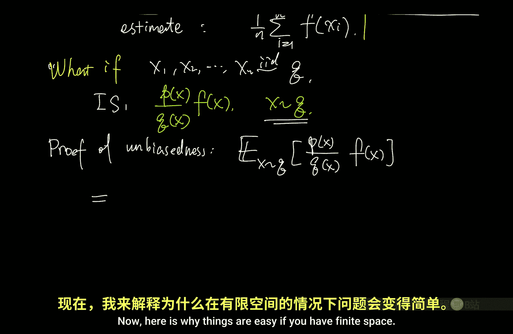

P of x， Q of x。F of x。And what happens？What happens here？Right， like you jump in too far。 Right， So。

 so here you have cancellation， right， So the Q of X that comes out from this expectation cancel out with the denominator of the importance weight P over  Q。

😊，And what you're left with is summation over a P of x f of x， what is this？😡，The expectation R P。

 right， so。This is expectation under。P。Okay， so we show that the mining of this  seter is indeed what we need。

And you have concentration， great。😊，Okay。Okay， so a couple of things。 So first of all。

 as you can see， like， if you think about this equation and this proof， like roughly speaking。

 intuitively speaking， what this importance weight does is that in expectation。

 it converts one distribution to another。Okay， so once you get used to this。

 what we will see is that whenever you have expectation under one distribution and then an important weight where the denominator is the distribution you're sampling from。

😡，Then essentially， this is equal to the expectation on whatever you put on the numerator。Right。

 so that's something like， you know， once you get used to。

 you can just immediately reflect because this is like conversion。 You know。

 whenever you have this ratio， it and this equals this。

 it converts the distribution from this guy to this guy。Okay， so that's the first thing。嗯。

The other thing is that the。

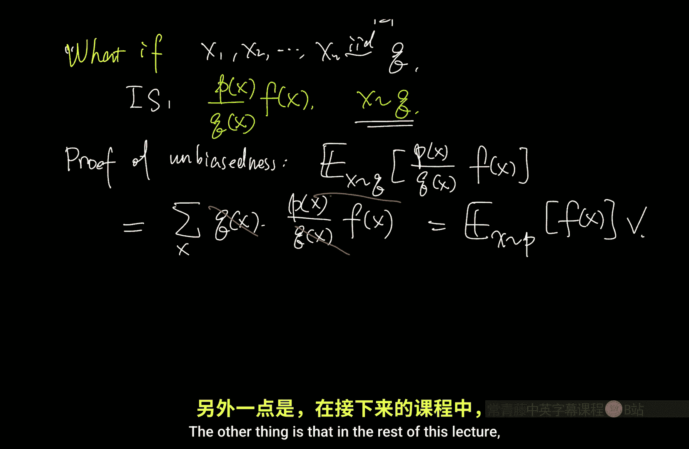

This， you know， in the rest of this。This lecture。This so called importance weight or importance ratio P of X over Q of X will play a real。

 really important role。 So we want to， want to really understand the， you know， its properties。

 One of the useful properties is that is expectation under the data sampling distribution。

 which is Q。 What is the expectation of this one。 this one。A equals to one， right。

 because to calculate this， you can basically let f to be 1。😡，Right， so F equals one。

 then this cancels。 You just have some over P of x， which is。1， right。

 because it's just that normalizes your distribution。 So this is one。

So therefore think of this important way as like， because it the expectation on data is one。

 is's kind of like an average， right， So it's basically the ways that allow you to reav the data。

 You're gonna up like essentially what happens is that let's say you have the distribution Q。

 you have the， let's say this is Q。 and you have a distribution。

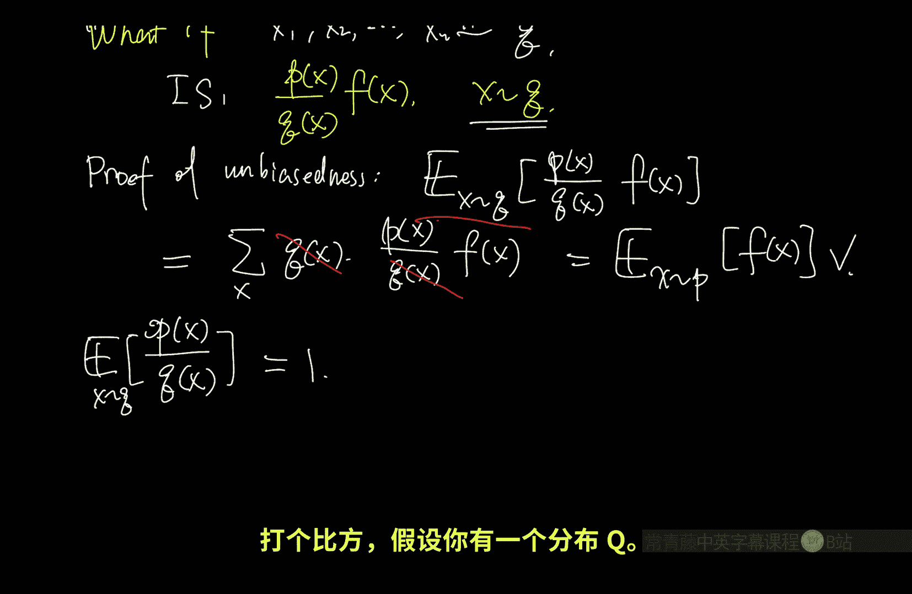

P， right？ You only have data coming from Q。嗯。So what I'm gonna do is that if I see a data from here。

 Well， it has good probably under cube， but really not that， not that large。 But under P E。

 I say that， oh， these kind of data points should have much higher probability。

 So what I'm doing essentially， I'm uping these data points。And then if I have data points from here。

 Well coming from Q， Well it has larger probability than it should have under P。

 So I'm down weighting those data points。 right， So essentially， by these reweighting。

 I'm reweighting data points that look like。That look like this is coming from P then Q and down weighting those that look like they are coming from Q then P so that I just essentially you know。

 adjust the， the distribution and expectation。Okay。

And the other way to think about it is like these are like ways。

 essentially you're still doing kind of an average over F， but it's like a weighted average。Okay。

 so and this is one thing。Well， the second thing is that， you know， I motivate this by saying that。

 okay， you know， at least one potential scenario， why you would want to use Monte Carlo is when you don't know the knowledge of P。

 but you have sampling access to it。

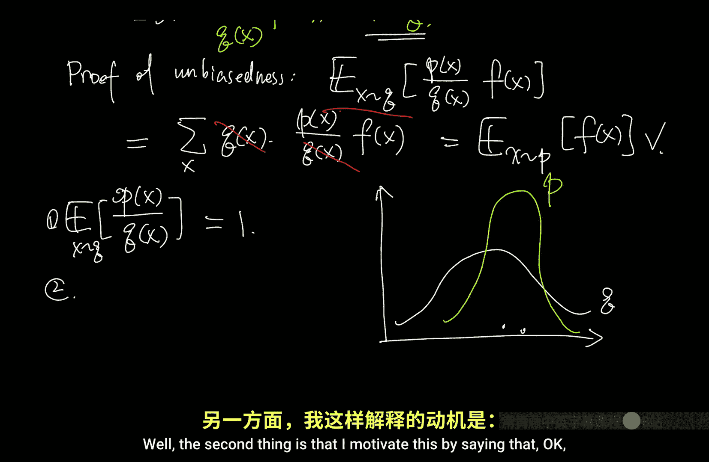

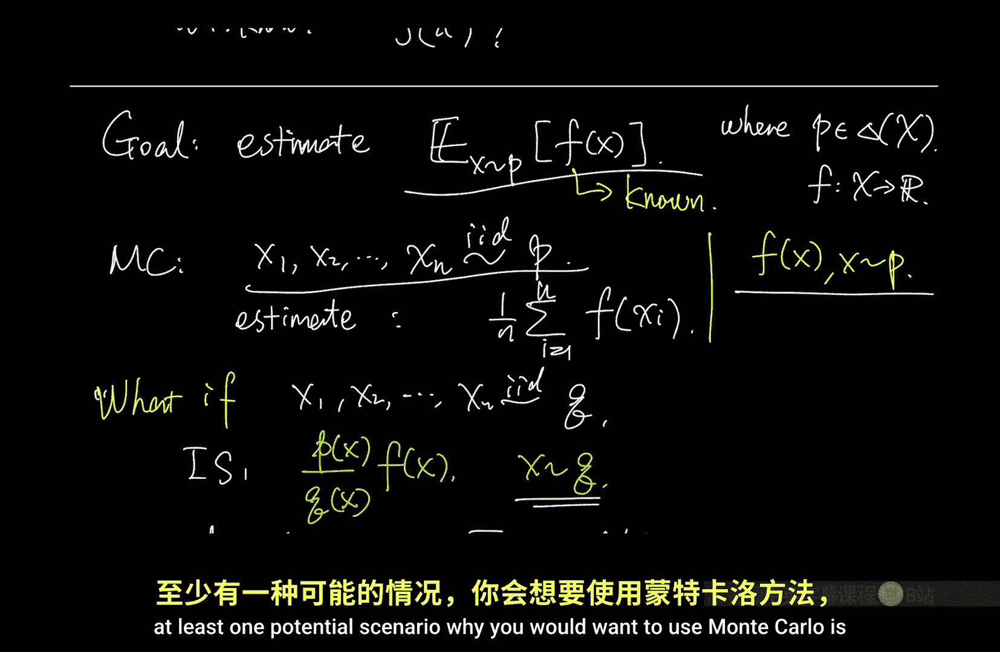

Right， and in fact， when we do this Monte carro estimation of the return， you know。

 on policy estimation of a return of a policy。 you have a policy pi。 I want to know is expectation。

 is expected return， which is throw out the trajectories from the simulator and then take the average。

 So that's a perfect example， because I have very easy access to generally dis sample from this distribution。

 But if you ask me， what's the actual distribution of a trajectories in the MP represented by the simulator。

 Who knows， like there's no way that you can write down that probability， you know， density function。

 especially when you have a complex black box simulator。 right。

 So this is a perfect example where you don't know the probability distribution of react。

 So in that example， X would be like like the whole trajectory。 But but you。

 but you have easy sampling access。

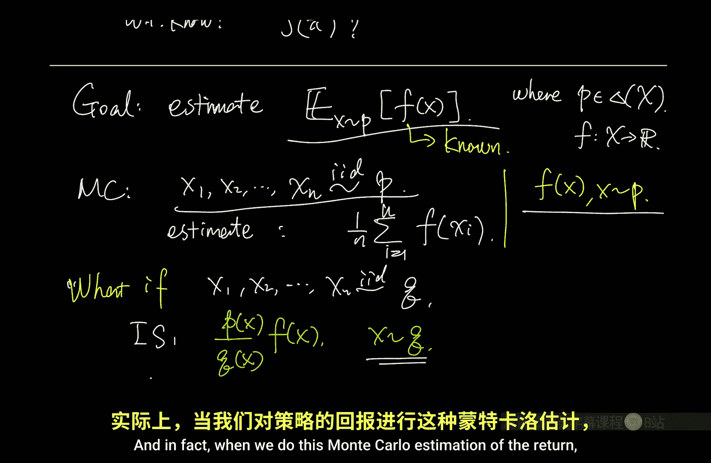

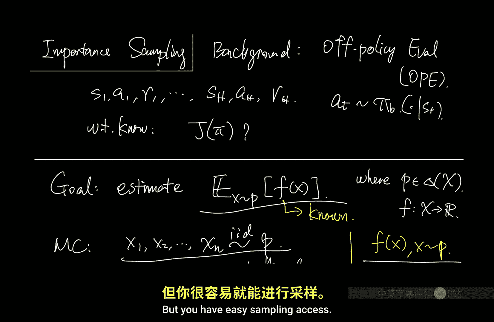

Right， but then if you look at the the important sampling estimator。

 it kind of like be the purpose of this， right， because in order to do important sampling。

 now you need a density function or probably mass function of for P and for Q。Okay。

So for now you can't like this maybe maybe doesn't make sense， but what the interesting example。

 in fact， I think RL of policy evaluation is one of the best like example for showing that oftentime in practice。

 you don't know P， you don't know Q， but you know they're ratio。😡，Okay， so we'll see that you know。

 immediately next in the R example。呃。So。你去。😔。

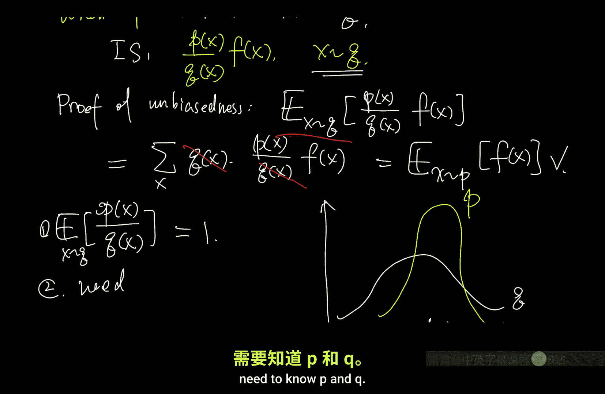

No， P And Q。Okay， so the third thing， as I mentioned， is that if you think about the。

When you use half things to bound the bound this。呃，帮 this呃。呃。To。

 to bound the error of this estimation， it involves the boundness of each term， right。

 So and the boundness not only come from the boundness of F。

 but additionally come from the boundness of P of x， Q of x， you know， like， let's say max over x。

Right， so or we can write it as P over Q infinitefin norm。 So in general。

 we what will require is that Q provides proper coverage over the P distribution。Right。

 so if you have like， like somewhere where P has non zero probability， but Q has no probability。

 Well， you essentially run into， or when the Q probability is like extremely low。

 then you basically run into like extremely large or even possibly infinite importance way。 right？

 So， of course， like things won't work。RightThe whole analysis so far， actually。

 I didn't write down this assumption， but even the on businessiness proof requires this assumption that whenever。

 you know， whenever for for any x such that P of x is greater than 0。

 Q of x need to be greater than 0 and their ratio should be bounded right， if you don't have this。

 if you don't have this， which is like very black and white binary， right， is。

 is whether like when it's greater than 0， it shouldn need need to be like strictly greater than 0。

 if you don't have this， the on businessness doesn't even hold。

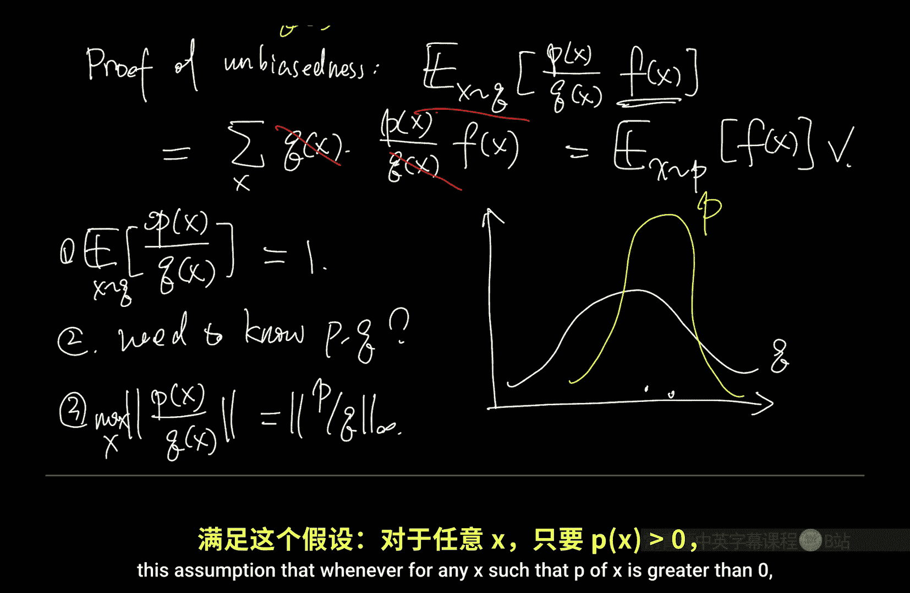

But even if vbis hold with this， if the ratio is terrible， when you do concentration。

 your concentration error can be like huge because the constant that is determined by the range of your random variable is extremely large。

Okay， so where have you seen this guy？😡，Where have you seen this。

We've seen like a quantity that looks very much like this just last week。😡，Yeah。

 so like when we analyze the fi iteration now or the more fi evaluation。

 it also involves this notion of coverage， right， so that， you know。

 our data distribution needs to provide coverage for the occupancy distribution induced by various different policies we may care about。

😊，Right， so that's what happens in in the analysis of you know， Feta cube。

 You see the same thing over here。Okay， so essentially， if you compare the proof of this and the。

 the proof we have last week， they're eventually doing the same thing， right。

 It's like you want to get something on a different。

 you want to get some guarantee on a different distribution than your sampling distribution。

 The difference is that there。 What happens is that。Like， so here。

 the algorithm explicitly involves the density ratio or importance way， density ratio。

 importance ratio， whatever you call it。 Okay， so we use it in an algorithm， right。

 so here by algorithm mean the important sampling estimator。

 we explicitly use this ratio to correct the the， the distribution from Q to P。😊。

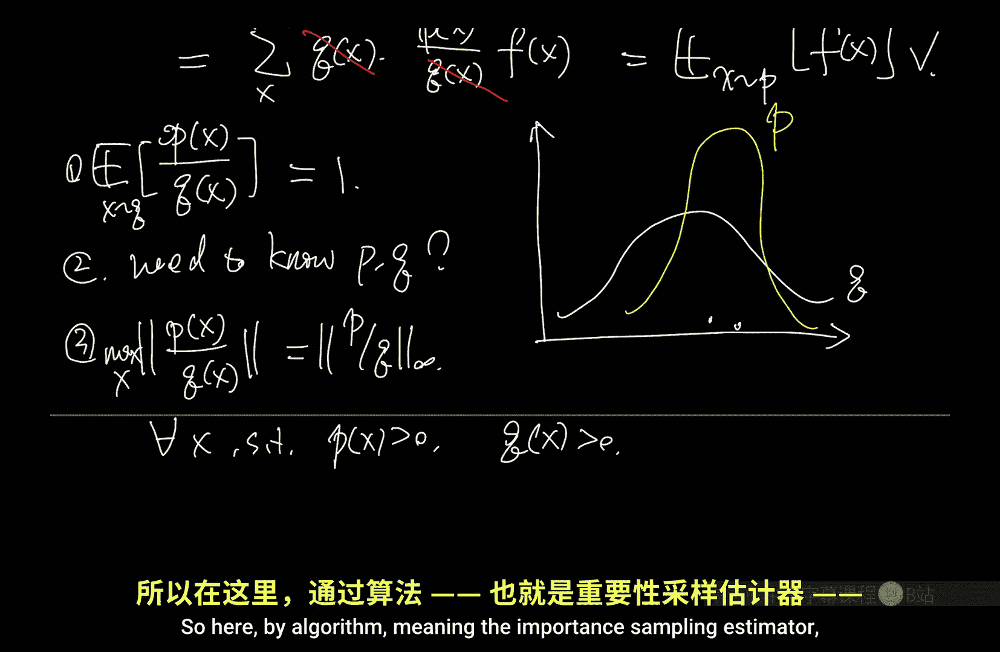

Right， but in the previous analysis， this ratio itself doesn't show up。 right。

 Like what happens is that we're actually minimize a loss function。 And， in fact。

 that loss function needs to be non negative。 and we minimize it on some Q distribution。 And we say。

 oh， like the same loss function must also be small when you evaluate it on the P distribution。

 So that conversion is implicit。 It only happens in the analysis。

 You only see this ratio in the analysis， but not in the， you know， algorithm。Right， so therefore。

 like， you know， sometimes people refer to both as important sampling。 But to avoid ambiguity。

 well call this important sampling。 And for the NA we did last time。

 it's often referred to as change of measure。 You're changing like the distribution you use to measure error。

 right？ And when you change that measure。 like， it can also involve something that looks like an importance weight。

Okay， and the other thing is that there， like， if you remember。

 like the change of measure crucially depends on the fact that your loss function is pointwise non negative。

 But here it doesn't have this restriction。 F can be positive negative。 It doesn't matter。

 And this is the benefit you get when you explicitly use the importance weight in in your estimator。

Okay。Any questions so far？

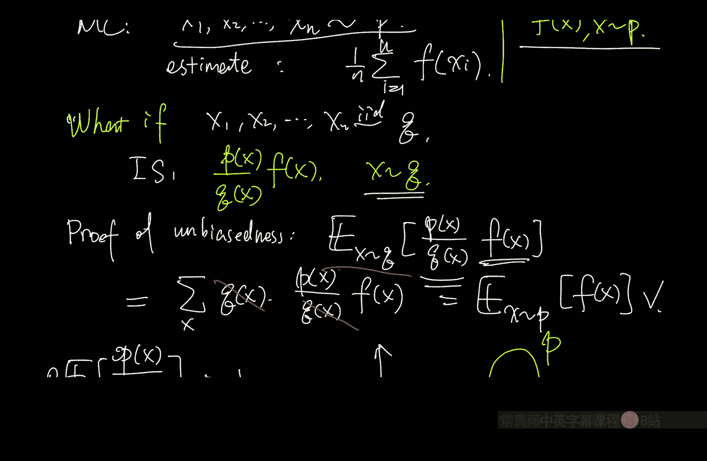

Okay， cool。 So now let's see the example， right， So as I mentioned， like this is a pretty abstract。

 And in particular， we have this weird question， which is like， you know， if， if you know。

 if you need to know P And Q that kind of defeats the purpose of using Monte Carlo style estimators。

 So let's see what have like like a very nice example of in context band。😊。

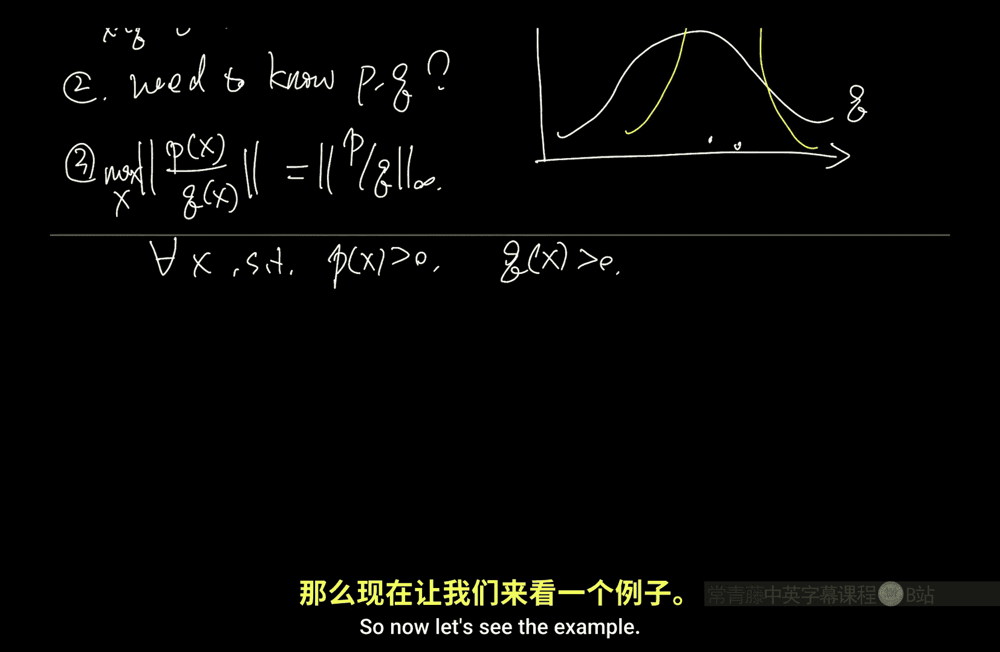

Okay， so Carial bandit。 And let's see， in order to avoid。ACo of。嗯。Of symbols。

 Let me still use as for state。 So what is context band is。

 So connection band is this essentially is finite horizon R with the horizon of one， right。

 So remember， finite horizon R is where you have many trajectoryjectories each trajectory。

 you start from some initial state distribution row out trajectory of like certain number of time steps that say H steps to the end and you're down start from the initial distribution again。

 row out another trajectory and so on so forth。 right。

 So connection band is can basically viewed it as like finite horizon R with horizon one where each trajectory is just a state action reward two right。

 So you have I'm gonna directly write the， okay， given。😊，Given a policy pi， the map states。

 let's say distribution of actions。嗯。Maps stays to distribution of reactions。

The kind of distribution or virtual trajectory it induces is like you sampled as from the0。

 Like we' you gonna use the 0 as the initial state distribution。 But in banded literature。

 this distribution is called the context distribution， right， So， for example。

 this is kind of like a movie recommendation where a random user comes。

 The user comes with user profile history and all the relevant information。

 And that is the state or the context， right， And then you take an action。

You take an action from Pi given S， right， So let's say you're the movie recommendation website。

 You recommend one of the movies to the user give using your current policy。

 using whatever policy you want based on the user profile。Right。

And the reward is maybe like user gives you a thumb up or a thumb down。 like whether the user。

 the user watches the movie and tells you whether he or she likes the movie or not。 right。

 So you have R。 So here we're gonna assume reward function is storcchastic。

 otherwise fored it's not that interesting if reward is deteristic。

 So let's say you get a random reward signal from a certain reward distribution that depends on the context or state and the action。

😊，RightNow in MDDP， you will have transition to next day， you take a action again and so on。

 but for band it's just one stepr， so you're done with this。😡，Okay， so given any policy。

 you can just it defines a joint distribution over S A R tuples。Okay， now you， you can have the。

You can have the off policy evaluation problem。 That is。Given data。Given data。Where I have S A R。

I'm just gonna say sample from some pi B， some behavior policy。 So it's still the same procedure。

 right， You asem S from D 0。 But here you asem a from pi B and you get R from R of S A。

I want to estimate。Want to estimate。J of pi， which is just the expectation under trajectoryies generated from the pi distribution。

 they expected to reward。Okay。And by the way， like， you know， for， for R， like， you know。

 before the using I O Ms， the most。Prominence industry application of R。

 It is actually applying contextual bandit to these like recommendation systems。

 and you actually run into you literally run into these of policy evaluation problem。 right。

 You've interacted with user for time。 You can a vast amount of data。 You analyze it。

 run your favorite training algorithm。 You get a new policy。 Well。

 wait before you deploy it to the user。 Wait before you push it to deployment。

 Please tell me why the new policy is better。 using your old data。😊，Okay， now you face this problem。

 literally。😡，Okay。So。We'll see that this is an important sampling problem because。😡。

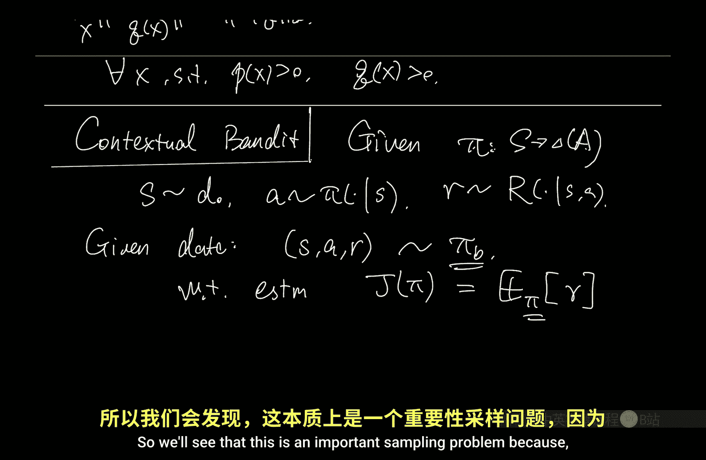

So we're gonna map it to important sampling， right。

 But important sampling talk about you have x from distribution。

 We're estimating the expectation of some function of this distribution of of this x sample from distribution。

 right so。

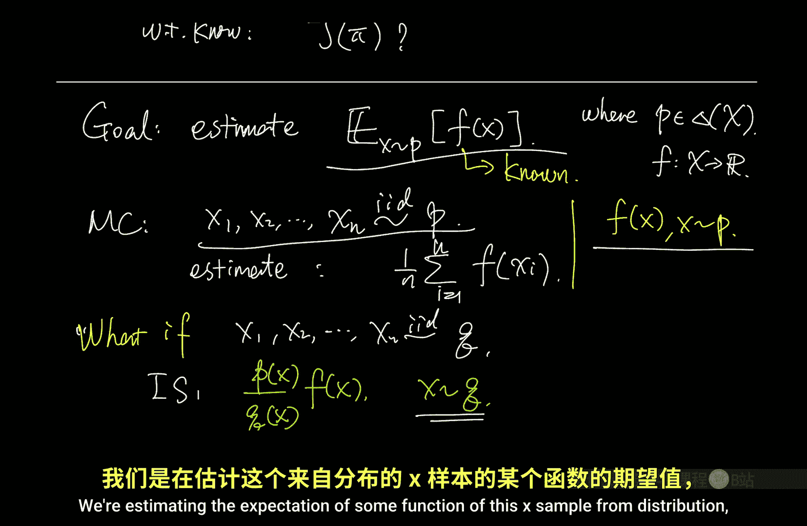

Therefore， we want to。呃。Map to important sampling formulation。 So important sampling。

 we have F X P Q， right， So we have these four elements。 If we can map these four elements to the R。

 like you know formulation， the bandit formulation over here。 Were good， right。

 So what is X X is basically each data point。RightWhat's the data point in this case？Right。

 so it's it's not just S， right， It's the entire tuple， right， So X is。S AR， right？

 So entire triple is an X。

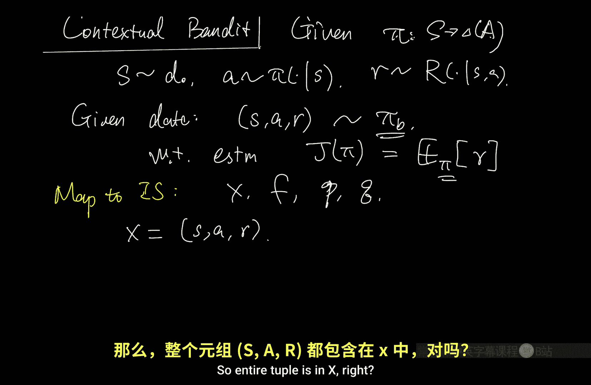

Right， so now what is the F that？Okay， before we talk about F， let's talk about Q， Q。

 which is the sampling distribution。 You're sampling the。're for the data。

 what's the distribution of SAR？😡，Well S from pi B， right？ So Q。

 like X sample from Q is equivalent to S from the 0。 A from pi B R from R of S A。Right？

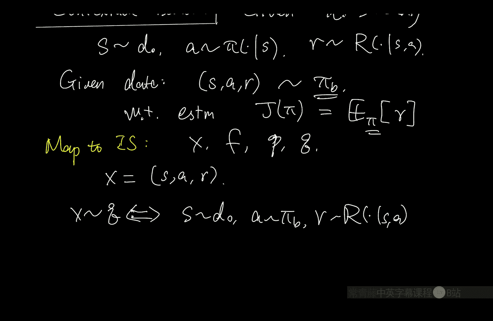

Okay， now for the say， Okay， so now let's say what is。So for the same reason， what would X from Ping。

 right， P is the target distribution。 Well， that obviously means。The 0， a from pi R from R of S a。

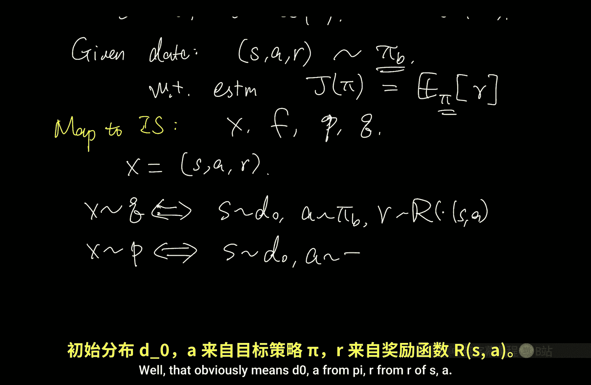

Okay， so what is F？So ultimately， we， we in the important sampling framework。 Ultimately。

 we want to estimate the expectation of F。Of x， when x sample from P。And there we say。

 we want to estimate the reward。Under the distribution generated by pi。 So what is F。Like， precisely。

Well， yes， you're right。 You say F is just R， but F is a mapping。

 F is a mapping from X to real number。 So you can informly write down that mapping。

It's not a tricky question。 It's a very easy one。 I just want some formality and rigor。Yeah。

 it basically takes in an X， right， So here X is S A R， It map be to R。Right， is that simple， right。

 So now you can easily like if。

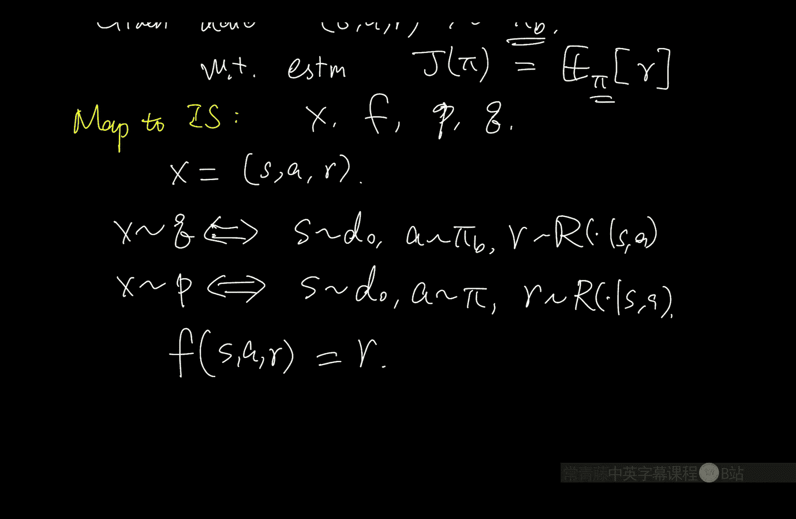

Easily verify that expectation under P of x。sorry， F of x is exactly Jpi that we want to evaluate。

Is that is that good？Okay， now I' just。Okay， now we've mapped everything。 important sampling。

 Let's go， right， So what's the important sampling estimator。

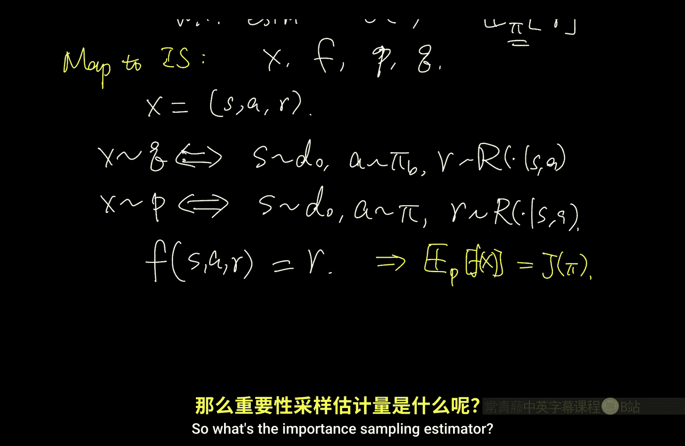

Important sampling estimator。 Remember， is P of x given Q of x times R， sorry， not R。 the F of x。

 We're gonna map it to the RL， you know， elements， the notation in the next step， right。

 So this is the important sampling estimator。Let， let's just plug thatddy。 Right， So F of X。

 we already know， that's just R。 right， So we， we'll put R at the end。Okay， so R is here。 Okay。

 so this ratio。 Now here's the， now we run into that problem， right。

 Now you're asking me to tell you， what's the joint probability distribution over S A R。几号。Okay。

 I know that。Well， let's try to write it down。 Right， So。

 so basically is whatever distribution of S A R is under pipe。Okay， maybe I can write it in this way。

嗯。Probability under pi B， the S AR versus probably under pi of the。呃，SR。Right。

 so essentially I'm asking you to figure out this。

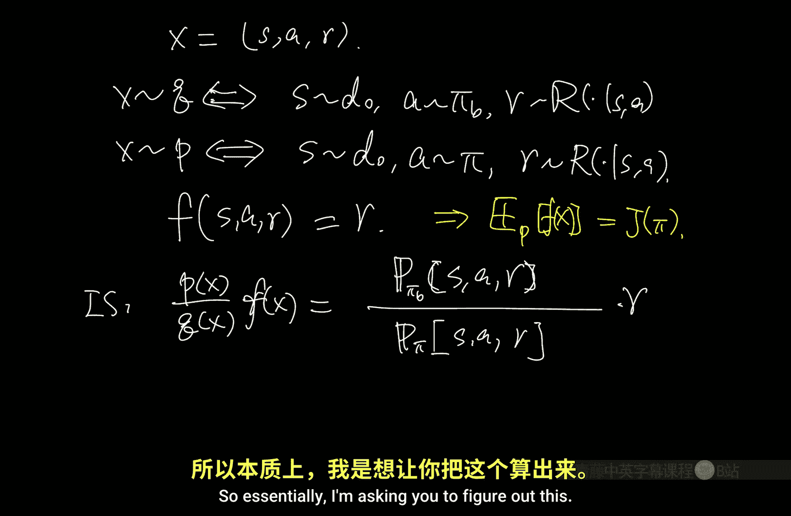

Okay， so， of course， this is not obvious how to do。 So let's do it more expanded， right。

 So we know that S A R is a， you know， it is a joint random variable。 It has like three components。

 S A R。😊。

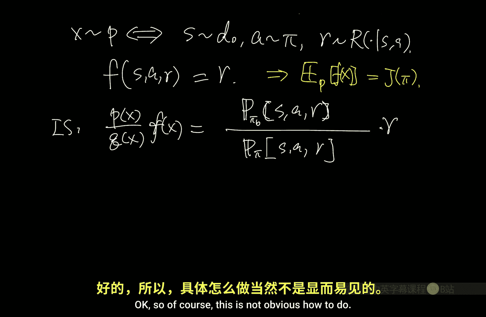

Right， right， right。 You're right。 So the new， yeah， yeah。 So here should be pi。

 Here has pi B good catch， okay。

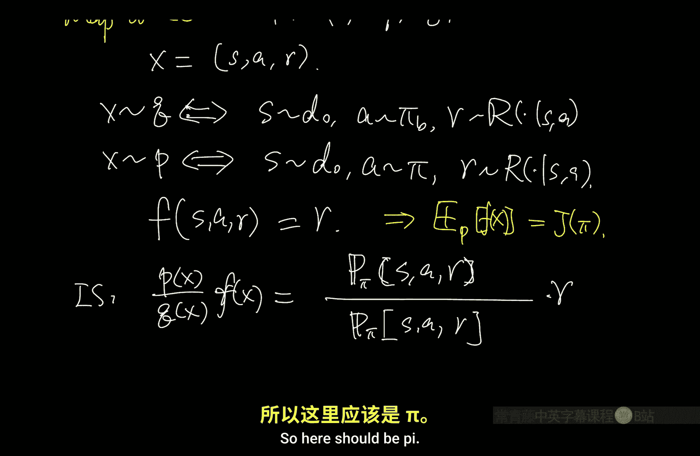

So， you know， let's take care of either one。 So let， let's start with the numerator， right。

 So with's the joint distribution。 Well， when you have a joint distribution of the joint probability of multiple random variables。

 you can always decompose it as the marginal of the first conditional of the second。

 given the first conditional of the third， given the first two and so on so forth。😊，Right。

 and and by the way， like I have a， this is one of my pet fees。

 A lot of people have complaints about the auto regressive nature of L Ms。 They say， oh。

 like auto regressive models are just bad because of blah and bh。 And they they decide reason， wow。

 that's because L M is generally the next token based on the previous tokens。 And I was like， like。

 what do you expect， like， like， if you generate anything that is a distribution of sequence。

 You can always write the entire distribution as the marginal of the first condition of the second。

 given the first condition of the third given its first two and so as so forth。 right？ And of course。

😊，You know， like。You know， LOM has this inductive bias。

 but just the fact that you can write down the entire join probability in that chain form doesn't mean anything。

😡，Right， but you often see people criticizing L M by say， oh， look， it's generating in this like。

 like， chain formed way， like probability。 It was like， that's not。Okay， so let's do that， right。

 So let， let's be a little slow here。 So actually。😊，Let's write down。 So what is the probability。

Of P given S A of S A R， right， So this is probably under pi， the S， probably pi A given S， probably。

A given G S A。So what is this？D0， right， So this is the like a state distribution is marginal， right？

 So it's， it's it's basically whatever probability that the0 assign to you。 Okay， and also。

 for simplicity， like here， I'm gonna like， as， as usual， I'm gonna assume state is finite。

 Actually is finite。 Reward is usually a continuous distribution。

 but you can always like deal with that properly。 But let's say for now。

 reward is always supported by a finite number of possible values just so that everything is probably mass that I don't need to separately handle like continuous density。

 okay。😊，Okay， so then what's the control distribution over of a given S。Well。

 that's just the policy probabilities， right pi a given s， and what is the final thing？😡，Well。

 that's just the the whatever reward distribution， right。

 given as a what probability the reward distribution assigns to a particular。Ohoops， okay， yes we。

Have to， I think， somehow。那。Is't a sensor over here。 Yeah， okay， cool。Okay。So， right。

 so you have this。 So by the same fashion， you can also write down under pi B S A R equals the 0 S pi B。

 A given S。

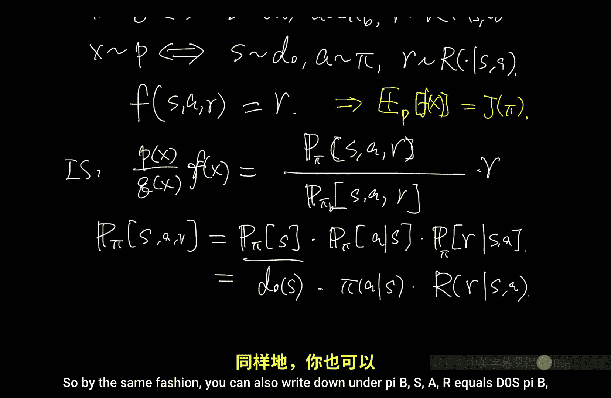

R， R given S A。So。Now， what happens when you take their ratio。Kled， right， so we take their ratio。

Take the ratio this。Right， and somehow magically， whatever get canceled are the things that we don't know。

Right， we don't know a probably density function or probably mass probably distribution function for the context or the state distribution。

We also don't know the。Reconal reward distribution， given essay。 And， in fact， like， in particular。

 this is kind of like the key thing of the really the system， right， because if we knew this。

 we can immediately give you the alpha policy。 I don't even need testing。

 I don't even need like validation。 I can immediately tell you。

 what's the optimal thing to do by guarantee， right， Of course， this is a thing that we don't know。

But magically， when you take the ratio， all these things that are unknown get canceled out。

And what's the reason， well the reason is because basically those are not the things that you cannot control。

😡，By changing different policies， you see like these quantities are independent of your policy。

 right， So over here， when we write it in very general form。

 when we just decompose the joint probability into a number of chains without leveraging the problem structure。

 all these probability needs to be parameterized by whatever policy you're using。However。

 by leveraging the problem structure， we now know that this quarterly distribution and this conditional distribution are both independent of your policy。

😡，So regardless of how you change your policy， these terms remain the same。

 So when you whenever you take the ratio， they always get cancel out。

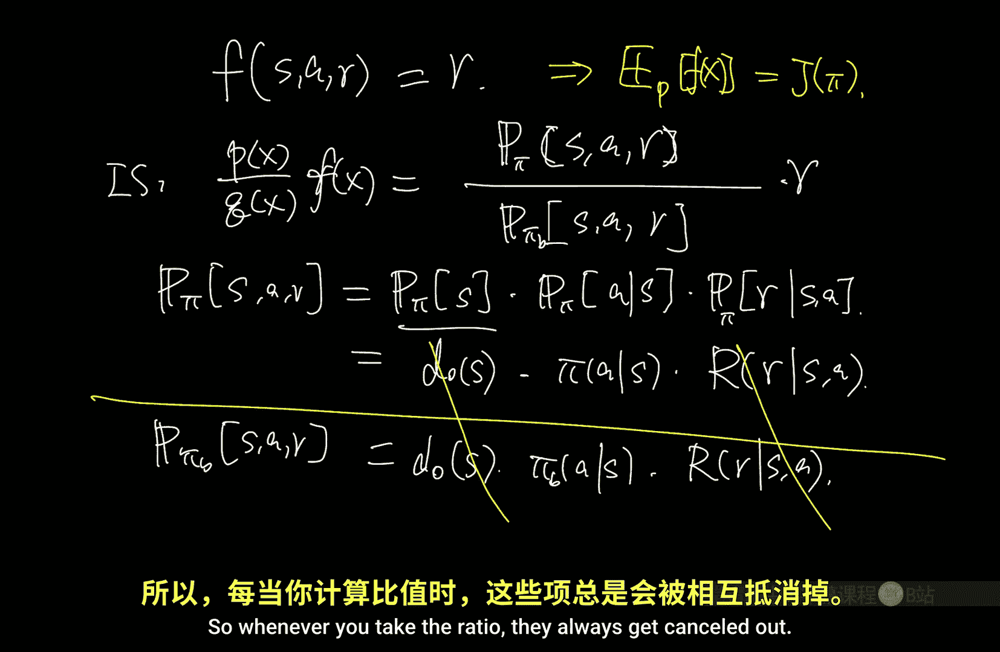

And the only thing that remains is like your action probability。😡，So at the end。😡。

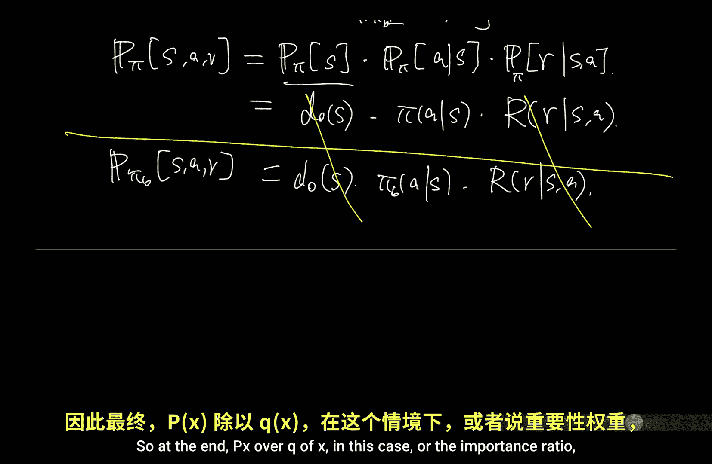

嗯。P X over Q of x in this case， were important ratio sometimes。You know。

 in the context of our L and bands， we often give it a symbol called row。嗯。呃，人民。Do it this way。嗯。

Row of x。 sorry， not row of x。 Just row row。It was。Pi a given act sorry， S。Pi B A given S。Okay。

 and your final important sampling estimator estimator is just row times R。With the understanding。

 what happens is that for each data point， SA AR， you plug that in and take the average。😡，Okay。

Any questions so far？So。嗯。Okay， so the fact that you can just evaluate a different policy， you know。

 using data from different policy， it sounds like magical in first at first place。

 But if you look at actually what the as parameter does， like you know， for it to work。

 it comes with assumptions， right， So just as before， whenever you use important sampling。

 you need to guarantee that this ratio never goes to infinity。 And， in fact。

 you want it to be well bounded， right， Therefore， you need pi a given an S divided by pi B。

 A given x to be well bounded。😊，It can be the case that pi puts good probabilities on action。

 but pi B puts parallel or even like0 probably on that action。 Then this wholesing breaks down。Okay。

 so when you have finite number of actions。 And， but， but let's say you train a。

 you train a deterministic policy。 Well， for each state， you wouldn't know which。

 which action the trained policy wants to take， right， So you can't see foresee that everyri。

So what's the best way to prepare for important sampling？😡。

What the best thing you can do is that when you collect data using pi B。

 let's say your previous iteration of the policy。 And let's say previously。

 you've evaluated theministic policy。 You think it's pretty good。😊，But then in production。

 what you end up doing is that you say， okay， because I want to use this later data later for a policy evaluation。

 let me inject a little bit of randomness。So you typically do this Epsilon greedy thing。

 which is like with probably one minus epsilon， you。

 you take like whatever determinist policy you want。 But with the remaining epson probability。

 you choose actions like uniformly or random。Okay， so that's a pretty common thing。😡，In practice。

 so that this pi B put nausea probably on all actions。Okay， then later， when you evaluate it。

 like at least like this is like some finite value and bound it。

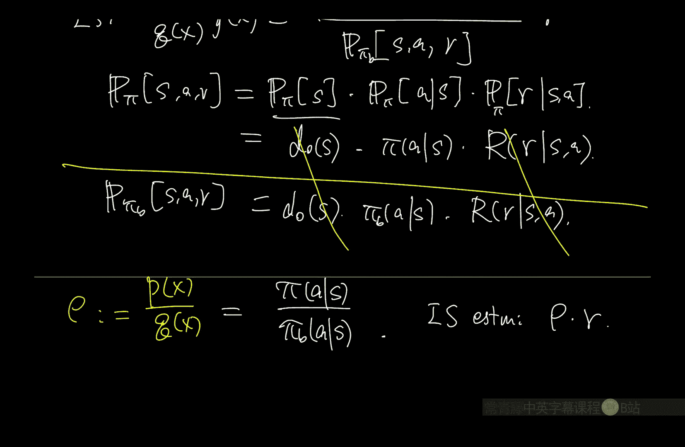

O。So that's the first thing。嗯。You know， and if you go back to the question I asked at the beginning。

 It is like， if during my data collection， I always take left。 No。

 I want to know what happens when I take right。 Of course， you still can't answer that question。

 right， So what the important sampling says is like。

 how about you randomize your action during a data collection， right。

 I put some probability on taking right。Right，And then like， okay。

 so we'll actually see you know what happens with that shortly， okay。So。There's that。 So。

 and to understand the the the real like behavior of this as meter。It will be like。Instructive to。

 to think about a special case。 So special case。So pi is deterministic。That is for each state。

 It puts all probably on one action。 So with abuse notation， we're also gonna write pi of S， right。

 So then this， this this to some action。 So， so therefore， here。

 the pi is treated as a mapping from just state to one of the actions。Okay， so and pi B is uniform。

At random。Okay。😊，So whenever you have an action， it's just like uniformly overall actions。Okay， so。

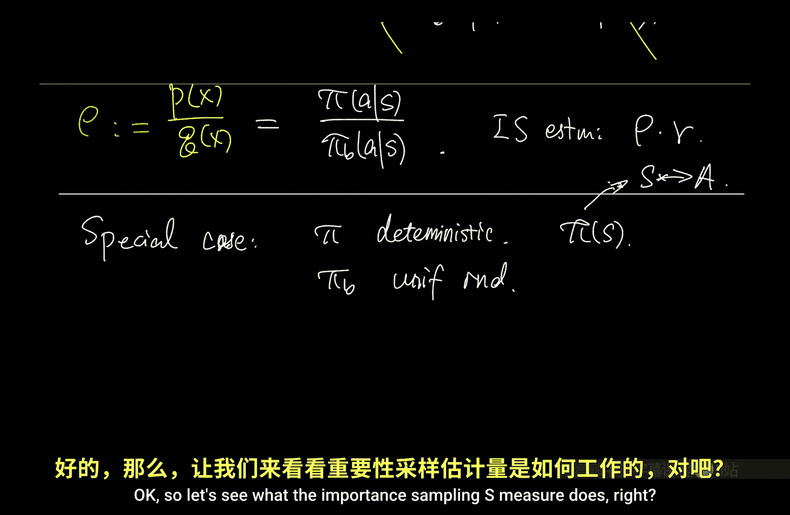

Let's see what the important sampling in as does， right， So then row equals would。

 row equals this weight。 So， so basically， what happens is that you see a state action pair drawn from data。

 right， And which policy do you use to collect data。

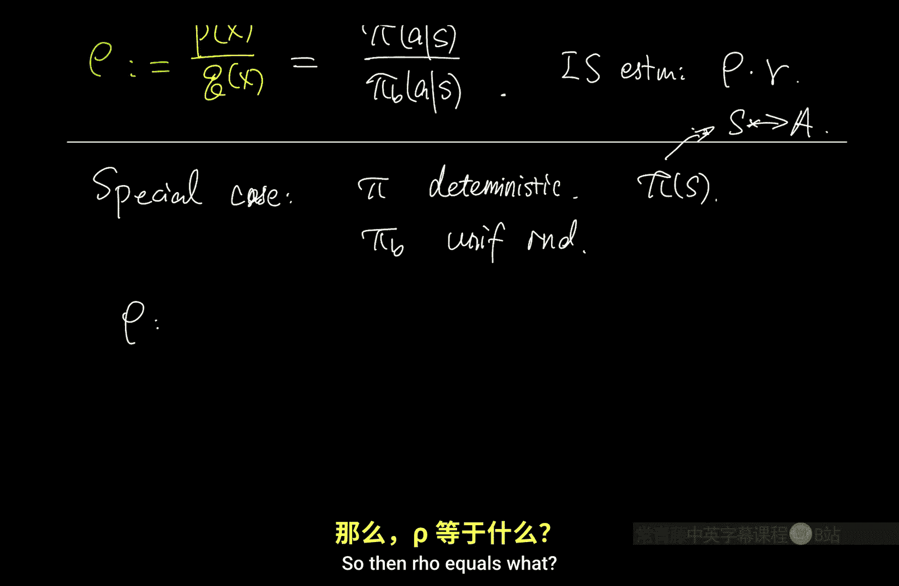

Which policy do you use to collect data pi B， right， So this is the B stands for behavior。

 This is like the behavior policy。 Sometimes it's also called the logging policy， okay。

So you use P B and because P B is random， so you will see all kinds of actions。😡，Okay， so basically。

 then whatever action state action pair gives you。 now you need to calculate this， right， So。

 so you first need to calculate this， right， So which is the probability that the policy pie assigns to whatever random action you see。

Right， but because pi here， in this special case， pi is deterministic。

 it only wants to take one of the actions。So which means that it assigns probably one to that action。

 Okay， But， but but you're taking action according to P B。 So you see all the actions。

 What happens when you see other actions。What a probability does pi assign to those actions。0， right。

 So， so therefore， the numerator is either 0 or one， right。

 depending on basically whether you have this match。

 whether the random action choice happens to run into the action that pi wants to take， right。

 So you can write it as indicator of pi of S equals a。Right， because。

 because here with abuse implementation， we use pi of v to mean the action that pi really wants to take。

And if it is equal to the action you see in the data， which is sampled from pi B。

 the uniform random is a1。😡，Otherwise， it's a  zero。😡，Right。Divided by one over。

No number actions because Ppe I assume is uniform， right， and I assume this is a finite action space。

Okay， so then what you see is that basically into two terms two possibilities。

 either its value is just a。 the number of actions。 if you get the hit。嗯。

And this hit happens with probability。1 over 8， right， Because with uniform sampling。

 the chance that your random action hit that particular action that Pi wants to take is just one over  a。

Okay， otherwise you gave it a0。😡，If pi of S is not equal to a。Okay。So I mean。

 one way to think about it is that essentially all these data points with zero ways are discarded。😡。

Okay， so there are two ways to think about this。 One way to think about it。 you know， if。

 if you follow this way to think about it and all the remaining data points where you haven to have a match get equal ways。

 although their ways are very large。Right， so there are two ways to think about it。 One is to say。

 okay， I'm actually dropping this these in these terms， these zeros。

 and I only focus on these data points and take the average of the reward over there。😡，Right。

 if you think about it makes sense。 So back to the left and right。 So in this case。

 let's say during data collection， I randomly take left versus right。

And now if you ask me what happens when you always take a right？😡，Well。

 I'm just gonna throw away all those data points where I've taken left。

I only got the data points where I had to taken right。I averaged their reward， but that's the answer。

 of course。Right， so if you think about it that way。

 like important assemblyse is not doing anything really magical。 It's， it's just like， you know。

 it just like behaves that way。😊，Another equivalent way of thinking about it is actually。

 if you think about it in terms of the important sampling estimator， right。

 So if you think about this like dropping sample view， then your effective data sample size reduces。

Right， but for each data point， because you're just doing average， like equal weight average， you。

 in some sense， theres some salary well get into later。 But like roughly speaking。

 you no longer have this issue that is you know， the importance weight has a large range。

 You need to take care of it in ho things。 roughly speaking。

 you don't need to deal with that anymore， right， because that's already reflected by the fact that your sample size has shrunk。

Because you've dropped data points。 In fact， in this case， you've dropped a lot of data points。

Only one over a portion of the data survives。The majority of the data is dropped。Right。

 if the number of actionss is like moderately large。

An alternative way of thinking about it is that I always have。

 I always have all my data points because I'm using important sampling estimator and average them over the in her data。

So my data size didn't change， but compared to on policy Monte Carlo estimate， all my data point。

 like my estimator on each data points has very terrible range。Right。

 because now it's the reward range times the range of this guy， which can be as large as a。Okay。

 so these are basically two like two sides of the same coin。😡。

Either you think that your estimator doesn't have blow up various or range。

 but your sample size has shrunk， or your sample size didn't shrink。

 but each your estimator has large range they're roughly the same thing。😡，O。

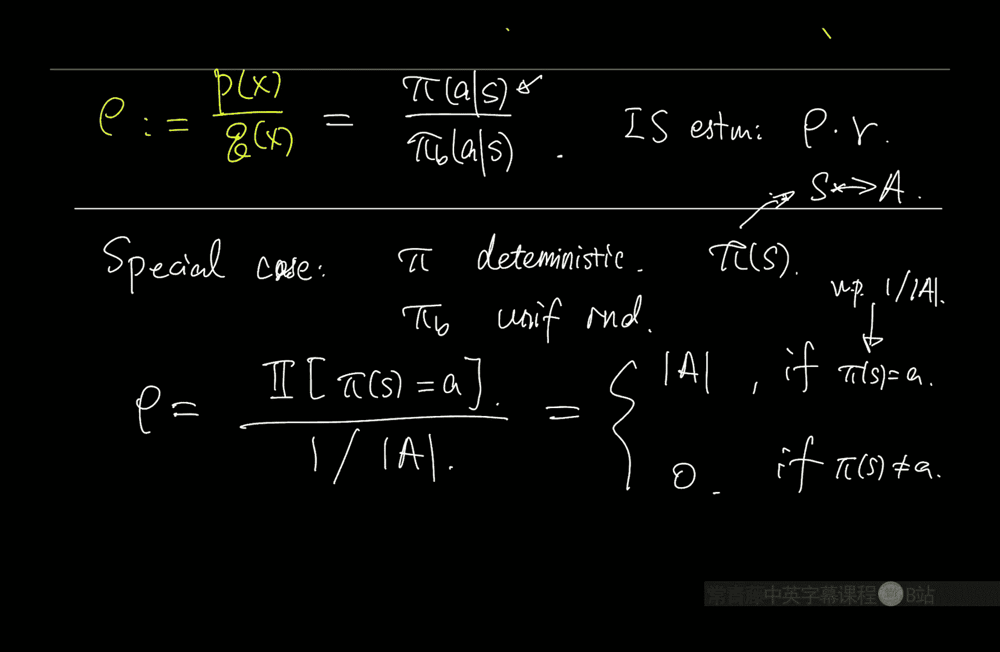

Okay， so there's this and。

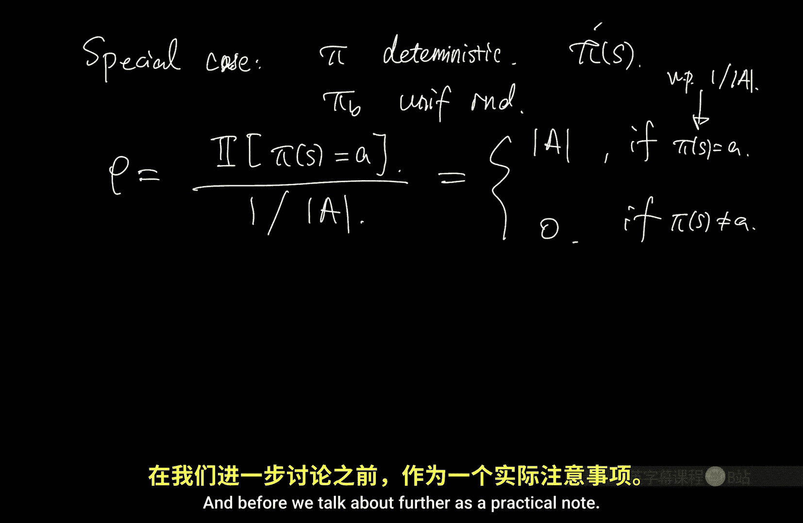

As a， before we talk about further as， as a， practical note。 So I mentioned that you know， in。

 in actual industry application to prepare yourself to do important sampling later。

 you may want to inject randomness into your policy when you collect data， right。

 So that's one thing you do。 What's the other thing you want to do。

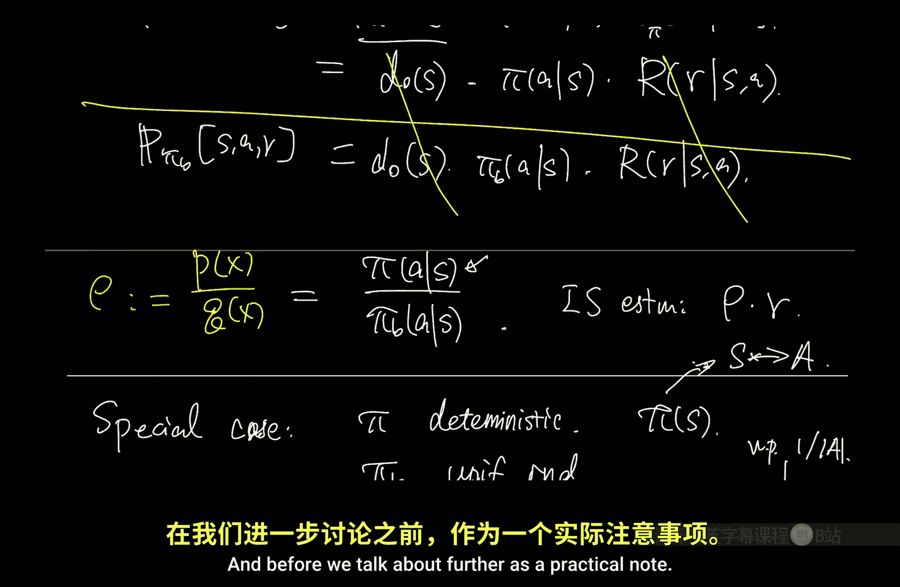

Let's see your data is S A R。 Like you collect your data。 Okay。

 so your data is a bunch of S A R twoples。 Now someone say， okay， please do important example。

 I have this new policy。 Please evaluate that for me。Okay， so now you have the S AR twos。

 You have the new policy you want to evaluate。You want to apply important assembly。

And turns out that you're missing something。😡，What are you missing if you want to apply important sampling。

是。Expectation， No， like when you apply important sampling。

 you just plug in the aimator into each your data point and take the average。You。

 you want to calculate the ratio， Right， You're going to like the key thing is calculate the this ratio pi is whatever policy that is given to you。

 right， So this is what you're asked to evaluate。 Of course， you know this one。What are you missing。

Pi B， right， as I said， if you only store your data in terms of state action reward twos。

 but forgot about how those actions were sampled during data collection。 now you no longer know pi B。

Okay， so now some may say， okay， So if， if pie B is， for example。

 generated by a complex neural network model， you might need to store that entire model around。

Or do you。Exactly， so what ends up happening is that if you look at like， you know。

 if Pi B is a complex neural networks， it turns out that you don't really need that full network。

 When you use sample data S A R， later， when you use for important sampling。

 all you need to know is the probability pi B assigns to the particular action you see。Right。

 so for a single data point。

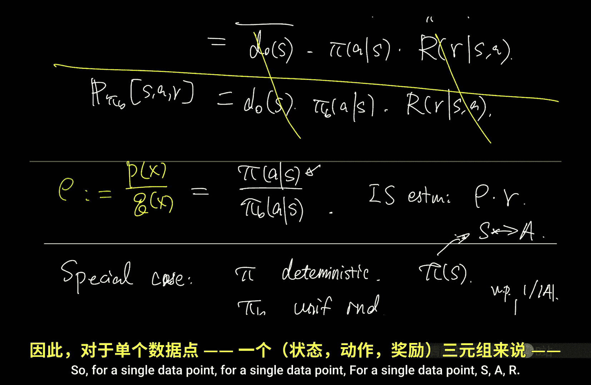

For a single data points。呃。For a single data point， S A R， really。

 what matters for later important sampling is the single number pi B A given S where。

 where S is coming from data and a coming from this data， right， It just need a single number。So the。

 this number is often called logging probability or sometimes called proposal probability。 That is。

 you know， which your behavior policy propose to assign to you know， the the distribution the size。

 you don't need this full， you know， you don't need this full model。

 You just need to give one more bit store one more bit of information to every single data point。

If you do that， you know， this is kind of like a， you know， this sounds easy。

 but if you go to a company that does these kind of things。

 but they didn't really have like an RL mindset when they build up infrastructure。

 like this may require very substantial change like in terms of like infrastructure work。

 which is a lot of things。 But you know， but if you go to a company that would say I want to do R want to optimize my decision in the workflow or whatever by looking at whether they've done that。

 you know whether the company has like RL minded people。 Okay。

 so this is kind of like a very neat saying that you can do。

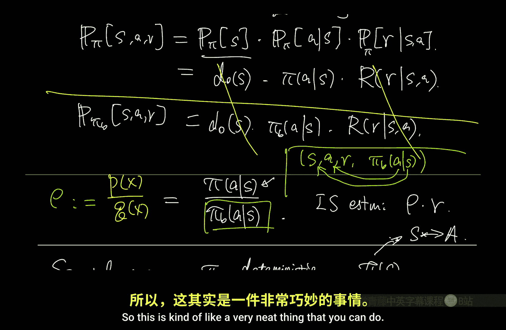

Okay， so there's that。

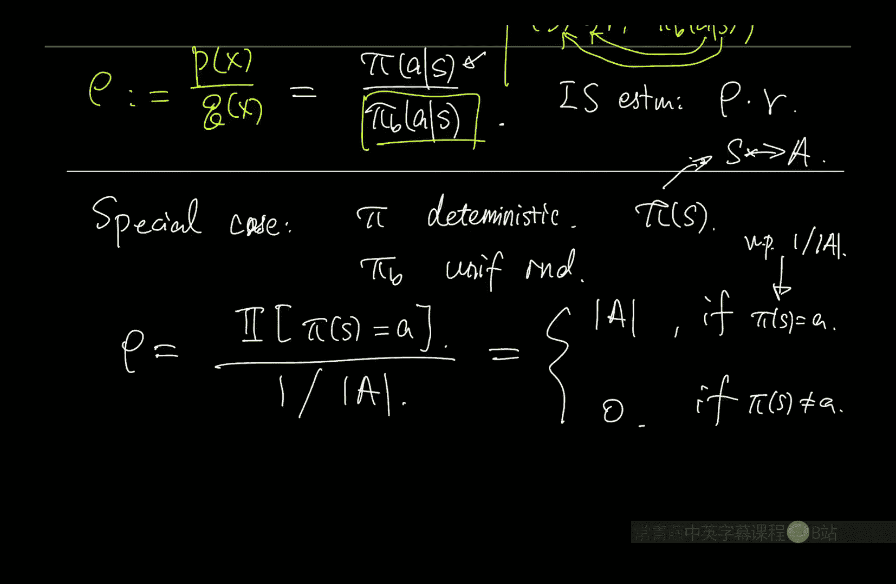

Okay。Now， coming back to this example， right， So when pi is deteristic in pi B is uniform。

 we see that row is look like this。 You can actually plot the。Let's say the， the， the probability。

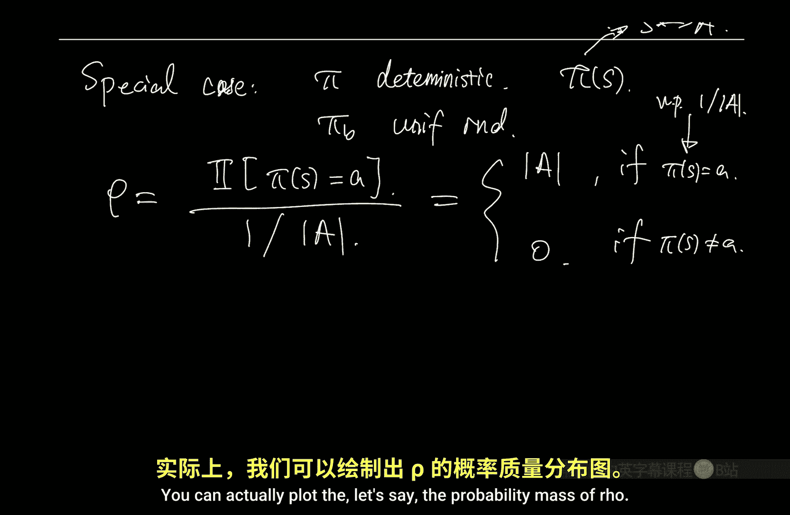

Ma， like a mass of， of row， right， So let's say this is the real view row。

 And let's say the Y axis is probability， right， So what ends up happening is that at value 0。

 you have a very large probability 1-1 over a。And at the value a。

 you have a very small probability one over a。Right， and as you can imagine。

 when you increase the number of actions， what's gonna to happen is that this one just increased a little bit。

 But， you know， stay at 0。 This one gets pushed away further and it's probably getting lower。Okay。So。

 so this is like， if you think about it it's like a very unbalass distribution， right。

 So when we do have density in equality， right， like H density inality only cares about the range of the random variable。

 It doesn't care about its variance。Right， and so among all possible distributions。

 you like intuitively， the， the kind of worst case ones are those that max out the variance， right。

 where you basically want if you have bonded range， what kind of random variable max out the。

 the variance given the bounded range。Yes， you have half at the half of the probably assigned to the smallest value and half of probably assigned to the largest value。

 You want a balanced distribution on the lowest value and high highest value， right。

 which is clearly not the case here here， the majority of the probably concentrates on the lowest value。

 but with very， very tiny， probably on the highest value。

So what ends up happening is that we can actually calculate the variance of this。😡，So， the variance。

Of row， Well， the very is， you know， you， you can say expectation of row square minus expectation of row square。

 And by the way， whenever we write expectation， what distribution should be under。PRQ。Q， right。

 because like the important sampling estimator is only meaningful when you apply it on the data sampling distribution。

 right， So whenever we say， what's this mean， What's this variance is always with respect to the data distribution。

 which is Q or sample from the behavior policy by B， okay。So first of year。

 what is the expectation room？😡，We just talk about it。It's one， right。

 because important ways when you take expectation on the data assembly distribution always equals one。

 right。

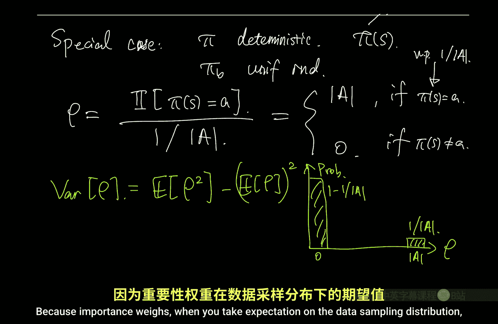

So then you have E of a row square。嗯。With the E of row square。 So in row square， we just plug this a。

The numerator is the indicator function。So when you square it， student indicator function。

 it doesn't change。Right， so you have one over a square minus-1。

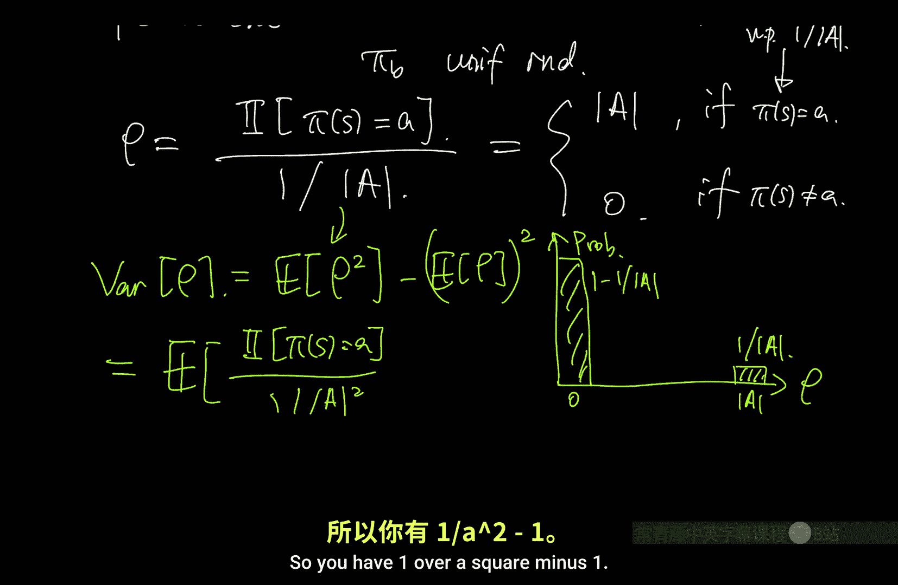

Now， I can just pull out A。Right， now inside it looks like the row again。

 what is the expectation of row。Is one right？ So the variance of this guy is a -1。Now。

 if you think about it， it's like very weird because usually if you have range like。

If you have range A and if you do that kind of like worst case thing that max house is variance。

 like have probably over here， have probably here。 What's the worst case range， like。

 what's the worst case of， of the variance and how it grows with a。Like， what。

 what polynomial order should the worst case variance grow， How does it grow with the range。

Is the linearing range quadating a squaring range cubic， which it should be square， right？

 because if you think about range is kind of like a first order quantity。

 variance is a second order quantity。 And of course， like second order quantity should be like。

 you know， roughly proportion to a square， right， And in fact， like， I think if it is half half。

 I think the， the max variance is something like range square divided by 12 or something like that。

 right， It is just a constant proportion portion of range square。😊，But if you look at here。

 this is very weird， right， because here the range of the random variable is 0 to a。

 So it's a number of actions。So the worst case variance should be proportional to a square among all random variables with bounded range 0 to a。

 But the importance is weight as a random variable has variance a instead of a square。So therefore。

 among all random variables with boundary range 0 to a。

 important assembly estimator actually has low variance compared to its range。Okay， so I mean。

 in this special case。 now， like it's weird to say that important sampling estimator has low variance because practically speaking。

 important sampling estimator has terrible variance。 And here， when I say low variance。

 I'm talking about this particular sced shape of the distribution。

 right It variance is actually small relative to its range， And in fact。

 because of this low variance property when you analyze， when you do concentration。

 hopefully in quality is actually very loose because hopefully only cares about the range of the random variable。

 So there are more advanced concentration in qualities that also takes into concentration。

 the variance of the random variable。 for example， one of the most standard ones people use a lot is burn size in quality and in the homework。

 you actually explore how you can。😊，Use that to establish tight concentration bound for important sampling estimator。

Okay， so there's that and。

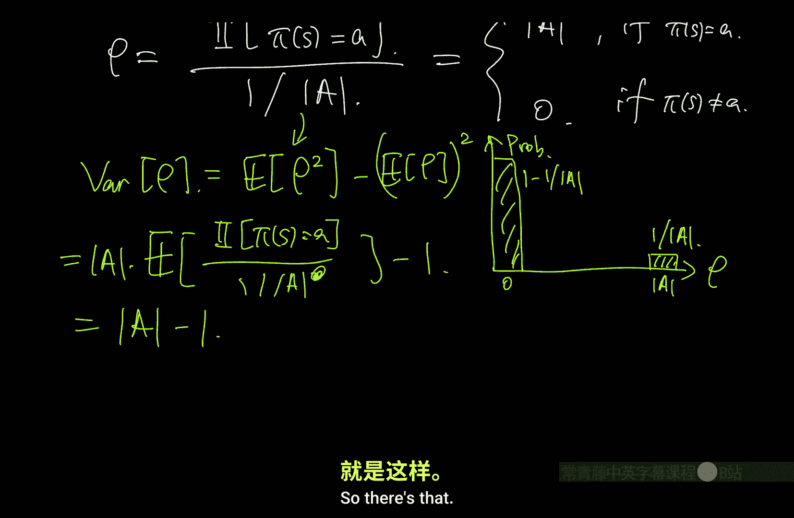

呃。Just one last comment of。This banded example。Okay。So。So now let's look at the， you know。

 let's look at the further special case。Further special case。So we still have pi deterministic。

Pi B uniform， everything the same as before。 Okay， everything the same as before。

 Let me add even a further assumption， which actually completely trivialized the problem。

 So let's say R is a。Let say， R is a constant。Let's say R equals one， regardless of what。😡。

Like whenever you you're in any state， you're in any action and whatever randomness comes out。

 you always see a reward of one。Okay， let's see as， as as crazy as that。 So now tell me what's J pie。

Its one because JP is the expectation under target policy， the expectation of reward。

 But if a reward is constant， then whatever policy you use is the expected return is always one。

 right so this should be a trivial problem。😡，And and if you think about it。

 if you're doing Monte Carro estimation， right， you roll out traies or roll out， you know， you you。

 you sample these two tables from your the policy you want to evaluate。

 the reward you see will always be one。And just take a bunch of once and you get one。

 So your estimation should have zero variances。Your estimation should be very， very accurate。

 Like you get like perfect sample complexity， just in one sample and immediately get the correct answer。

😡，Okay。Now， now， if you think about what happens with the important sampling。 Now。

 if you use the analogy or or the description I use， right。

 So one of the ways to understand important sampling is to say。

It is to say that I'm essentially dropping the data points where there's a mismatch， right。

 And only keep around those data points where the random action happens to hit the， the。

 the action that Pi wants to take。 and those data points will be relevant。

And I'm just averaging the rewarding those data points。Right。Now， here's the problem。😡。

If I'm still doing average within those remaining data points。

 those data points reward is still just one。Right。Which means that I should still have a zero variance estimator。

Right？Well， as it turns out， this is not the case。 So actually， actually， instead of one。

 let me just。

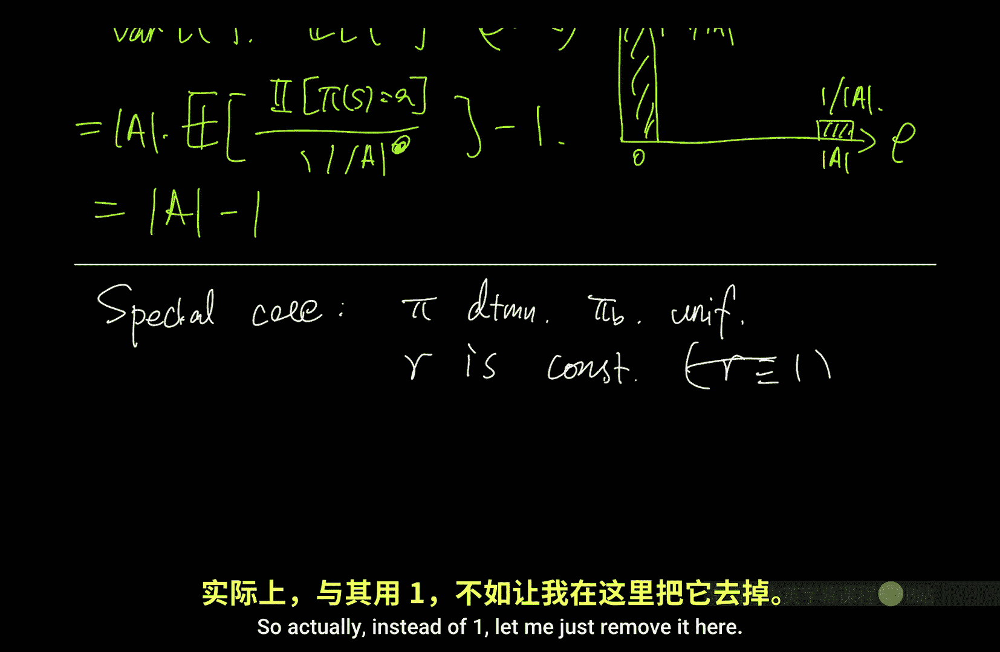

Remove it here。So。If you calculate the variance in this case， which is a row times R， right。

 because R is a constant。 So I'm not assuming R is one anymore， but I'm just gonna use R as the。

 as as that constant number right， because R is a constant， I can just pull R out。

 So I get N and R basically like the only randomness is in row。 R is a constant， right。

 So it's a scalr。 So when you you pull that out， it gets squared because variance is a quadratic is a second moment。

 R square variance of row。 And the variance we just calculated， right。

 So this is equal to R square times a-1。😊。

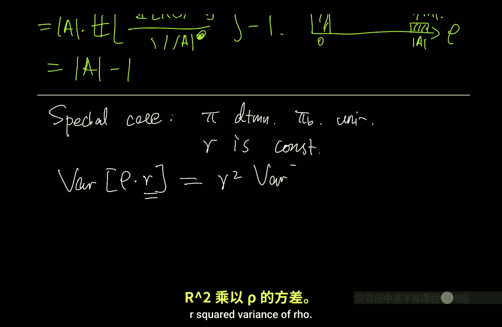

Okay， something crazy happened。Like， we didn't do any relaxation。This is an exact calculation。😡。

It tells you that the importance weight estimator still has terrible variance。

 its variance is a minus1 times r squared。😡，Okay， did you see the contradiction， right？

 I'm saying that， oh， if you average to reward within the remaining data points。

 all the remaining data points still has reward one。So your estimator should have zero variance。

 But here， when you calculate it， the， the estimator has huge variance。So as it turns out。

 I li to you，😊，What important sampling estimator does when you viewed it from that dropping data points point of view is similar to。

 but not exactly the same as taking average。 Let's look at what what。

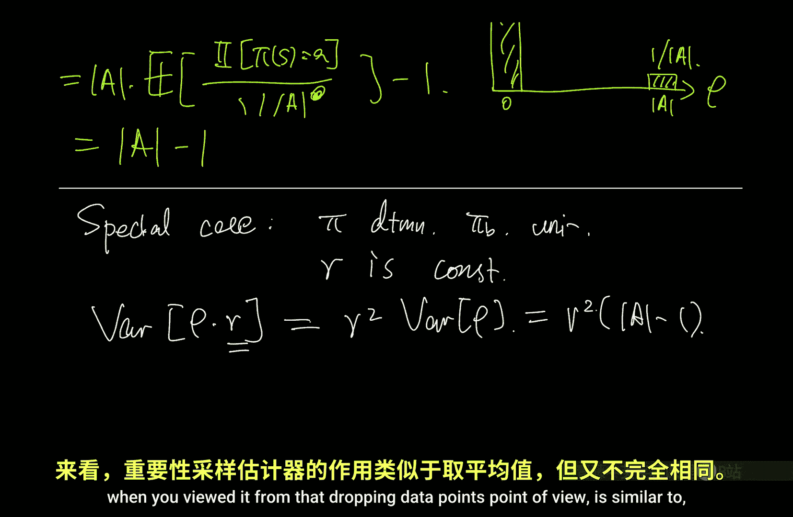

So。you will see。 Okay， so for the moment， let's bring back the data index。 Okay。

 so the important assembly estimate me are row I times I R I。

 where I is the referring to the I data point， right。

 So we have one over n sumation over I equals1 to N。 equal to one over n sumation I equal to N。

 We have this indicator of whether pi of S I equal to AI divided by one over a times R I。

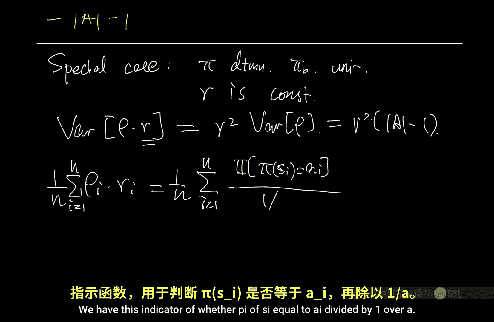

Equals now here's the thing。 right， So here we're gonna rewrite it in this view of like dropping data points。

 right， because here I have a summation。 I have an indicator function。 Basically， I can only。

 I can simply only sum over those indices where the indicator is one。😊，Right。

 so this correspond to this view of like， I'm actually， you know。

 only taking some over those remaining data points。 so I have one over N。 And by the way。

 like here is one over A。 I can move that out。 So I have a on the numerator。 Actually。

 maybe it's actually better to keep it on the。Deenominator N over a， O， summation I， I such that。

Pi S I equal AI。给。Okay， so I have RI。Okay， so now like this indeed looks like I'm sum over the remaining data points reverse and divide by like a normalizer。

O。But if， if that were actually the case。I should have zero variance instead of like that huge variance。

So what's wrong？The normalizer， right， So the like if you actually take the average。

 the actual normalizer should be the number of data points where pi S I is equal to AI。

 And that should be a random variable。Right， what's the expectation of that random variable。

On average， how many data points can you keep around？😡，Like the probability that。

 like for each data point， the probability that the uniform random action hits the target policy is one over a。

 So in expectation， on average， how many data points should you have。N over 8， right。

 so that's what we're dividing。😡，You see the problem like if you actually do average。

 you should have divided by a random variable whose the expectation is earn over a。😡。

So instead of dividing my dad， we're actually dividing by its expectation。As it turns out。

 this is like I'm biased because this has come from the important sampling。

 but this is where the virus is coming from。😡，Okay。So that's why I said I lie to you say， oh。

 I'm actually doing an average。 I'm kind of doing average。

 but there is this mismatch between the random number of hits versus the expected number of hits。

I'm actually dividing them by the expected number of hits。

 which and the mismatch between the the random number of hits versus acid is what causes that you know high virus to still creep in。

 despite that this is like a trivial problem。😡，Okay。So on Friday， we'll talk about， you know。

 some improved version of important sampling that actually， you know， can address this issue。Okay。

 so that's it。 and Ill see you on Friday。Have have some questions about last lecture。 Yeah yeah。

 okay。 The first one is where does the no negativity work， Oh， no negativity。

 So this is whenever you do that translation， right， So hold on hold on yeah， so。me。

Oh it's over here。 right， So when decom this。 We have the first term， Second term。

 The second term is like the screen you see， right。

 So that part has nothing to do with non negativeivity or whatever， right， So its this part。

 right what we have is that we have its control is the square error under under the data distribution mu。

 But here we need it to be small under D0。 So we say， oh， we have coverage like mu covers d0。

 So we can do the translation。 and non activityivity comes from the fact that you have squared。

 So within the expectation on each single data point or each single realization。

 each single possible sample point， the loss is squared。 So that square gives you nonivity。

 Otherwise， you can do the translation。😊，第下头上面。I give some intuition that。So。

We ship from the the one to， right， right is。

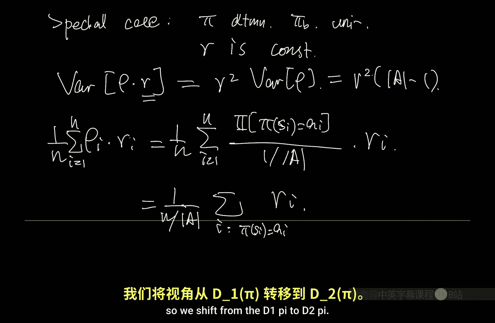