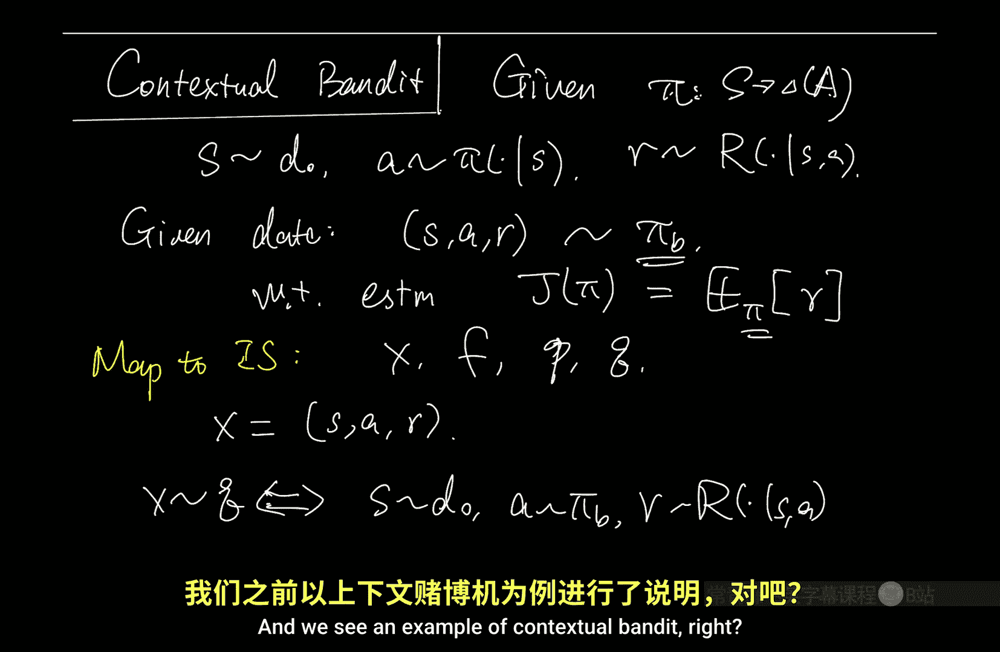
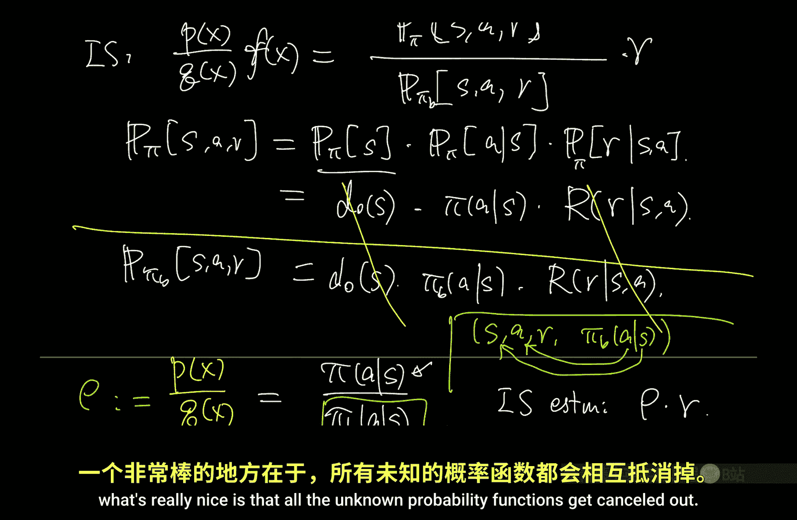
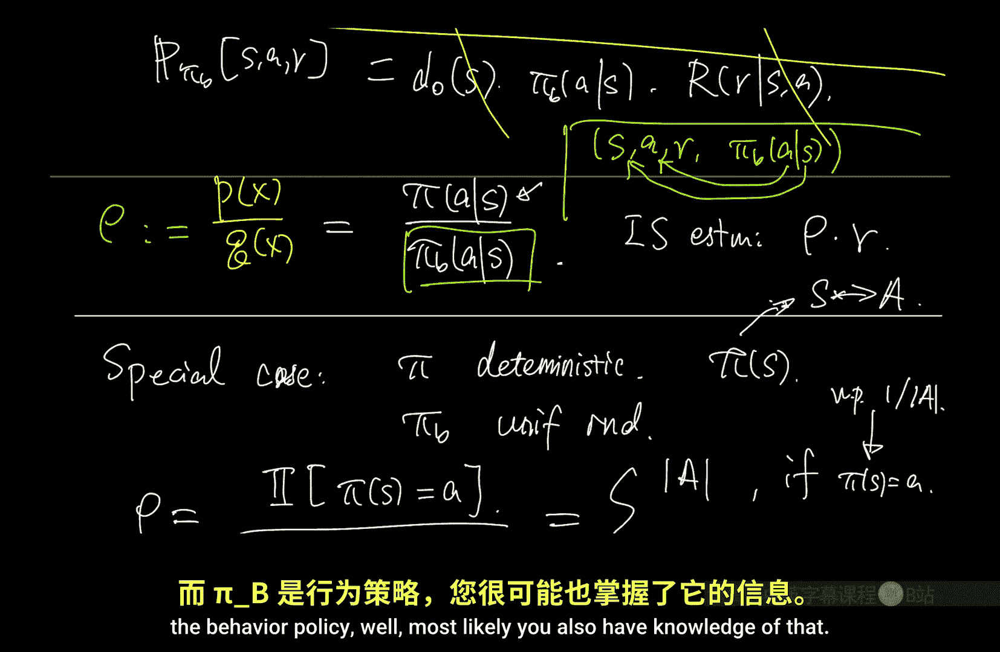
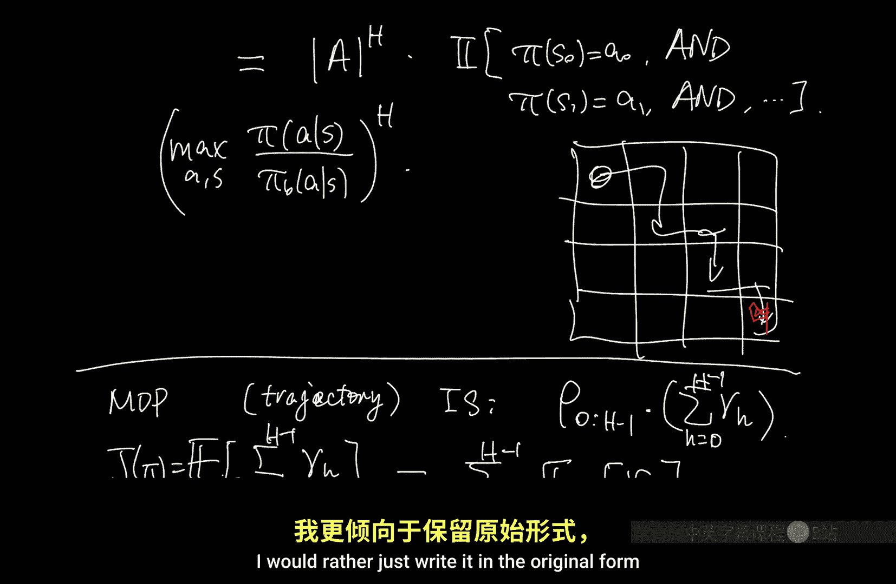

# 伊利诺伊大学【中英⚡统计强化学习｜CS542 Fall 2025, Statistical Reinforcement Learning】 p30 P30 重要性采样（续）（视角2） -BV1YsZHBZEyM_p30-

Okay， cool， so let's start。 So we talk about important sampling last time。 So if you remember。

 so important sampling is this process that helps you。

Essentially convert one distribution to another， right。

 So you want to estimate the expectation or one distribution。

 But you have samples from another distribution。 You can use this importance weight to。

 to do the conversion。And we see an example contextual bandit， Right。

 So where when you apply this framework， what's really nice is that all the unknown probability functions get canceled out。

 And eventually， you get this very nice result that tells you that the important way that con between the two distributions is literally just the ratio between the policies。

 probabilities， which most likely， you know， right， So the pis， the target policy you're evaluating。

 Of course， you know that and pi B， the behavior policy。

 Well most likely you can you also have knowledge of that。😊。

Okay， now we started looking into the sort of the behavior of this behavior of this。

estimator in some special case to， to get some intuition。

 where the special case we look at is when the target policy is deterministic and the behavior policy is uniformly at random。

Okay， then you see that essentially it has this flavor of discarding all the data points where the random action choice in the data doesn't actually match the determinacy policy。

 Okay， so roughly speaking， only。You know， roughly speaking， only。You know。

 one over a portion of the data is actually useful。

 And those are the data points where the target where the random action choice matches the action that the target policy wants to take。

Right， and we further look at this further special case， which on top of this， you know。

 deterministic target and uniform behavior， we further say， like reward is always constant， right。

 And to our surprise， we show that the variances of the important sample estimator。

 the most naive version， actually has now zero variance。 despite the intuition that in this case。

 important sampling should be just throw away some data points。

 keep the remaining hit points and do some kind of average over there。Right。

 but it turns out that that's not what exactly it does。 right。

 We wrote the important sample estimator when you apply on the entire data set， right。

 So this is one of the few cases where we actually have to specify， you know。

 the data index and look at what the algorithm does on the entire data instead of individual data point。

Right， and what we see is that it definitely has this flavor。

 that is some of all the rewards where the random action choice。

 So this AI sample from pi B matches the target policy， right。

 and it's divided by some normalization constant。 So it does have that average like flavor。

 except that it's not It's not divided by the set by the number of indices over here。

 It' it's dividing the sum by the expected number of。😊，Data points you would have right， And in fact。

 like due to the because of the proof， we know that this is actually the unbied way to do it。😡。

So how can you improve it， Of course。 So here is a improvement。Improvement。呃。

Which is literally to do summation I equal I pi S， I equals AI， R， I divided by。The size。那呃。Sorry。的。

The size of a。I such that pi S I is equal to AI。Right， so this would be the most obvious thing to do。

 right， So instead of normalizing by the， expected number of you know， like matches。

 you divided by the actual number of matches， right。

 then you would actually be like doing a real average over those relevant data points。

 And in the special case， when R is always like a constant， you get back like zero variance。😊，Right。

 so now。So it turns out that when you have a large amount amount of data， this is actually biased。

 We'll see why。 but astically is consistent， right， Because astically。

 when you have large amount of data and you would expect that this number。Would converge to N over8。

Right， by what。 Why should this number not conversege to， But when， when you divide。

 when you think about this number divided by n， it should converversege to one over a。Why is that？

Right， so this number is the actual number of a。The actual number of data points you have where the action matches。

 So what we say is that this number divided by n should conversege to one over a as N goes to infinite y。

Can take。Yes。And why。I'm looking for like a particular inequality。

Hope equality right because every single data point。

 whether you have match or not is a random variable。

 what is is mean is 1 over8 right and with this number divided by n。

 well this is just the empirical average of those random variables。😡，Right， so， you know。

 you you if have anything like after taking this course， like。

 I hope that you see more and more like everything like that you see in machine learning。

 not everything， a lot of things should look like average of I D random variables that that immediately gives you convers。

 right， So therefore， in the limit， the whether you divide the thing by this or this， they。

 they won't differ like too much。 right， So in the limit this is actually consistent  estimateimator。

 However， like in the finite sample regime， this is actually clearly biased。 to see why this bias。

 you can。 So。😊，You know， so here we don't see any bias because we have this very simple case where reward is always one。

 But in general， when your reward is like， you know， changes。

 what you can see is that what happens when I equals sorry， what happens when so first first thing。

 when you have a small number of data points， you may not get any hit at all。

RightSo if you don't get any matches， like you have divide by0 like we don't even know how to define this estimator。

😡，Furthermore， like if you have like one match， what happens or if you have one match。

 like this is just that single reward itself， right。

 But we know that that reward is sampled from behavior policy。 like you。

 you basically give up on any reweighting of that at all。 right， So there for this estimator。

 like only behaves well when you have relatively large amount of data。Okay， yeah but and furthermore。

 this idea is now limited to this special case of uniform behavior policy and large and deterministic target policy。

 In the most general case， you can also。Extend this idea by do the following， right， so previously。你。

The estimator is this。 right， So this is the canonical， like the standard。

 important sample estimator。Right， okay， so what's the what's the generalization of this improvement idea。

 What the generalization is to say， okay， let's remove this and do some summation variable。O。See。

 like it's actually exactly the same idea， right， because what's the expectation of row？😡。

Can someone tell me what's the expectation of role？😡，Is one， right， basically it's important weight。

 importance weight has expanded to one。 So when you sum up all the importance ways over your data points and data points。

 what's the expectation of the sum。This is not supposed to be a tricky question。

So each arrayI is IDd random variable is the expectation is one。

 What's the expectation of the sum over N Id copies of Roi。😡，It's it right， So like you see。

 we're doing exactly the same thing。 We replace the sort of the expected normalizer with an actual random normalizer。

Right， and what's really nice about it。 Like it's the same thing in small sample regime。

 like you can get some biass。 but as with large N， this doesn't have that much noise and in general has better variance。

 right， So one thing you can see is that when you do things this way。

 your final estimate will always be a convex average of the actual rewards you see in the data。Right。

 because for each。Because for each I， the actual weight you assign to I is like row I divided by the sum of these。

 right， And each weight， when you sum them over n equal exactly one because of this normalization。

Okay， so this ensures that you will never predict something that is like， you know， outlandish。

 whereas if you do standard important sampling， we've seen that especially when your importance weight has this very large variance occasionally。

 you may predict some。 you may up the data point with like super super large weight。Right。

 so even when you have a reasonable number of data points， it could be very。

 it could very well be the case that your final prediction is actually， for example。

 even out of the reward range or even something like that happens。 right。

 But so here when you do this normalization， you know， that never happens。Okay， so， so this is。

Sometimes called weighted important sampling。 also has many other names。 by the way。

 so important this terminology， important sampling。 I actually learned this pretty recently。

 This term， important sampling comes from the MCMC community， like Monte Caro Mark of chain。

 or anyway， And in statistics， they related concepts called inverse prop propensity score that refers to these kind of estimators And in statistics。

 there's there's， so so in our case is kind of like the sampling distributions are given to us。

 the targeted distribution is given to us。 we just form the estimator right， And typically。

 we think this as like when the sampling distribution differs from the target distribution。

 we think of it as a bad thing。Right，Because we're running into these large importance weight and so on so forth。

 But in statistics， sometimes when you just want to estimate something and you could sample from it。

 when your distribution actually has a very like scoot shape。

 you may actually benefit from sampling from a different distribution。 So in statistics。

 sometimes there's this design aspect to it， where you proactively sample from a different distribution。

 actually， in order to reduce virus。Okay， so then you know， in that case。

 like this is relate to the concept like a stratified sampling and so on， right， So for example。

 if I want to sample you know， Po opinion not something， okay。And let's say I。

 I pull opinion from like undergrad students and PhD students。

 and I want to know the opinion as a total。But what if I know that for this particular thing。

 let's say undergrads don't care about it。 And everyone's opinion is pretty much the same。

 And I know all the variation is in the PhD students， that PhD students are somehow have a large。

 you know， you know， disagreement on this thing， right， So then how shall I sample。 Well。

 like eventually I want to know， let's say the expected value across the entire population。

 But when I sample， I may decide to sample very few undergrad students。

 because I know there's less variation there， but I sample a lot of like PhD students。Right。

 so actually get the fine grain understanding of like， what's exactly the disagreement in there。

 So this way， I may actually end up have less variance than just sample uniform me。

RightSo in this case， the final estimator I use would still be like an important sampling estimator。

 but this know practice of actively designing a sampling distribution is like stratified sampling。😡。

Okay， so there's a， there there's these like， you know， background。 Okay。

 so this is weighteding important sampling。 So this is one improvement that can actually sort of address this very naive example where you would assume that any reasonable estimator should have zero virus。

 but vanilla important sampling has very large virus。😊，Okay， so now look at this。

 this various expression again。So this is the case where pi is deterministic pi B uniform R is always constant。

😡，I just said that vanilla important sampling， which gets this virus， always have large。

 very large variance。😡，That's actually not true。😡，Becauseuse one to tell me。

 like by looking at the expression， you should tell me there are some cases， some further。

 further special cases where even Manilla important sampling has perfect zero variances。

 When is that。Only one actually good。 That's， that that's true。

 but that's not a interesting case I'm looking into。There are only two ways to make the zero。

 and you chose the less interesting one。😊，So what's the other way to make this0。

I think it should be obvious once you've excluded the wrong answer。When reward is 0， right。

 because so here's the thing。 Like， it turns out that the variance of important sampling in this case actually scales with the reward。

Okay。And， and this is the， the， the a place where I would， again， like。

 challenge what I told you myself， like very early on。 Remember when we did planning。

 like the very early on， we said that， oh， we can just assume reward is not negative because you can always just do a constant shift to the reward and reward doesn't matter。

 at least for planning。Right？However， when it comes to learning， especially in important sampling。

 this is where like shifts and scaling still doesn't matter。

 but this is where like shifting reward actually matters。😡，Okay。

 so here is one thing I can do to actually address this problem。 So this is improvement number one。

 I have improvement number two。Right， so。So， you know， clearly， if reward is0。

 like I have zero ver as well， right， So now I'm going to design something。

 I'm going to design an estimator such that when it applies to this special case。😡。

It will have perfect variances。But the estimator still make sense。

 even if it's not this very special case， it's still unbiased everywhere else。😡，Okay。

 so this like like if you have an estimator that only works for this problem。

 that's very uninteresting because this is a boring problem。 right。

 So you want an estimator that works like still have biases everywhere， but have zero variance here。

 So here's what I'm going to do， okay。😡，So suppose there's a reward。 Okay， let。

 let's try to distinguish these things。 right， So we have the random reward。

 And let's say in this particular case， it's always equal to a particular constancy。

 but we also want our estimator to apply to more general case where reward is not this constant。😡。

Okay， so here's what I'm going to do， so step 1。😡，Define a。New。Conts of any problem。

Where we still have the same as same A。 But instead of receive reward R。

 we're gonna receive reward R tutor， which is always equal to the original reward minus C。Okay。So。

 then， if the。嗯。If the target policy J pi。 So this is the expected return。

 the target policy in the original problem。Whats is return。In the new problem。

 let's say call it J tilde pi。Like equals like you need to make some modification to this to get the Jqpi。

😡，What kind of modification do you need to make。Plus zero or minus C。😡，So this is like just bandit。

 right， There's only as a reward。😡，Mus C， right， because I've subtracted like C from everything。Okay。

没。Okay， so so this is what this means right， So this means that if I can get estimated for this guy。

😡，How can I use that to construct an estimate for JP？😡，You're just plus E to that。😡，Right。Okay。

 so now let's focus on this guy， right now， well。You now have a new bandy problem。😡，Like。

 and in that special case where reward is always C， the new reward is always0。

And you just do important sampling in that new problem。😡，And you have perfect merits。Right。

 and furthermore， like we have S A R， right， So that's our data points。

We can use that to translate that to a data point for the new problem， right， so this S is the same。

 A is the same for the R two that we just construct this in this way ourselves right。

 We take the reward from the original problem to subtract C from that。😡，We get our new problem。

 well get a random reward for our new problem。😡，Right so then if you look at the estimator。

 it will be like row times with a new reward art tuor， which is R minus c。

 So this will be an biased estimate for this。😡，And note that this is unbiased。

 even if a reward is not always a constant， right， So even if your rewarder is actually arbitrarily distributed。

You， you do it this way。 This is still on by of JT Opi。Right。Okay。

 now you want a final estimate for JP。 What do you do。You add S back， right， you do C plus this。Okay。

 so now you see like， so， so now you see that this is actually not。The same as row times R， right。

 like if you unpack this， what you get is row times R。

 this is the originally important samplingestimator。Plus，1 minus row times C。Right。

And like you can actually view it from here just to understand the unbiness of the new estimator。

 like even if reward is arbitrary and not a constant， because when you take expectation。

 this is just the expectation of this， which is the Shu J Pi plus the expectation of this guy。😡。

And what's the expectation of this guy。Why。😡，Explanation row is one， right， So we're actually。

 so basically what's happening is that we're actually adding a zero zero mean term。

To the original estimator。 So that doesn't affect its unbiness。Right， but what's really like。

 but in this particular example， if reward is always equal to C or even reward is only approximately equal to C。

 what's really nice。 And what's happening is that essentially what happens is that you add additional noise term that has a negative that has noise that is negatively correlated with the noise with the with the randomness in your estimator。

 So actually cancel out some of the variance here。Okay。

 so this is also a very well established principle in statistics this called a control variant。Okay。

 so。This is called的。This is called a control variant。You know， you can， you can look up the。

 you know， Wikipedia page of this， you know term。 you know， tell you that， you know。

 in statisticsistic， when you estimate something， Oh。

 Convari means that you add some zero means to it。 that has negatively correlated variance with your original estimator。

 But if you just see that very， you know， abstract solution。 you're like， you know。

 like where do I come up with such a thing， right， So this is an example where you can come up with that。

And， of course， just as before， you can generalize this to a more。You know。

 the more general setting where you don't expect the reward to be exactly a constant。

 So what happens is that you can say given。Say our hat of S A。

So our head is a m reward model that given SA， our head would be my guess of the true mean of the reward is。

😡，Okay， so then you do exactly the same thing。 You do row times R minus R head of S。

And plus expectation of our head of S A。Prime where a prime is sampled from the target policy plan。

Okay， so you can explain this  animator in exactly the same ways。 That is， you can say， oh。

 I'm shifting my the original problems。 But now instead of a constant shift。

 I'm doing this particular shift and I'm doing the compensation over here。

Another way to think about it is that。😡，You can extract things out。 So this is row times R。

Minus row times are head of S A plus expectation， a primes from pi。Are head of S A prime。Okay。

 now row times R is through the original important sampling estimator。

 and these two terms that we add in expectation cancel out with each other because essentially。

 we're actually using important sampling to， to match。 remember， A is sample from pi B。

 We're matching this with the pi over here。So they also cancel exactly with each other。Okay。

 and this estimator in general would have a less variance if your art head is a good estimate of what the true main is。

Right， so， so essentially like we're using some potentially unreliable。

 like sign information to do variance reduction， right， And the， the。

 the previous example is just a special case where our head is a constant guess。😊。

But even that constant gas is something that you can already do in practice， right。

 Because given the analysis that we see above， that the variance。

 actually the reward magnitude matters in terms of important sampling estimators variance。

 So this is， when you do important sampling， actually， is's very beneficial to center your reward。

Right， so previously， for convenience， for theoretical convenience。

 we've always assumed that rewards are non negative。 like we。

 we con we intentionally shift to the positive side。 But here it tells you that you。

 you should actually shift it to being like 0 meaning should be center to be like around 0 because the。

 the absolute magnitude。 the second mode actually matters。😊，Okay。So， and。

 and further and this is this particular estimator。 I'm not gonna tell you why。

 but in statistics and in machine learning， is's called a W robust estimator。Okay。I guess Ill。

 I'll tell you why it's called W Ru。 So as you can see， this estimator is always unbiased。

 even if our head is ararily wrong。😊，Okay，Because， because like this pair， we always cancel out。

 it doesn't like our analysis doesn't depend on whether our head is the true main reward or not。

 It could be just a guess。And， and in general， you have reduced variance if your gas is like roughly good。

Okay， so this is like one source of robustness。 Like the reason it's called a W robustness is precisely for the setting where row is unknown。

 right？ So like， if you're like， how do you calculate row， What do you need to calculate a row。

The two policies， right， So the new policy， youre evaluating。 of course， you know it， right， But I B。

 we said that if you didn't write down the logging probability during like sampling。

 you may lose that information， right， So in practice， like we do run into these situations。

 And what people sometimes do is essentially do behavior cloning on data。

 You do imitation learning on data， trying to predict trying to guess what's the kind of。

Behavior policy you've used to generate data， right， So then like， and then you。

 you plug that in over here。 Then that row won't be the exact row。 It will be in a guess of row。😡。

 so and in general， if you just use that in important sampling， you may get a bias estimator。😡。

But here is the interesting thing。 If the R head， in that case。

 if our head is actually the true main reward。Then r minus our hat would be a zeroing random noise。😡。

Then whether you have the correct row or not doesn't matter anymore。😡，Okay。

 so this is why it's called doubly robust。 is's like if you get either R hat or row ride。

 the estimator is unbiased。😡，Okay。Okay， so。And， and final thing is like。

 you can always just do like two together。 like， you know， whenever you do the average， you like。

 you can start with W bus estimator。 And whenever you do average。

 you can replace the N with the sum of row。 So there's always that。Okay， any questions so far？Okay。

Having seen the bandit case， let's move on to Ar， okay。😡，So。Mty。Step R L。嗯。

To talk about important sampling multistep R， it would be easier to talk about the finite horizon setting。

 And this will be only the start。 Okay， anyway， I mentioned earlier。

 we'll see more and more finite horizon in the second half of the semester， It's just like， you know。

 more convenient and cleaner and more elegant for many ideas we be talk about。 Okay。

 so for given finite horizon R。 So finite horizon。😊，You know， let's say H step。

 So you have MP S A PRR， and let's say H and maybe some initial state distribution。So， you。Let's say。

 do I do one indexing or0 indexing。 That's still always the hard part。

 I'm gonna try  zero index here so that these0 actually correspond to the zero times step。 Okay。

 so you as trajectories S 0， a 0， R 0， S 1， A 1， R 1， all the way to S， H-1， A， H-1， R， H-1。Right。

 where S 0 is sample from D 0。And A T sample or A H sampled from。The you know。

 some behavior policy given as age。 Now， the behavior policy can be time there like it could additionally depend on the time step。

 It doesn't matter。 Why actually comment on that further later on。 But for now， for simplicity。

 I'm just gonna still pretend that is only a function of the current state。

And then reward from the reward distribution， as usual。

 and transition come from the transition and probability as usual。Okay， so you have this， you know。

 a final horizon problem。 And if you want， you can add discount factor。 or it doesn't matter。

 Like for now， let's just go on discounted。Okay， so this is how you draw out trajectory and you can ask exactly the same of policy evaluation problem。

😊，So， O P E。呃 given。Tjectories。From。排避。1，2。Evaluates。J pie， which is。Expectation pi， summation。

A equals 1 to big H R sub h。Right， so， so this is the just the expected return we want to evaluate。

 And， but， but we don't have trajectoryjecties sample from pi。 We have trajectories in this form。

 like multiple trajectories sample from some pi B。Okay。So as usual， we're gonna， you know。

 cast things in the important sampling framework， right， So as we recall， important sampling says。

 you know， if， if we use one equation to summarize important sampling。

 It says X from P F of X is equal to expectation x from Q， P X， Q X F of X， right。

 So this is like one line reminder of what important sampling does， right。

 we have data sampling from Q， we want to estimate the expectation of some function or P。

 we do this importance weight correction。😊，Okay， so， and whenever we try to。

Apply modern than sampling。 Basically， we need to find what is F， What is P， What is Q， What is X。

Right， so let's do that exercise again。 What is X here。Tris， okay， good gas。

Trickless will be something we talk about afterwards， but not for now。 Yes， I hear that， right。

 So X is the entire trajectory， right， because because if you think about the important sampling。

 it says that we get I I D X from the sampling distribution。 if you use triples。

 which is like know S A R S prime pair tus， like you would extract multiple those tus from trajectory。

 They're interdependent。 They're not I D， right， So to to cast it like strictly in this form。

 we need I D samples。 So X is just trajectory。So。X is s 0， a 0 R 0 S H-1， A， H-1 R H minus-1。 Okay。

 what is F。Right， so F maps X to the。Right， so X is the whole thing， which is summation H equals1，2。

 H R sub H。Right， so you take this whole thing in， you ignore the state actions。

 just look at the reverse sum of them up。 this is F。Right。Now。What is P N Q， right， P And Q。

 Well is just the you know， I guess at this point it should be clear。

 P And Q are basically the entire joint distribution over the entire trajectory induced by the behavior policy versus the target policy。

Right。Okay， so now the the question again is like for either of those distribution。

 we have no idea what it is。 It involves the N DP dynamics。

 The reward distribution and so on and so forth。 We have no idea what it is。 But we can， you know。

 hopefully we can find the ratio。 So we basically repeat exactly the same thing as before。

 So let's start with P Q of X。 So what is the joint probability of this entire trajectory。

 how you would even start dealing with it。Yes， right。 So as we did before。

 So previously for the bandit case， we have， you know， only the first three couple。

 And what we did is that we asked， what's the。Probability of S with the probability of A given as then what's the probability of R given S A and so on so forth。

 right， So you would do exactly the same thing。 And I'm not going。

You're going to quickly get to the answer。 So you have d0 as 0， right， So the first term。

 what's the second term。What's the conditional of a 0 given S 0。Pi B， right， So here I'm writing Q。

 This is pi B A 0 given S 0。 Now for P， this term would just be pi a 0 given S 0。

 right times now the reward， we have the reward distribution are 0 S 0 times the transition distribution S H plus S S 1。

S 0， a 0， and then so on and so forth。Okay。Again， cancel actually happens。 Which terms get like。

 okay， So， so these are the terms。 But when you keep going it， it would just be repetition， right。

 So of like once you get S1， the next thing will be pi B， A1， given S 1。

 then R P and so on so forth all the way to the end。Okay， so in these kind of terms。

 which terms get canceled out。Yeah， except why， right， So exactly the same thing as before。

 So this goes away， this goes away， this goes away。Right， only pi remains。Now。

 what's important is that the way。 So like the new thing over here compared to the bandit case is that we have this multi step decision you're making right。

 Then for each pie， for example， this term just literally look like the banded importance way。Right。

 but then we don't just have it for the first time step。 We have that for each time step。

 We have the importance weight for each time step。 And how are those important ways aggregated together to form the final weight。

Just just from this expression。😡，Is multiplied together， right。So if we define。

Let's say define rows of edge。Defined as pi， Oh， it should be P over Q， right。

 I probably should write P on the top pi A， H given S， H divided by pi B， H given S， H。

 Then the final row。Which is。P of x given Q of x is equal to the joint product of H equals 1，2 H。

A row sub H。 Okay， so well also write this as a row sub 1 comma。H， actually。

 it probably is like'm using， forgetting， I'm using zero indexing。So it's something like this。O。

So you get the and this is the thing。 What you get is you get a cumulative product。

Of the importance weight at each time stamp。Okay， so now think about like and to help you understand what that means。

 Again， let's look at the special case， special case。😊，Pi B uniform over。A。

 and let's say we have finite action space。 pi is。Determine。This stick。 Okay。

 so let's calculate what is the， the total row or row 0 comma H -1。What is that？Okay。

 so in this case， this row is just the product of a。Product of H equals 0， H -1。

 the per step importance weight。 And for per step， we know that this is the indicator of pi of S H equals H。

 You know， whether you find a match divided by the probability of the uniform distribution。Okay。

So now you multiply all of them together。😡，So when you have a multiple indicator functions。

 So indicator function is that you have some condition inside， if the condition holds is one。

 otherwise it's0。😡，When you multiply these indicators together， how do you simplify that。

 You can actually simplify that into a single indicator indicator of what。In the area of。Or。

Think about it again。Is end， right， Because multiplication， right， is 0 when it fails。

 when you have a multi when you have the product of a bunch of things， if any one of them is 0。

 the whole product is 0， right？ It's only one。 if every single one of them is one。

 So the logic operation you're essentially doing is and， right。So。This is equal to。呃。sing。Equal to。

 So here， this product is easy。 So you just get a a to the H。 Okay， then indicator of。

Pi S 0 equals a 0 and pi S1 equals a 1。 and。Okay， see what's going on here， right， So basically。

 what happens is that if if you use that analogy of like or like that rough understanding that you are throw away some data points and only keep around some data points that are relevant here。

 you throw away any trajectory where there's even a single mismatch in the in the action choices and you can only keep around the trajectory。

 if every single random action choice happens to hit whatever you want to take in every single time step。

😊，And therefore， the number of remaining trajectories。

 if like the effective sample size in this particular case， is exponentially small。Okay， and。

 you know， like in the band case， when we have uniform over a and when a is not that large。

 the importance way it doesn't look too bad at all。 right， So if I have five actions， I do this。

 I have 20% of my data that that are still relevant。But here， even if you have just two actions。

 you do this and H is like moderately large， it immediately becomes terrible。😡，Okay。So。

But like in general， this can be still useful， right， So in general。

 like if you think about what's the range of this random variable， which if if you remember。

 determines its its range， but also its variance， right。

 So so this is you you can do max over A S as a crude upper bound。

 you can do a given as divided by pi B， A given S。So it's like the worst case maximumon ratio between pi and pi B raise it to the power of H。

Right， so this will be the general bound for upper bound for the range of the cumulative as important as weight。

Okay， so now this thing will be exponential as long as this thing over here is like constantly away from one。

😡，Okay， so basically， you can only use it like the sequential important sampling。

 either if H is not that large， like H is 2 or3 or something like that， right， When H is large。

 you can only use it if this thing is very， very small， close to one。Right， for example。

 if this is like， if this is order of one plus one over H。The whole thing will not be exponential。

 It will approximate to eat。RightBut that requires that basically for every time step。

 the target policy you're evaluating and your behavior policy， their distribution are very。

 very similar。😡，Okay。So this is like one of the biggest problem that like。

 you will face if you try to do like all policy evaluation a。in the in the NDB setting。

AndI hope that gives you some appreciation for， you know why we talk about， what， you know。

 you can actually like appreciate the value based methods we talked about early on。

 right using Fi evaluation and so on where you get the state ratio， the state density ratio。

 which in many environments can be much better than this， you know。

 although there like you pay for the price of having to introduce function approximation in rely on like。

 say， the Bel complete assumption of the function approximation。

 So it it seems like it has a lot of disadvantage But the one thing goes thing at the voice is that it avoid this guy。

😊，Okay。Like and， and to， to， to， to show like how this guy， you know。

 the state answer ratio can be much better than this guy。 I guess you can imagine， like， for example。

 let's say we have a simple grid world。😊，Okay， and let's say you have many trajectories that that start from here。

 and then the the end goal is like here。 Okay， and let's say you sample many trajectories。

 And suppose your data covers the entire like grid， okay， And if you use a value based method。

 for example， even just the tableular method where you leverage the markov reality of， you know。

 the this grid world that each grid is just simply a state。

 then we should pay is that if you're evaluating any policy， like you pay the。

 the the matching the the， the test ratio in terms of the grid distribution。Right， in particular。

 if you have enough samples from each grid， then you can even do a table of analysis and show that you can confidently evaluate any policy that is you know covered。

 right。But now， if you give up on the market of reality and you say。

 I just want to use important sampling， then basically you say like you can only evaluate a trajectory if in your data。

 those kind of trajectories has appeared like you know， sufficient number of times， right。

 But as you can see from here to here。 let's say when you action is randomre like with a moderately large grid。

 you can have exponentially many different path right， So immediately you run into these you know。

 these exponential issues and like issues like you know。

 you get like these exponential over horizon in general， modern， we call that curseive horizon。😊。

So using value based methods， leveraging the mark of property of the， of the problem you know。

 is a way of， you know， overcoming the curse of horizon。Okay， so there is that any questions so far。

O。So， so。呃。So just a quick recap， right， So for MP。The version of important sampling。

 which sometimes is called trajectory。A Jack tree。Trejectary level， important sampling is。

When you only have one trajectory， like when we write it in the form of just one trajectory is this times the。

Sing we're estimating， right， So or 0，2 H minus-1。Right。

Because because this is the the function F evaluated on single trajectory， right。

 And this is the importance weight between the the the。

 the ratio between the probability assigned by the target policy versus the behavior policy。

So this is our estimator。Okay。So it turns out that there is some free improvement here waiting to be discovered。

😡，Okay， so this this guy， we can actually improve it。 So let's look at the thing again， right。

 So what we want to estimate is J pi equal to H equal not this。Okay， so。Sumation H equals 1 R sub H。

Right， under policy part。Okay， so then we directly did an important sampling on this one。😡，Okay。

 now let me try。 let's try something else。But in the area of expectation。

 I can pull out the expectation， pull out the summation。I'm doing this again， okay。Ex over pi。

 just a marginal。There the marginal expectation of the reward at a particular timet。😡，Okay。

So now if I can form on biastes estimate for each of these term。😡，And I sum up together。😡。

That was still Vietnam bias estimates made for JI。Correct。😊，Okay。

 so let me ask you when a shape equal was0， how you would estimate this guy。😡。

So this is asking you under the distribution induced by the H policy Pi。

 what's the expectation of the first very first reward you see where you have data sampled from behavior policy。

😡，Right， so we have a。Our data is。嗯。Our data is s 0， a 0 sample from pi B， R 0 S。S 1， A 1， R 1。

 so on on so forth。 We want to know what's the expectation of R 0 if we take action according pi。

So how you would estimate it。Now， if you look at what important sampling does。

 you can sort of understand how to estimate it， right， because you can also take that summation out。

😡，Which means that for each RH， you just multiply that with the cumd product of the importance of the entire trajectory。

And for h equals 0， it's the same， you take the r0 in the data。

 you multiply it with the cumulative importance weight for every time step。😡，But clearly。

 there is something that is much better you can do。😡，What is it。Yes， like see。

 so essentially you just have a band problem。😡，Right， you're asking， okay。

 so I'm generally in this way where a is according pi B。 I'm saying， okay。

 if all policy actions are according sampled according to pi， I want you to know。

 what's the expectation of the first reward。Like these guys are not relevant to you。

You can just get them away。 You can just throw them away， right， Pret that you just have this。

 this like， So you have one trajectory like this， you have multiple trajectories。

 But for the purpose of asating the first reward， only this chunk of your data is relevant。

 And it's just the potential band problem。Right， so you just this is equal to exp under pi B。

Row 0 or 0， right， You just need to correct for this one。Right。

 and one interpretation of this is essentially you only correct this one from pi B to pi。

 You leave all the remaining action as pi B。 And that's fine because essentially。

 like when we generate should MP， you have this temporal order of variables that has causal relationship。

 right， So once R is generated。 your later action can no longer affect you know。

 what kind of rewards you obtain early on。😊，So therefore we don't need to correct those guys。

 we can leave them as is。RightNow by the same analogy， what is expectation pi over over1。

 So how you would estimate this guy。Expectation。排币。So how， how you would estimate this guy。

 So apparently you would take Dar one and reweight it somehow。 So how do you do it。😡，Right， so it's。

 you need a row 0， row 1， right， So now you look at this one。 And again。

 only this chunk of the trajectory matters。 But now you actually face a multi step decision making problem。

 right， So you can just correct or row 1。 If you only correct row 1。

 that would be the distribution of first action according to pi B。 Second action according to pi。

Right， but we know that early action does have influence over later rewards because it will change the state distribution。

So if you're correct， you have correct from the very beginning。😡，Right。

 so then hopefully you see the general principle expectation R H is equal to expectation under pi B。

 row 0 comma H。呃，入comer H RH。Okay， so the final estimator， which is sometimes called stepwise。

Or per decision has many names is a summation over h equals 0 to H minus-1 row 0 to H R H。Right。

 so you see like， you know， this is nice improvement。

 but it doesn't really solve the hardest problem。 If you have non trivialvial reward at the very end for that very end reward。

 you still need to multiply that with the huge， cumulative importance weight over the entire trajectory。

 However， if you have some non0 reward early on。 You don't have to you don't have to hit them with this like。

 you know， giant， high variance importance weight。 All you need is just accumulate this importance weight up to that times step。

Okay。Okay， so there is that。嗯。Previous， we talked about， you know。

 two improvement to important sampling in the bandit case。

 where you can do double robust and and weight important sampling for weighted important sampling is pretty easy。

 Right， So like when you， when you sum things out， so。Like， like if you're。

 if you're doing for important， if you're doing this per step version。

 you can just do it for every time step for every time step。

 your estimator still looks like some row times R， right。

 And instead of like sum them up divided by n， you divide it by the sum of the importance weights。

 right， So you can weight in important sampling pretty easily。 Now for。😊。

W robust is actually pretty tricky。 And but it also turns out to be very interesting。

 It gives you a new understanding of what what this estimator does。 So actually。

 when you do w robust， you can only do it like in some sense， like only start from the， the stepwise。

 important sampling estimator and sort of rewrite it。 Okay， so let me actually just rewrite this。

 this whole thing。 So this is row 0 R 0 plus。😊，嗯。Row 0， row 1 R 1 plus row 0， row 1。

 row 2 R 2 plus b， bh， okay。So。There is a common factor in all of these things。

 What's the common factor？R 0， right，0 0 is in everybody。 So let's get that out。 Okay。

 row 0 are 0 plus， Okay， so now after you get out of 0。

 all those remaining terms has one common factor。 What is that。😊，R丸O肉 one。And you see the pattern。

 right， So you have R  one plus row 2 or 2 plus all the way to the very end。Okay， so at the very end。

 what you get is row H-1 times R H-1。 And that's it。 And you you have like many， many。

 many like right parentheses to close other parenthees。Okay。So。So what does this look like？😡，Right。

 remember， like our， like when you have row where like， let's say row 0 comma H or something。

 that's the importance ways for entire trajectory or a prefix of the trajectory， right。

 But if the row only has one time subscript， is' just the one step importance weight。

 It looks like a band importance weighting problem， right。

 and it's only correcting for one action right， So here by hitting the final reward with H minus with just a that steps importance weight is' kind of like saying that okay。

 what if we just change the very last reward what if we only change the very last action from pi B to pi。

😊，Okay。So actually， let me write it in this way。 So you can， you can write this in recursive form。

 That's as， let's say。😊，We。H minus H。So this thing， let's say the final estimate Let me call it V V。

 let's say V H。Where the sub of V correspond to how many remaining time steps are there。

 So at the very beginning of the trajectory， you have like H steps to go。

 So you can write it in this recursive form that says row V A H minus H is equal to row H times R。

 H plus。V H minus H minus-1。Right， because the this form is like you have， you have a row H， R H。

 Then the whole thing has this recursive form。 But it's like， you know， one step further。

 So you have one step less， right， So you have like H H H -1。Okay， so here is the。

 I'll just tell you the word， the interpretation。 So at the very end。😊，You the。

 the interpretation is that so， see， so， so this one， we know that this is so okay。

 so at the very beginning， we know that this is an unbiased estimate of J pie。😊，Okay。

 so it turns out that you can also view it as on bias estimate of， let's see。😊。

So you can also view it as an unbiased estimate of V P S 0， which itself is unbiased estimate of Jpi。

Okay。Because。呃， the呃呃。呃， let me see。Right， so， and， and if you， if you treat it as。

 treat it as this way and you will see like what this， what this what this saying is doing。

 So basically， what， what this does is that recursively。

 this is an on bias estimate of V as a V pi of let me see is' probably S H。Okay， and and when。

 and you combine it with reward from the previous time step。 remember， like in this time step。

 we have S， H， A H or A H from pi B。 And， and then you sum this。 Okay， so basically。

 what you end up with is on bias estimate of Q pi of S， H。A， where A H is still from pi B。Okay。Now。

 how can you get。So。Like by induction， what we want is that we want this guy to be an nonbiased estimate of V pi of S H -1。

Right。Actually， hold， let me see。 Theres some mismatching。V H minus H。 So this is just a。The AI S A。

 So here is H plus  one， okay。Okay， so， and this is H plus 1。 And here is the。S H， O。

 so that's right。 Okay， so suppose you have Q pi S H， like if you have a Q pi function。

How can you convert that to V。😡，Like， forget about the important sampling。 If someone give you Q pi。

 how do you get V pi。You just plug pi into here。😡，Right， so Q pi S pi is equal to v pi。Crrect。Okay。

 so， and， and if you don't need exact V， let's say your policy pie is random。

 Let's say you don't need exact V pie。 You only need an nonbied se of v pie。

 You can just sample an action from pi and plug it。 That also works， correct。Okay。

 but now here this AA is sampled from pi B。😡，How can you make this whole thing an nonbi estimate of v pie。

You just correct for this action， right， correct for this action by multiply that with。😡。

Just multiply that with pi A， H S， H with pi B， A H S， H。Right， which is exactly this guy。Okay。

 so then you get an un bias that made of V pie of S， H。 And then this induction works。

 So every in every time step， it does this and you row from the very bottom all the way to the beginning。

 And at the very beginning， you obtain on bias that made of V pie S 0， where S 0。

 is just sample from the initial distribution。And if you just further do expectation to marginalize out the randomness of S 0。

 it's just straight。O。So， so you see like， like this is another interpretation of what like sequence。

 like this stepwise， important sampling does is actually is essentially treating every time step as a banding problem where the reward for thatend is actually a random reward whose expectation is coupon。

😊，Okay， so this pi is the target policy， right， Because you've done all those correction from the bottom up。

 So， you have done all the correction to have corrected all the pi B actions later on to the pi actions。

Okay， so that's why you get Q pi， right， pi。 So remember pi。

 the the pi on the superscript of Q means that all your future actions are taken according to this target policy。

 not a behavior policy， because I've already already done all those corrections later on， right。

 But at this step， all I need to manage is the mismatch between Q pi S A versus V pi。

Because here a is not sample from pi， but from pi B。 So I just need to do this one single correction。

 And that correction is like， is kind of like a bandit。

 except like my reward actually is like a long term Q value。Okay， and every time step I do that。😡。

Okay。So if you view it this way， it'll be like obvious how you do kind how you do w robust。

 because every time step you have like this kind of bandit problem。

 So you just treat it as a bandit problem and do w robust there。 Okay， so for the W robust estimator。

Wubly robustPrevious in the bandit case， we require someone like as a site information。

 some guess or approximation of the mean reward function， right。

 So here what we need is basically some guess of the expectation of whatever this reward is。

 given the current state action pair， right， So what is that， Well， basically。

 you need approximation of。😊，The Q function。Okay， so once you have that， you just do。

So in each iteration， so you do。R，H plus V。H H-1。 So here， because of iteration。

 like this V would not be the same as the top anymore。

 So I just put D R here to mean this is different。 So you subtract your guess mean。And add it back。

 it's， you know， the correction term。 And the correction term is that you sample a from pi Q hat S。

 H A。Okay， so if you think about what this is， this is like you treat your Q head as the true Q and calculate what the corresponding V pi is。

 Okay， so this is V H minus H D R。 Okay， and then you keep iterate like this。Okay， so。

 and as another way to understand this， again， like you can just like。

 you can just keep around whatever term that is already that is already like that is already there in the original important sampling  asimator and look at what additional terms you've added。

 right， So the original term you added is this term plus the row times this term。

 And you can just verify that they always cancel out a expectation regardless of what your Q hat is。

But still， like， you know， if your Q hat is a good guess of what the true coupon is， you can。

 you know， enjoy reduced virus similar to， you know， how the band case works。😊，O。So there's that。

 And let me see what else I need to cover from this。Okay， so I think that's the for。

That's it for today。 We have a early and today。 And next we go talk about policy gradient and another form of important sampling and。

I'll see you next week。So basically this like inductive proof right。

 so because you can start with very end at the very last step after H minus-1。

 theres no step anymore。So then youll start your estimator with 0 and vpi there is also0。😡。

So that trivialoli holds。And you can just repeat this story。

 like you can start like that's the base case and you can just start your induction over there。😡。

Finine horizon。 No， not， not really because we use finite horizon。

 because if you have infinite horizon， a correct， like like a real trajectory will have to be infinite law。

 You can't sample infinite law trajectory in reality， right， So then what you do in practice is like。

 oh， let's say we suffer natural distribution。 and sample it is somewhere And then cut off things there。

 right， And we can suffer a truncation error， which we've shown like you can it with gama to the age。

 whatever， whatever。 So whatever estimate you have。

 you always leave that a little bit of extra error there。 but that's just ugly to write。

 I don't want to write it。 And that's why we do it in this way。😊，So if you。

 if you do that truncation and never saying， you can apply to finalize and discounted setting。

 there's no problem。Another question。The reason。でき嗯ん。The occurscur of horizoniz， yeah。because。

because we still have to pay a cost of the C T pie for each step。 Right， right。

 So you need to pay need pay the state densityer ratio。 So which， which， okay。

 so that densityer ratio is not always。Like better than the same。 So here's one thing。 So for any MP。

 you can always get a new MDP by treating the history in her history estate。Like。

 and if you look at denser ratio over history as state， Well， that's just literally important weight。

 so。And yeah， I don't know how to better。 Like， it's basically like exploiting like some structure in the problem。

 For example， like in this example， like， you know， in the great world。

 like it has a very simple structure， It has small number of like， stays and so on。

 But you can also imagine， like， for example， if your MPP is just a complete tree。Okay， and your。

And each free node is your state。And each node can only be。

 you can only reach that node from a unique pass from the beginning。Okay。

 then you can show that the density ratio over state distribution in that3MDP is exactly the same as the cumulative importance weight。

So there， even if you use， you know， Feta Q without a strong structure assumption on your function class。

 you can't get any benefit。So basically， like， if， if you think about like。

 what's special about this kind of grid world is because like。There are many， many different paths。

 exponentially many， but a lot of them， in fact， even a subset of them where there's already exponentially many paths。

 they will join paths and come to the same state later on。

So only when you have these kind of structures， like leveraging state， give you a lot of benefit。

But if that's not the case。嗯。But I don't know if you have done the homework。

 But I think the latest homework shows you that even when that's not the case。

 if your function class has a lot of structure， you can also yeah linear， like another example。

 like a special case of linear is piecewise constant right。

 So which means basically state abstractions， right。

 So that is like even if your problem has all these exponential paths that never join。 I say， oh。

 let me treat like all these paths knows as the same。 then they， they become the same， right， So。

 so either way， like you have to get this kind of benefit。 you， you you， you have to treat all these。

 you have to recognize that oh， all these paths that， you know， action sequences that takes。

 you know， exponentially different paths。 But at this time step， they give me the same thing。😊。

Then something like FiQ can you know， benefit tremendously from that and get like exponential improvement over important sampling。

そう。There's no。How do say。Well not Right， I mean， the other thing is that， well， so fi。

 if you have all those right assumptions， fi in some sense。I mean， there， there are a few things。

 First in VQ， you still need to pay the complexity of the function class。 So here we don't have that。

 We don't even need a function class， right， in your function class。

 need to satisfy those assumptions， which are not verifiable when they don't satisfy those assumptions。

 You have additional biass。 We have none of these important sampling。

 So that's the benefit of advantage of important sampling。But even when。

 when those assumptions are always satisfied and let's say the complexity of your function class is not large。

 fittedque in some is always no worse in terms of the guarantee because one thing you can show is that regardless of whether you have this treestructured NP or is these kind of nice structure where all pass will rejoin。

 the state acid ratios variance is never worse than the cumulative importance waste variance。

So when you do fit Q， you never， it never hurts in some sense。 Like。

 if you just look at these like rough guarantees。 But in some problems， it improves significantly。

Is this some a property of the state occupancy？ Yeah， yeah， yeah， yeah。Sure sure。

 because look greater。So that I missed something and this is what I had。

 I guess I missed something but I didn't know he said that I need to take a union bound of all the possible poems。

 Yeah， so I think that's a key step in this this thing right because I used the once the bound does see which is the。

Like joint distribution of SA and the next state as prime right。

 but this C is like coming from this one， right， so it's for like a particular policy。Yeah。

 like you write a pie here， right， And， and when you don't have this， if you look at the final bound。

 it's like too good to be true。 Like， like in our class， we did like two analysis。

 One has like actual S。 One has an actual like factor of a horizon。Like， you have neither of that。

 So， so this bound is supposed to replicate that one where you have an as vector。

And then that S factor comes from in this particular analysis comes from un bounding over all policies because the number of policies like deterministic policies is a to the S。

 So when you need an amount over that， you have log of that。

 which has an actual S comes coming out because we're doing policy optimizationization， right。

 because like the， the underlying logic here is that if our estimated model can accurately evaluate every single deterministic policy。

 then it's picking the right or near optimal near optimal policy。So it's what we're doing learning。

 we're not just doing policy evaluation。Right， so there's this very last step of like union bonding over all policies。

So that is A to the S。 Yeah， A to the S。 Yeah， so it's slightly different from the。

 So because this one will give you an actual log A， whereas。The， the thing in the class。

 we don't have that log A。 but roughly speaking， it， it， it matches in the main terms。

 So this is kind of like an alternative， like a different way of doing the analysis that we did in class。

Yeah， I went back to my definition of C and that does depend on some policy Right， right yeah。

 so that's why like when you wrote that， I was like， you know。

 I would rather just write it in the you know original form where you can see the dependence on pi like clearly when you're write in that way like it makes you it makes it very easy for you to forget that this is the case。

😊。

王者玩快发。H small， H-1 or plus 1 I'm alone。 yeah， I I think I'm。

 I'm defining it in terms of like how many number of time steps there that remains。

So whenever you go one step deeper， like the number of steps that remains is less anyway。

 like all these indexexing things can be messy。 And you know， if you just get the idea。

 I think that's， that's okay。 like you don't really， yeah。也也事实这块不。What the product I see。Fixed。

 wonderful。呃， is it you。

