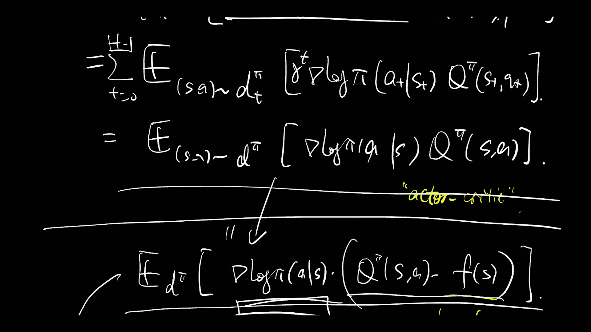

# 伊利诺伊大学【中英⚡统计强化学习｜CS542 Fall 2025, Statistical Reinforcement Learning】 p32 P32 策略梯度（视角2） -BV1YsZHBZEyM_p32-

Yeah。Yeah。그。Yeah。Yeah。Okay。Yeah。Yeah。嗯。Yeah。Yeah。Yeah。嗯。Yeah。Yeah。Yeah。Yeah。Yeah。Yeah。Yeah。

