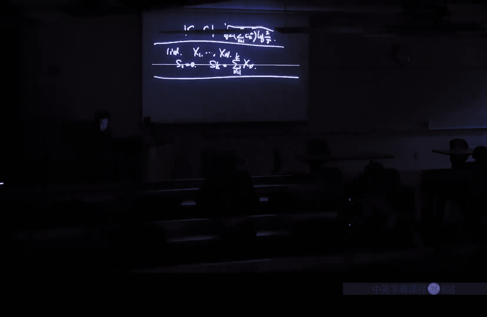

# 伊利诺伊大学【中英⚡统计强化学习｜CS542 Fall 2025, Statistical Reinforcement Learning】 p38 P38 鞅集中性与岭回归 -BV1YsZHBZEyM_p38-

Okay， so let's start。First， the， the plan for the rest of the semester。

So we have we have this week and then these two lectures and then there'll be full break。

 and after that I'll be like the week there'll be in Europe so I'll be away。 And after that。

 I think we just have one last lecture on the 10th， which is last day of lecture anyway。Okay。

 and today is the due for homework4， I think， right。 So after that will be no homework。

 So you can just focus your time on the course project。 The project will be due。

 I think probably just after a couple days， like probably the， the the， the， the end of the week。

 like in the， in the week of the last lecture。So the details will be I'll create create a submission portal assignment on the。

 on canvas。And。嗯。So it turns out that after I checked the schedule。

 we have fewer lectures than what we usually do in this semester。

 so Ill have to sort of shorten the material for the remaining two topics a little bit but before that any question about logistics。

😊，Its like email will be good。代じ。Sure， well， I would。 I'm not 100% sure。

 but I think the T A will probably also be traveling to Europe Europes yeah。

But you can check with him。 I'm not sure。Okay， so。So one thing okay。

 so and if you remember like the where we were left last time is like we finished the proof for or the proof sketch for Ol。

 and we have this very general statistical guarantee。

 but it's not quite clear how to efficiently implement it。

 right So therefore I mentioned that this the very last topic on online R is that we're gonna look at this intermediate ground。

 which is a highly structured model called linear NDP。 And you've worked with that in your homework。

So it turns out that for linear MP， you can have both statisticalial efficiency and computationalal efficiency in the algorithm。

 So we'll see how that plays out。😊，But。For the entirety of today。

 we wont actually talk about linear Dps because in order to give you the analysis for linear Dps。

 we actually need to do a lot of preparation。 So introducing the analysis of linear Dps is also a good opportunity to tell you like to introduce to you several important tools that are。

 you know， not only useful for this specific topic， but widely used across machine learning theory。

 especially when you do with some form of know， online interactive learning。Okay， now， as I said。

 given the limited time， so like for some of the analysis， I won't be doing them in detail。

 So in particular， after I introduce one of each tools。

 you may not see it like exactly how it applies in the later analysis because I can't go into the details there。

 but I can tell you which part of thelemma that we directly quoted that we directly use actually rely on this two that we introduced earlier。

Okay， so let's start， so the very first tool that we're going to use is a covering argument。Okay， so。

 so this is， this is different from， you know， coverage。 It's a completely different thing。 So。

 so this is talking about， you know you like in the past。

 whenever we say we use function approximation， we've always like said， okay。

 let's just assume it's finite， but exponentially large。

 and we pay log F in the as a statistical complexity。Right， but at some point。

 like you probably have to deal with like a really like continuous class， right， as you can imagine。

 like when we deal with the， you know， linear function approximation。

 you're dealing with a linear class。😊，And apparently， that just continues。

And you will need to do some concentration bound with union bound that you want to union bound over the entire class。

😡，So in that case it' like， what do you do。So there are many more advanced version of covering argument。

 so I will be introduced the most basic form of so-called L infinity covering that directly connects to the kind of analysis we've done so far。

 so basically the kind of question is if you remember we want to bound this form。😡。

So we have the true expectation。Versus the。F， X， I。So basically， like。

 let's say we have some distribution over x and we have some function F over the x over the x space。

 and we have a function class F for it。 And F here is continuous。😊，Right。And after all。

 like the kind of you know， previously by paying log F。

 what concentration bound plus union bound helps us to control is basically， errors of this form。

Right， so we basically want to say that for all possible F。 So for all F in the function class。

 the empirical mean。Is close to the true expectation。 And we want that hold for all F simultaneously。

Right， we want to say like， for all F in the F class， this is bounded by something。

 And in on that right hand， we pay log F， right， and that comes from a un about。

So another way to write it is just to say， would you directly bound the worst case error over the entire F class。

 that's the same way to write it。😡，Right， so this is what we previously deal with。

 But just assuming F is finite。 But now if F is continuous， we can't pay log F anymore。Right。

 but we still want to be able to control this。And in the past lectures。

 I've alluded to the idea a couple of times that， for example， if your F is linear。

 you can imagine that you're in the parameter space and you basically discretize your parameter space。

😡，Right， and then you， you know， like oftentimes we call that discalization， like an epsilon net。

 So so basically， like you， you discretize each dimension and then you get essentially get a discretized exponentially many functions。

 but you get a discrete class。Okay， but that's like a really hand wavy argument。

 So here I'm gonna give you the the more like rigorous version of that。So， the definition of。呃。

L infinity。Covering number。O， so we say that F epsilon。Is an。Apsilon cover of F。

And epsilon is a just subset of。functions over the whatever x space you have。If。If for all F in F。

 there exists F C in。As epsilon。Such that。FFC。Infinity， less than apsil。Okay。

 and then the covering number usually dened as an epsilon is。Or。

It's the covering number of your function class is the。Size of a。Smallest。F。Okay。

So if you think about this is like what what this is saying is that giving your function class。

 you're basically doing that disization， right， So after that disization。

 those distized functions are in this Fps。And the epsilon basically controls the disization accuracy。

Okay， so in particular， it has to be the case that regardless of like， you know。

 you pick any function F your original like continuous class。

You must be able to find a function in your like， this is called the Epsilon cover。

 such that the two functions are sufficiently close。

And here is called our infin covering number because it you measure the Al infinian norm and they must be epsilon closes to each other。

Right， so。And so here， this just defines you know what， what can be called a epsilon cover。

 But finally， the， the covering number， which also takes epsilon as a parameter。

 is the smallest size of such cover。Okay， so now like when you actually construct a cover and bound is size。

 you don't have to find the smallest one because usually you just need upper bound so you can just construct a valid but usually tight cover and that'll be enough。

Okay， so let's see an example， an example。 Yeah， I suppose I just have F is。

P of x transpose theta where theta is some， you have D dimensional feature。

 and you have the linear class like theta is unknown parameter。 And usually we。

 let's say we have theta。 let's say， two norm or let's say infinite norm bound by one。Okay。

So what do you do， Well， you literally do what I said， right， So imagine。

 So this is like the equals two case where your， let's say we。

 we think of this as the parameter space。 Okay， so then all possible theta are in this are in。

 are in this unit ball actually no， like I， I said L infinity。

 So let's say we do this L infinity ball。😊，Okay， so this correspond to this， right。

 So we consider all possible theta such that o infinity is bounded by one。

 so then what you do is that the standard construction is basically， you know。

 you divide here to Epsilom， not quite Epsilon， but epsilon prime。Okay。

 so here this list is epsilon prime， right， then you just pick all these points。Right， so you。

 you imagine like you， you do this lattice， right， And then you get all these points。

 And basically the， So each of these， we can call this theta C， right， Then F epsilon is the。嗯。

Phi of x transs theta C， where theta C is。So basically。

 this is the the set of all these green points。Okay。Now if so， but， but。

 but so basically what I need to do is that I need to choose the parameter Epsilon prime to guarantee that。

This is indeed an L infinity cover。 Absil， I a cover of the original F。

RightNow basically what you can do is like let's say I pick an arbitrary function in the original class。

 so let's say this data。Right， and I have to say， okay。

 I need to find its closest functioning F epsilon， right， So typically。

 you just find like one of the closest green points。Okay， then what can you say， Well。

 you can say that the green points， you have a theta minus。Cta C， infinite norm。Is。

Bounded by Epom Prime。But know that this infinite norm is not quite the same as the l covering we need because here this norm is in the parameter space。

😡，We need it in the function space， in the value space。Okay， so in fact， like may like。

 like if here is L2 norm or other norm is completely okay。 Like here。

 this inity has nothing to do with the infinity we need。

 We'll see how we translate that that to the infinity we need。 Okay， actually， like， for example。

 like here， depending on the our our feature assumption。

 maybe you actually want to do a little bit of relaxation here。 So， for example。

 I can relax to do to this， right？ So this will be something like this。😊，Right， so if we。

 let's say we measure two norm， then the two norm between these two points can be bounded by epson prime times like square root of D。

Okay， now what can you see about。Like the function as a whole， right？ So you want to say， okay。

 F theta。 So F theta is but just this function， right， So F theta minus F theta C， the infinite norm。

 or what is that， That is max over x， right， P of x transpose theta minus p of x transpose theta C。😊。

So this is the actual infinite normal we under control。And this is equal to max over x。呃。

C transpose theta theta of this。Okay。Now， by holders in quality， we can relax that to max over x。

Fel X L2 times。Theta theta C L。Right， so this is typically like you need an assumption to bound it。

 right， You need some assumption now feature bounding this。 And typically like in linear settings。

 like you bound out to normal of the feature。 So so this part comes with an assumption。Well。

 this part is like。Is given to you by by D Fson Prime。So together。

 then you know that to ensure that this is bound to Epsilon， you know how to set Epsilon prime。😡。

Right， so let's say， let's say we call this。We give it like B fee， which is the bound is a fee。

 right？ So then we have。We know that epsilon prime needs to be set as epsilon divided by root D times beef。

Right， and then what's the overall size， Right， So overall size of this is basically， what is it。

 Like the， the N Eon is。2 over epsilon prime to the D， right， So this is the original lattice。

 You discrecratize up to epsilon prime accuracy on each axis。Right， and each axis has has less two。

 right。 And so this is the number of points you have。Right。

 but we need to translate it as a function of epon。 So we plug that， plug this in。 So this is。

What like two square root D， B P， Epsilon prime to the D sorry， Epsilon to the D。Okay， so you know。

 this is a standard way to do everything cover of the linear class。Okay， and later in the analysis。

 we'll see that here， these blow ups are very mild like they don't really matter because what we're gonna end up paying is basically。

 if you imagine like previously we't have a discrete F。 We pay log F。Right， so here's the same thing。

 This is basically like size of F for a discrete function class。 So we pay log of it。 So the really。

 the only outstanding term that comes out of here is the exponent。😊，For anything inside here。

 we're only paying like poly logarithic dependence on it。 So like you know。

 if you have like some polynomial blow up here， usually like it just appears in the lock term。😡，Okay。

So， now， given that。Now， this is just the example， right， But when we do the analysis。

 we can just rely on this more abstract definition。 So suppose someone tells you that， oh。

 your function class F has a good L infinitefin covering。

Its log size is something small that you're willing to pay。Okay。

 so now how can you use that to bound。This。So that's the final goal。😡，Okay。

 so the and the the thing is the following。 So what you do is that you first。Use union bound。Plus。

 concentration。 So basically exactly what we did for the finite class。Actually。Let's say， it's also。

F is。In 0，1， Okay， with un plus concentration， we immediately have。

With probability greater than one minus delta for all F。In the Epsilon cover， we have that。

Oneever root n， sorry。truerue expectationation。Minus the empirical average。Is bounded by， you know。

 order。So here I'm ignoring the constants。 It's gonna be one over N log。Size of F。Divide by deelta。

Right， and here this， if we're choosing the small， the best cover。

 this thing is basically the covering number。Right。

 so what we do is that we just forget about the original class。

 We just do the concentration for the the union bound for the Epsilon cover， for the for the。

 for the for the， for the for the cover， which is like a discrete class。😊，Okay， that works。O。

But now we like， and， and this will be the only concentration about like high probability event that we going state。

 Everything else will be a deterministic consequence。Of this。Okay。Now， eventually。

 what we want to bound is that for our F in the original class， which is continuous。

 we want to bound E of F minus1 over n。F of X I， right， we want to bound this guy。Okay。

 now we're not gonna do any additional union bound on this， but we're gonna use。This。As a bridge。

 Okay， so what you do is that you find as close as the Fc， such that。In the cover。

Such that F minus F。Infant norm is bounded by epsilom。Okay。Then what you can do is that you。

 you just。Do a。So， you do F minus。F。Plus。1 over root n， I F， X， I minus。IFC C X， I。So basically。

 like you change this， you change the true expectation from F to F。

 You also change the empirical average from F to F， Okay， and then after that。

You can just say this is expectation of F minus1 over N F of X I。Okay。So basically。

 the idea is that you replace that difference， which is true expectation and empirical average。

With the difference for the closest F。Okay。And then by doing that translation， you。

 you pay a pair of differences， right， which is always between F andFC， F andFC。

But here this is the same F， but one is true expectation， one is the empirical average。Okay， so what。

 how can we bound this term。We already already bounded by Union Bo， right， So this。Right， as I said。

 this will be our only concentration bound， so。So therefore， this bound directly goes here。Right？

How can I bond these two terms。Any idea？By what definition， you can't just say by definition。Right。

 so F and F F， F C are elevated close to each other。 So whenever you take the same average。

 which is the expectation with respect to the same distribution。 Well here， basically。

 it's the same kind of average。These like immediately hold， right， So this is Abpsilon。

 This is Abpsilon。Okay， so the final sample complexity is basically just say， okay。

 if I want all of these sum， like the final saying to be upper bound by some like new epsilon。

 that's call it epsilon prime。 The typical way to do it is like you just split that epsilon prime into。

 let's say three terms。 You know， one gives to this one gives to this and one gives to this。 right。

 now let's say， let's say eventually you want this to be upper bound by epsilon。 no。

 I already use epson Prime。 So let me use epsilon 0。 Okay。

 so then what like how do you back up the sample complexity。

 You get you just assign epsilon equals epsilon over3， okay。😊。

And you also need this thing to be as0 over 3， right。The value of Abpsilon。

Will then determine the log covering number， right because that determines your disization accuracy。

Right， but this blow up， like over three is like really mild because we've seen that even when you have you know。

 a polynomial blow up here， eventually you just throw up like logarithmically。Okay， so basically。

 like you always have some ugly logarith factors。 But if you ignore them。

 roughly speaking log covering number here， like is just like the， like say or linear。Okay。And。

 and then you， and you use this to figure out， you know， the final sample complexity。Okay。

So with this argument， like you can immediately handle some of the standard continuous classes。

 like you know， mostly like linear classes， you know， but， but more generally， like if。

 if yourre the translation between your parameter to the final function value isipious like then basically log covering like covering like allow you to basically do a parameter counting。

Like if you just come number parameters， that's roughly going to be like your log covering number based on this argument。

Okay， any question about this part？Okay， as I said， like this is something that， you know。

 will actually be used in the foolproof of the linear NP analysis， but。

Like we'll actually you know skip some of the result and you know directly quotes on Lamma without proving it。

 so you won't really see like we exactly use it， but like whenever like the quoted Lemma uses like tools like this。

 I'll point it out。😡，Okay， so this is the first thing that we need。Okay。

 so let's go to the second item， Second two。Which is so。

 so this one is like a very standard statistical learning theory， right， So you。

 like you will learn about this like in a statistical learning theory course。

 which is just about say， supervised learning and generalization on I D data。

 Like there's no interactivity。 There's， no online learning and whatsoever。😊，Okay。

 but the next one is very much。Like， you know， some were specific to now I D data and you know。

 learning with online in online fashion。Okay， so this is a Martiningale concentration。Okay。

 so this is gonna be what I'm gonna introduce is an extension of the like the hoing like inequalities that we use。

 right， So so far， we've mostly used hoing to basically deal with everything。

 in the homework you seen bird size in quality， but in both cases。

 the assumptions we've seen require at least independence， right， So Hing doesn't have to be I D。

 but at least it requires independence。But if you think about the kind of data you collect。😡。

In the online setting， you know， your data is obviously generally not gonna be Id， right。

 because what's happening is that， let's say you collect trajectory， you have some data， right。

 and you use this data to analyze， you analyze this data and figure out what policy you use next。

 right， And then you collect the next tra。 and so on so forth。 And typically。

 you want the average of these like trajectories， something about these trajectories to converge to some like true expectation。

RightBut clearly， these trajectories are not I because later trajectories are sampled using policies。

 but those policies are computed by your algorithm based on all the previous trajectories。😡。

So you have this， right， So if you think about the online exploration。If this is the trajectoryject。

 right， you sample many trajectories。Where this is pi 1， pi 2， pi 3， pi T and all the way to。

 you know， pi big T， which is the very last trajectory。

 What happens is that the randomness of this trajectory is determined by the distribution of the entire trajectory is is determined by which policy you use。

 and that policy。Depends on all the random data over here， because that's what your algorithm does。

Okay， so basically， you don't have idiness。😡，Right，But what you do have is that once you fix pie tea。

 you're sampling like a fresh trajectory。Right， so therefore。

 like we need a new tool for that that that that that that that handles concentration in this case。

 Now， we didn't have to handle this in our max because there。

 we can separate the data for each state and use that clever tape or like， you know。

 pre cash argument to say that， oh， like， you don't need to worry about the interdependence between the data。

But in general， especially in the linear case， as you can imagine， when you do linear regression。

 you can't separate the data to like， you know， separate state。 You know。

 all the data become relevant and you merge all of them together and do like a regression。Okay。

 so in that case， you have to deal with this data interdepend this。Okay。

 so what's the standard tool for that。 So let me introduce the one of the generalization of of things to these kind of interdependent data。

 and the most basic form is called azm as inality。Okay， so let。呃，X。1， let's say x 0。 sorry。

 let me use S。 Maybe that's better。 S 0， S 1。As。K B a Martiningale。Okay， so I， you know。

 that there is a strict definition of what Martin means。 But I'll give you like， you know。

 more of an example and give you some intuition for what that means such that。

S K minus S K-1 is less than C K， almost surely。 So this is a constant。Okay， then then then。With fix。

And。With probability greater than woman is deelta， S N minus S 0 is less than。

2 sum over k equals to1，2 n。C， K square log2 over delta。Okay。

 so now this is actually a extension to half things， because if you actually have I D。

 let's say I have I I D X 1，2， X N。 then you can just let S 0 equals 0 and S。😊。

As K is just a partial cell。Summation。let's say K prime equals 1，2， K X。K pride。Okay。

 so in that case， as you can imagine， like what's the， what's the difference between S K and S K -1。

It's X K， right， because because here， this is the partial sum。

 So the difference between two consecutive partial sum is basically that the very last item you just added。

Okay， so what is that assumption then， It says like the different。

 the basically the size of the S K is always bounded。

 So this basically amounts to the range assumption that we needed in Hings。 right， So in Hing。

 we need that the range for each random variable is bounded。 Well， this is exactly that。Right。

 and basically， so this is in the sum form。 So you can divide this by n on both sides。

 both hand size， right， So， so if you do that， you recognize that by specializing to this scenario。

 this looks exactly like of in quality up to maybe some， like maybe a slightly loser constant here。😊。

Okay。So therefore， eventually when you use it， you're using it as if Hing applies。😡。

But really like what's important here is that what does it mean to be a Martiningale， Like， you know。

 when can you claim that this sequence of， the sequence of things satisfies the Martiningale property that is okay to。

 to， to。To， to， to， to， to invoke this particular assumption in particular， like inequality。Okay。

 so for that。Let's see。

Oops。O。So technically for for this to be a maringale， I think this is a common sufficient condition。

 I mean if you actually need to write it like super rigorously。

 you need to introduce fturration andre not like we're not doing all of that here。

 So technically the condition you need is this。Okay， so equals 0。嗯。So basically。

 that says condition all the previous realization of the the the partial sum。

 So basically like given historical information so far， the， sorry， this is S K plus one。

The difference between Sk plus1 and Sk the expectation equal to 0。Right？So if。

 if you think about it in the context of， you know， like I D X 1 to X N。

 this is a very standard because this says that this is just S the difference is just the word S K X K plus one。

 right and。Right， actually， sorry the。嗯。Okay， when when we apply this when we specialize to this。

 actually， these， these X N is like a 0 mean。0 me。Okay， so think， think of this S M I。

 Think of this S N as like the accumulation of the error。

 like the deviation between each X I and its expectation。 So like。

 or to simplify simply assume that all these X Ns have0 mean。 And that's what what， what。

 what corresponds here。Okay， so。So this is， this is the assumption you need。

 And what it allows you to do like more adaptive things is basically because now that now it no longer requires that each X N to be independent of all the past X 1。

 all the past X I。Because all the past Xs are reflected here。 You can condition on them。😡。

So basically， it says like condition on all everything in the past for the new pair of difference I've introduced。

 is that0ome。If that's the case， then by accumulate like by adding all these errors up all these errors like。

 you know， can to enjoy concentrationcent concentration。Okay， actually， maybe， actually。

 maybe let me write it a little better here。 So instead of assuming there zero mean。

You can just say what I'm adding together is the。difference between S K prime minus， especially S K。

Okay， so then it it's like the error term。 And eventually， you want the error term to be small。Okay。

Okay， so let me give a concrete example of。And of what's happening。

 And to give you some sort of intuition for。You know what's going on。

 So let's say we just have a simple moduleji on bandit problem。 So remember。

 Moji on bandit is just like a bandit problem where you， every round。

 you have just the finite number of arms to choose from。 And for each arm。

 there's a corresponding reward distribution。 and you choose arm， you get a reward。

 then you choose the next arm， you get another reward， and so on and so forth。😡，Okay。

 so like typically the interaction between the algorithm and the， and the the the problem instance。

 like you choose arm A1， you get R1。 You choose a2。 Now， this a2 can depend on。All the previous data。

 right， What you did in round one and what was the outcome， You use that to germ A2。

 and then you get R 2， and then you choose a 3。And a3 can depend on everything prior to it and so on and so forth。

 Okay， and let's say we interact with big tea round。Okay。So。

And let's say we assume like RRT is sample from the reward solution for the corresponding action you've taken in that round。

Okay。Now。So it turns out that you can there's some concentration， you know。

Things like you can claim by using the by， by invoking the marketing or concentration in quality。

 right， So， for example， one of them is that you can have sum over12 T and you say R T。

 This is a reward I get。In that round。Minus。For example， the true， let's say， with mean。Mu A T。

 So mu sub a is just the true mean of the reward distribution associated with action A。

 So you can say this is minus mu A T。And this， this will be a， you know， you。

 this may be something that you want to buy， right， And if you look at the， the shape the。

 the form of discretion here， if every round the action is chosen I D。

You can directly apply host same quality here。RightBecause here this is the reward。

 random reward you get。 It's true expectation。 When you marginalize out the randomness in reward will be just the corresponding。

 like the the trueing of associated with that arm。O。However， it turns out that， you know。

 this particular sum， you can also bound it， even if you're。

 if you're actually running an algorithm where every new action is chosen based on all the previous historical data。

 Okay， now what you need to do is basically to verify that it satisfies the， you。

 satisfies the Martiningale condition。Okay， so we， we we know is that basically this S K plus 1 minus S K is the latest item you introduced。

 right， so that will be。😊，RK plus1 minus mu A K plus1， right。So this is the。

 so this is the difference between S K plus1 and S K。Condition on everything， all the things before。

 which is S 1 to S K， which is essentially your condition on R I minus mu AI for all I less than equal to k。

so we're doing this。Okay。So。To verify this is equals 0， typically， the thing you do is that you just。

 you do a law of total expectation。 R K plus 1- mu A K plus 1。 You condition on everything here。

 But additionally， you also condition now a K plus 1。O， for all I less than K。Okay。

 then the outside expectation is just expectation with respect to A K plus one conditional or the。

 you know。Everything here。Here， and。Okay。So what is this。

 This is basically like what the like your algorithm may be randomized， but conditional， like。

 you know， seeing these in the past， your algorithm will give some distribution over what the next action would be。

Right， but we won't care about it because it turns out that。If you just evaluate。

 the inside expectation is always0。Why， because given all the history。

 but also given like what the your your your algorithm already decide on what action to take in this round。

 at K plus1。The randomness over here will be independent of the history。😡，Right。

Because conditional ak plus 1， mu Ak plus1 becomes a deterministic quantity。

And condition on AK plus one， well， this is just you know。

 a random reward sampled from know that particular reward distribution。Right， so essentially。

 what happens is that you're using this as a bottleneck that separates the future from the past。Okay。

 so if we write it more。Formerally， we have expectation A K plus  one， given all these historical。

 historical errors。R， let's say we do a， okay。嗯。呃，RK是不是A呃。So basically， you become mu A。

Given A K plus 1。你个谁。Right，So it is essentially like， you know， by finding this bottleneck。

 you can just drop all the historical dependence。I guess I need another。You know。

 another thing over here。 Okay， so then inside is 0。 So the outer expectation is also 0。Okay。

 so this is typically how you verify the the Martining property that is you don't really look at like。

 you know， all the things over here。 But instead， what you do is that you hear， for example。

 what we're doing is that we're like actually like choosing the precise action you're。

 you're taking in that particular round as a bottleneck， right。

 You see that the reward and is different from the from this mean given a that and all the history are basically separated probabilistically。

 given this bottleneck variable。So by condition on that bottleneck variable。

 you can just drop the past and just prove that the。

 the error term you want to show that is0 conditional， this bottleneck variable is 0。Okay。Okay。

 now with that。Here is the。Found quiz time， okay， and。I've given this quiz。

 and I've taught this material for maybe two or three times。

And I think this is always the the next two quizzes is always the time where like the whole class is most divided。

 Okay， so let's try it。😊，Okay， so again， let's say we have a M B algorithm like algorithm where the action space only have two actions。

Okay，And the algorithm， we're going to collect data using an algorithm。

 The algorithm is the following。 you toss a coin。And with。Have probability。呃。

You always take action A with the other half probability。 You always take the other action。😡。

 basically you toss a coin to decide between a and A and prime。

 but once you're decided over the entire round， you always take that single action。😡，Okay。

 so this is like weird algorithm。 Okay， but but we're just using that to illustrate like the the idea。

 okay。So I'm gonna write the sum of two error terms。

 And you can tell me like which one or both or neither of them enjoy Martin Ga concentration。 Okay。

 so the first one is sum over T equals 1 to T， R T minus。😊，Mu at。Okay。

 so the second one is sum over t equals1 to T。 Rt minus expectation of R T。Okay。

 so here are the expectation。 No that when you row out a wrong。😡，There will be randomness due to。

 for example， the random reward， but there is also randomness due to the randomness of the algorithm because the algorithm has tosseded the coin at the initialization。

Okay， so this expectation marginalizes out all the possible randomness。😡，Okay， so。

Is possible that neither of them satisfied concentration。Or both of them satisfy concentration。

 or one satisfies but the other doesn't。😡，Okay， I'll let you think about it。😊。

Think about whether which one。I'll give you a little bit of time。Which one。

 you mean the expectation here。No， that's an external randomness。用他。Yeah， yeah。

 So this algorithm isn't like it's a very special case。

 It's not really like deciding the next action deciding the next action。

 like based on the previous reward outcome。 But， but you could， right， But this is like even simpler。

 So， so， you know， we talk about this thing of like you know。

 you can sample you don't need to sample actually external latent latent variable。

 So one way to think about this is that your， your algorithm chooses the first action uniformly randomly。

 and all the future action becomes history dependent。

 It looks at what random action it shows in the first time death and always stick to that。😊。

So that's another way to introvert it。Okay， so， so therefore， in general。

 you still have these kind of dependencies， right， because you can say， okay。

 I choose this one uniformly randomly and all the future action。

 you have a probably dependence from the first action to hear。You just stick to that action。😡，Okay。

So you have two things。 One is reward minus the true mean of the。

 of the action you choose at that round。The other one is reward minus the entire marginalized expectation。

Okay， let's do a vote for the first one who think we should enjoy Martin concentration。😊，2， okay。

 so the rest， I believe you think that it doesn't。What， what， what's your。有没有有有有。You。

 you pick one as enjoying concentration。 Okay， so for the second one。

 how many think that we should enjoy concentration。😊，No。Okay。

 then I assume all of you think that it doesn't enjoy concept。 You， you think it enjoys。

Both enjoy concentration， okay。Okay， let me give you the answer。 So the first one。

 obviously enjoy concentration， because this is exactly the expression I give you both。 Like。

 like in general， I just verify that in general， anything in this form。😊。

Like for any arbitraryrbitrarily like， you know complicated algorithm。

 as long as you decide the next action based on the historical information。

 this one always enjoy concentration。 I just verify that condition for you。 Okay， so。

 so this one works。 And if you look at what it does is that because like in a single trial。

 you always stick to one of the actions。😊，Right， then mu A is just the true me for that action。Right。

 and you always get reward from that action。 So here。

 this is just saying the average reward for that action is concentrating to the meaning of that action。

 Of course， it works。Okay， so the first one works。😡，Now， the second one doesn't work。 why。

 Because here， when we marginalize out everything。😡，tell me， what's the true expectation here？😡。

Using mu A and mu A prime。What's the expected reward over here when you marginalize out all possible randomness？

😡，The average of muA and mu a prime， right？😡，Now， intuitively to get that。

 you need information from a and a prime。😡，But in a single run。

 So note that here we're doing a single pass and con over a single run Over a single round。

 You've only sampled from either A or a prime。 You've never get information from both of them。

 How can you expect this to accurately reflect this。 There's no， there's no hope。

RightIn a single run， you will only get accurate estimate of what either mu A is or what Mu A prime is。

 but you never get both simultaneouslyly。😡，But if you look at the expression。

 this one looks most similar to what we're used to in H density in quality。Right。

 and this doesn't work precisely because， you know， our algorithm has this interdependence。 It。

 it actually chooses something based on history。 And what this tells you is that like you， you。

 like you， you don't need to create， like to create a situation where expression like this fails concentration。

 You don't even need complex behavior where you choose the next action based on， for example。

 the reward randomness。 like here， we're not even depending on reward randomness。

 We just depend on the randomness of the earlier action we chose ourselves。

 Even that alone is enough to， to create these kind of situation。Right， and really， like， you know。

 what's， what's， what's wrong with it， right？ So basically。

 what you should do is that you should say， okay。The is the expectation of this condition on all the historical information is that to0。

😡，Right， if it's non zero， then you don't have concentration。Right， now。

 given all the historical information， So this one is already a deterministic quantity。

 It's a fully deterministic quantity。 right， When you take any expectation。

 this this guy won't change at all。So when you take expectation， given history。

 only this one will be marginalized out。What would be this one？Or given history information。

 right because given history information， history information includes what action youve chosen earlier。

RightAnd condition on that information， this expectation is the mu， Yeah。

40 action you've chosen in this round。Right。And that and this thing， there are two different things。

 They're not equal to each other。Okay， so therefore， like。

 if you verify marketing like the condition， this doesn't hold。Okay。So typically。

 if you think about like， like like in these like online scenarios， the， the。

 the kind of things that works is， is basically like， you have the random variable minus like。

Like what's soomic counterintuitive here is that in maringgon concentration。

 like the actual sum of errors that actually works typically take the form where you have a random variable minus this is another random variable。

😡，Okay， it's not gonna be a random variable minus something purely deterministic anymore。

But this random variable has less randomness than this one， right， because its， the its value is。

 this value is the， is the expectation of the， the random signal you're seeing conditional， you know。

 less of a history。😊，Right， so， so basically， like， you know， the， the marginal difference， you can。

 you can always think of it as， you know， something with more randomness minus is the expectation。

 given you know， less of a， less part of a history。 something of that form typically always works。

Okay。But as ST increases， you have to condition on more and more history。Okay， but， but this one。

 this one never updates， right， because this one marginalized in everything。

 It never conditioned on any history。 So this one doesn't work。Okay， so this is just to say。

 if you actually start working with Martiningale， there are like a lot of traps like this。

 and this is merely the tip the tip of the iceberg that we're seeing over here。😊，Okay。Okay。

 any question about this part？Okay。So， now。Oh。You know。

 we're gonna get to something that is closer to our final goal， which they analyze linear MP。

 And it turns out that to do that， we actually need to actually look at a linear regression。 Okay。

 so we're gonna actually derive something about the finite sample guarantee of linear regression。 So。

 and this is so online。😊，Rich。Regression。Okay， so we have a。嗯。那 see。Okay， so for。T equals 1。

2 all the way to big T。Nature。Choosess Xt。Reviews。呃。Okay， so we actually。Keep this blank over here。

And then reviews the true label。Y T， which is X T。嗯N RD。Stta star。Plus， absent。And the Zon T is。

 lets say I D noise。Okay， so as you can imagine， like this is a very stand， like。

 it looks like a very standard linear regression setting where like you get X T， Y T， X T Y T pairs。

 where Y T is generated by a unknown linear function of X T。

 So like the state star is something that we want to learn。 plus I D0ing noise。😊，Okay。

 and typically you need， let's say this noise is， let's say bounded。 Let's say0 and V max。Okay。So。

 so now what's different from usual linear regression is that usual linear regression typically you assume that either the all the X Ts are fixed or the X T R I D drawn from some distribution。

Okay， but here， this is called the online setting。 And it matches like you know what we later do in linear and the piece and also in linear be that we don't assume that X T are drawn from some distribution。

 So here by saying nature chooses X T， it means that X T is adversely chosen。Okay。

 so it can be chosen like， for example， based on what your algorithm want to do and can also be chosen in a way that based on all the historical data。

😡，Okay， so this is gonna like mimic the， the， the later setting。 For example。

 you can imagine like a linear bandit where you have a lot of actions to choose in each round。

 and each action has a linear feature。 And the feature will be something like X D， right and well。😊。

And after you choose many arms， each arm has a feature。 You've seen the reward， which is linear。

 You can run linear regression。Right， but if you think about how data is collected。

 you've collected the data every round you've chosen arm。 So essentially。

 you've chosen the X D and you've chosen it based on the previous。Like information， in particular。

 you may have chosen an X D based on the epsilon T -1， the noise term in the previous realizations。

Okay， so in that case， like you break the idiness。Okay， so therefore。

 like when you actually analyze and give guarantee for linear regression in this form。

 you actually need maring Ga concentration in qualities instead of like relying on the more more standard inequ qualities for independent samples。

 Okay， so this is like an example over say， like， you know。

 the the idea of like Martin concentration helps。 although like， you know。

 I won't give a limited time。 I won't exactly go through， you know。

 how these Martin concentration is established and how it gives you the final guarantee。😊，Okay。

 so what I'm gonna give you is two things。 One is like an algorithm。 And then。

 we'll see like some of its guarantees。 Okay， so so what does algorithm。 So。

 so here by the algorithm， I'm not saying like in the bandit or linear B P setting where the algorithm chooses X T。

 So here were， we're in the perspective of。😊，The component of the algorithm that focuses on doing linear regression to recover the theta star parameter。

Okay， so therefore， those X T are have been chosen externally like in an adverse manner。 like。

 but that those are out of my control。 All I want to do here is just to do regression。Okay。

 and here we're gonna to do like very standard regression， which is to say at each round T。

 I have theta head T base， which is like my best estimate of theta star given all the data so far。

Okay。What what is， Well would just do square loss minimization plus a little bit of a regularization。

 Okay， summation I equals 1，2 T-1。Let's say Theta T is like in this round。

 I've not seen the data for this round yet。 So I only have data from。Time step 1，2， T management。

Okay， so I can do X， I transpose theta minus Y， I square plus。Seta score square。Okay。

 so if we don't have the last term， well， this is square square loss regression， right。

 And because it's linear， this is like the most standard form of linear regression。Okay， now。

 but and it's also very standard。 Like， like， for example。

 you know that if the design matrix is not full rank， linear regression may run into like issues。

 right， you need to invert certain matrix that are not necessary invertible。

 So it's very standard to add a L regularization at the end。

 and that makes sure that the matrix you need to invert is always invertible。 Okay。

 so this is often called a rigid regression in the。😊，In the。In in the frequencies。

 the sample complexity and regression analysis。Okay， so and。Now， given this。If you say， okay， stop。

 this is all the data you have。 So here is my stateta had T at this round。

 Then you can actually make prediction based on this。 Okay。

 so Y T is your prediction function at at this round。 You can say what is。😊。

It's just the X transpose。Sa hat。 Okay， so basically saying that， okay。

 now if this is all you get and I give you a new X and ask。

 what do you think the right label is for the new X， Well this is what you would predict。Right。Okay？

So now okay， so now equivalently。We can write the。Algorithm in matrix form。

 we can define lambda T as I plus。I equals t-1 X， I， X， I transpose。Okay。

 so this is a D times D matrix， right？ So this is basically like sometimes we call the sample covariance matrix。

 although strictly speaking， this is not covariance。

 This is only second moment because we're not subtracting the meaning。 But oftentime， you know。

 we don't really strictly distinguish between those two concepts。

 anyone guess what's the I correspond to here。It it correspond to racial regression， right。

 So without racial regression， you wouldn't have this term。Right， now the and as you can imagine the。

Theta T hat is just the lambda T inverse because I'm， I'm adding rich。 So it's always invertible。呃呃。

To T-1 X， I， Y， I， right， So this is the standard like L to regular the linear regression formula。

Right， and therefore， Y T had X is x transpose。T inverse summation I equals 1 to T -1 X， Y， Y。Okay。

So this is the algorithm。Now， we want to give a guarantee。Okay。

 now let's say we stop it at sometime tea。And this is all we get， right， so we get this guy。

And this is the， like， how we're gonna make predictionds for different acts。

 We want to say how accurate this is。so the guarantee。So we want to bound Y T head of x minus。嗯。

Let's say， like the true y of x， which is just the x transpose theta star。Right。

Because the true label you will see is x transpose X like a new X transpose theta star with some I D noise。

 But this noise is unpredictable， right， So the， the best prediction you can make is the deteristic portion。

 right， So so therefore， like， we can we can we can have error like in in this form， right。

 And in fact， if your theta had T equals theta star， then this will be 0。😊，Okay。

 so now imagine like this is something you want to bound。Typically， do you think like， you。

 do you think you can already rebound it or do you think you need additional assumptions。

So basically， we' are doing linear regression， right， We have a bunch of x and y's。And so far。

 basically we have no assumption on whatsoever。😡，And say， okay。

 we use regression to learn the parameter and use that parameter to make new predictions。

 We hope the new prediction is correct for is accurate。 What kind of assumption do you need。Okay。

 so let me ask in this in this way， so。It should be very easy to construct worst case examples where。

The anniversary is choosing the data X in a certain way so that there will be some X such that there's no hope that you can。

 there， there's no hope that this will be accurate。Can you give me an example。So in general。

 if you don't make any assumption about the data。😡，This won't always be bounded。

 even when you have an infinite amount of data， or as like， you know， T increases。

 this won't shrink with T。For at least for some X。Okay， so can someone give me examples？

 let me ask anything yet a different way。😊，As you can imagine， one way you bound this is to say。

 this is。Equals to x。Transpose sayta hat T minus X transpose itta star。So by holders， this is。

 you know， X norm times2 norm。T minus theta star L2。 so this is one way to bound this。Okay。

 if you're bound it this way and like， we like typically assume that X is always bounded， right。

 So this bounding is we can afford。So it suffices to bound this， this particular turn。😡。

Okay suppose you want to bound this。😡，What kind of additional assumptions do you need to introduce。

This is like L2 parameter recovery， right， You want to guarantee that your learned data。

Is actually close to the truth datata star in L2 norm。

Well turns out that you need to make some assumption on our data。

 otherwise it's impossible to have this。😡，What kind of assumption do you need on your data。Anyone。

Just guess。What particular kind of coverage are you talking about？Well， so here it's， okay。

 so later we'll get you there， but here is not there yet。

 So I'm asking something like very basic about linear regression， right so。

Like enng variable regression， if you want to identify theta star。😡。

What kind of act do you hope to see。No， no， no， ID is not enough， that's a good try。

 but I is not enough。😡，The distribution actually matters。 So， yeah， forget about the。

 like the Martin yield and the interdependence。 Let's just imagine the I D case。

 Suppose you're doing leader regression I D。 You want to learn say star really well。

What kind of assumption on the distribution over x do you need to make？😡，Where are the I D。

 That's not enough。Okay， so。Suppose you're like， okay。The assumption you need is that you want the。

 if you're actually in the， in the stochastic case。

What you need is that you want expectation of Xx transpose to be invertible。😡，And better still。

 you want the smallest eigenvalue to be， you know， large。Right， so basically。

 the idea is that if you want to do linear regression， every time you see X。

 you're doing essentially a linear measurement of theta say star along that particular direction。

 right， like similar to the， you know， the the， the。

 the the thing we we talk about that volumemetric argument or the linear independent thing， right。

 So basically， you want to measure theta star in all directions， right。

 at least the linearly independent directions。😊，Suppose there are some direction X that。

Like some direction of x that you just never see in the data。😡。

Then your datata star like is never measured in that direction。😡。

Then you can really learn say the star， you know， in that direction， right， for example。

 let me give you even trivial more trivial example。 Suppose all the X you see is always un vectors。

 Its always like 0 everywhere and only one in one coordinate。Okay。But suppose like among all。

 like for all the acts you see in the data， there is a coordinate where you never see in one。😡，Okay。

 then the corresponding coordinating theta star can never be identified。😡，Right。So basically。

 you want like the x in the data to be as like to be a distribution of X that is like as orthogonal to each other as possible and span the host space。

😡，Right， and that particular like is can be measured by the。You know， if I being more quantitative。

Is， is measured by， say， the smallest eigenvalue of this to be greater than 0。

 or like you want it to be as large as possible。Okay。

 so this is the kind of like assumption you need to， to make sure that。This is a small。

So here to be similar， right， we have this lambmbda T matrix。So basically。

 if you need the star to be well identified， you also need the smallest eigenvalue of this guy to be bounded away from 0。

Okay。So， so like。🤧嗯。Okay， anyway， so， but it turns out that for the kind of guarantee that and analysis we're going to do。

 we can't make this assumption。Okay， so therefore， like we're gonna accept the fact we， we。

 we can't make any assumption on what the data looks like。 So data will be anything。Okay。

 so as I said， then you can't really。Take this route。2。To to produce a guarantee。

 because this term over here is generally unbounded。

which means that there will be some xs such that when you plug in over here。

 this error will be large。😡，But the hope is that for there will be some other x。

 like over the entire space of X， there will be some X that you can still hope to make good predictions。

Okay， so think about this。 Like if someone give you an arbitrary set of X Is in the past。

What kind of new X do you think you can make accurate reparations on。Yes， that's a good point。 right。

 So you can think of like even like a very bad worst case example， right。

 So suppose like the anniversary chooses the X so that it deliberately makes this matrix very。

 very ill condition。😊，Okay， what he can do。 What he can do is to say。

 I always just choose exactly the same X for you。Okay， the x1， x2， S3。

 they're always exactly the same x。So then this matrix you have or the Lada matrix。

 if you ignore the rich regression part， is actually a rank1 matrix。But you hope it to be rank D。

 right， So it's rank one。So， if it's the case that。X 1， x 2 all the way to X T plus plus1。

 All of them is some x 0， okay。So in that case， for most of the Xs。

 when you try to make a prediction， you can't make good prediction at all。

 But there are still some acts you can make good prediction on。

 What are the Xs you can make good prediction of。😡，X0ero itself。 But there is more than that。So。

 for example， suppose you're， you're asked to make an next good prediction on x 0。

 And you order leaving a regression， you can do anything。 What are you gonna to do， Someone ask you。

 okay， what do you think is the Y label for x 0。 What are you gonna do。Like historically。

 all the previous x is exactly this x 0。So what do you do？The close， right， but， but like。

 this is a linear regression。 So all the labels are real values。 You take the average， right。

 because you， you can't just pick any one of them because that contains a noise term But by taking average over everything。

 the noise cancel out by concentration。Right， so you just。

 so what you do is that you just you have y 1， Y 2， Y T plus -1。 You know。

 each of them is an I D draw for the correct label for this x0。 So when someone ask you。

 what is the value of x 0， just take their average。 And that's your good prediction。

 And that certainly works， right， So that， when you have more and more data that will become small。

 and the error will shrink with， with data。 Okay， so it turns out there's more to that other than x 0。

 there's still other X， you can make good prediction now。 what are they。Should be pretty obvious。

So it's still related to x 0， It's not a different direction。Yes， like scaling， right。

 So suppose I do alpha x 0。 Okay， What is your prediction now。Alva times the average label， right？😡。

So as you can see， in this particular case， if your historical data is all like the same。

 or maybe theyre also like just the constant and multiple of each other all along the same line。

 you can still make a cooperation on a one dimensional subspace。😡，Okay， so I guess Ive spend1。

1 or two more minutes。 So this is scenario 1。 So scenario 2， suppose you have half of the data。

 Let's say T over2 is like， let's say x0。The other half of the data。😡，Is a different vector。

 which is， let's say x 0 prime。 Okay， so now your historical data is rank2。

 You have x 0 and x 0 prime。 Okay， so now I ask you， based on the same logic， what kind of。New X。

 can you make good predictions on。ペスタん。Right， right， right。 So you guys are getting ahead， right。

 So first of all， alpha x 0， of course， good， right， and beta x0 prime， of course， good。

 but also their linear combination。😊，Right， so anything that is a linear combination because you can just decompose that into the X portion and X prime portion。

 make prediction here， make prediction here and add them together because of linearity that always works。

😡，Okay， but are are you seeing the the pattern here。So basically， as long as the X。

 the new X being asked is within the span of the historical data。You can make a good version on it。😡。

If it's out of the span， then you can'， right， So what you really And， and also。

 even is within the the historical span， it should be the case that it has appeared multiple times。

 right， You don't want to appear it only like a small number of times。 Let's say in this direction。

 I've only see only one X。 only only see this direction once。Then you get a label。

 but that label contains a noise， but you need to see it multiple times for the errors to cancel out。

😡，Right， so therefore， like you basically want to have a measure of like the like the effective sample size that is along that direction。

 like in the data。Okay， so give the guarantee and。Briefly explain explain it and will will be done。

 Okay， so the guarantee is。With high probability。Y hat T of x minus y of x is less than or equal to x。

