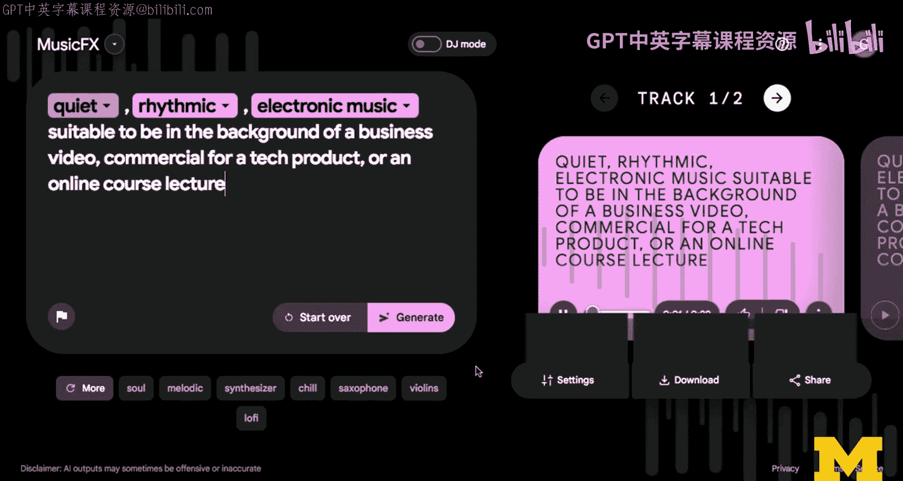
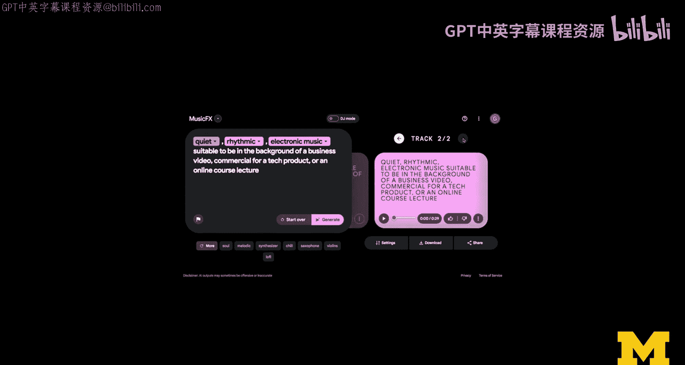
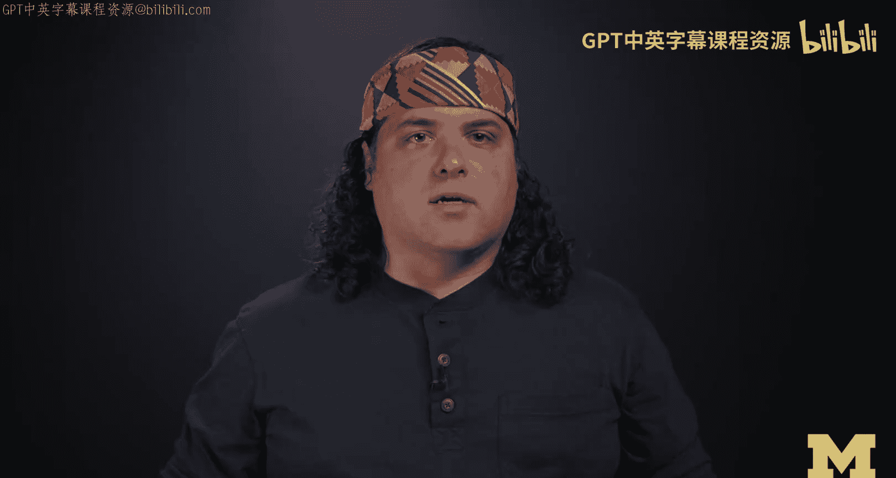
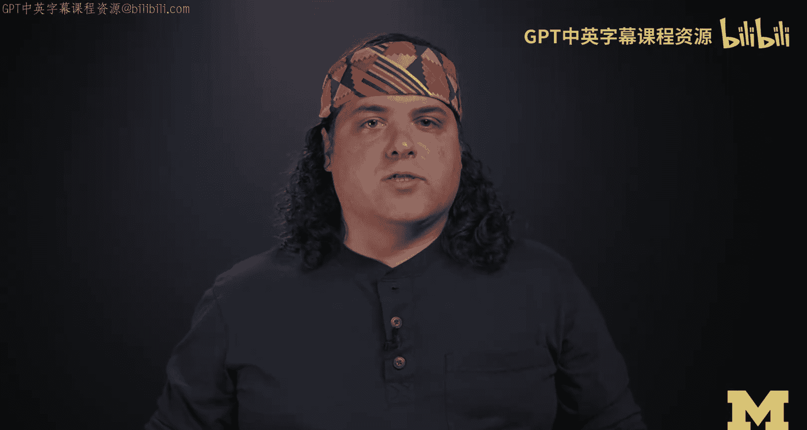
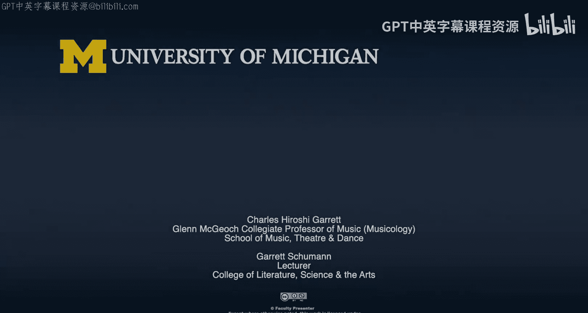

# 03：AI音乐生成工具对比演示 🎵


在本节课中，我们将通过一位音乐家的实际体验，对比两款AI音乐生成工具：Google的MusicFX和BandLab的SongStarter。我们将了解它们如何辅助创作，各自的优势与局限性，以及如何选择适合专业工作流的工具。

---

## 工具初探：Google MusicFX

上一节我们了解了AI在创意领域的潜力，本节中我们来看看具体的应用。首先，我以音乐家的身份，测试了Google免费且备受关注的AI音乐生成工具MusicFX。

我输入了一个非常具体的提示词，其中包含了我所寻找的音乐风格和声音特性的线索。这个工具的潜在好处是巨大的，因为尽管我有能力创作原创音乐，但使用MusicFX只需撰写提示词，远比从头构思和制作音乐更省时省力。

以下是我使用的提示词示例：
```
安静、有节奏感的电子音乐，适合作为商业视频、科技产品广告或在线课程讲座的背景音乐。
```

我点击生成示例。片刻之后，程序根据我的要求创建了两段音轨。生成完成后，第一段音轨开始自动播放。




现在，我们来听听第二段音轨。




## MusicFX的优势与局限

MusicFX允许我下载这些音轨，这对我至关重要，使我能在创意项目中灵活使用它们。

然而，该软件存在一些重要的局限性，这些局限让我作为一名专业音乐家，会想去寻找其他工具。

以下是MusicFX的主要限制：

1.  **时长固定**：MusicFX创建的所有片段都是30秒，这非常短。
2.  **导出格式单一**：我只能以MP3一种文件格式下载音频。我希望能有更多选择，尤其是更高保真度的选项，但MusicFX（至少在免费版本中）没有提供。
3.  **缺乏编辑功能**：我无法在MusicFX内部对根据提示生成的音轨进行任何定制或变换，必须依赖其他软件。


如此复杂的工作流程，对我来说并不比从自己的音乐灵感开始创作更有用。并且，从我导出的MusicFX音轨中，听不到我个人显著的创作声音，这令人沮丧。


---

## 更优选择：BandLab SongStarter

不过，有些AI音乐工具我更可能觉得有用，并且更愿意将其融入我的工作。例如，我们现在听到的就是AI生成的音乐。

它来自免费、基于浏览器的数字音频工作站BandLab。该平台有一个名为SongStarter的AI功能，能根据我选择的风格建议，生成大约一分钟的音乐。



## SongStarter的核心优势


与MusicFX不同，SongStarter允许我在BandLab常规的录音室工作区中，进一步编辑它生成的音乐。

除了让我有机会在生成式AI的支持下进行自我表达，这个扩展功能意味着使用AI工具不会对我的工作流程造成重大改变。


此外，BandLab自带一套全面的软件乐器和效果器。与MusicFX等使用从互联网各处采集的音频录音进行训练的简易AI音乐生成器不同，BandLab使用其内置的**音源库**来演奏SongStarter生成的音轨。

代码示例（示意）：
```python
# SongStarter 生成音乐后，可直接在BandLab DAW中调用内置音源
audio_track = songstarter.generate(style="electronic")
bandlab_daw.load_instrument("synth_pad") # 加载内置合成器音色
bandlab_daw.edit(audio_track) # 进行编辑
```


这增加了编辑的便捷性，也让我更放心地在创意项目中使用AI生成的材料。


---

## 总结与启示

本节课中，我们一起学习了通过对比MusicFX和SongStarter，评估AI音乐生成工具的实用性。

我的对比体验表明，借助合适的工具，创意专业人士仍能在使用生成式AI增强创作的同时，展现自己独特的技能和个人视角。关键在于选择那些**能无缝融入现有工作流、并提供足够创作控制权**的工具，而不是那些生成封闭、固定结果的工具。








对于希望将AI融入创作的音乐人，BandLab这类集成了AI生成与专业编辑环境的平台，可能是比MusicFX这类独立生成器更高效、更具创造性的选择。