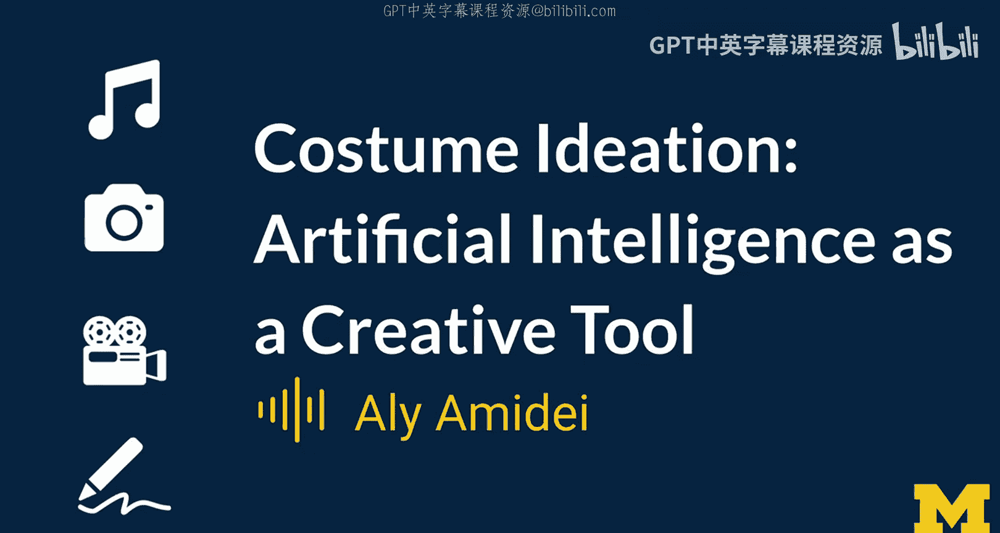
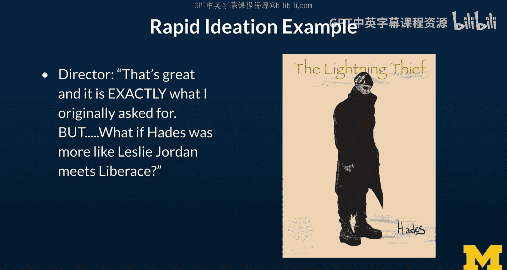
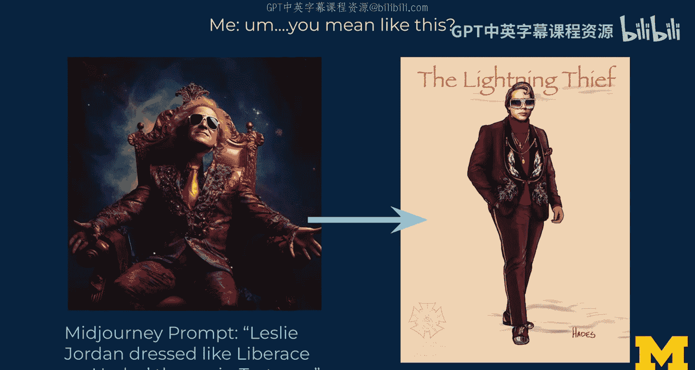
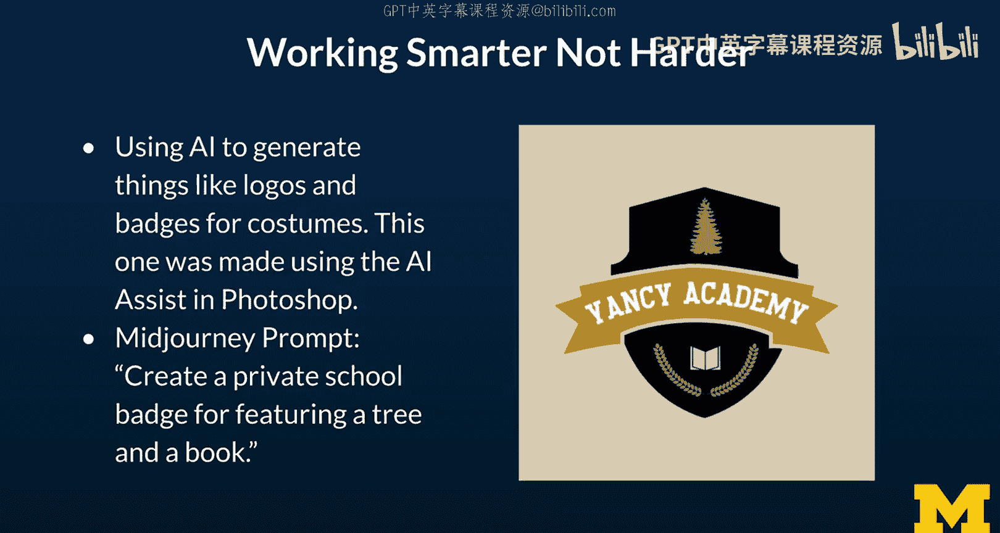
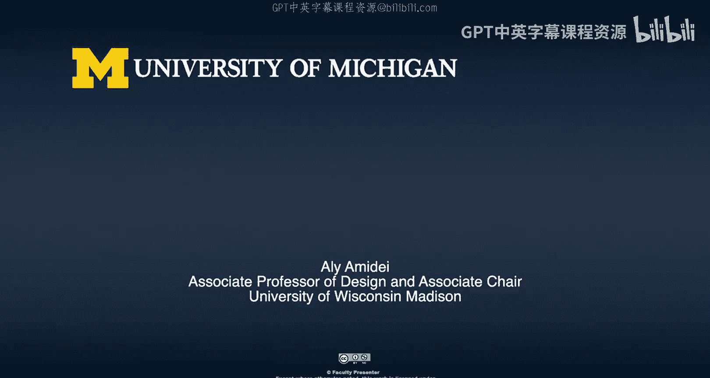

# 04：艾丽·阿米迪的专题讲座

## 概述
在本节课中，我们将跟随戏剧服装设计师艾丽·阿米迪，学习她如何将人工智能工具（如Midjourney）融入创意工作流程。我们将探讨AI在快速构思、辅助研究和提升效率方面的具体应用，同时也会了解其局限性。

---

大家好，我是阿米迪，我将分享关于服装构思的话题：**人工智能作为一种创意工具**。

我是一名戏剧服装设计师。服装设计师负责创造演员在舞台上穿着的服装。这些服装更具体地被称为戏服。戏服为我们提供关于穿着角色的信息，并支撑剧本的故事。

我的工作涉及大量的研究、问题解决、原型制作、沟通以及亲自动手的创意和技术劳动，目的是将纸上的想法变成舞台上的服装。服装设计是团队协作的一部分，团队包括设计师、导演、演员、技术人员等，所有人共同努力，为观众呈现一部鲜活的戏剧或演出。

现在，我在工作中会使用许多数字和模拟工具。我直到2023年才开始将像ChatGPT和Midjourney这样的AI工具融入我的教学和艺术创作实践中。

目前，当我需要做三件事时，我会转向像Midjourney这样的图像生成工具：**快速构思、辅助研究以及更聪明地工作（而非更辛苦）**。

---

### 快速构思
对于快速构思，像Midjourney这样的工具非常适合进行实验。我可以快速测试一个古怪的想法。

以下是我使用的方法：
*   在短时间内，通过精心设计的提示词，我能立即获得合作者的反馈，判断我的方向是否正确。
*   AI生成的图像成为概念的初步验证，之后我可以在此基础上，运用更传统的非AI艺术实践进行深化。
*   这极大地减少了在没有AI辅助的情况下，达到相同阶段所需的时间和劳动。

---

上一节我们介绍了AI如何加速创意构思，本节中我们来看看它在辅助研究方面的作用。

### 辅助研究
作为一名服装设计师，我为角色设计戏服，但在创作时也需要同时考虑角色和演员的身份。我非常重视寻找能代表演员和角色身份的研究图像。根据戏剧的性质，找到具有代表性的研究资料可能具有挑战性。

这里有一个例子：我曾难以找到一张描绘一位患有行动障碍的现代黑人青少年、穿着时尚服装、并具有典型戏剧作品那种戏剧性灯光的图片。

因此，我使用Midjourney和以下提示词创建了一张：
`young black teenager with a mobility disability in modern stylish clothing, dramatic theatrical lighting`

在服装研究演示中，将此类图像作为实际主要图像资源的补充，可以作为一个强有力的视觉辅助，帮助更好地讲述故事。它也能更好地传达我的设计意图，并能确保我呈现的研究图像以文化响应的方式，综合考虑了角色和演员的交叉身份。

---

然而，AI作为一种工具远非完美。尽管进行了多次提示词尝试，我仍然无法为这个关于一个痴迷于AO3、Jared Leto的眼睛和罗马帝国的少女的、有趣又傻气的设计概念，生成哪怕一张可用的图像。

在这里，AI的局限性显而易见。经过一次尝试后，最好的选择是手动快速制作一个拼贴图，而不是继续徒劳地使用AI。我了解到，当需要奇思妙想、幽默感以及设计眼光时，Midjourney的帮助有限。

---

但是，有失败也有成功。有时，任务非常庞大，值得尝试看看Midjourney是否能缩短原型制作时间，从而产生一个团队都认可的成功创意草案。

当被问及音乐剧中所有合唱队员都穿着相似的粉色西装时，与其重新绘制西装或在Photoshop中制作，我能够快速生成这个图像，当场获得对“粉色西装合唱队”这个想法的肯定或否定答复。

---

### 更聪明地工作（案例研究）
作为一个实际案例，我最近为麦迪逊儿童剧院设计了音乐剧《闪电窃贼》的服装。导演布莱恩·科温最初要求将哈迪斯设计成一个赛博朋克哥特悲伤emo风格的角色。

然而，在与演员排练一周后，他回来告诉我这个方向完全错了，我们需要转向不同的方向。原来的服装已经采购完毕，而我们距离带妆彩排只有三周时间。因此，为这样一个主要角色更换服装是一个大问题。

他问：如果哈迪斯更像**莱斯利·乔丹遇见利伯拉切**（Leslie Jordan meets Liberace）会怎样？这感觉正是Midjourney出手相助的合适时机。

使用这个提示词，我创建了你在这里看到的图像，而导演的反应是：“是的，这太完美了。” 然后，我利用这张图像进行了新的初步研究，并为该角色创作了新的服装效果图。我采购了服装，瞧，大功告成。这套服装取得了巨大成功，并允许我们在最小化对项目创意流程负面影响的前提下，进行充分的实时协作和问题解决。

---

最后，AI可以帮助我更聪明地工作，而非更辛苦。另一个来自《闪电窃贼》制作的例子：我需要为扬西学院校服设计徽章。利用Photoshop中的AI工具，我能够快速生成这个符合我们需求的图像，并且创作时间不到五分钟。

---

## 总结
本节课中，我们一起学习了艾丽·阿米迪在其创意实践中使用AI生成的三种主要方式：
1.  **快速构思**：用于实验和验证初期概念。
2.  **辅助研究**：用于生成具有特定代表性要求的视觉参考。
3.  **提升效率**：用于快速生成视觉素材，辅助决策和具体制作。

尽管我意识到AI带来的负面影响，特别是对环境和版权侵权的担忧，我仍然感到矛盾。但最终，我尝试负责任地使用它，以一种能帮助我维持工作与生活平衡的方式。

谢谢。