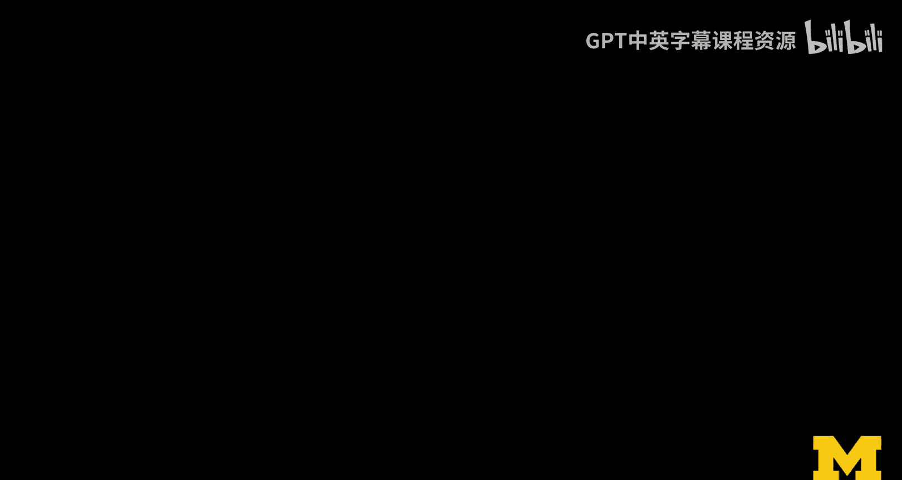
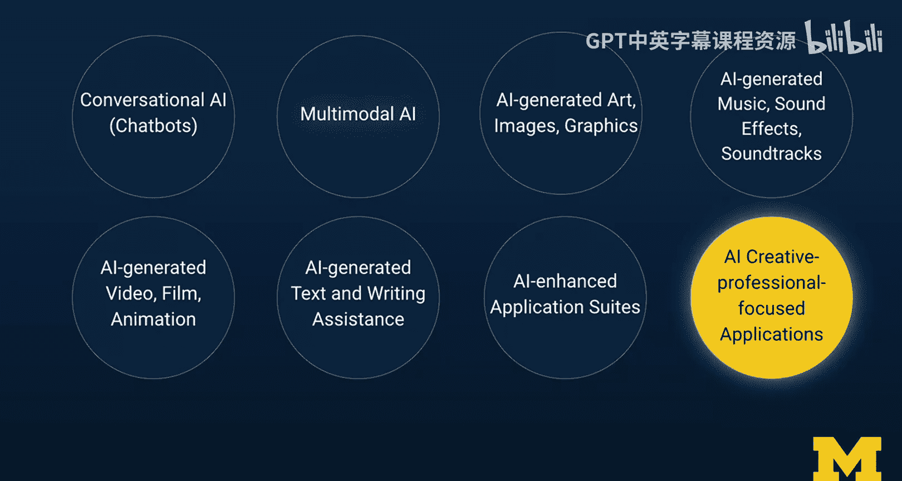
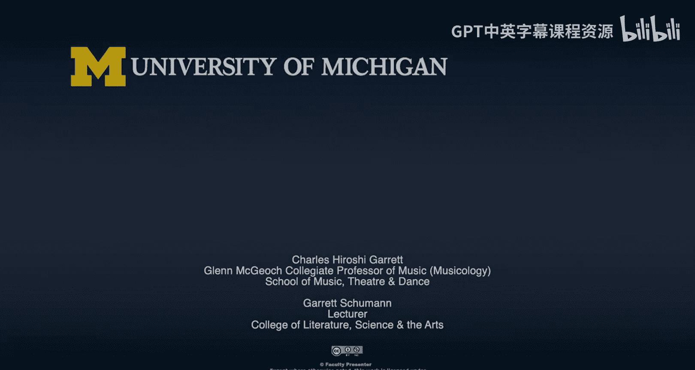
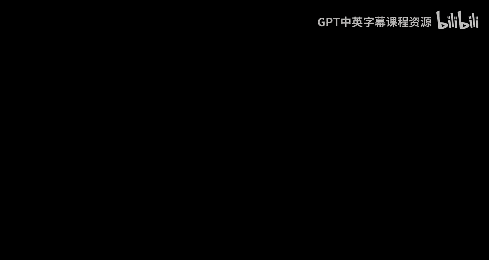

# 05：生成式AI工具综述 🧠

在本节课中，我们将系统性地了解生成式AI如何辅助创意工作。我们将介绍多种类型的生成式AI工具，并探讨它们在不同创意领域的具体应用。

---

## 概述

人工智能行业投入了大量精力开发旨在模仿、替代或增强人类创造力的应用。因此，辅助创意工作的生成式AI工具正变得越来越普及。一些工具通过自动化任务来提高工作效率，另一些则旨在帮助我们进行头脑风暴、探索想法并激发好奇心。流行的生成式AI工具使用基于海量数据训练的模型，能够生成文本、视觉图像、音乐、高清视频、3D动画等多种类型的内容。如今，许多创意工作者正通过各种软件程序和应用套件来使用生成式AI。

## 生成式AI的八大应用领域

以下是AI目前影响创意工作的八种主要方式。请注意，这些类别可能存在重叠。例如，像OpenAI的GPT-4和Google的Gemini这样的先进多模态AI程序，能够生成AI图像、AI音乐、AI视频和AI文本。

### 1. 对话式AI与聊天机器人 🤖

当OpenAI于2022年11月推出ChatGPT-3.5时，以生成式AI聊天机器人形式出现的对话式AI便开始重塑我们的世界。如今，各行各业的创意工作者都利用聊天机器人先进的自然语言处理和机器学习能力，来辅助他们的专业工作和日常生活，包括头脑风暴、学习、研究、分析和管理。

到2023年，包括ChatGPT和Google Gemini在内的大多数先进聊天机器人已发展为**多模态**。这意味着它们不仅能通过交换文字进行书面对话，还能做更多事情。

### 2. 多模态AI平台 🌐

多模态AI不仅能生成文本、图像、音频和视频等多种形式的内容，还能接受语音指令、分析图像、理解声音和视频。换句话说，多模态AI不仅能写，还能听、看和说。

一些多模态AI工具可以免费使用，但最先进的平台通常需要个人或团队付费订阅才能访问其高级功能。

### 3. AI图像生成 🎨

生成AI艺术和其他类型视觉图像的能力，正在改变许多行业的创意工作。像**Midjourney**、**Stable Diffusion**和OpenAI的**DALL-E**这类应用，能够响应用户的提示词，生成符合指定尺寸、分辨率、风格和视角的高质量视觉图像。

许多图库服务，如Shutterstock和Getty Images，现在也加入了AI增强功能，允许用户仅基于其庞大的图像库来生成新的AI图像。

### 4. AI音乐生成 🎵

AI生成音乐正在创意产业中快速发展。像**BandLab**、**Aiva**、**Amper Music**和**Soundraw**这样的AI应用，允许用户创作各种类型的音乐，且无需支付版税。

一些程序特别擅长根据文字提示创作歌曲。例如，你可以输入提示：“创作一首融合民谣和乡村元素、表达对乡村故乡怀念之情的歌曲。” 😊

而其他程序则允许用户微调请求，指定确切的流派、乐器和节奏。

### 5. AI视频与动画生成 🎬

大多数多模态AI套件都能生成AI视频片段、电影、动画和其他视觉图像。此外，也存在许多专门用于生成特定类型媒体的针对性软件包，例如：
*   **Puppetry**：生成带有木偶角色的AI卡通。
*   **D-ID**：将数字肖像转化为会说话的动画头像。

### 6. AI写作辅助 ✍️

对话式AI聊天机器人和多模态AI应用在商业世界广受欢迎，因为它们能生成新文本并协助写作任务，例如起草电子邮件、总结会议记录，或调整写作语气以适应不同的消费者群体。

也有专门的AI写作软件来帮助完成特定任务：
*   **Copy.ai**：旨在创建广告文案和其他类型的营销内容。
*   **文本补全应用（如Bloom）**：旨在完善书面短语和填充句子。

### 7. 集成于主流软件的AI 🧩

如果你长期使用微软或Adobe的应用程序，你可能已经在使用生成式AI了。
*   **Microsoft Copilot**：一个集成在其商业软件平台中的AI工具，旨在通过生成书面内容、组织日程、总结会议记录等方式提升创造力。
*   **Adobe Creative Suite**：现在包含自动化的生成式AI功能，使用户能够生成、润色、重新着色和转换图像。😊 Adobe的**Audition**软件通过生成式AI增强了其音频混音能力，而**Adobe Premiere**则使用AI为视频同步字幕。**Adobe Acrobat**中的AI功能现在可以帮助分析、总结或从冗长的PDF文档中提取特定信息。

### 8. 特定用途的专用AI工具 🎯

虽然创意专业人士可以探索许多流行的生成式AI应用，但AI软件行业已经发展到为非常具体的目的开发针对性应用的程度。例如：
*   **Synthesia**：旨在使用AI头像创建培训教程和操作视频。
*   **Murf AI**：为演示文稿和视频生成画外音。
*   **文本创作应用Jasper**：旨在帮助营销人员生成网页文案、博客、销售宣传稿和社交媒体帖子。😊

---

## 总结

本节课我们一起学习了生成式AI在创意工作中的广泛应用。从多模态平台到专注于图像、音乐、视频、写作的专用工具，再到集成于主流软件的AI助手，这些工具旨在帮助创意专业人士增强、扩展和转变工作方式。作为创意专业人士，你可以探索广泛的生成式AI工具，以提升你的创造力和工作效率。