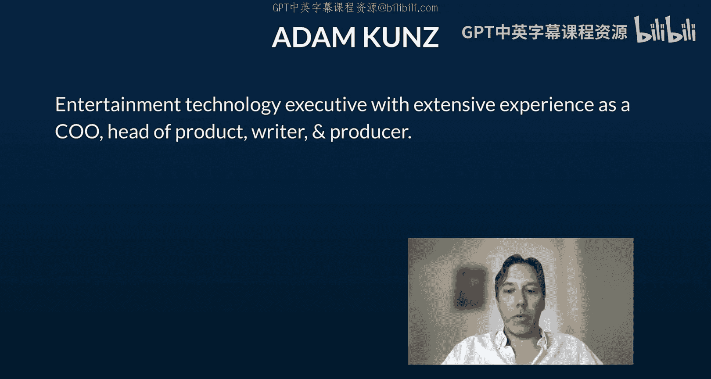
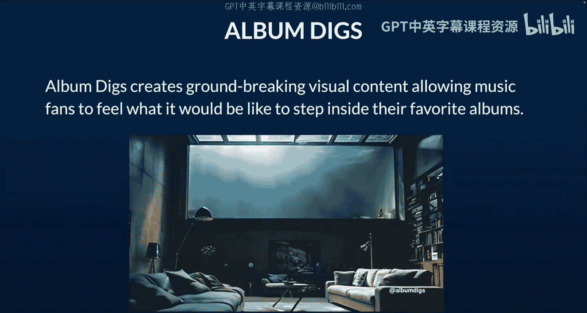
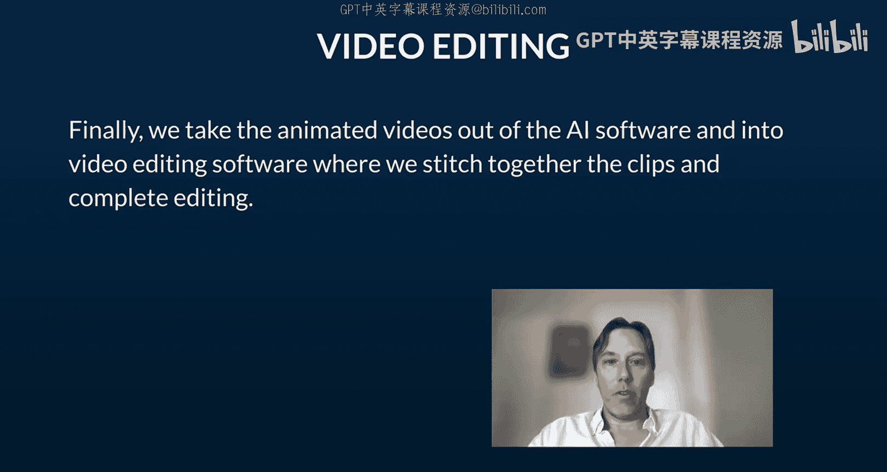
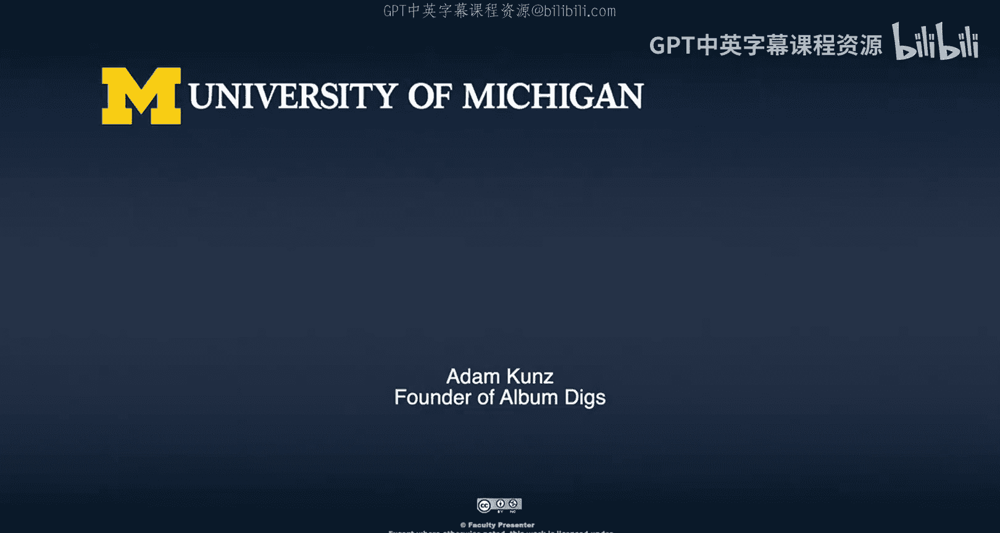

# 07：亚当·昆兹的实操演示 🎬

在本节课中，我们将跟随娱乐科技高管亚当·昆兹，详细了解其团队“Album Digs”如何将AI与人类创意结合，为音乐专辑创作沉浸式视觉内容。我们将一步步拆解从聆听音乐到最终视频成品的完整工作流程。

---

我叫亚当·昆兹，是一名娱乐科技高管，拥有丰富的首席运营官、产品策划和制作人经验。我的职业生涯始于一家名为Mogley的公司，我们很早就开始构建专有算法，利用AI技术让人们无需音乐天赋也能进行歌曲混音和混搭。这让我开始与索尼、华纳、环球等大型唱片公司合作，并带领多家初创公司与大型企业建立伙伴关系。

今天我要分享的是我们“Album Digs”项目的工作流程。Album Digs是一个开创性的视觉内容项目，它让乐迷感觉自己能“走进”他们最喜爱的歌曲和专辑中。我们独特的视觉内容创作方式曾与音乐传奇人物合作，并在顶级媒体上亮相。内容发布在Instagram、TikTok、Facebook等社交媒体平台，YouTube频道也即将上线。你将看到一些视频片段，可能会认出我们正在创作的专辑。这是一个将AI与人类创意、艺术指导相结合的漫长过程，接下来我将为你详细讲解。

---

以下是整个创作流程的各个阶段：**聆听**、**情绪板制作**、**提示词工程**、**迭代**、**复制**、**直接置入**、**提示动画**、**分层动画**以及**视频剪辑**。我们将从聆听开始。

### 聆听 🎧

这一阶段假设我们已经选定了一张专辑，并由此开始。我们首先会从头到尾深度聆听整张专辑，同时进行研究。这个过程包括观看音乐视频、演唱会、阅读乐评、查看幕后花絮，并在社交媒体上搜寻信息，以深入理解粉丝群体。

### 情绪板制作 🖼️

完成研究后，我们开始创建情绪板。其中可以包含具有相似氛围的空间摄影、家具、建筑，或是从音乐视频、现场演出、专辑封面中提取的美学元素。我们会汇集各种类型的图像，力求准确反映专辑的精髓。

### 提示词工程 ✍️

收集好所有图像后，我们进入提示词工程阶段。我们将情绪板中的所有图像连同文本提示一起输入AI。这些文本提示旨在描绘我们对专辑氛围的理解，这些可能无法完全从图像中体现，例如色彩调色板。我们还会给出关于时间、摄影风格、环境条件等提示。然后，我们会权衡提示词与图像的比重，根据需要决定是更侧重图像还是文本。

### 迭代 🔄

接下来，我们不断调整提示词，使生成的图像越来越接近我们设想的空间。这就是迭代阶段。经过反复调整，我们可能会发现图像的某一部分看起来是正确的——可能不是整张图，但某个角落的感觉正是我们想要的。然后，我们会遮罩图像的其他部分，并用新的提示词重新生成，直到得到一个完全正确的房间。最初的图像都不完美，因此这个阶段可能非常漫长，我们需要进行成百上千次迭代，才能找到最能代表这张专辑的核心图像。

### 复制 🏠

一旦有了第一个房间，我们就进入复制阶段。我们的目标是以2D图像的形式，围绕这张专辑构建一整套房子。我们会以第一张图像为参考，将这种风格外推（或称“种子模拟”）到整个房子的外观上。这个过程是逐个房间进行的，每个房间都可以加入引用不同歌曲歌词的“彩蛋”。例如，下一个房间可能基于某首单曲设计，而房子的外观则需要看起来能容纳所有这些反映专辑主题的房间和环境，使其成为一个连贯的整体。

### 直接置入 🛠️

当我们拥有了所有房间和房屋外景图像后，有时需要将工作从AI转移到我们自己的软件中进行直接物体置入。通常，AI无法生成你想要的精确物品。例如，我们可能想（在获得许可后）在墙上放置乐队的标志。如果这样做，我们必须通过独立的3D、灯光和环境软件来精确完成，因为在AI内部生成只会是对该标志的“诠释”，而非精确复制。另一个例子是，我们曾与雕塑家和街头艺术家合作，将他们的作品放入受专辑启发的我们的内容中。为了在虚拟房间中精确放置他们的雕塑并进行恰当的布光，使其看起来真实，我们必须脱离AI，使用前述软件来完成。否则，AI会扭曲图像，生成其自己的版本，而非艺术家的原作。在这个阶段，我们也可以再次利用AI，如果我们置入物体的边缘与背景图像有些不协调，AI可以帮助实现无缝过渡。

### 提示动画 🎞️

流程的下一部分是提示动画阶段。我们将所有完成的图像导入其他AI软件，让它们动起来。这个过程涉及将静态图像和文本提示输入AI，这些文本提示会解释这个镜头的动作，可以包括从摄像机运动到环境效果的一切描述。例如，我们可能想描述房间里有雾气，或者描述摄像机如何平移，或者这是一个固定镜头。

### 分层动画 📊

接下来是动画分层。AI通常不理解哪些物体应该在前景，哪些不应该。因此，我们会进行调整，让近处的物体运动较少，让远处的物体运动更明显。我们还会加入环境效果，通过额外的环境“噪音”将其添加到特定位置。例如，如果房间里有壁炉，我们会给火焰添加大量环境噪音，突出这一层。同样，如果窗外有海洋，我们也会给它添加额外的运动效果。

### 视频剪辑 ✂️

最后是视频剪辑部分。我们将AI生成的动画视频导出，并将这些片段拼接在一起。当我们为新的YouTube频道制作音乐视频时，这一步还包括将灯光效果与音乐节拍同步。我们会将房间里的发光物体与节拍同步，从而创造一种完整的体验，让人们感觉环境在实时响应音乐。这是我们将内容发布到各个频道之前的最后一步。

---

本节课中，我们一起学习了亚当·昆兹团队“Album Digs”项目利用AI创作专辑视觉内容的完整流程。从深度聆听与研究开始，到构建情绪板、进行精细的提示词工程与迭代，再到复制风格、直接置入精确元素，最后通过动画和剪辑让静态图像“活”起来并与音乐同步。这个过程完美展示了如何将AI的强大生成能力与人类艺术家的创意指导和精细控制相结合，创造出独特而富有感染力的沉浸式艺术内容。