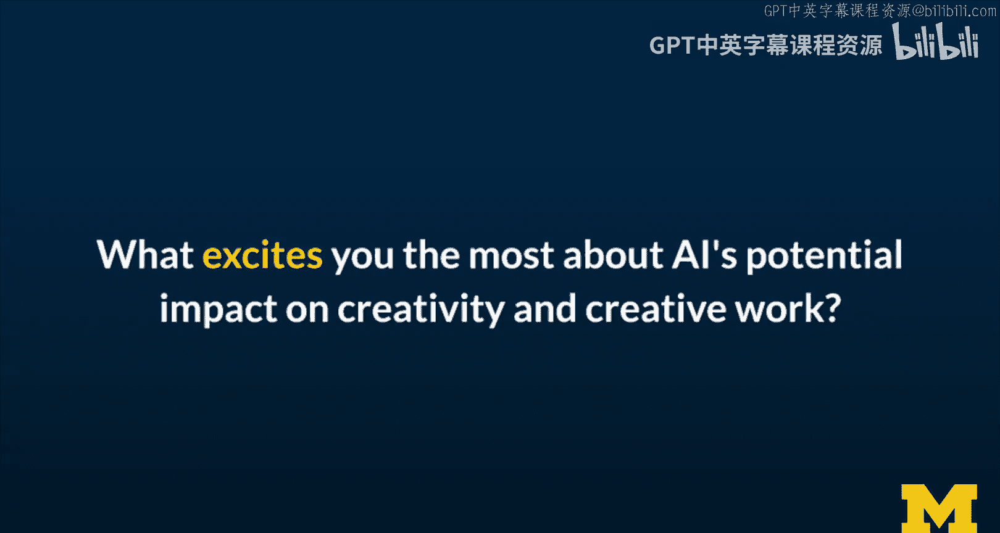
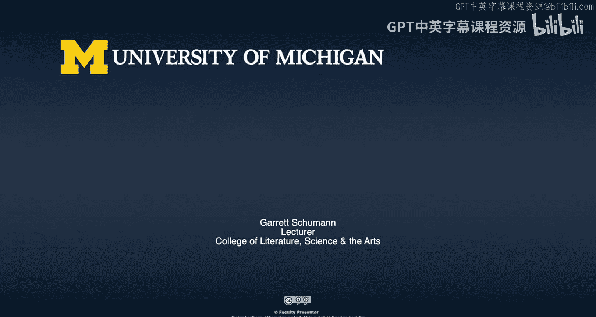

# 09：领域之声：加勒特·舒曼 🎵

在本节课中，我们将聆听来自作曲家加勒特·舒曼的见解，探讨人工智能如何影响创意工作，特别是音乐创作领域。我们将了解AI在简化繁琐任务方面的潜力，以及它作为个人创造力延伸的可能性。

---

和许多人一样，关于AI影响创造力和创意工作，我首先想到的是它有可能简化那些非常繁琐的任务。

例如，作曲家在与管弦乐团等团体合作时，需要处理一项特别耗时的任务：为团体中的每个成员制作分谱。

这项工作必须手动完成，并且在该领域内是如此令人厌恶，以至于催生了一个活跃的抄谱员二级市场，作曲家们会将分谱制作外包给他们。

AI似乎有可能为作曲家处理这类任务，或者为其他创意专业人士处理类似的任务，尽管我会克制我的乐观态度。

因为这种小规模、高度个性化的AI工具似乎并不是科技行业的首要任务，至少在目前是这样。

---

基于此，AI工具能够作为个人创造力的镜子和延伸，这种方式令我着迷。

我将很高兴看到这条道路的发展。

---

## 总结

本节课中，我们一起学习了作曲家加勒特·舒曼对AI在创意工作中应用的看法。他指出了AI在自动化繁琐任务（如制作分谱）方面的潜力，同时也表达了对AI作为创造力延伸工具的期待。尽管目前高度个性化的AI工具可能并非行业优先发展方向，但其未来可能性依然令人兴奋。