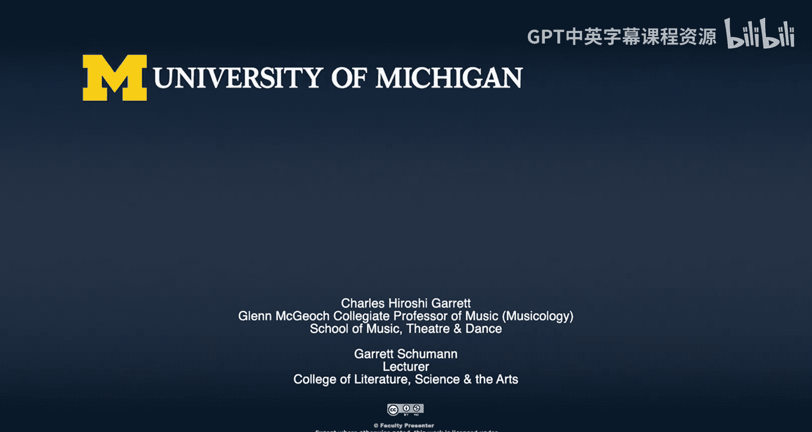

# 12：负责任地使用AI

在本节课中，我们将要学习如何在创意工作中负责任地使用人工智能。我们将探讨AI的实际应用与伦理维度，理解其能力与局限，并学习一个评估AI工具的系统性方法。

我们已经开始探索AI工具如何被用于增强工作场所的创造力。你也已经有机会思考整合AI可能会如何影响你自己的创意工作流程。现在，让我们花点时间思考一下接下来的步骤。

在采用最新、最强大的AI应用程序之前，批判性地思考在何时、何种情况下适合整合AI至关重要。

我们如何在创意背景下学会负责任地使用AI？是否存在一套在工作场所使用AI的最佳实践？AI是否总是应对我们所面临挑战的合适解决方案？

在本模块中，我们将转向在创意背景下使用AI的实际和伦理维度。理解AI的能力及其局限性非常重要。在涉及AI治理、可持续性、数据安全和知识产权等关键问题时，评估和权衡在工作场所使用AI的风险尤为重要。

我们将首先讨论如何负责任地使用生成式AI，如何跟上围绕AI的法律环境，以及如何避免公司为错误任务采用AI工具时可能产生的声誉风险。

然后，我们将进入整个课程的核心部分：一个你可以用来识别、评估、并证明或排除使用任何AI工具的过程。我们称这个必不可少的四步过程为 **SIFT**。

**SIFT** 代表：
*   **S**pecify（明确）
*   **I**dentify（识别）
*   **F**ocus（聚焦）
*   **T**rust（信任）

通过学习如何筛选你的AI选项，并将这个过程应用到你的工作中，你将能够开始负责任、合乎道德且高效地增强你的创意工作。

本节课中，我们一起学习了在创意工作中引入AI时需要考虑的伦理与实际风险，并介绍了一个名为 **SIFT** 的四步评估流程，以帮助大家更负责任地选择和运用AI工具。