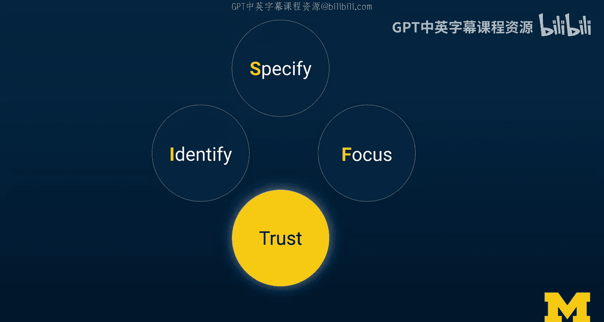
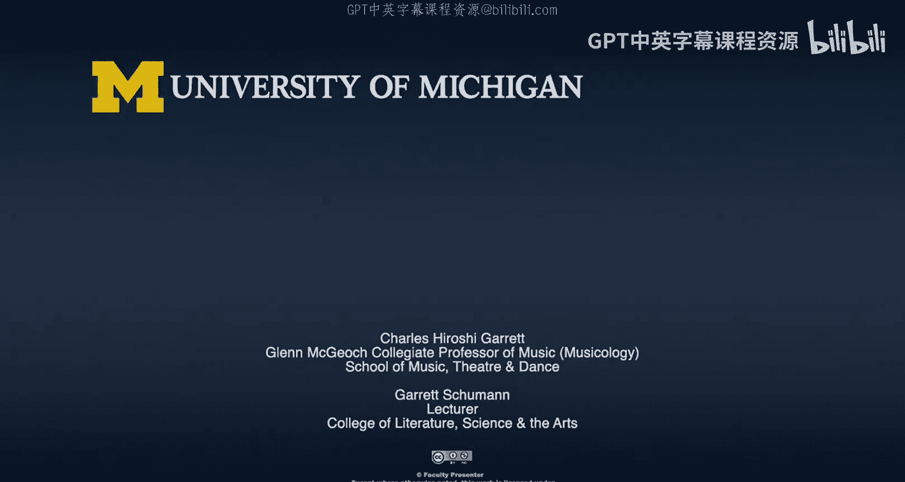

# 16：SIFT方法导论 🧐

在本节课中，我们将学习一个名为SIFT的结构化方法，用于评估AI工具。这个方法旨在帮助创意工作者在纷繁复杂的AI工具中，找到最适合自己工作流程、品牌和组织文化的选择。

通过前面的学习，你已经看到了许多例子，它们说明了定位、理解和评估AI工具对于人们将这项技术融入创意工作至关重要。

这里我们将介绍一种评估AI的结构化方法，旨在使这个过程更简单、更可靠。学习如何与AI技术深入互动，也将使你更容易向你的经理、员工或客户证明，是否应该使用AI。我们称这个过程为SIFT，它代表**明确任务、识别风险、聚焦声音、建立信任**。它的目标是帮助你梳理当代众多的AI工具，并让你有信心选择到适合你、你的工作方式以及你组织运作方式的产品。

如果你是一名独立的创意专业人士，SIFT将引导你思考所评估的AI工具如何支持你的工作流程和品牌，以及如何提升你的创意实践。SIFT将帮助你决定一个AI工具是否适合你的创意工作，是否与你的工作流程兼容，是否与你的目标和使命一致。它将通过提供一个一致的、循序渐进的评估流程，帮助你对你选择采用的技术做出深思熟虑的选择。

要遵循SIFT流程，你需要做的是：

以下是SIFT流程的四个核心步骤：

1.  **明确任务**：明确你想用AI工具完成的具体任务，和/或你希望AI工具为你的工作提供的协助。你必须知道你想让AI做什么，否则你将无法找到最适合的工具。同样关键的是，你需要理解将AI融入工作流程能为你带来什么好处。
2.  **识别风险**：识别使用AI可能对你和公司品牌、组织理念以及职场文化带来的潜在风险。
3.  **聚焦声音**：聚焦你作为创意工作者的独特声音。思考如何利用AI来支持、增强和保持你个人的观点。
4.  **建立信任**：确保你可以信任你的AI提供商，并了解你所选的AI工具的数据来源。

接下来，我们将更深入地探讨SIFT流程中的每一个步骤。然后，你将有机会将SIFT方法应用到自己的创意需求中，并思考将你的工作流程与当今AI工具结合的最佳方式。

发现AI如何能增强你的创造力并改进工作，这令人兴奋。但无需匆忙。因此，在决定采用某个AI工具之前，请花时间仔细思考，并始终问自己：对于你需要完成的任何任务，AI是否真的是最佳解决方案。

本节课中，我们一起学习了用于评估AI工具的SIFT结构化方法。该方法通过**明确任务、识别风险、聚焦声音、建立信任**四个步骤，帮助创意工作者系统性地筛选和评估AI工具，确保所选工具与个人工作流程、品牌价值和组织目标相匹配，从而做出明智的技术采纳决策。