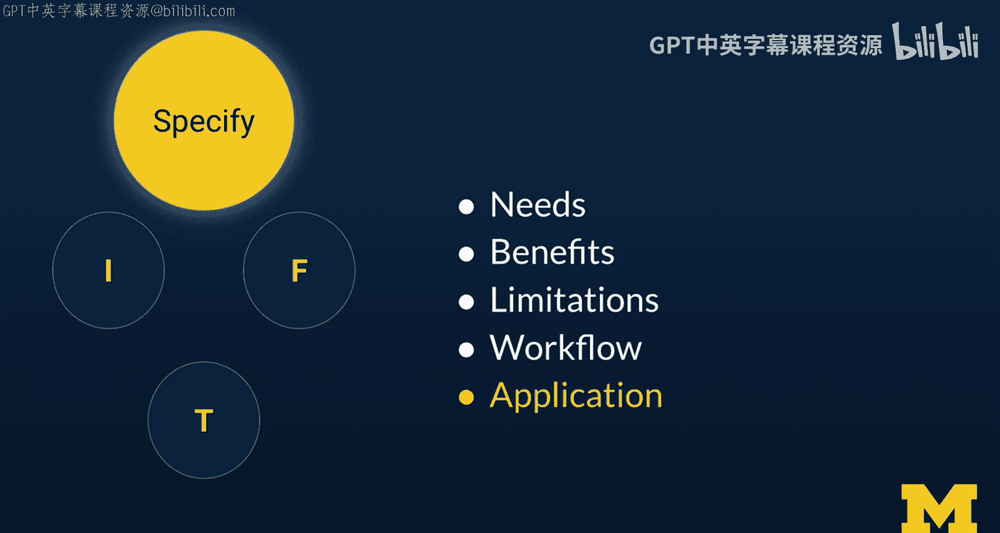

# 17：明确参数 🎯

在本节课中，我们将学习如何为AI工具设定明确的需求和参数，以确保它能真正融入并优化你的创意工作流程。我们将通过一位音乐家的具体案例，来理解明确参数的重要性。

上一节我们介绍了评估AI工具的Sift流程。本节中，我们来看看该流程的第一步：明确你希望从AI工具中获得什么，以及你将如何从中受益。

---

我是一名音乐家，正在考虑将AI引入我的工作。因为我遵循评估和选择AI工具的Sift流程，所以我将从明确我对AI的需求以及我将如何从中受益开始。

让我们从一个简单的目标开始：我希望找到一个能生成音乐素材的工具，帮助我为未来的项目构思创意。在本系列的前一课程中，我比较了两个易用的音乐生成工具：Google Music FX和BandLab Song Starter。我判断Song Starter对我更具吸引力，原因之一是我可以更轻松地定制其输出。

从抽象层面看，这个特性可能意味着Song Starter是我当前需求的最佳选择。但我需要更具体地明确需求，以确保将其引入工作能真正使我受益。

每个AI工具都有其局限性。Song Starter虽然有其他优点，但它只允许我从其提供的菜单中选择风格提示。我无法通过提示词工程进行实验，以创建高度定制的输入。

我的客户或项目需求，有可能不在Song Starter允许我选择的选项范围内。

同样重要的是，我需要考虑将AI音乐生成融入我的工作是否真的能带来益处。Song Starter可以提供灵感火花，但我仍然需要做一些工作来充分利用它生成的素材。

事实上，我喜欢Song Starter的这一点，因为它意味着我可以定制和个性化最终产品。但Song Starter的这一特性也意味着，通常我不应期望这个工具能大幅节省时间，除非我处于特定的工作流程情境中，几乎没有时间进行头脑风暴，或者我一天工作过度，需要将灵感外包给AI音乐生成器来获得助力。

如果我的具体情况不允许我有时间进行定制，我可能会使用不同的工具。例如，像Google Music FX这样的工具，可以根据我输入的文本提示快速生成一个现成的曲目。

以如此细致的方式对待这个工具可能显得繁琐，但有充分的理由需要明确参数。在创意工作中，许多经久不衰的成功AI工具，如Auto-Tune，都有明确的应用范围。它们最适合完成有限范围的任务，并且做得很好。以Auto-Tune为例，它带来了巨大的好处：使创意工作者能够做到原本不可能的事情。

Song Starter和其他生成音乐素材的GenAI工具，其主要益处在于提升个人生产力。但其中仍然存在需要权衡的取舍，这反映了改变工作流程以融入AI所带来的复杂现实。

---

本节课中我们一起学习了为AI工具设定明确参数的重要性。通过具体分析音乐家使用Song Starter的案例，我们了解到，明确工具能做什么、不能做什么，以及它如何与你的具体工作情境和需求相匹配，是成功引入AI的关键第一步。这有助于管理预期，并在工具的能力与你的创意目标之间找到最佳平衡点。