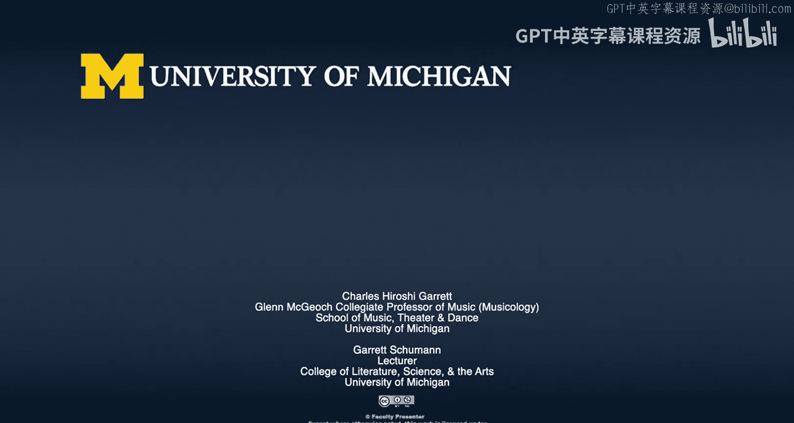

# 19：聚焦核心 🎯

在本节课中，我们将学习SPT流程的第三步：聚焦。这一步骤旨在引导你以突出和强调自身独特创意声音的方式，将生成式AI工具融入你的创意工作中。

## 聚焦：强化你的创意声音

上一节我们介绍了“具体化”和“迭代”两个步骤，本节中我们来看看“聚焦”如何与它们相辅相成。如果你能成功明确AI需要完成的任务，那么你在下一个项目中就更有可能专注于发挥你的创意声音。同样地，如果你在使用某些生成式AI工具时，感觉能够有意义地表达自我，那么你将更容易规避上一节视频中讨论的组织内部风险。

## 借鉴现有自动化经验

作为一名经验丰富的创意专业人士，我发现有一种思维方式有助于想象AI在不掩盖我个人视角的情况下如何应用于工作，那就是思考那些已经使我受益的其他自动化形式和工作流效率工具。

例如，我是一名作曲家，在记谱和数字音频工作站软件中，我时刻都在使用**快捷键**。任何使用电脑的创意工作者可能都依赖快捷键。这个功能消除了我与所用软件之间工作流程中的许多步骤。

其创意益处在于，我有更多时间专注于我的实践和流程中，最能展现我个人声音的部分。任何人都可以点击鼠标，但并非每个人都能创作出我的音乐。因此，我受益于使用快捷键的自动化，这让我有更多时间专注于那些我的个性能产生最大影响的工作部分。AI也能做到这一点，前提是你以正确的方式使用正确的工具。

## 案例分析：音乐制作人的工作流

考虑一位嘻哈制作人、节拍制作人或混音艺术家的例子。他们的创意实践通常分为两部分：收集音频文件以融入音乐项目的后勤性任务，以及将不同来源的音乐样本融合成激动人心新作品的创造性任务。

就像棱镜将白光分离成单色光一样，诸如Moises和Vocal Remover这类AI工具，可以将从录制歌曲中分离人声和乐器音轨这一曾经繁琐的过程，变得高效得多。在这种场景下的权衡，对相关创意工作者显然是有益的。

以下是AI工具带来的具体改变：
*   AI软件提供了一个新的机会，可以卸下那些通常无法进行有意义个人表达的繁琐工作。
*   因此，他们更多的工作时间可以投入到发挥其创意视角上。

## 聚焦的普遍价值与意义

这是一个具体例子，但任何创意工作者都会面临其实践中枯燥或乏味的部分。基于项目的创意工作的重复性可能导致单调感，而尽可能将时间集中在个人独特表达上的工作方式，是让你的劳动对自身更有意义的强大方法。

以支持和促进个人表达的方式使用AI，对自由职业者和企业同样有益，因为创意工作者希望展现他们的观点。这正是激励我们的热情驱动力。

## 抵御行业趋势，掌控叙事

将AI引入工作时，专注于你的创意声音之所以重要的另一个原因是，它可以帮助工作者抵制那些只对开发生成式AI工具的大型公司有利的科技行业趋势。

想象一种创意实践：生成式AI图像创作工具生成毫无定制化和个人表达的设计，而将下载文件、组织文件并为客户打包的任务留给那些对创意充满热情的人。这种模式除了远在千里之外的科技公司CEO，不会让任何人满意。

在探索将AI工具引入创意工作的过程中，专注于你的个人视角，将为你留出做自己的空间，实现自我价值，并掌控关于AI与人类创造力关系的主流叙事。

## 本节总结

本节课中，我们一起学习了SPT流程的第三步——聚焦。我们探讨了如何通过借鉴现有自动化经验（如快捷键），理解AI如何通过处理繁琐任务来解放创意时间，并通过音乐制作案例进行了具体分析。最后，我们强调了聚焦于个人创意声音不仅能提升工作意义和满足感，更是抵御不利行业趋势、主动塑造人机协作叙事的关键。记住，目标是让AI服务于你的独特声音，而不是取而代之。