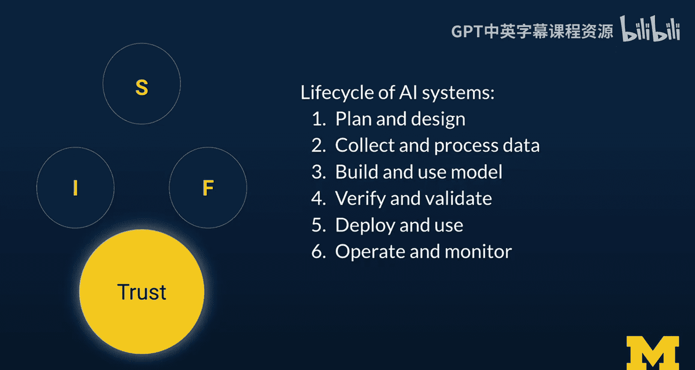

# 20：建立信任 🤝

在本节课中，我们将学习SIFT流程中的“信任”环节。这一环节通过提供评估AI工具可靠性的资源，来支持你与AI工具之间的关系。

## 概述

在之前的课程中，我们学习了如何明确希望AI完成的任务，识别AI对工作动态和品牌可能产生的影响，并专注于AI如何能澄清和支持你个人的创意表达。与你选择的AI工具建立信任，是SIFT流程的最后一步。

## 理解信任的重要性

AI技术可能显得新颖，其当前的文化影响力以及强调技术潜力而淡化潜在风险的营销策略，可能会让人感到不知所措。但正如加州大学伯克利分校长期网络安全中心所提醒的，专家们长期以来一直将信任视为计算、网络空间和自动化的关键方面。

该中心引用了美国国家标准与技术研究院对“可信度”的定义：

> **可信度** 是指系统在任何条件下都能按照设计行为运行的、可证明的可能性，其证据体现在包括但不限于**安全性、隐私性、可靠性和韧性**等特性中。

## 评估AI可信度的框架

关于人工智能，该中心概述了150种不同的属性，用于评估技术可信度，这些属性与以下七个特征之一相关联：

以下是评估AI工具可信度的七个核心特征：

*   **有效且可靠**
*   **安全且具有韧性**
*   **可问责且透明**
*   **可解释且可解读**
*   **隐私得到增强**
*   **公平，且有害偏见得到管理**

正如我们在评估AI工具的其他材料中所讨论的，提供AI软件、服务或系统的企业应能展示其产品如何体现这些品质。理解这一系列全面的期望，可以帮助你发现潜在风险所在，并根据项目的具体需求恰当地权衡它们。

## 考虑对人的影响与生命周期

该中心还建议考虑AI工具与人的互动及其对人的影响。这项特定技术是否利用了人类产生的数据？它的应用如何影响人们？

此外，该中心概述了AI技术生命周期的六个阶段，这是评估潜在工具时需要纳入考量的另一个细节。

以下是AI系统的生命周期阶段：

1.  **规划与设计**
2.  **收集与处理数据**
3.  **构建与使用模型**
4.  **验证与确认**
5.  **部署与使用**
6.  **运营与监控**

要对你选择的AI工具建立充分信任，可能需要了解该产品处于生命周期的哪个阶段。像“监控”这样的后期阶段步骤，对于技术的长期性和可持续性至关重要。

## 要求透明度

尽管美国当前关于AI软件的监管状况意味着这一框架尚未标准化，但你应当期望AI工具的提供方保持透明。如果开发者或供应商无法清晰地说明产品的特性和生命周期，你为何要信任它呢？

## 整合SIFT流程

现在我们已经更详细地探讨了SIFT流程，你或许可以看出这四个步骤是如何相互关联、并以不同方式相互支持的。

在识别了潜在风险之后，建立信任会更容易。当你明确了希望技术做什么之后，专注于AI如何增强你的个人创造力也会更容易。现在，剩下的就是将SIFT付诸实践。

## 总结

本节课中，我们一起学习了SIFT流程的最后一步——建立信任。我们了解了信任在AI应用中的核心地位，学习了评估AI工具可信度的关键特征和生命周期框架，并强调了要求工具提供方保持透明度的重要性。通过将“信任”与之前学习的“明确任务”、“识别影响”和“聚焦创意”步骤相结合，你将能更自信、更负责任地在创意工作中使用AI工具。