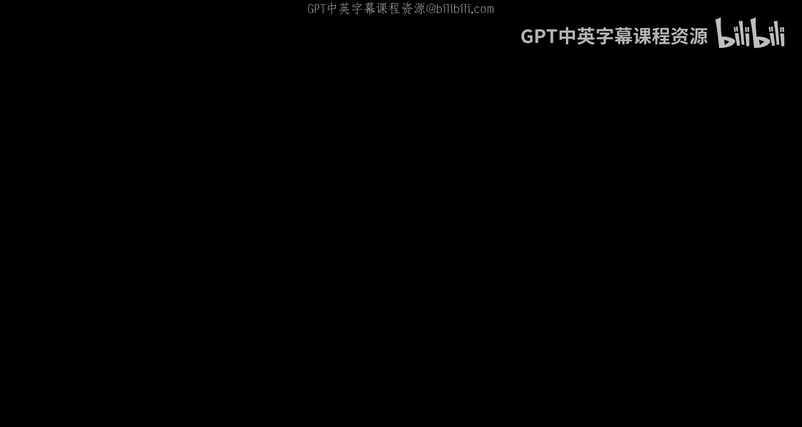
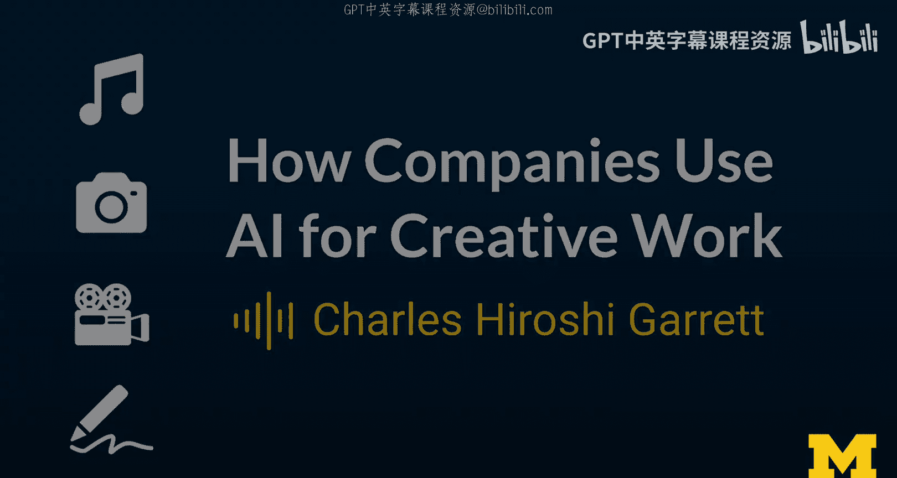
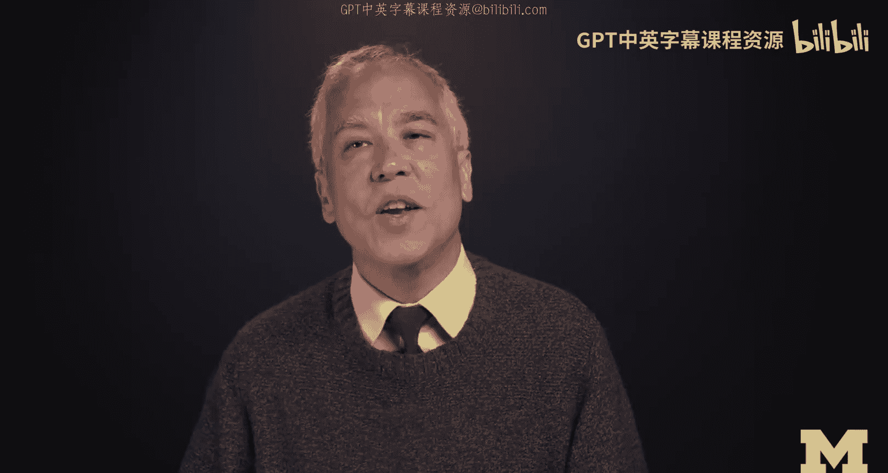
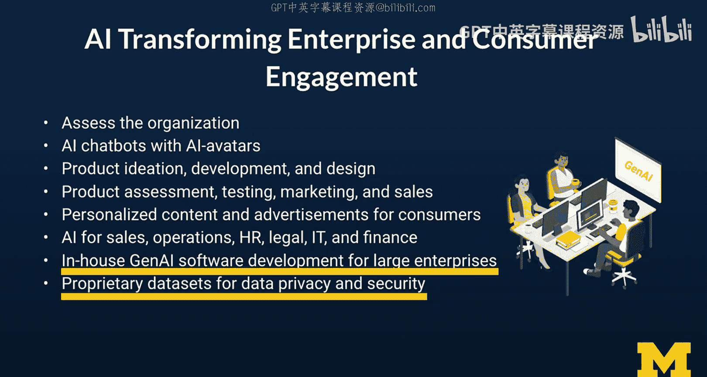
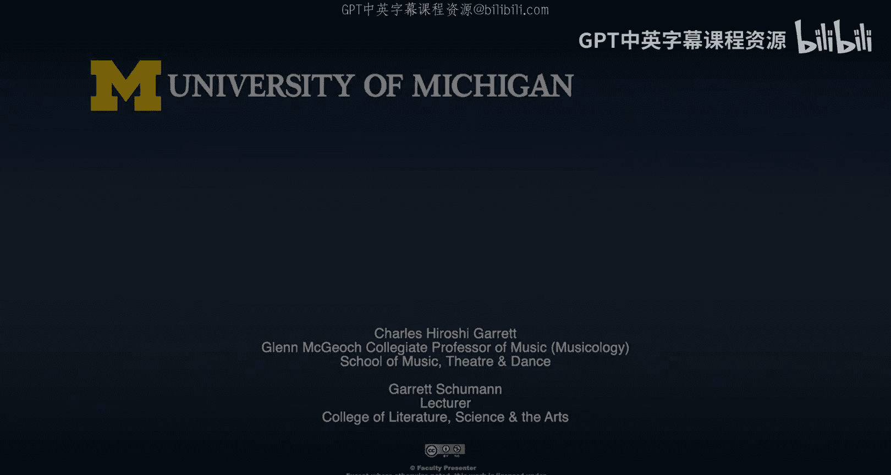

# 22：企业创意工作中的人工智能应用 🏢🤖

在本节课中，我们将探讨生成式人工智能（Gen AI）如何融入企业环境，重塑创意工作的流程与结构。我们将了解从个体专业人士到大型企业，AI应用的多层面影响。

---

正如本课程所阐明，许多创意工作者已开始利用生成式AI应用进行头脑风暴、探索想法并生成新内容，包括文本、图像、音频和视频等。

然而，AI所激发的变革范围更为广泛和深入。

## 企业层面的AI整合策略

上一节我们介绍了创意工作者对AI的个人应用，本节中我们来看看企业如何系统性地整合AI。

许多大型企业现已雇佣精通AI的人员，来评估其组织结构、项目工作流和内部流程，目的是识别哪些具体任务和员工最能从AI自动化或AI辅助中受益。

## AI在客户服务与互动中的应用

目前，大多数客户已经熟悉了集成到客服行业中的、面向公众的生成式AI界面。

这包括由AI生成虚拟形象担任的、经过AI增强的聊天机器人。

## AI赋能产品全生命周期

AI同样正在改变产品的构思、开发与设计，以及产品的评估、测试、营销和销售。

正如Spotify的AI引擎会推算应向您推荐什么音乐，各行各业的企业都希望生成式AI能帮助他们，通过个性化内容和广告来精准定位个体消费者。

## AI在后台运营中的角色

在幕后，销售人员、运营团队、人力资源人员、法律团队、IT员工和财务规划师都在使用生成式AI。

其目的无论是自动化任务、头脑风暴、提高效率，还是加速周转。

## 企业内部AI开发

一些大型企业拥有足够的资源来开发其内部的生成式AI软件。

这包括基于专有数据集训练的大型语言模型，这些模型既能整合内部知识，又能保护数据隐私并解决安全问题。

---

生成式AI似乎将在工作场所中持续存在。

因此，现在是一个很好的时机，让您作为创意工作者，更深入地了解生成式AI可能为您带来什么，以及其能力的边界。

---

本节课中我们一起学习了生成式AI在企业创意工作中的应用全景。从战略评估、客户互动、产品开发到后台运营，AI正在多维度地融入企业流程。理解这些趋势，有助于您定位自身在AI增强型工作环境中的角色与发展方向。