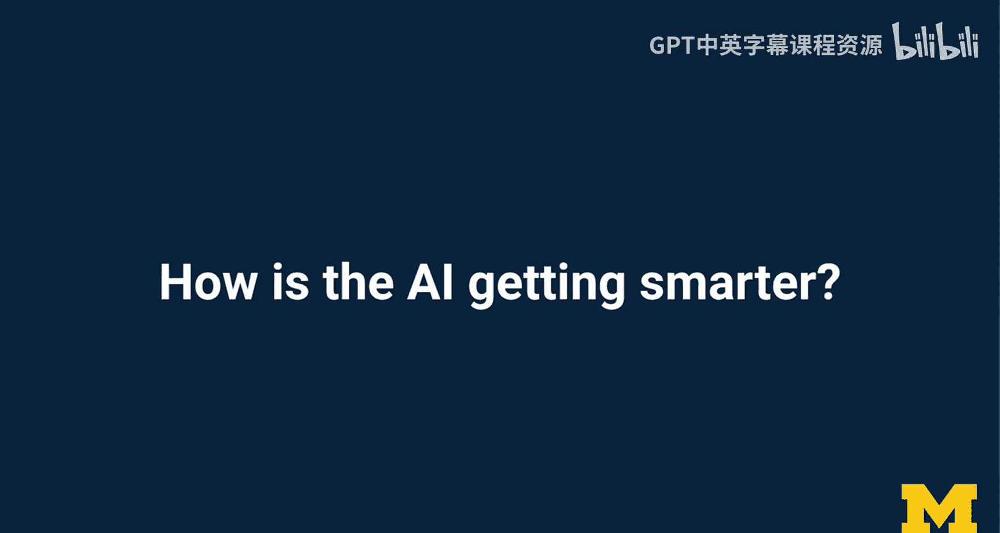
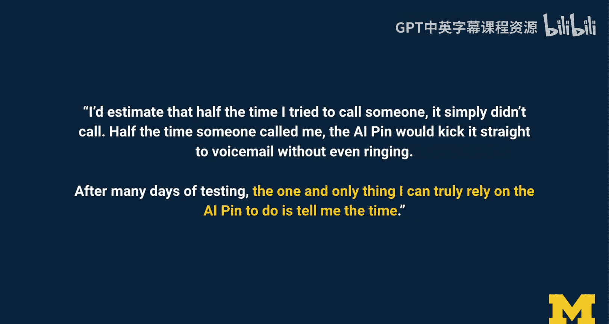

# 23：对AI工具投资的批判性思考 🧐

在本节课中，我们将学习如何对生成式AI工具的投资进行批判性思考。你将了解到，除了技术本身，评估一个AI产品时还需考虑其可靠性、长期表现、数据来源以及作为商业产品的综合价值。

---

## 投资决策的核心考量

你、你的团队或组织围绕生成式AI可能要做出的最重要决定之一，就是是否应该投资一个工具来支持你的工作。虽然你在本课程中学到的筛选过程可以帮助你做出此类决策，但还有其他一些因素需要牢记。

例如，来自专注于创建合规营销材料的AI公司Cypher的内容营销助理Sarah Walker建议，将以下问题抛给你潜在的AI供应商。

以下是评估AI工具时需要向供应商提出的关键问题：

*   **使用的AI类型是什么？**
*   **数据从何而来？**
*   **模型的性能如何？**
*   **AI如何变得更智能？**

---

## 将AI视为产品进行评估

你和你的团队应该记住，生成式AI是一种产品。开发这项技术的公司会使用营销手段来销售它。Walker的示例问题非常有用，因为它们强调了与特定AI工具相关的可靠性、长期性能和数据来源等问题。

但同样重要的是，要像评估你计划购买并集成到工作中的任何其他产品一样来评估AI工具。除了价格之外，客户服务和安全性等因素——这些也是你的企业在进行其他采购时常见的考量——对于评估生成式AI产品同样重要。

许多AI工具确实令人印象深刻，并且几乎所有工具在呈现给我们时，都被描述为能够实现惊人的功能。正如我们在课程其他部分提到的，我们很容易被灌输的关于生成式AI工具强大能力的预期所吸引，但令人窒息的兴奋并不能保证它们是好的产品。😊

David Pierce于2024年4月11日在《The Verge》上发表的关于Humane AI Pin的评测，为我们提供了一个有启发性的例子，告诉我们如何对待一个新颖、炫目的AI产品。

---

## 案例分析：Humane AI Pin

Humane的网站将其可穿戴AI Pin描述为一种让用户超越触摸、超越屏幕的设备。

该设备旨在通过聆听用户指令，接管我们使用智能手机完成的许多任务。它甚至配备了一个投影仪，可以根据请求在用户的手上显示文本、方向和其他信息。

正如Pierce所描述的，它可以回答基本的类ChatGPT风格的问题、打电话、拍照、发送短信、告诉你附近有什么等等。你还可以通过点击触摸板来做一些事情，就像电脑上的键盘快捷键一样：用两根手指双击拍照，用两根手指双击并按住拍摄视频。

Pierce承认，Humane的营销让AI Pin看起来像一个功能异常强大的产品，这里的标准很高。Pierce在评测开头指出，AI Pin有可能解决涉及智能手机功能的一些实际问题。“我逐渐意识到，事实上，有很多事情我的手机做得很糟糕。通常，我只想看看时间、记点东西或者给我妻子发条短信，结果却被TikTok、我的电子邮件或屏幕上任何不需要的通知吸走了注意力。”Pierce继续说道，“另外，你有没有想过你的手有多少次被杂货、咖啡杯、狗绳、孩子、方向盘占据，同时还要试图平衡手机是多么烦人且不安全？我意识到我在手机上做的很多事情，可能更希望在其他地方完成。所以，是的，这（指AI Pin的概念）是有点意思。”

但Pierce并不推荐Humane AI Pin，因为简单来说，它无法正常工作。“AI Pin是一个有趣的想法，但它如此彻底地未完成，并且在许多不可接受的方式上完全失灵，以至于我想不出我会向谁推荐花费699美元购买这个设备并支付每月24美元的订阅费。”Pierce描述了他对产品的沮丧：“我测试AI Pin越多，就越感觉这个设备试图做太多事情，而硬件根本跟不上。”他继续说：“我估计，有一半的时候我试图给别人打电话，它根本打不通。有一半的时候别人给我打电话，AI Pin会直接把它转到语音信箱，甚至不响铃。经过多天的测试，我唯一能真正依赖AI Pin做的事情就是告诉我时间。”

---

## 可靠性与长期可持续性

Pierce的评测特别具有启发性，因为它强调了产品测试的至高重要性。对Pierce而言，AI Pin的价格问题只有在他发现它无法工作后才成为关注的焦点。

本讲座前面提到的Sarah Walker的问题并非针对某个单一特定产品，但目标相似。她希望确保她评估的AI工具能够长期可靠、稳定地工作，且不损害用户数据。

当你评估AI产品时，考虑产品在长期内为用户交付内容的质量方面的可持续性也很重要。随着像ChatGPT这样的大型语言模型使用时间增长，AI生成的内容已经进入了训练数据，这使得它生成的文本可靠性降低。通过测试产品、查阅评测以及与产品开发者沟通以评估它们随时间的表现情况，你可以更有信心地确认你选择的AI工具能够持续地交付高质量的结果。

---

## 总结

本节课中，我们一起学习了如何批判性地评估生成式AI工具的投资。我们认识到，不能仅被营销宣传所吸引，而必须将AI工具视为一个需要全面评估的商业产品。关键步骤包括：向供应商询问核心技术细节（如AI类型、数据来源、模型性能与进化机制），像评估任何其他商业采购一样考量价格、客户服务和安全性，并通过实际测试、查阅独立评测来验证产品的可靠性与长期可持续性。记住，一个工具真正的价值在于它能否稳定、可靠地解决你的实际问题。