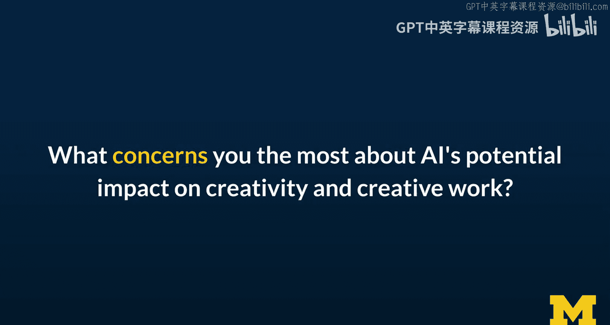
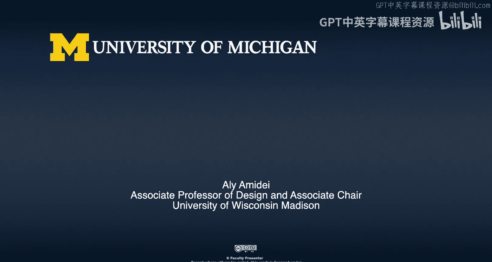

# 27：领域之声：艾丽·阿米迪 👩‍🎨

在本节课中，我们将聆听来自创意产业从业者艾丽·阿米迪的见解，探讨人工智能图像生成技术对互联网信息生态、视觉素养教育以及社会心理健康带来的具体挑战。

上一节我们讨论了AI在创意领域的广泛应用，本节中我们来看看来自一线从业者的真实反馈。

## 对互联网信息生态的冲击 🌐

艾丽·阿米迪最大的担忧在于AI图像正在阻塞互联网搜索。

以下是她的具体观察：
*   她指出，Pinterest平台已基本沦为AI图像农场。
*   她认为，在该平台上几乎难以找到真实的图像内容。
*   她补充说明，Pinterest过去也并非其进行服装设计研究的最佳平台。

## 对视觉素养教育的挑战 🧑‍🏫

艾丽·阿米迪同样担忧AI图像对视觉素养培养构成的挑战。

以下是相关的具体问题：
*   这影响了她教授学生如何具备视觉素养的能力。
*   核心难点在于，学生需要学会**识别与理解**何为现实、何为人工制造。

## 对社会心理健康的潜在影响 😔

此外，艾丽·阿米迪还提到了AI图像对社会心理健康的广泛影响。

她特别强调了以下方面：
*   人们被大量**不可能实现的完美且失实的图像**所轰炸。
*   这种信息环境对大众的心理健康与整体福祉产生了负面影响。

本节课中我们一起学习了艾丽·阿米迪从创意工作者视角提出的关切。她指出了AI图像泛滥如何污染互联网信息源、增加视觉素养教育难度，并可能通过传播不切实际的完美形象对公众心理健康造成损害。这些见解提醒我们，在拥抱技术创新的同时，也需审慎评估其社会成本。