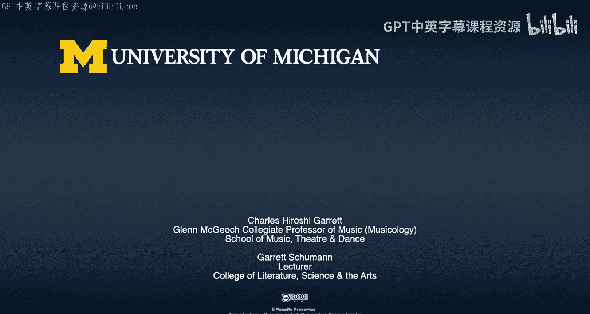

# 29：深化理解与反思

在本节课中，我们将深入探讨人工智能与人类创造力之间的关系，并学习如何在创意实践中更有效地与AI协作。我们将回顾已学概念，并引入新的思考，以帮助你在使用AI工具时保持并强化个人独特的创意表达。

---

在课程的这个阶段，你已经学会了批判性地思考人工智能，在适当的情况下负责任地使用生成式AI，并权衡工作场所中使用AI的风险与回报。

你也了解了筛选流程，这个流程将帮助你评估众多可用的AI工具，以提升工作场所中的创造力。

现在是时候进行更深入的探索，进一步思考人工智能与人类创造力，并在你的创意实践中拓宽使用AI工具的视野。

---

## 是什么让创造力成为人类的基本特质？

上一节我们介绍了如何评估AI工具，本节中我们来看看创造力的本质。创造力之所以被视为人类的基本特质，是因为它根植于我们的情感、经验、主观意图和对世界的独特理解。AI可以生成内容，但它缺乏真实的意图、情感体验和个人历史背景。

## 如何在与AI协作时强化个人声音？

与AI协作的关键在于将其视为增强工具，而非替代品。以下是与AI协作时保持个人特色的方法：

*   **明确你的核心意图**：在开始任何AI辅助创作前，先明确你想要表达的核心思想、情感或故事。
*   **将AI输出作为素材**：把AI生成的内容看作原始素材或灵感火花，你需要对其进行筛选、编辑和重塑。
*   **注入个人经验与情感**：在AI生成的草稿基础上，融入你自己的经历、感受和独特视角。

## AI如何帮助你保持基本的人性？

事实上，与AI合作可以反向促使我们更关注自身的人性特质。AI处理重复性和模式化任务，从而将人类解放出来，让我们能更专注于需要同理心、价值判断和深度思考的创造性工作。这个过程强化了我们作为决策者、编辑者和情感赋予者的角色。

---

最终，回答这些问题需要进行反思。因此，除了介绍新想法和额外的创意机会，我们还将请你重温本系列课程早期的材料，以强调这些概念如何与你个人的创意实践产生共鸣。

本节课中我们一起学习了创造力的人本核心、与AI协作时强化个人声音的策略，以及AI如何帮助我们更专注于人性化的创意活动。记住，强大的创意成果来自于人类智慧与AI能力之间的协同合作。