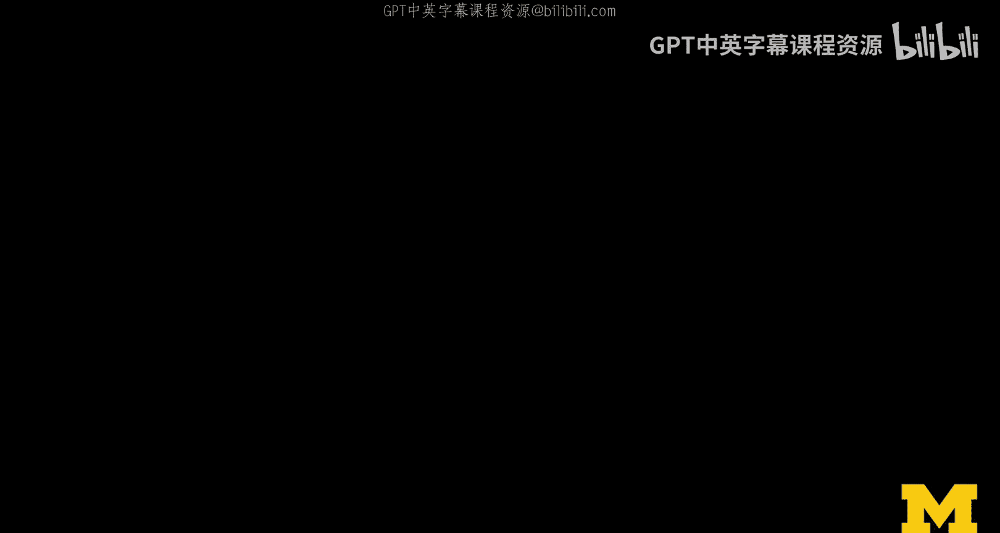
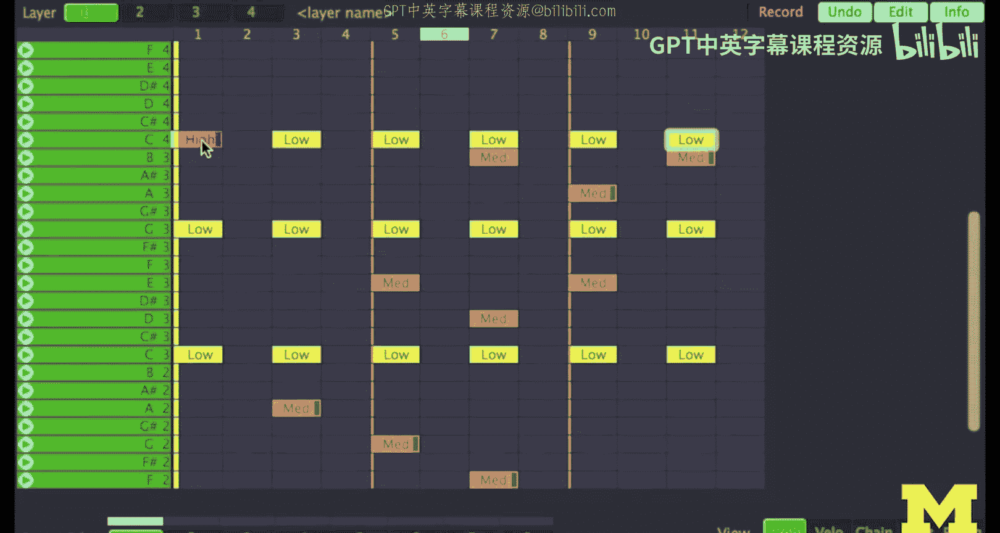
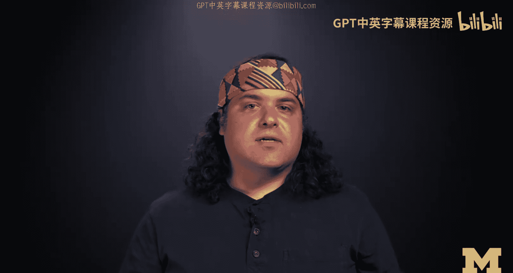
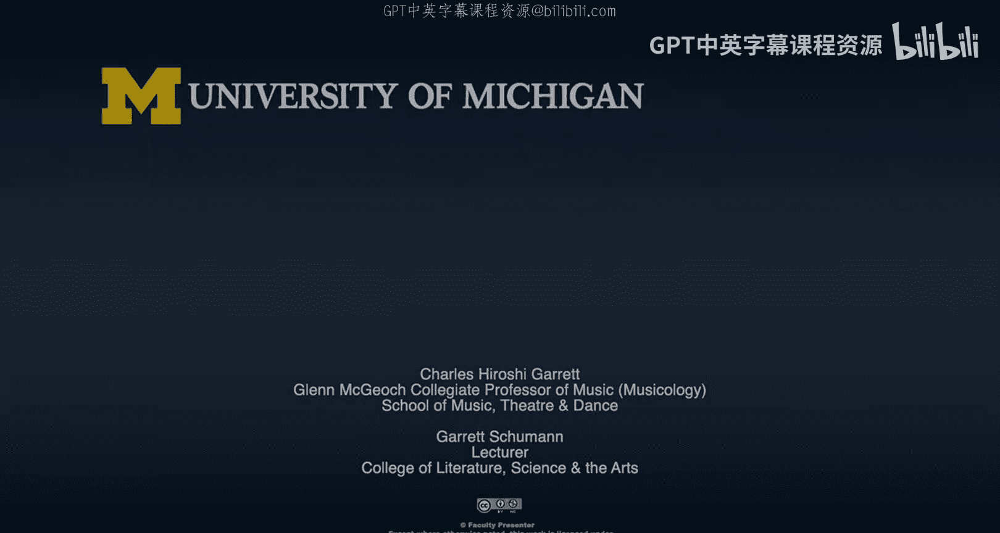

# 2：人工智能与艺术思维 🧠🎨

在本节课中，我们将探讨人工智能如何不仅仅是提升效率，更重要的是它如何改变我们构思和进行艺术创作的方式。我们将通过两个具体的AI音乐工具实例，来理解这种思维范式的转变。

---

关于AI对创意工作潜在影响的讨论，大多集中在它如何节省时间或提高生产力上。在本演示中，我将展示并讨论几款不同的AI音乐工具如何引导我和其他人以不同的方式思考我们的创造力。

当我思考AI与创造力时，最让我兴奋的是它改变个人构建和概念化其创作过程的能力。我是一名音乐人，在某些项目中我喜欢使用一款名为Stooks的软件工具。

## 工具一：Stooks - 算法概率MIDI音序器 🎹

上一节我们提到了AI改变创作思维的可能性，本节中我们来看看第一个具体工具。Stooks是一个**算法概率MIDI音序器**。这意味着它控制着由软件乐器演奏的节奏和音符，这些软件乐器由我在偏好的数字音频工作站中选择。

Stooks迫使我以不同的方式思考音乐创意的生成。传统上，音乐创作是完全确定性的。作为作曲者或歌曲作者，我决定在特定时间演奏哪些音符。但当我使用Stooks时，我选择放弃对循环模式在每次迭代中具体演奏哪些音符的完全控制。

该工具允许我设置它在音乐时间的特定时刻选择演奏特定音符的**概率**。

Stooks还有一个名为“Chain”的功能，它允许我通过影响软件从一个音符移动到下一个音符的决策来构建旋律。

但最终，我无法完全预测Stooks将呈现的最终演奏效果。我只能为程序设置一系列偏好和通用指导原则。

以下是使用Stooks进行实时创作的简要演示过程：我从一个空白的、随机化的音乐纹理开始，通过调整参数，逐步将其转变为包含更传统旋律元素的作品。

与Stooks这样的工具合作，从根本上改变了与传统方法相比创作音乐的意义。我必须将一定程度的控制权让渡给软件，使其成为一种协作伙伴，而不仅仅是音乐纹理中的一个乐器。

我决定演奏结果的能力受到限制，这迫使我以不同于传统环境下的方式，去思考旋律与和声等基本音乐参数。这改变了我在此背景下工作时“创造力”的含义。我的决策过程被新的、特定的约束条件重塑，我需要调整我的音乐表达方法，以适应软件的优势和局限性。

## 工具二：Rave - 深度学习声音合成程序 🎤

上一节我们探讨了算法工具Stooks如何重塑创作过程，本节中我们来看看基于机器学习的工具。Stooks是一种算法工具，但同样影响音乐人创作范式的当代机器学习软件并不难找到。例如，Rave就是一个备受赞誉的声音合成程序，它使用**深度学习**来精确复制由单个表演者提供的音频输入。

这个工具实现了一种原本不可能实现的表演形式。一位独奏者可以与“自己”同台演出，并非基于预先录制的音轨，而是与一个基于其特定嗓音或乐器声音的计算机化合作表演者一起。

这里的自反性是新颖且引人入胜的。该软件就像训练它的音乐人的一面镜子。

与Stooks（一款兼容任何标准数字音频工作站的免费软件插件）类似，Rave是一款开源工具，设计用于与Max MSP和其他常见的现场电子音乐制作平台协同工作。Rave的设计也考虑到了有限的训练需求，用于训练Rave的输入音频只需三小时长。

## 总结与影响 💡

这种水平的可及性意味着Stooks和Rave能够激励比昂贵软件更多的音乐人。使用这些工具的音乐人，得以从音乐创作和创意技术市场的传统惯例中突破出来。

在本节课中，我们一起学习了人工智能如何通过引入概率控制（如Stooks）和深度学习复制（如Rave），从根本层面改变艺术创作的思维框架。这些工具并非简单的效率工具，而是作为创作伙伴，通过施加新的约束条件，重塑了创作者的决策过程和表达方式，从而拓展了艺术创造的可能性边界。