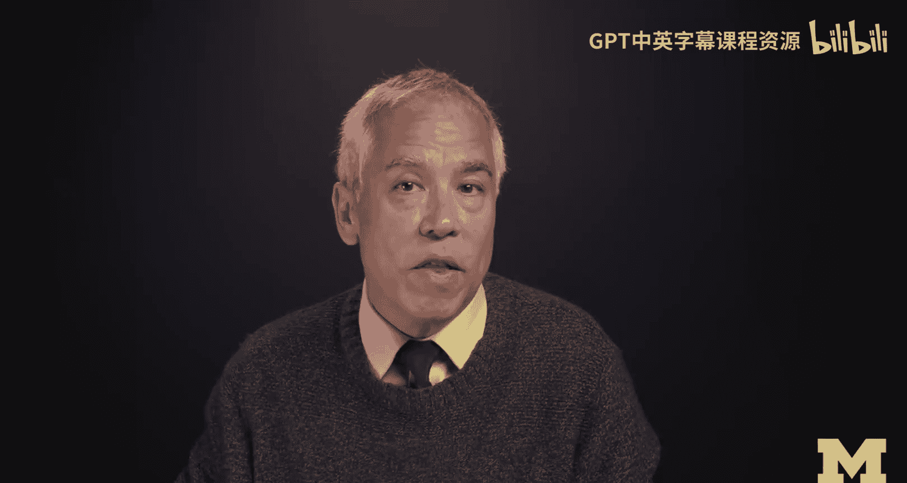
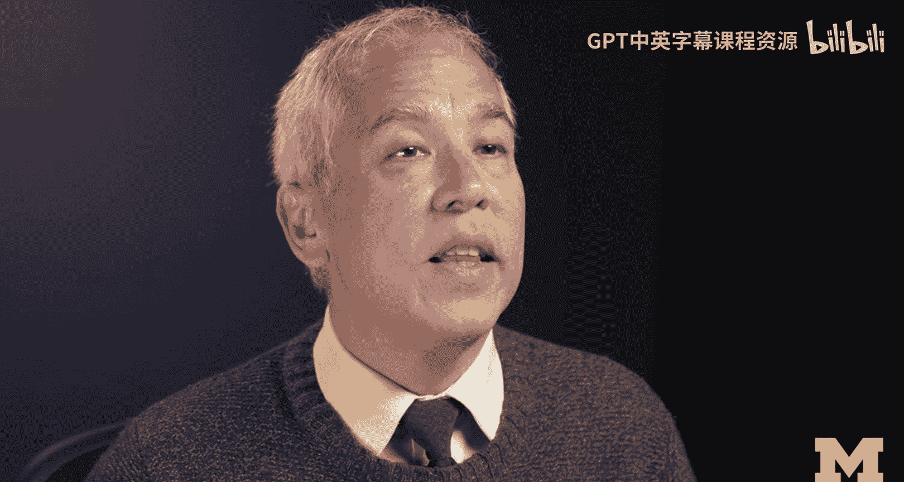
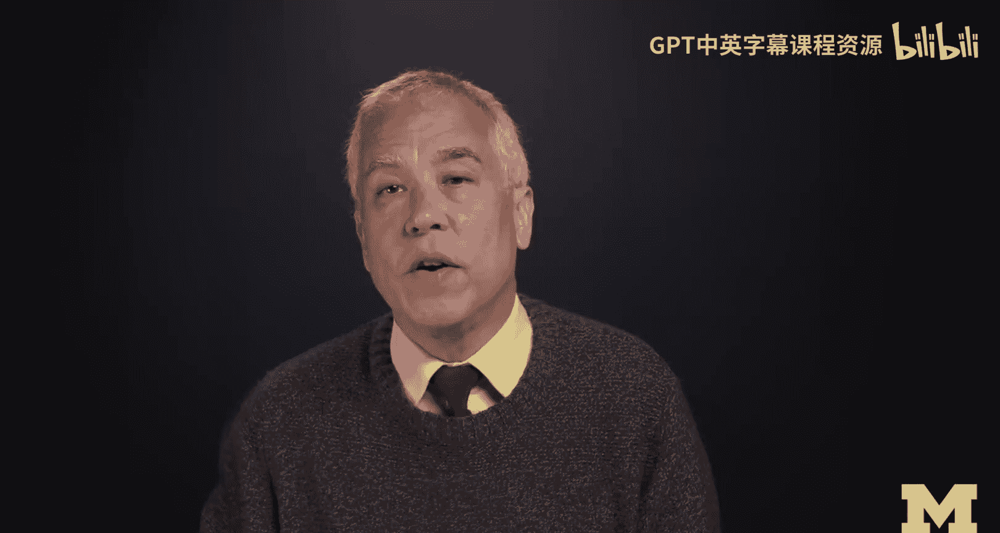
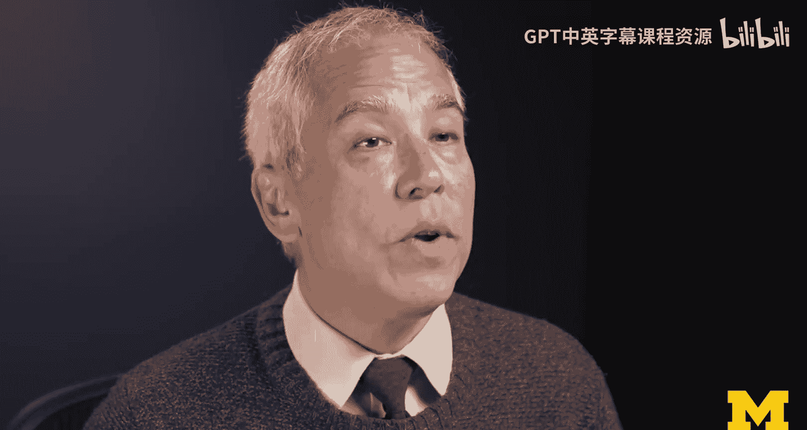
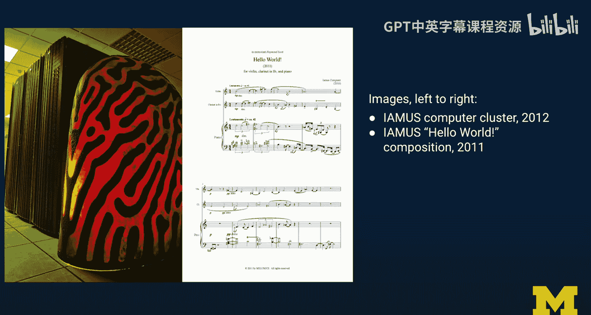
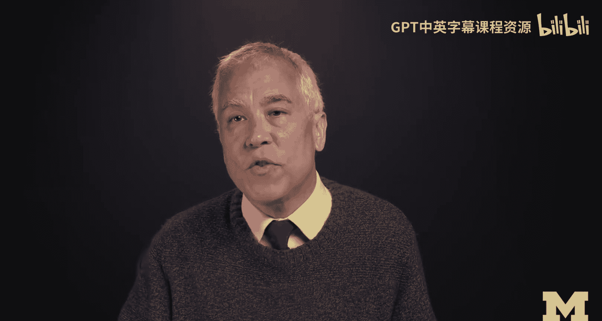
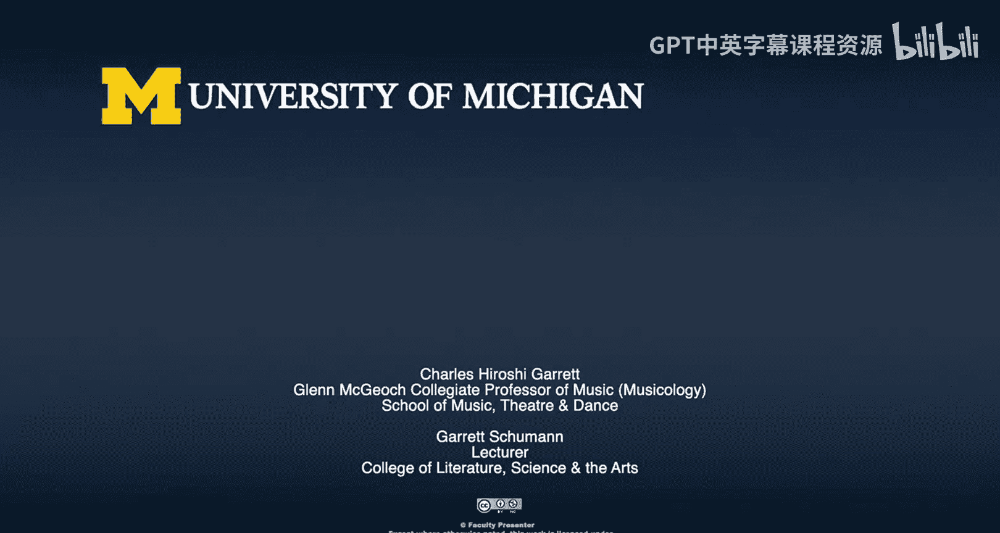

# 3：实验性艺术扩展的历史演进 🎨

在本节课中，我们将回顾从20世纪中期至今，创意艺术家和音乐家如何利用计算技术与人工智能进行实验，并推动其向多个方向演进。我们将看到这一历程如何从基础的算法编程开始，发展到如今创意工作者可用的复杂AI软件。

---

## 早期探索：算法与计算机艺术的诞生

上一节我们介绍了AI与创意结合的基本概念，本节中我们来看看其历史起点。从20世纪中期开始，艺术家和科学家开始尝试用计算机进行创作。

*   **1957年**：作曲家莱贾伦·希尔与数学家伦纳德·艾萨克森成功为**伊利阿克1号**计算机编程，创作出完全由计算机生成的弦乐四重奏。
*   **20世纪60年代末**：德国生成艺术先驱乔治·尼斯能够编写算法，使用可编程绘图仪制作复杂的计算机图形。
*   **1970年**：哈罗德·科恩开发了**AARON**，这是一个绘图软件程序，常被引为最早用于视觉艺术创作的AI软件示例。

---

## 发展与深化：音乐与视觉艺术的AI实验

随着技术发展，AI在音乐和视觉艺术领域的应用变得更加深入和多样化。

以下是音乐领域的几个关键进展：

*   **劳里·施皮格尔**：这位在贝尔实验室工作的美国作曲家创造了**“音乐鼠标”**，这是一个用户友好的音乐软件，让公众能在家庭电脑上创作算法音乐。她于1980年发行的专辑《扩展的宇宙》记录了她70年代最重要的音乐实验。
*   **大卫·科普**：他于1981年开始开发名为**“音乐智能实验”**的软件。该程序不仅能分析如巴赫等作曲家的音乐，还能创作相同风格的新作品。这项革命性成就引发了关于创造力本质的争论。他的持续研究最终催生了**艾米莉·豪厄尔**——一个经过精心训练、能作曲并发行专辑的交互式计算机界面。

与此同时，视觉艺术家也在持续进行技术实验。

*   一些艺术家利用AI探索生成过程，启动复杂算法，创造出不可预测、复杂且常令人惊讶的图像，例如**分形艺术作品**。

---

## 世纪之交：互联网与交互性

临近20世纪末，随着计算能力增强和互联网的爆炸式普及，AI在实验性艺术和音乐中的作用进一步扩大。

以下是该时期的一些代表性探索：

*   **肯·戈德堡**：这位艺术家兼机器人专家开始探索交互性和**远程呈现**概念，在线用户可以控制画廊空间中的物理物体，将在线现实与物理现实融合。
*   **先驱AI艺术家**：如卡尔·西姆斯和埃里克·米利金等人，展示了AI辅助视觉艺术如何既能打动观众，又能获得评论界赞誉。

---

## 21世纪的突破：从实验室到大众

进入21世纪，音乐研究在科学实验室和大学中继续取得显著进展，而生成艺术则迎来了爆炸性增长。

以下是音乐AI领域的进展：

*   **2010年**：西班牙的AI研究人员开发了软件程序**Iamus**，开始创作其原创的当代古典音乐。
*   **索尼实验室**：法国科学家兼作曲家弗朗索瓦·帕切的持续研究在音乐AI和机器即兴创作方面取得多项突破，最终使他被任命为Spotlab的负责人，该实验室致力于开发音乐创作的计算工具。

生成艺术领域的发展更为迅猛。

*   **标志性事件**：2018年，AI艺术品《埃德蒙·德·贝拉米肖像》在佳士得拍卖行以超过40万美元的价格售出。
*   **大众化应用**：流行的社交媒体应用程序出现，用户只需按下一个按钮即可生成、编辑和过滤图像。

---

## 当下与未来：普及化与创造力重塑

如今，借助复杂的神经网络和深度学习算法，AI软件已变得高度普及和强大。

以下是当前代表性的AI创意工具：

*   **生成艺术领域**：如**Stable Diffusion**、**DALL-E** 和 **Midjourney**。
*   **生成音乐领域**：如**AIVA** 和 **Suno AI**。

这些工具使未经高级训练的用户也能通过简单的提示词，创作出有时与人类作品难以区分的音乐和视觉内容。如此巨大的进步，正在挑战并重塑创造力的本质、艺术的定义，以及未来几十年人类和机器在艺术与音乐发展中所扮演的角色。

---

本节课中，我们一起学习了实验性艺术与AI结合的历史演进。我们看到，这条道路从早期的算法作曲和绘图，发展到交互艺术和远程呈现，最终到达如今基于深度学习的、大众可及的生成式AI工具。这一历程不仅是技术的进步史，更是一部关于人类如何不断重新定义艺术与创造力的思想史。