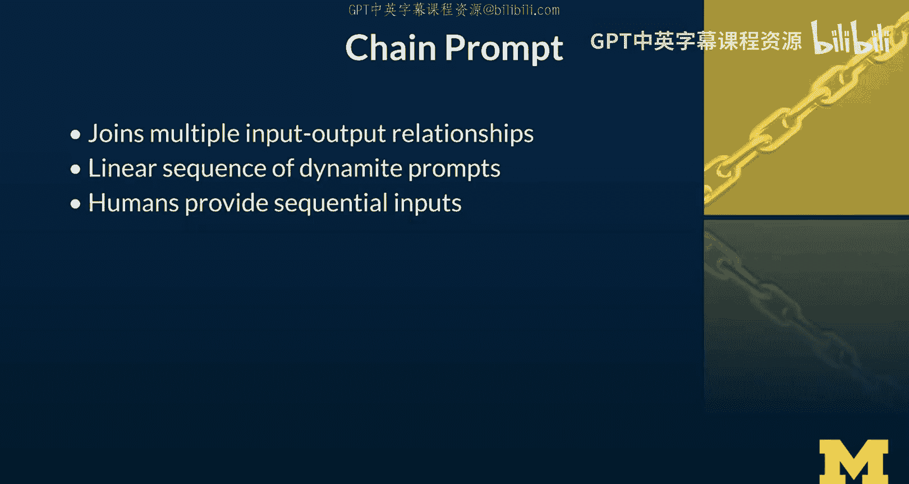
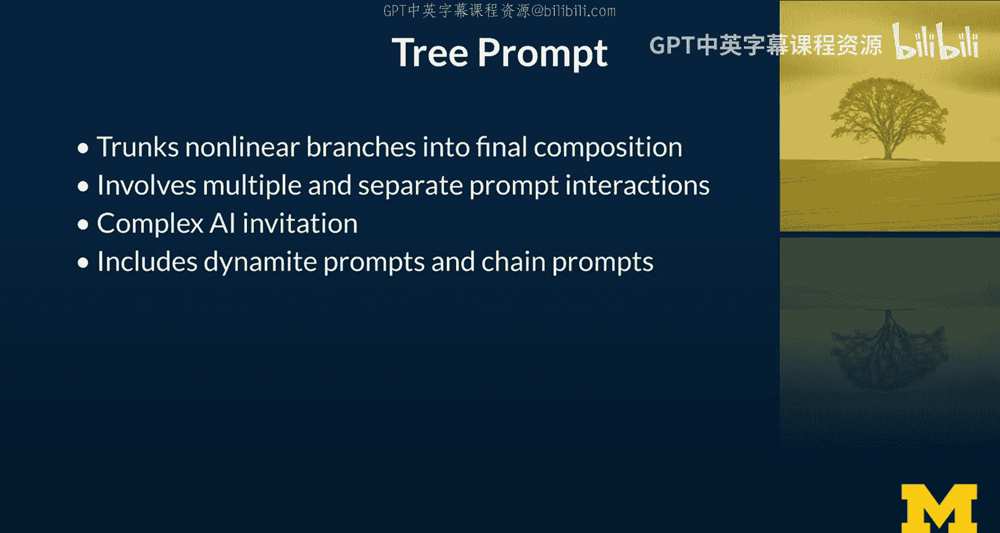
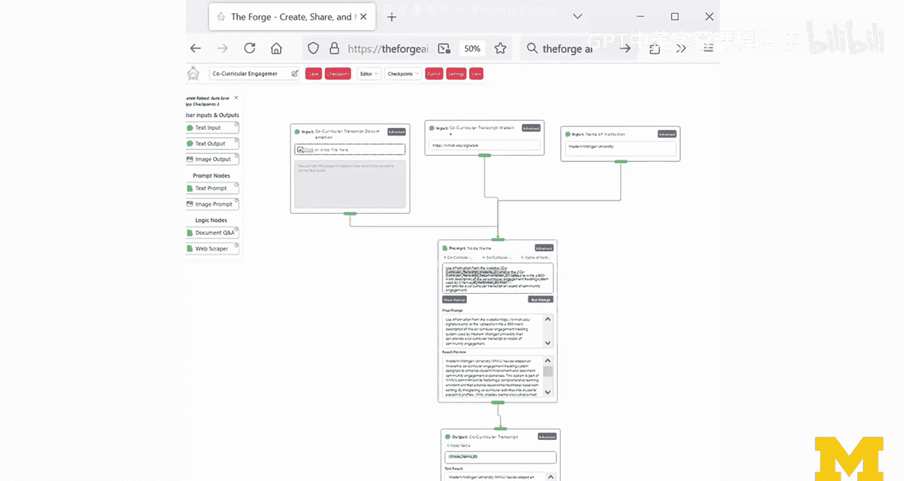

# 5：构建AI协作闭环

## 概述

在本节课中，我们将探讨人工智能如何融入写作过程，并学习三种核心的提示词结构，以帮助你更有效地邀请AI参与创作循环，从而生成更具目的性、更合乎伦理的文本。

我是布莱恩·戈根，西密歇根大学的修辞学与写作教授。我将讨论AI扩展写作过程的一些方式。

AI正被引入写作过程，或者说我们称之为“生产循环”的各个环节，从最早的构思时刻到最后的编辑阶段，无处不在。无论AI在何时进入生产循环，都需要人类发出邀请，让AI平台参与到这个创作过程中来。我发现这种邀请本身就极具魅力且富有创造性，尤其是当产出的作品能够在现实世界中真正实现其目的时。

当我们将AI应用于现实世界的问题和具体需求时，便开启了广阔的潜力。而这一切潜力都取决于我们向AI发出的邀请。这些邀请通常被称为“提示词”，它们是我们提供给AI以获取输出的输入内容。这些提示词的功能是指令和引导AI，使其作为我们的伙伴和共同生产者与我们人类协作。我感兴趣的是，人类如何能以产生更有效、更合乎伦理、更公平的写作或其他类型作品的方式，向AI发出这些邀请。

通过与一组学生和实践者合作，我确定了三种宏观或高级别的提示词结构，它们在你邀请AI进入自己的生产循环时可能会很有用。我将与你分享的这三种宏观结构，应被视为创建AI提示词的三种不同方法。它们是帮助我们管理输入、指令和邀请的结构。

## 三种宏观提示词结构

以下是三种不同的宏观提示词结构，它们代表了邀请AI协作的不同方式。

### 结构一：炸药包提示词

第一种结构我称之为“炸药包提示词”。这个名称是首字母缩写TNT的文字游戏，在这里代表“模板与术语”。正如缩写所示，炸药包提示词结构使用一个人类输入AI的模板。这些模板通常包含填空位置，人类必须提供术语以使提示词具体化。在炸药包提示词结构中，人类创建模板并提供术语。这是一种向AI发出的一次性邀请，以获取输出。人类可以通过微妙地改变模板中使用的术语，或更彻底地改变模板本身，来引导AI产生不同的输出。

现在，让我们看看这个结构在实际中的应用。我写了一个相当基础的模板，这里有两个填空位置。我的模板是：“写一封____页的粉丝信给____。”你们有些人会注意到，这个提示词类似于谷歌在2024年夏季奥运会期间播放的一则有争议的广告中使用的提示词，其中一位父亲使用AI帮助他的女儿给西蒙·拜尔斯写粉丝信。在这个案例中，我将像广告中的父亲一样，也使用谷歌的Gemini，并看看使用两组不同术语搭配模板会得到什么输出。

以下是第一个提示词：“写一封两页的粉丝信给泰勒·斯威夫特。”以及结果。

以下是第二个提示词：“写一封半页的粉丝信给勒布朗·詹姆斯。”以及结果。

请注意，这种提示词结构具有“一蹴而就”的潜力。炸药包提示词结构对于相当直接的现实世界目的具有爆炸性的效力。然后，人类可以着手修改炸药包提示词的输出。

### 结构二：链条提示词

上一节我们介绍了简单直接的“炸药包提示词”，本节中我们来看看更注重迭代的“链条提示词”。这种结构的名称源于它将人类输入与AI输出之间的关系组织成一个线性序列，其中多个输入-输出关系连接在一起。这种提示词结构背后的理念是，单一的人类输入不足以获得最优的AI输出。因此，链条提示词由多个串联在一起的炸药包提示词组成。在收到对初始提示词的输出后，链条提示词以此输出为基础，构建另一个输入，逐步走向最终的文稿。通过这种方式，在已完成的输出和后续的输入之间建立了链接。

让我们看看这个结构在实际中的应用。

我首先使用一个炸药包提示词。我使用的提示词是：“写一封给我的主管唐的电子邮件，请求一周的休假时间。”我决定使用Anthropic的Claude。这是使用链条提示词结构的结果。我通过输入另一个提示词来邀请AI优化这第一个输出。

并且我可以通过一个接一个地添加链接来扩展链条提示词，用更多输入连续提示AI，例如这个：“现在，修改这封邮件，解释我需要休假是因为将在英国举行一次家庭团聚。”

还有这个：“保持积极的语气，强调这次团聚对我的重要性，因为它将给我一个机会与大家庭重新联系，并向我的孩子们传授我们的传统。”

以及，最后这个：“修改邮件，使其在250字以内。”

关于这种提示词结构的一个注意事项是，人类必须意识到一个薄弱环节，因为链条中一个环节的有问题的输出将影响提示词中所有后续环节。因此，在链条提示词推进的过程中，人类必须保持警惕，检查每一个输出。

### 结构三：树状提示词

前面我们探讨了线性的“链条提示词”，本节我们将认识最复杂的“树状提示词”。这种结构得名于它将输入-输出关系组织成非线性的分支，这些分支最终在不同的节点汇聚到一起，共同贡献于一个最终的作品。由于树状提示词涉及多次且通常是独立的提示词交互，树状提示词结构是你可以向AI发出的最复杂的邀请。树状提示词的非线性特性促进了一种适合多模态集成、澄清指令、逻辑操作和网络抓取技术的生产过程。树状提示词内部经常同时嵌入炸药包提示词结构和链条提示词结构。

让我们看看这个结构在实际中的应用。

在这个例子中，我使用的是Forge AI，这是一个使用OpenAI的ChatGPT的集成设计环境。你会看到，我已经为一个分类文件（像我所在机构可能选择完成的文件）的一个部分绘制了一个小的树状提示词。树状分支包括一个可选的文档上传功能、一个网络抓取功能和一个文本输入。这些分支然后汇聚成一个提示词，最终生成一段可用于分类文件草案的文本。Forge AI实际上允许我将这个树状提示词作为一个应用程序启动，我可以与不同机构的同事分享，这样我们都可以为分类文件的这一部分生成草案文本。

我想再次强调，这个树状提示词示例是大幅缩小的。典型的树状提示词包含多个输入、三到四个主要分支以及数十个通向最终作品的小提示词。

## 总结

在本节课中，我们一起学习了AI如何融入写作的生产循环，并重点掌握了三种宏观的提示词结构：“炸药包提示词”、“链条提示词”和“树状提示词”。每种结构都提供了不同复杂度和协作深度的邀请方式。我希望在你创造性地邀请AI进入自己的生产循环时，会发现这三种方法很有用。谢谢。