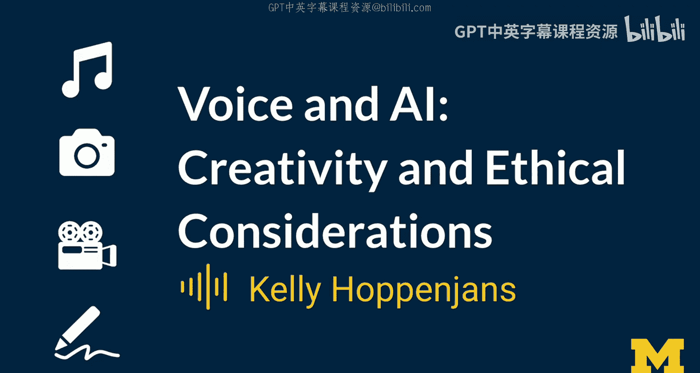
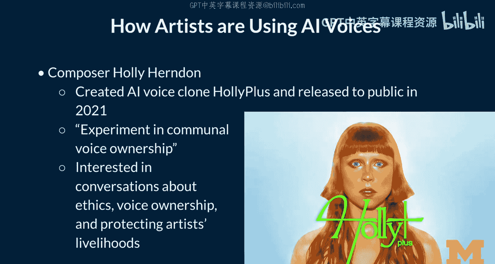
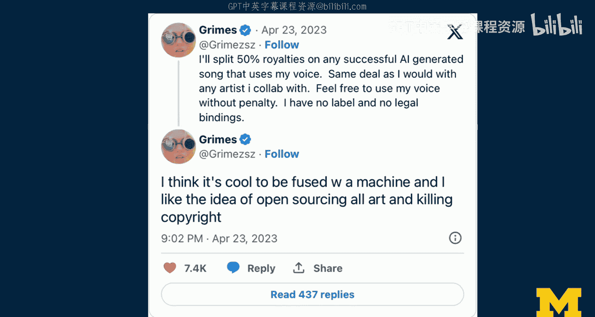
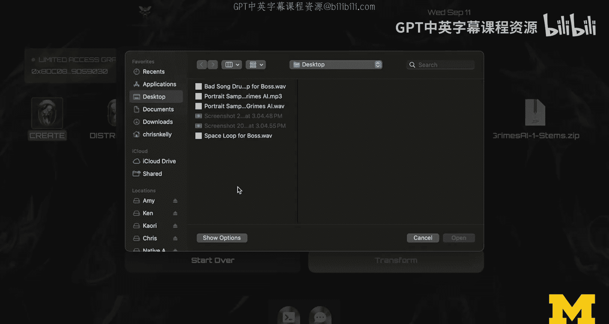
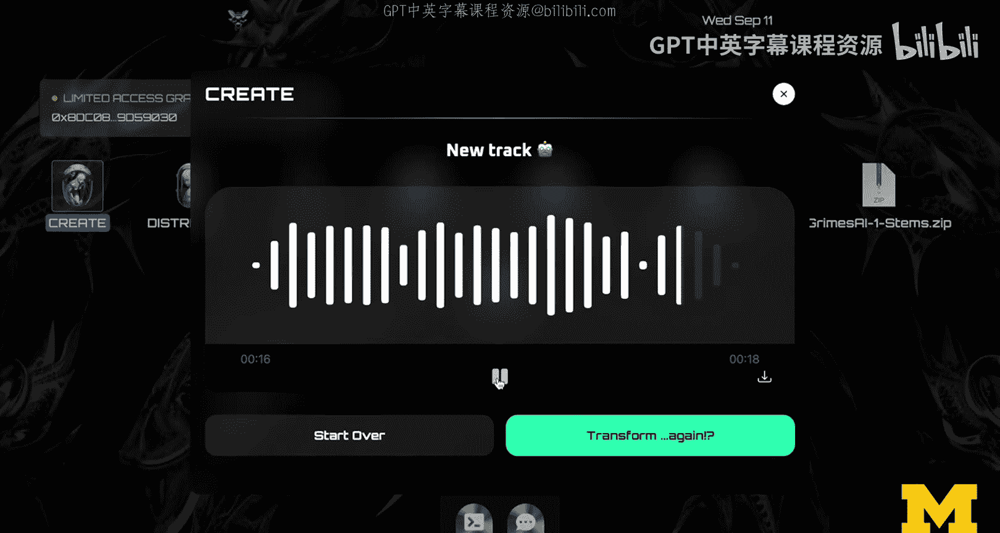
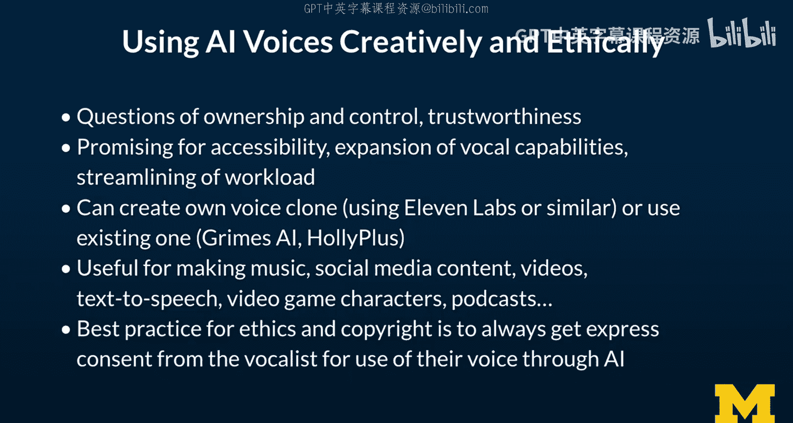
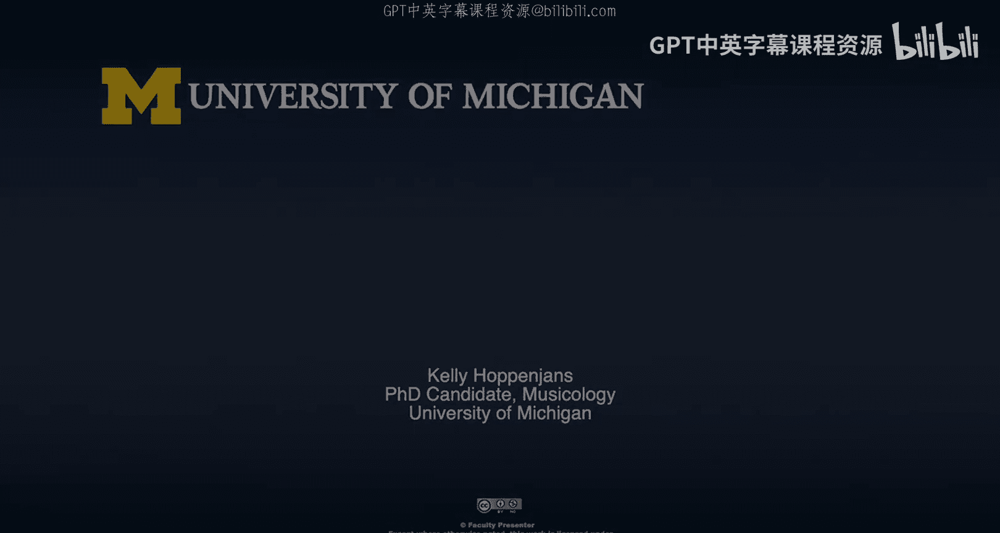

# 6：声觉智能：创造与伦理的双重考量 🎤🤖

在本节课中，我们将要学习人工智能在声音领域的应用，特别是AI语音克隆技术。我们将探讨其工作原理、创造潜力以及伴随而来的重要伦理与法律问题。

---

## 概述

AI语音技术能够模仿人类的声音进行说话或歌唱，这为创意工作开辟了新的可能性，同时也引发了关于声音所有权、同意和真实性的深刻讨论。本节课将引导你了解这项技术的核心概念、应用实例以及如何负责任地使用它。

---

## AI语音克隆简介

上一节我们概述了课程内容，本节中我们来看看什么是AI语音克隆。AI可以被训练来复制人的声音，用于说话或歌唱，我们称之为语音克隆。

*   **训练过程**：使用目标声音的录音作为训练数据，AI可以学习模仿该声音的音色、节奏、发音甚至呼吸。
*   **应用方式**：克隆的声音主要有两种使用方式。
    *   **文本转语音**：你提供文本，克隆的声音会将其朗读出来。例如：`text_to_speech("你好，世界")`。
    *   **歌唱合成**：你可以输入歌词和MIDI数据（包括音高、节奏、强度等），让AI用特定的声音演唱出来。

---

## 语音克隆工具与案例

了解了基本概念后，我们来看看一些具体的工具和它们如何被使用。

以下是目前一些流行的AI语音克隆程序：

*   **11 Labs**：一个主流的AI语音服务，可用于创建语音克隆。其工作方式类似于ChatGPT的语音库。
*   **Voicemod AI插件**：允许用户输入歌词和MIDI数据，使用其声音库中的“人格”进行演唱。
*   **Vocaloid**：将AI语音技术与早年间著名的非AI声音库软件结合。其最著名的角色是虚拟歌姬**初音未来**。

值得注意的是，虽然Vocaloid的角色基于真实声音训练，但它们并非真实人物。而许多其他服务则提供了未经授权的名人或角色声音克隆。

---

## 伦理挑战与未经授权的使用

使用这些工具时，一个核心问题浮现出来：用户可能在未经他人同意的情况下克隆其声音，有时甚至怀有不道德的意图。

例如，11 Labs曾被用于克隆美国总统拜登的声音，制造虚假的自动电话，试图影响选举。这凸显了AI语音技术被滥用的巨大风险。

因此，AI语音在拥有巨大创意潜力的同时，也伴随着真实的伦理担忧。

---

## 艺术家的回应：开放与掌控

面对这些挑战，艺术家们既兴奋于AI带来的机会，也担忧其对声音所有权、形象控制及生计的影响。他们采取了不同的策略。

*   **Holly Herndon**：电子音乐家，于2021年向公众发布了她的声音克隆“Holly Plus”。她称之为“集体声音所有权实验”，旨在鼓励人们以创意方式探索AI技术，同时推动关于伦理、所有权和保护艺术家生计的讨论。
*   **Grimes**：暗黑流行艺术家，在2022年向公众发布了她的声音克隆。她将其定位为对抗音乐产业对艺术家操控的“科技解药”，并承诺将与使用她AI声音创作的歌曲**五五分成**。

---

## 创意应用与法律风险

艺术家和创作者们正在利用这些技术进行各种创作，其中也暴露了法律上的模糊地带。

*   **创意合作**：创作者Kito使用Grimes的AI声音创作了歌曲《Cold Touch》，获得了Grimes本人的认可和数百万流量。
*   **法律争议**：说唱歌手Drake在2024年的歌曲中未经许可使用了已故歌手Tupac Shakur的AI声音，随后收到了其遗产管理方的禁止令，歌曲被迫下架。这是一个未经同意使用AI声音导致法律和声誉风险的典型案例。
*   **风格实验与幽默创作**：许多创作者在社交媒体上使用名人AI声音制作风格混搭或幽默内容，例如让AI Johnny Cash演唱《Barbie Girl》。目前法律尚不明确这类创作是否侵犯原歌手的版权。
*   **辅助与康复**：歌手Randy Travis在2013年中风后失去了歌唱能力。2024年，他通过AI语音克隆技术，将另一位歌手的声音转化为自己的声音，发布了新歌。这展示了AI声音在辅助表达和康复方面的潜力。

---

## 核心议题：所有权、真实性与未来

AI语音技术迫使我们思考一系列核心问题。

*   **所有权与控制权**：我们是否有权控制自己声音的使用方式？美国国会提出了《禁止深度伪造法案》等法律，田纳西州也颁布了《埃尔维斯法案》，将声音纳入姓名、形象和肖像的保护范围。然而，法律常常滞后于技术发展。
*   **真实性与信任**：AI语音克隆加剧了人们对深度伪造技术中声音可信度的担忧。我们如何相信听到的话确实出自本人之口？虽然一些社交媒体要求AI生成内容添加免责声明，但许多音乐流媒体平台（如Spotify）并无此要求。
*   **创意潜力与可及性**：另一方面，这项技术具有巨大的创意潜力，它能让人突破生理限制，扩展声音能力。它还能创建个人语音替身，提高工作效率。对于有语言障碍或视障人士，这项技术在表达和内容创作上也极具前景。

---

## 给你的创意建议

对于你自己的创意实践，你可以考虑以下方式：

1.  **创建自己的语音模型**：使用11 Labs或类似程序，为你自己的声音创建一个模型，用于内容创作。请记住，**只应克隆你自己的声音，或在获得明确同意后克隆他人的声音**。
2.  **使用已授权的公共语音克隆**：你可以使用那些已获得明确同意并公开提供的语音克隆，如Holly Plus、Grimes AI等。
3.  **探索多种应用**：利用这些声音，你可以创作音乐、社交媒体内容、视频、文本转语音内容、视频游戏角色、播客等等。

---

## 总结

本节课中，我们一起学习了AI语音克隆技术的原理与应用。我们看到了它如何被用于音乐创作、风格实验和辅助表达，展现了非凡的创意潜力。同时，我们也深入探讨了其带来的严峻挑战：包括声音所有权、使用同意、法律风险以及信息真实性等问题。

希望这节课能让你对AI声音的能力与关切有所了解，并让你有信心去尝试使用这些工具，探索属于你自己的创作可能。关键在于，始终以**负责任和符合伦理**的方式运用这项强大的技术。