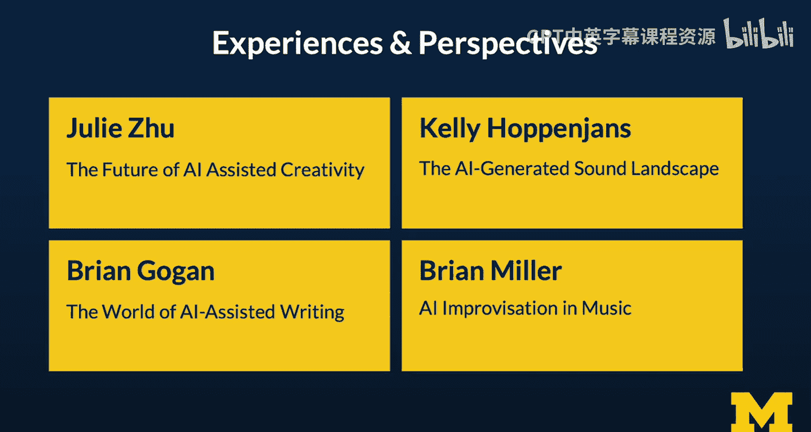
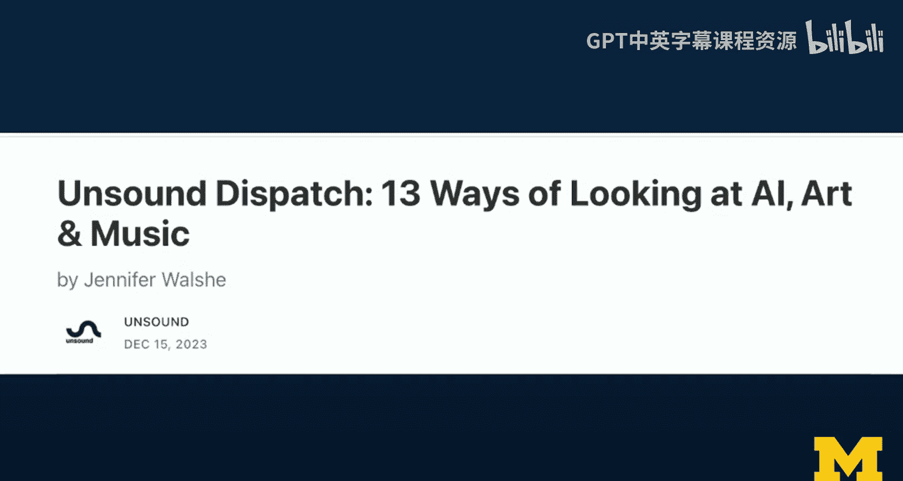
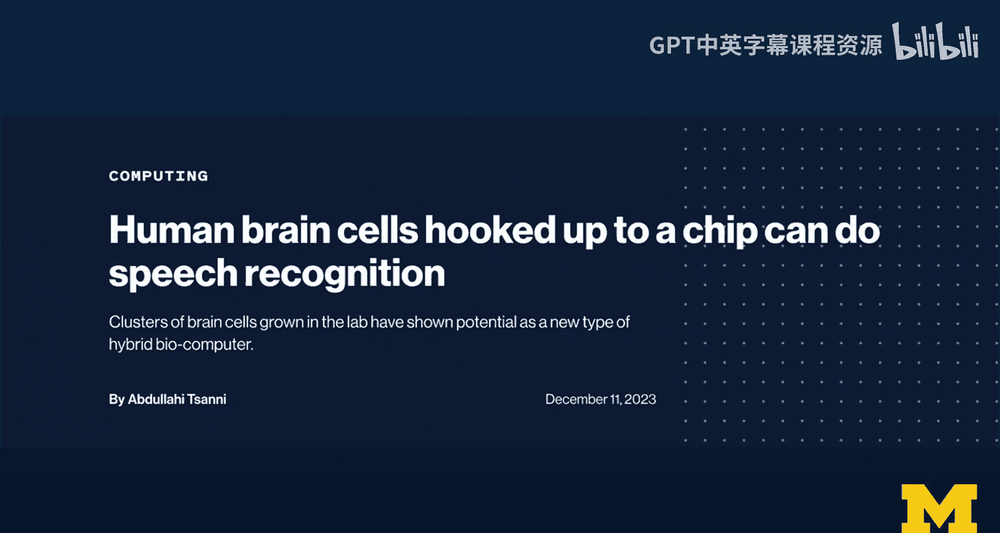
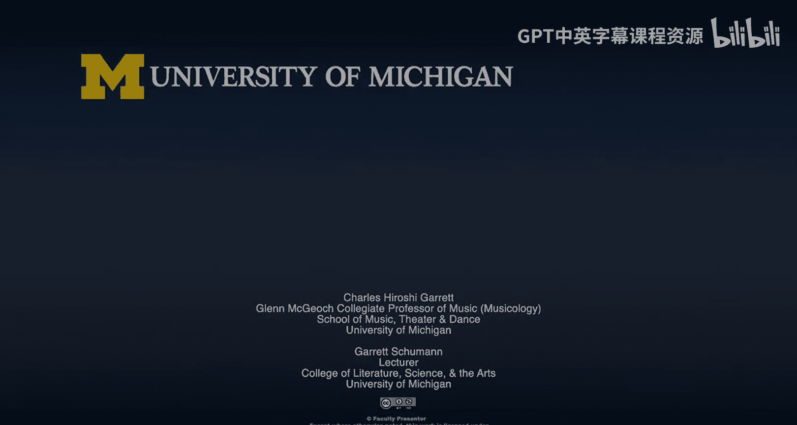

# 8：人机表达关系反思 🤖

在本节课中，我们将回顾四位专家关于AI与人类创意表达关系的见解，并深入探讨一个新兴主题：AI技术与人体日益紧密的交集，以及这对创意工作意味着什么。

上一节我们聆听了四位客座专家的分享，他们从不同角度阐述了AI与创意表达中核心人性的关系。本节中，我们将聚焦于多位专家在视频论文中触及的一个新兴议题。

## 专家观点回顾

以下是四位专家分享的核心内容：

*   **朱莉·朱**通过她的实验性作品，向我们展示了AI辅助创意工作的未来一瞥。
*   **凯利·赫彭宁斯**向我们展示了基于她本人声音的AI人声模型实例，同时也提到了音乐人格里姆斯和霍利·赫恩登的案例，以此探讨AI生成声音与音乐领域中一个引人入胜的角落。
*   **布莱恩·高根**将我们带入AI辅助写作的世界。
*   **布莱恩·米勒**以佐治亚理工学院开发的机器人鼓手“夏蒙”为重点，开启了客座讲座系列，重点介绍了音乐中的AI即兴创作。

## 核心议题：AI与身体的交集

随着AI技术的发展，特别是在我们刚刚了解的创意领域，我们可以观察到其与人体之间的重叠日益增加。

这一点在机器人“夏蒙”的表演中显而易见。它的物理存在和实体性为人机交互开辟了基于计算机的工具所无法实现的新前沿。

同样，AI驱动的人声模型能够体现虚构或真实个体的潜力，对人类体验产生了惊人的影响。技术专家兼音乐家詹妮弗·沃尔什在2023年的著作中描述了AI发展这一方面的多重影响。

其中之一是**AI辅助的粉丝创作**。沃尔什通过“AIsis”项目来描述这一现象。该项目由英国另类摇滚乐队绿洲的粉丝发起并推崇，它利用AI驱动的人声模型和音乐生成器，让粉丝能够通过提示词创作出体现乐队独特风格的新歌曲。

与凯利·赫彭宁斯讨论的霍利·赫恩登和格里姆斯创建的AI人声模型不同，AIsis项目并未得到绿洲乐队成员的同意。这通过AI声音化身，制造了一种可能不受欢迎的“身体占有”的棘手局面。

## 个人能动性与技术整合

布莱恩·高根强调，将AI融入实践的作家需要“将技术整合进来”。这标志着随着创意工作者越来越多地使用这项技术，个人能动性成为一个相关的焦点。

这一点尤其重要，因为AI工具开始与人体物理性重叠，例如夏蒙或其他使用AI与周围世界交互的复杂机器人，或者在它们的建模或其他操作中依赖于人体。

正如《麻省理工科技评论》2023年发表的一篇文章所阐明，先进计算和人工智能的另一个前沿是**脑类器官**的使用，即“在培养皿中生长的人类脑细胞团，用于执行计算任务”。

尽管这只是一个实验，但其潜力作为一个重要的提醒：尽管我们倾向于将计算机和复杂的信息技术视为与物理世界截然分离的事物，但像人工智能这样的先进计算，与人体及我们的身体体验有着深刻的联系。

## 重新思考AI与人类创造力的关系

当我们思考AI与人类创造力的关系时，这个观点显然具有分量。

或许AI技术，特别是生成式AI的新创新，并不代表传统意义上的发现，也没有释放出人类创造力的新部分。更准确的说法可能是，由于人工智能已经并且持续深化其与人体的关系，AI帮助我们触及了人类创造力中一直存在、但在早期可能未被充分利用的部分。

## 总结

本节课中，我们一起学习了AI在创意工作中一个深刻的发展方向：其与人体及物理体验日益紧密的结合。从机器人表演到AI声音化身，再到脑类器官计算，我们看到AI不再仅仅是虚拟工具，而是开始与我们的身体性产生交集。这要求创意工作者在整合技术时，更加注重个人能动性和伦理考量，并促使我们重新思考AI如何帮助我们触及和表达人类与生俱来的创造力。