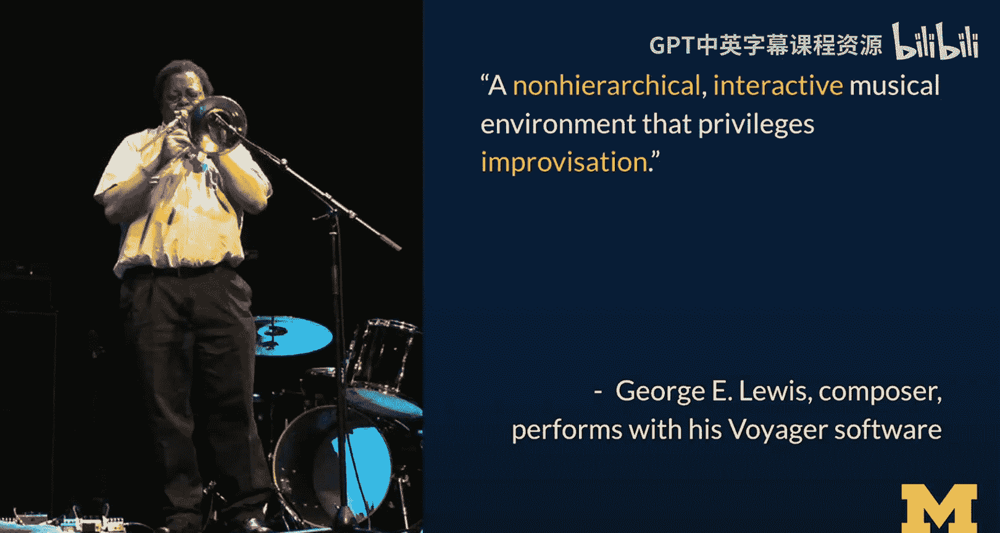
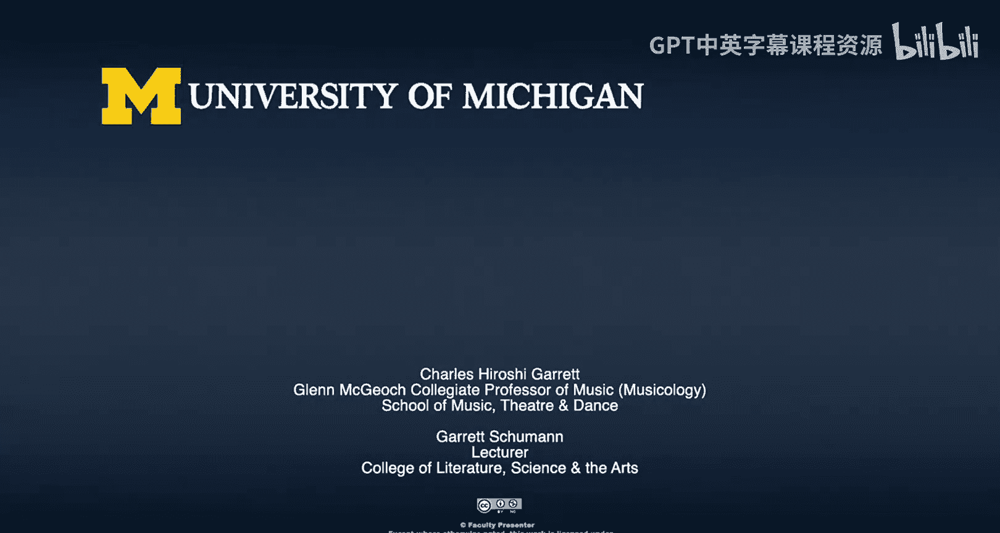

# 9：协作创新范例 🤖

在本节课中，我们将探讨人工智能如何参与创意协作，分析其与人类协作的本质区别，并通过两位创作者的实践案例来理解这种协作关系的潜力与局限。

## 概述：AI作为创意协作者

AI能够参与创意协作，这一概念既充满争议又引人入胜。将AI置于协作情境中，突显了一个现实：当前AI工具的决策方式与人类的决策方式截然不同。因此，当我们思考AI在协作中的角色时，必须牢记它无法像人类一样成为协作者。这未必是弱点，AI出人意料的结果自有其价值。但如果我们希望将AI视为潜在的协作者，就必须接受这项技术的思考方式与我们不同。从这个角度看，与AI协作从根本上扩展了创意过程，因为AI实际提供的贡献很可能与人类为项目或表演带来的贡献不同。

## 案例一：作家与ChatGPT的协作 📝

获奖作家兼记者瓦希尼·维拉的实践，生动地展示了她所描述的与ChatGPT的协作动态。她在2023年9月发表于《连线》杂志的文章《一位病毒式AI写手的自白》中描述了这段经历。

维拉曾尝试使用该软件撰写一个关于家庭失去的故事，并取得了一定成功。但由于大型语言模型并非高度定制化的，她不得不忽略其较为通用的输出，专注于那些与她所经历的真实事件视角产生共鸣的ChatGPT回复。

以下是她的工作流程：
*   **迭代尝试**：她反复尝试，每次删除AI生成的文本，并添加自己之前写的内容，然后要求GPT-3在故事后续部分接续思路。
*   **突破时刻**：起初屡屡失败，但在第四或第五次尝试时，情况发生了变化。AI开始用感觉更真实的语言描述悲伤。
*   **逐步接近**：随着后续每次尝试，AI的描述都更接近她自身的经历。

维拉与ChatGPT的这种来回互动，体现了协作的某些方面，因为她与软件合作的经验催生了双方都无法独立完成的新作品。

然而，维拉文章的结论并非凯歌高奏。生成式AI的输出受限于其训练数据。在此案例中，ChatGPT生成的声音非常通用。此外，正如维拉所写，ChatGPT缺乏实体性，这对其理解世界构成了有意义的限制。这些限制阻碍了当前AI写作所能拥有的深度。

正如维拉总结道：
> “如果写作是我试图阐明世界对我而言是怎样的，那么AI的问题不仅在于它无法形成对世界的个人视角，更在于它甚至无法理解世界是什么。”

维拉的文章为我们提供了一个重要教训，即对于像ChatGPT这样面向公众的生成式AI工具，我们应抱有何种及不应抱有何种期望。在本课程中，我们已经遇到过更具高度可定制性的AI软件，例如声音合成程序Brave。我们可以想象，一个更明确地或在维拉作品上单独训练的写作工具，或许能更成功地满足她的期望。

## 案例二：作曲家与算法程序的协作 🎵

与维拉的案例形成对比，一些与AI协作的创意实践者完全接纳了计算机的非人性，而不是希望技术能更成功地模仿人类决策。

作曲家乔治·E·刘易斯自20世纪80年代以来，一直在开发复杂的、由算法驱动的即兴计算机程序。在2000年的文章中，他将自己最著名的AI实验软件“旅行者号”描述为**一个非等级制的、互动的音乐环境，推崇即兴创作**。

这个非常规的描述再次提醒我们，与AI的协作应与人类协作区别看待，原因很简单：计算机不是人类。值得注意的是，刘易斯在其数十年的职业生涯中，一直专门使用自制的工具，这使他能够发展出适合其创意价值观和观点的协作模式。

## 总结与展望

归根结底，未来人类与AI协作方式最重要的限制，可能部分取决于科技行业自身的发展轨迹。但瓦希尼·维拉和乔治·刘易斯的例子有力地表明，多个学科的创意工作者正在继续学习如何以有意义的、个人的、独特的且不同的方式，与他们的非人类伙伴进行协作。

本节课中，我们一起学习了AI作为创意协作者的特殊性，分析了其与人类思维的根本差异，并通过作家与ChatGPT的文本协作、作曲家与算法程序的音乐即兴协作两个具体案例，深入理解了这种协作关系的动态、价值与当前局限。关键在于认识到AI的“非人性”并非缺陷，而是拓展创意可能性的独特起点。