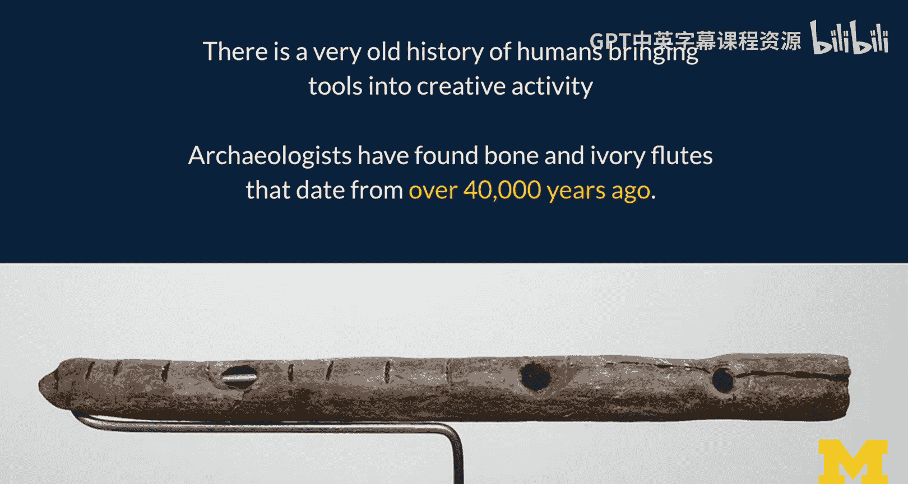
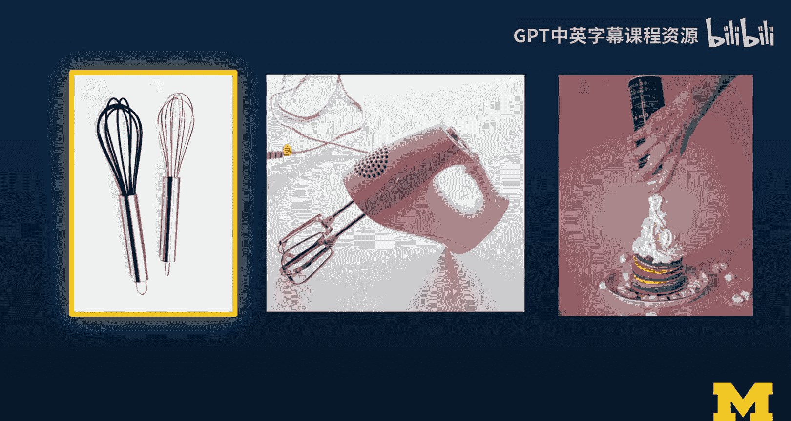
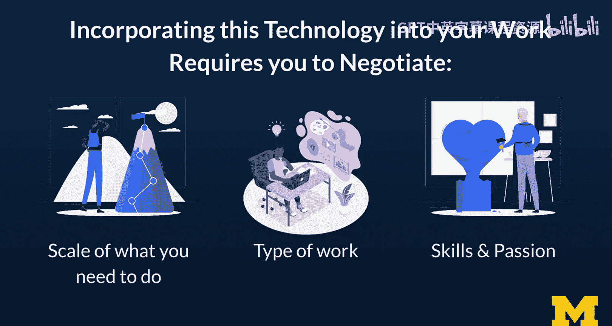
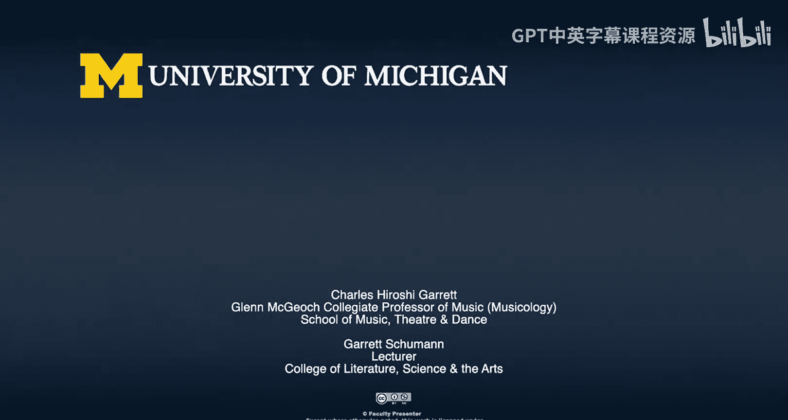

# 10：技术对艺术实践的影响 🎨

在本节课中，我们将探讨生成式人工智能（Gen AI）等新技术如何融入并影响创意实践的历史背景与现实选择。我们将通过一个简单的比喻，帮助你理解如何在创意工作中明智地选择和使用技术工具。

---

当你完成本课程，并开始将所学概念与技能进一步应用于生成式人工智能及其他AI工具时，必须将这项技术置于更广阔的历史实践背景中来看待。诸如“筛选过程”等方法，以及你在本系列课程中接触到的理念和各位特邀专家的见解，都能帮助你在面对这项看似潜力无限的新技术时，打下坚实的基础。

我们带着这样的认知来到生成式AI取得突破的当下：人类将工具引入创意活动有着非常悠久的历史。考古学家发现了距今超过四万年的骨笛与象牙笛。历史上，新技术发展影响创意实践的例子数不胜数，即使这些技术最初并非为创意目的而设计。必须承认，新工具不可避免地会改变艺术实践和艺术成果，理想情况下，这会带来有益且可接受的权衡。

---

为了更具体地理解这种权衡，让我们通过一个日常生活的比喻来思考。

想象你在自家厨房，需要一个食谱用到打发奶油。你有三种选择：用手动打蛋器手动打发奶油；用电动手持搅拌器打发奶油；或者直接使用罐装喷射奶油。

以下是三种获取所需原料的方法或技术，但每一种都不同，不仅在于过程，也在于结果。

*   **手动打蛋器**：速度最慢，最费力。但你对工具的控制力也最强。你能感受到奶油在充气过程中质地的变化，并能非常轻松、无缝地调整你的工作强度。
*   **电动手持搅拌器**：让你工作更快，并能一定程度上控制过程，但方式与手动打蛋器不同。
*   **罐装喷射奶油**：除了打开和使用它的时机外，你对其没有任何控制。

在这个比喻中，如果家庭厨师是创意工作者，而打发奶油是其创意工作的产出，那么我们首先应承认：**每种方法都需要某种工具**。你已经在使用技术来创造事物，但你可能努力根据你的优先事项和需求，选择“合适”的技术。

---

当前围绕生成式AI的浪潮，可能会让你觉得驱动你创意工作的价值观几乎没有空间。将那些由海量数据驱动的图像、文本和音乐生成器，想象成罐装喷射奶油或许会有所帮助。这些即用型工具让你在需要时能立即使用，但你得到的产品并非定制化的，可能感觉是预先包装好的，缺乏真实感。

也许你只以特定方式使用这类生成式AI工具，以确保其局限性不会主导你的创意项目成果。将这项技术融入你的工作，需要你权衡所需工作的规模、你所提供或被要求完成的工作类型、你的技能以及你的热情。

延续烹饪的比喻：如果你能手工制作出异常细腻的奶油，如果你能根据奶油的充气情况精湛地调整打蛋器的速度，如果你能比任何人都更具想象力地定制风味，那么支持性AI技术的最佳用武之地，可能并不出现在创意过程本身，而在于**其他使你的创造力成为可能的工作中**。

---

关键不在于你必须做出这些选择，而在于**你有权选择你与这项技术的关系**。当前生成式AI工具时代的一个决定性特征是，它们似乎具有支配性和不可阻挡性。但正如我们在整个系列中讨论的，这些产品并非魔法。在某些情况下，这些工具甚至无法提供相当于一罐喷射奶油的效果。但在另一些情况下，经过恰当的考量后，AI工具可能像电动手持搅拌器一样，其特定能力会带来好处，同时付出的代价（在个人触感方面）对你或你的客户而言并不十分明显。

你在本系列课程中学到的技能和概念，将帮助你在创意工作中使用AI时做出必要的判断。但在许多方面，**你的声音和你最关心的创意优先事项更为重要**。坚持这些价值观，将有助于确保你掌控自己的创意实践与技术之间的关系。

---

**本节课总结**：我们一起探讨了技术（尤其是生成式AI）影响创意实践的历史必然性与个体选择性。通过“打发奶油”的比喻，我们理解了从完全手动控制到全自动工具之间的光谱，以及如何在其中根据控制力、效率、个性化表达等需求做出明智选择。最终，技术的价值应由创意工作者根据自身项目的核心目标与价值观来定义和驾驭。