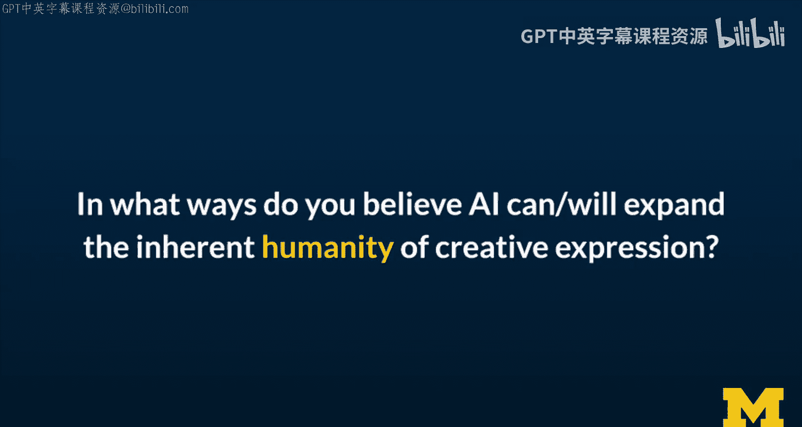
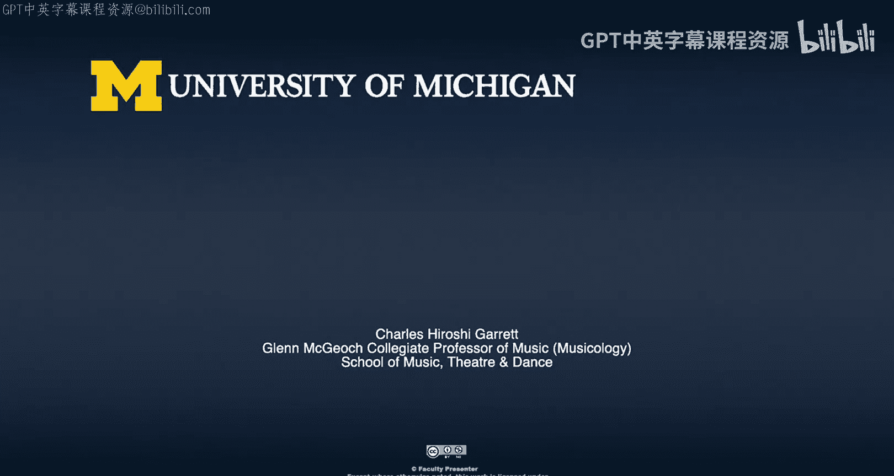

# 11：课程总结：领域之声与未来展望

在本节课中，我们将一起回顾并总结一位行业专家——查尔斯·浩石·加勒特——关于AI与创意表达的核心观点。我们将探讨AI在创意工作中的角色、人类的责任，以及如何主动塑造未来。

---

上一节我们探讨了AI在创意流程中的具体应用，本节中我们来看看专家对AI与人类创造力关系的宏观思考。

查尔斯·浩石·加勒特相信，AI拥有扩展创意表达中固有**人性**的力量。其核心观点可以用一个简单的**公式**表示：
**AI的影响 = 人类的选择**

然而，AI将如何、是否以及在何种程度上塑造创意表达，这取决于我们——即取决于**人类**，取决于**我**，也取决于**你**。

---

这个观点与如何看待AI对社会及工作场所的广泛影响密切相关。人们有时会讨论并担忧AI是否会取代我们，AI是否会夺走我们的工作。这些当然是合理的关切。

但事实上，关于AI是否会取代我们的决定，并非由失控的AI程序做出。这些决定是由**人**做出的。人类有责任选择是否采用那些可以辅助或取代人类活动的AI解决方案。

---

以下是本课程希望为你提供的核心策略与解决方案，旨在帮助你牢牢掌握创意过程的主导权：

*   **策略一：将AI视为扩展工具**。利用AI增强而非取代你独特的创意视角和人性化表达。
*   **策略二：保持批判性思维**。在采用任何AI解决方案时，主动评估其对你工作流程和最终产出的影响。
*   **策略三：明确人类责任**。认识到技术的应用方向最终由人类的选择和价值观决定。

---

如果这是你选择的前进方向，本课程希望所提供的策略和解决方案，能帮助你将创意过程牢牢掌握在自己手中，并让AI扩展你创意表达中固有的**人性**。

---

本节课中我们一起学习了专家查尔斯·浩石·加勒特的核心观点：AI是强大的工具，但它的角色和影响完全由人类的选择所决定。在创意工作中，我们应主动利用AI来扩展和丰富我们的人性化表达，而非被动地接受其可能带来的替代。未来，掌握主动权的是我们每一个人。