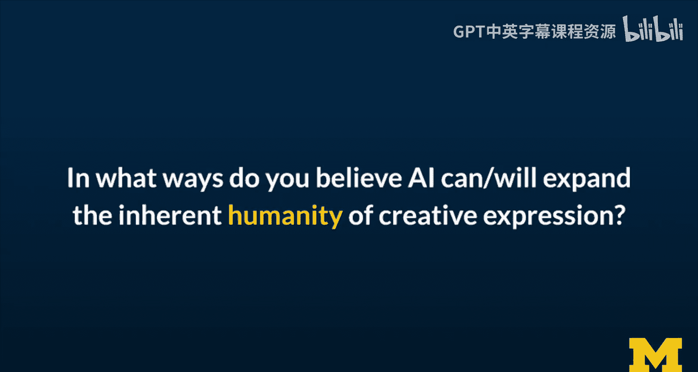
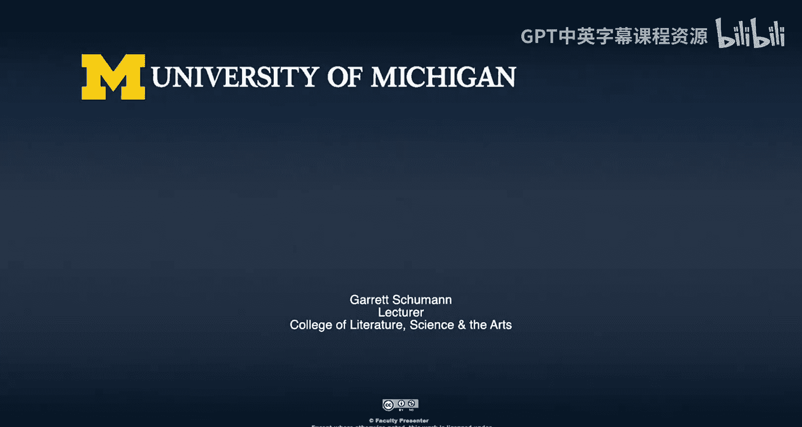

# 12：领域之声：加勒特·舒曼

## 概述
在本节课中，我们将探讨如何利用高度个性化的AI来扩展创作者的思维过程。我们将以作曲家为例，分析AI如何通过外化创意思维，让创作者能与自己的创作倾向和偏好进行“对话”。

## 个性化AI作为创意扩展工具
在回答本系列课程的第一个问题时，我曾提到以下内容。

想象一下，我作为一名作曲家，拥有一个高度个性化的AI程序。这个程序基于我创作过的所有音乐进行训练。

## AI如何改变创作流程
这种方式将通过外化我的头脑风暴过程，并以一种不可思议的方式扩展我的创作流程，使我能够与自己的创作倾向和偏好进行对话。这取代了将所有复杂思考都局限在自己脑海中的传统方式。

在本课程中，我们已经遇到了沿此方向进行的基础性实验案例。

## 现有技术：分离表达与载体
我们已经看到了一些AI工具，它们能够将个人的创造性表达与其物理载体分离开来。例如，像Hollyplus这样的声音模型以及其他技术已经以这种形式存在。

## 展望：将创作本能软件化
但更令人兴奋的是思考以下转变的意义：将个人的创作本能复现为一种软件形式，允许用户从一个全新的视角与自己的思维进行互动。

## 总结
本节课中，我们一起学习了利用个性化AI扩展创意过程的理念。我们探讨了AI如何通过外化头脑风暴、实现与自我创作倾向的对话来改变工作流程，并展望了将个人创作本能转化为可交互软件形式的未来前景。