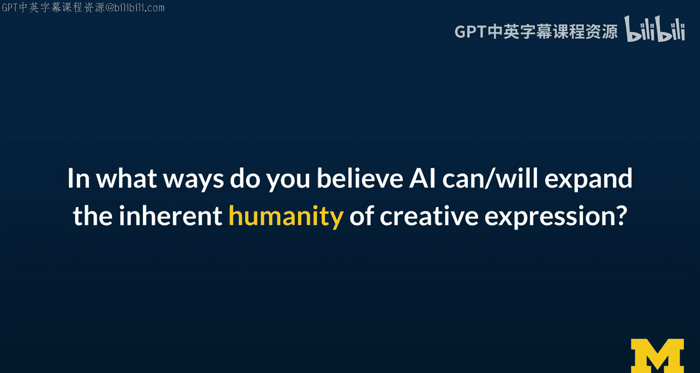
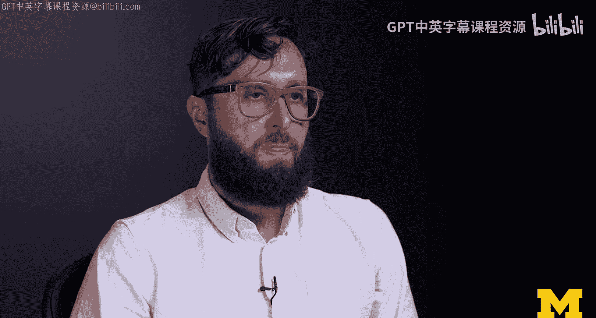
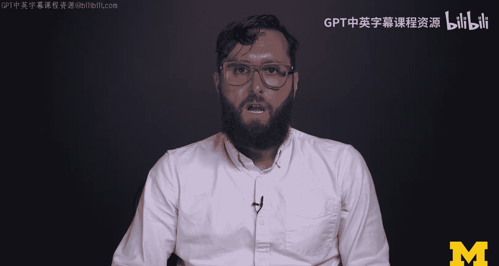
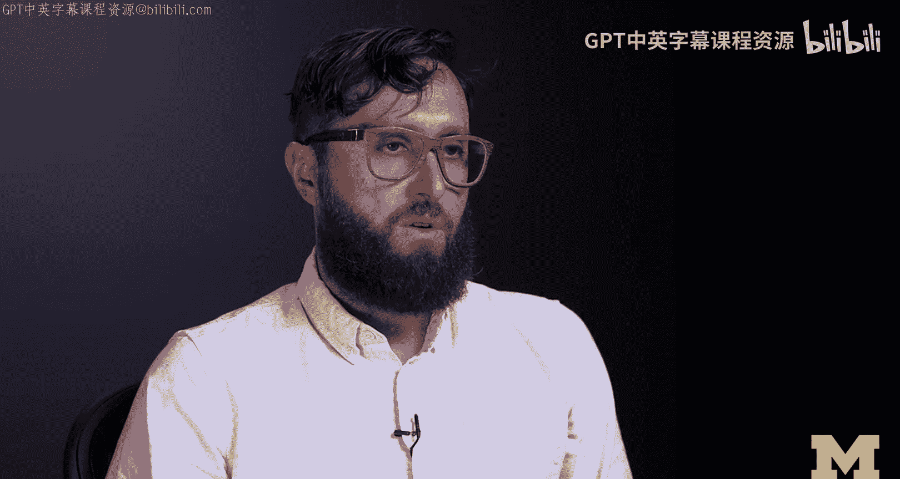
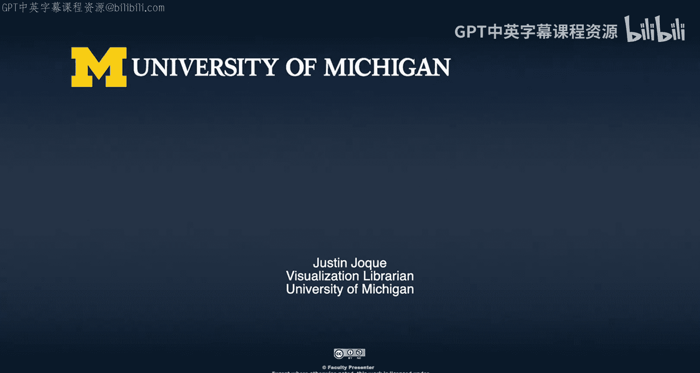

# 13：领域之声：贾斯汀·约克 🎤

在本节课中，我们将学习贾斯汀·约克关于AI在创意工作中应用的见解。他认为，AI最令人兴奋之处在于构建复杂、实时的系统，以生成和修改创意内容，实现传统方法无法达到的效果。

## 核心概念：从算法到创意工具 🔄

上一节我们介绍了AI在创意领域的宏观潜力，本节中我们来看看一个具体的算法如何跨越不同领域，最终成为创意工具。

贾斯汀·约克指出，一个算法最初可能并非为创意目的而设计。他以自动调音（Autotune）算法为例进行说明。

以下是关于Autotune算法演变过程的要点：

*   **最初用途**：该算法最初是为地震探测中的信号处理而开发的。
*   **创意应用**：后来有人发现，它可以用来将歌手的音高移动到正确的音符上。
*   **医疗应用**：据近期阅读，该技术现也被用于心脏起搏器中，以检测心率的变化。

这个例子展示了技术如何从“大地”到“耳朵”再到“心脏”的跨领域旅程。

## 技术的双重性：工具与创意 🎭

当然，任何技术都可能被不同地使用。Autotune也不例外。

一方面，它曾被用来制作听起来单调、相似的音乐。另一方面，它也被以极具创意的方式使用，创造出独特的声音和风格。其关键在于**实时处理声音**的能力，这为艺术家提供了增强和改变自己嗓音或其他声音的新可能。

艺术家可以利用这种实时操控，探索前所未有的声音效果。

## 总结 📝

本节课中我们一起学习了贾斯汀·约克的观点。他通过Autotune的例子阐明，AI及相关算法的价值在于其作为强大工具的潜力。这些工具能够实现**实时生成与修改内容**，其应用可横跨地震学、音乐制作乃至医疗设备等多个迥异的领域。最终，技术的创造性与否，取决于使用者如何运用它。