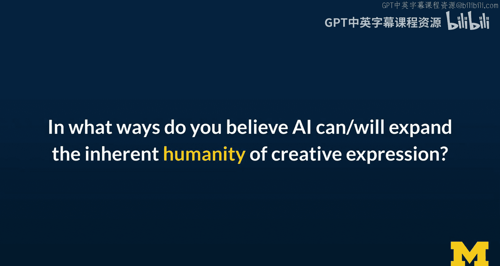
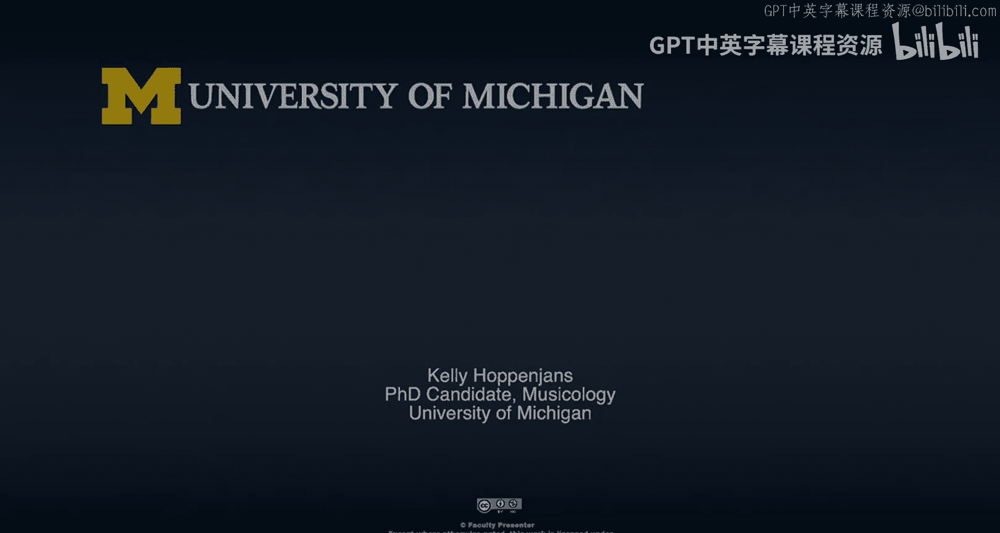

# 18：领域之声：凯莉·霍彭詹斯

## 🎯 概述
在本节课中，我们将学习凯莉·霍彭詹斯关于AI与人类创造力关系的核心观点。她认为，AI的创造力本质源于人类，并强调了在AI协作中保持人类中心地位的重要性。

## 🤔 AI创造力的根本来源
上一节我们探讨了AI在创意领域的应用，本节中我们来看看其创造力的根本来源。凯莉·霍彭詹斯认为，即使技术有时会掩盖这一点，但**AI的创造力从根本上源于人类**。

除了需要人类的提示指令外，AI的运作离不开庞大的人类创意数据库作为支撑。这些数据可以来自书籍、音乐、社交媒体帖子或任何我们创造的内容。

## 👥 被忽视的人类贡献
这还不包括AI程序员的工作，以及为AI系统进行数据标注和清洗的劳动者。他们的劳动常常被严重忽视。

## 💡 在协作中保持人类中心
尽管AI艺术具有新颖性和魅力，但我们仍需在其中寻找人性，并在我们自己的AI协作中，**以人类的智慧和创造力为中心**。

## 🎨 赋予AI产出更深层的意义
AI或许能产出可信的人类表达仿制品，但**赋予它们更深层的意义和共鸣，是我们的责任**。

## 📝 总结
本节课中我们一起学习了凯莉·霍彭詹斯的观点。她提醒我们，AI是工具而非创造者，真正的创造力、意义和共鸣始终来自人类。在利用AI进行创意工作时，我们应始终铭记并突出人类的贡献与核心地位。