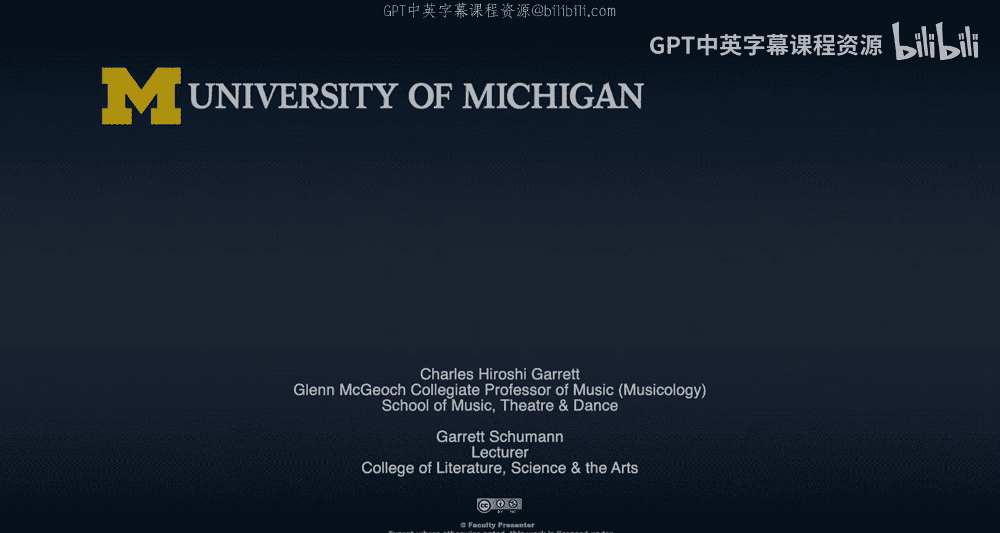

# 密歇根大学《AI用于创意工作｜AI for Creative Work》中英字幕 p01 0_欢迎学习本课程.zh_en -BV1DXNiznEXk_p1-

We're delighted you could join us for this short course on AI for creative work。

 Artific intelligence technologies are reshaping our lives and our work。

 So it's a perfect time to jump in and learn more。😊。

We've designed the following three course series to support anyone who is curious about AI and its impacts on creativity。

 from artists and designers in multiple disciplines to the organizations and leaders who employ and manage these professionals。

My name is Charles Hiroshi Garrett and I'm a professor in the Department of Musicology at the University of Michigan。

 where I teach courses on contemporary music， AI and other emerging technologies and my name is Garrett Schumman。

 I also teach at the University of Michigan in addition to working as a composer。

 music scholar and writer In recent years I have published articles about AI and creativity in The New York Times and other outlets。

You can expect to leave this course with an understanding of how AI works and how it may help you enhance your individual creativity in your creativity in the workplace。

 You'll also learn how to recognize the limits of AI tools and how to engage with this technology responsibly。

Along the way we'll teach you a fourstep process that will guide you future discovery and evaluation of AI tools and throughout the course we'll encourage you to contemplate how AI can expand and transform your creative thinking Something we love about this course series is that you won't only hear from us we've assembled a multidisciplinary team of guest experts who will share their unique and remarkable insights on current AI technology so that you can gain the most comprehensive understanding of this topic possible。

Let's get started with the first course， which discusses the basics of AI and then looks at how powerful AI tools are reshaping the landscape of creative work。

