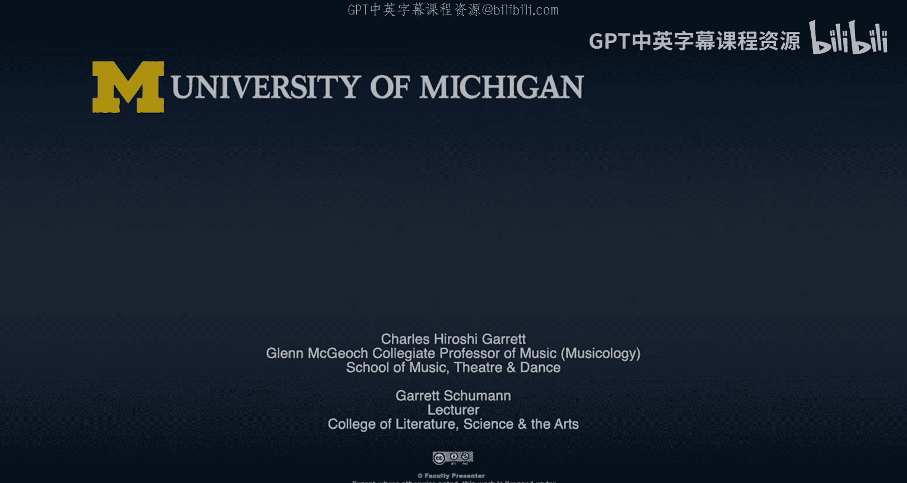

# AI用于创意工作：01：欢迎学习本课程 🎨

在本课程中，我们将一起探索人工智能如何重塑创意领域，并学习如何利用AI工具来增强个人与工作场所的创造力。

我们很高兴您能加入这个关于AI用于创意工作的短期课程。人工智能技术正在重塑我们的生活与工作。因此，现在是深入了解它的绝佳时机。

我们设计了以下三个系列课程，旨在帮助所有对AI及其对创造力影响感到好奇的人。这包括来自多个学科的艺术家和设计师，以及雇佣和管理这些专业人士的组织与领导者。

我的名字是查尔斯·广志·加勒特，我是密歇根大学音乐学系的教授。我教授的课程涉及当代音乐、人工智能及其他新兴技术。我的名字是加勒特·舒曼。除了在密歇根大学任教，我还是一名作曲家、音乐学者和作家。近年来，我曾在《纽约时报》等媒体发表关于AI与创造力的文章。

完成本课程后，您将能够理解AI的工作原理，以及它如何帮助您增强个人及工作场所的创造力。您还将学会识别AI工具的局限性，以及如何负责任地使用这项技术。

在此过程中，我们将教您一个四步流程，以指导您未来对AI工具的探索与评估。在整个课程中，我们将鼓励您思考AI如何能扩展和转变您的创造性思维。本系列课程的一个亮点是，您不仅能听到我们的讲解。我们还组建了一个跨学科的客座专家团队，他们将分享关于当前AI技术的独特而深刻的见解，让您尽可能全面地理解这个主题。

让我们从第一个课程开始，它将讨论AI的基础知识，然后探讨强大的AI工具如何重塑创意工作的格局。

---

本节课中，我们一起学习了本课程的概述、目标以及讲师介绍。我们了解到，AI正在深刻影响创意领域，而本课程旨在提供一个全面的框架，帮助我们从基础理解到实际应用，负责任地探索和利用AI工具来激发创造力。