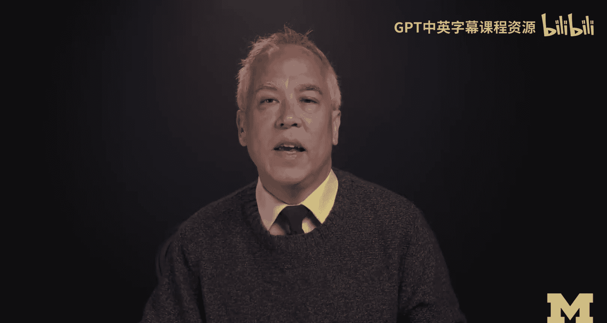
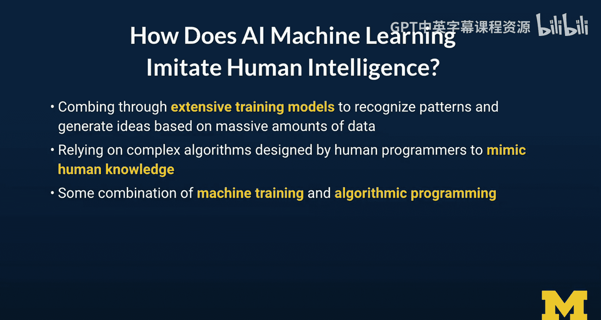
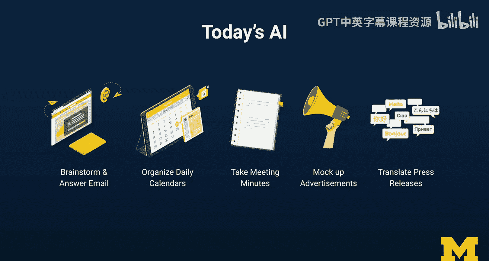
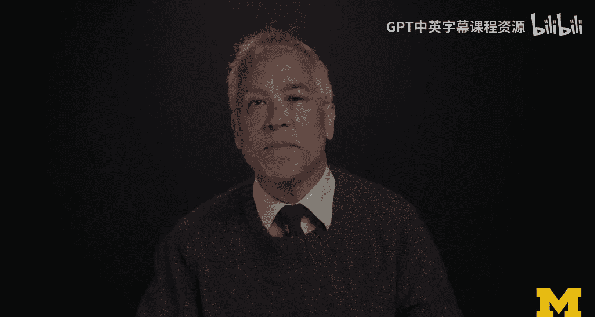
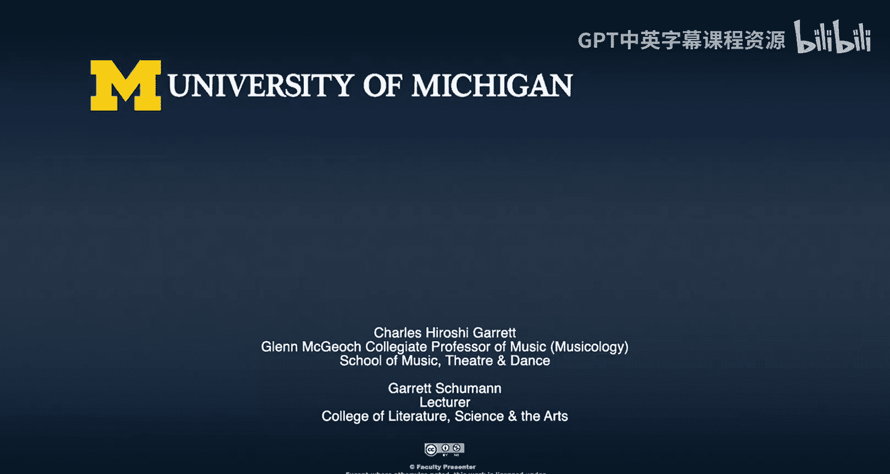

# 密歇根大学《AI用于创意工作｜AI for Creative Work》中英字幕 p02 1_人工智能在创意领域的应用概览.zh_en -BV1DXNiznEXk_p2-

Yeah。Generative AI tools are transforming how we live。

 how we work and how we learn at a dizzying pace。 Powerful advances in artificial intelligence have reshaped the business world。

 as we know it， and specialized AI tools are becoming part of the day to day work of creative professionals across the world。

😊，Today's popular Gen AI tools incorporate sophisticated machine learning technologies that respond to user directions。

 prompts， and commands。

AI machine learning seeks to imitate human intelligence either by one。

 combing through extensive training models to recognize patterns and generate ideas based on massive amounts of data。

2， by relying on complex algorithms designed by human programmers to mimic human knowledge， or three。

 some combination of both machine training and algorithmic programming。

A machine trained Gen AI tool that seeks to produce Western classical music， for instance。

 might be trained on and thus learn from all of the music composed by Bach， Mozart and Beethoven。

 whereas an algorithmic Gen AI tool for creating music might instead rely on encoding a set of specific rules about music that captures how music theorists and music historians conceptualize the inner workings of traditional classical music。

Advanced AI software across creative fields now often merges elements of machine learning with algorithmic approaches to achieve more nuanced results。

Recent generative AI advances are beginning to saturate the business world。

 AI tools cannot not only assist information technology workgroup。

 but also impact product development， sales， finance， marketing， product testing， PR。

 nearly every sector of industry today。

Today， AI can help users brainstorm， answer email， organize daily calendars， take meeting minutes。

 mock up advertisements， translate press releases， and much more。

It's the right moment for creative professionals to explore the possibilities and the potential pitfalls of these new technologies to learn how to move forward responsibly in the age of AI。

