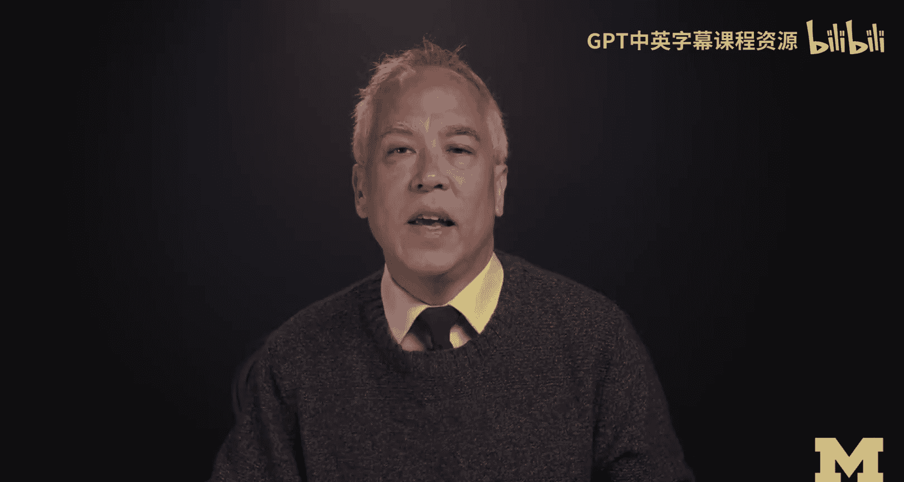
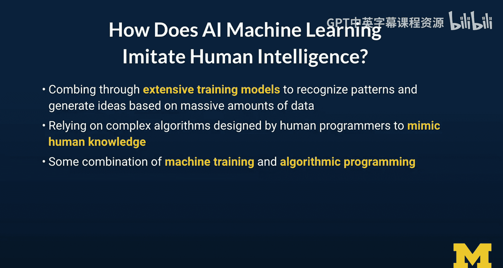
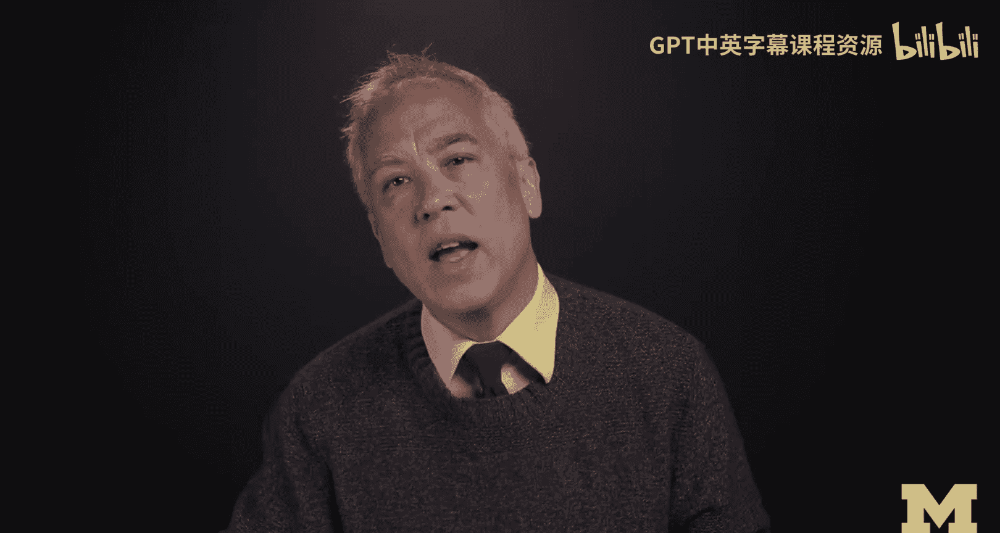
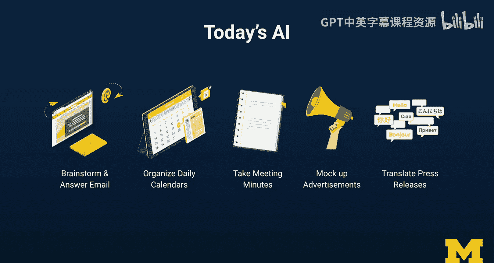
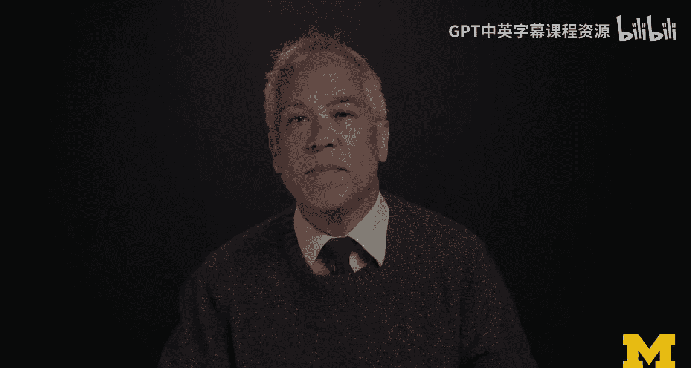
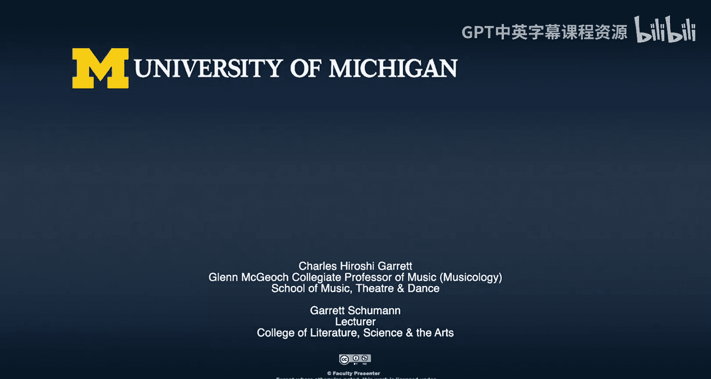

# AI用于创意工作：01：人工智能在创意领域的应用概览 🚀

在本节课中，我们将要学习生成式人工智能（AI）如何以惊人的速度改变我们的生活、工作和学习方式。我们将了解AI在商业世界中的重塑作用，以及它如何成为全球创意专业人士日常工作的一部分。

---

生成式AI工具正在以令人目眩的速度改变我们的生活、工作与学习方式。人工智能领域的强大进步重塑了我们所熟知的商业世界，而专业的AI工具正逐渐成为全球创意专业人士日常工作的一部分。

如今流行的生成式AI工具融合了复杂的机器学习技术，能够响应用户的指示、提示和命令。

---

上一节我们提到了AI工具的强大能力，本节中我们来看看其背后的技术原理。人工智能与机器学习旨在模仿人类智能，其实现方式主要有以下三种：

以下是三种主要实现方式：
1.  通过梳理海量的训练模型来识别模式，并基于大量数据生成想法。
2.  依靠人类程序员设计的复杂算法来模拟人类知识。
3.  结合上述的机器训练与算法编程。

---

理解了AI的基本原理后，我们通过一个具体例子来区分这两种方法。例如，一个旨在创作西方古典音乐的、基于机器训练的生成式AI工具，可能会在巴赫、莫扎特和贝多芬的所有作品上进行训练并从中学习。

而一个用于创作音乐的、基于算法的生成式AI工具，则可能依赖于编码一套关于音乐的特定规则，这些规则捕捉了音乐理论家和历史学家对传统古典音乐内在运作方式的概念化理解。

如今，创意领域的先进AI软件通常融合了机器学习与算法方法的元素，以获得更细致入微的结果。

---

了解了技术细节，我们来看看AI在商业世界中的实际影响。近期的生成式AI进展正开始渗透到商业世界的各个角落。AI工具不仅能协助信息技术工作组，还能影响产品开发、销售、财务、营销、产品测试、公关等当今几乎所有的行业领域。

具体而言，如今的AI可以帮助用户进行头脑风暴、回复邮件、整理日程、记录会议纪要、制作广告原型、翻译新闻稿等等。

---

因此，对于创意专业人士而言，现在正是探索这些新技术可能性与潜在风险的恰当时机，以学习如何在AI时代负责任地前行。