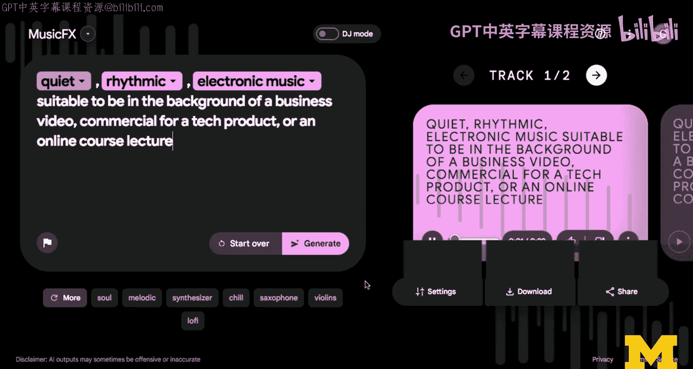
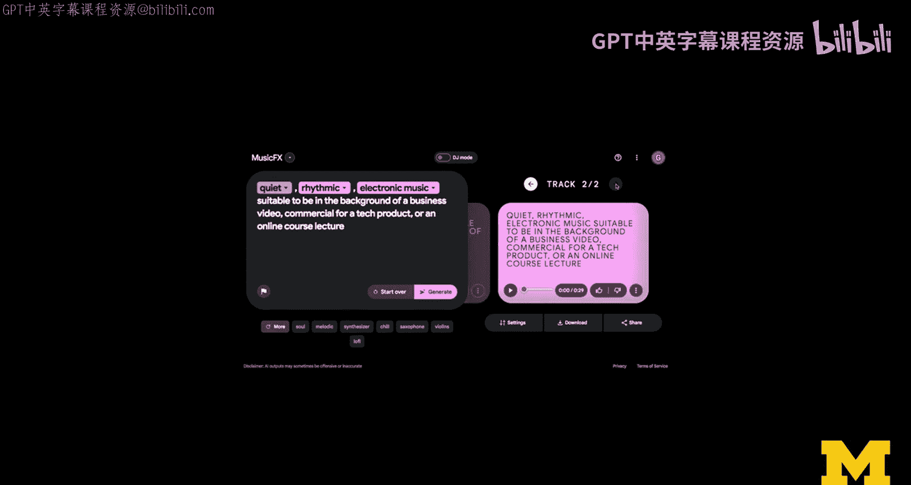
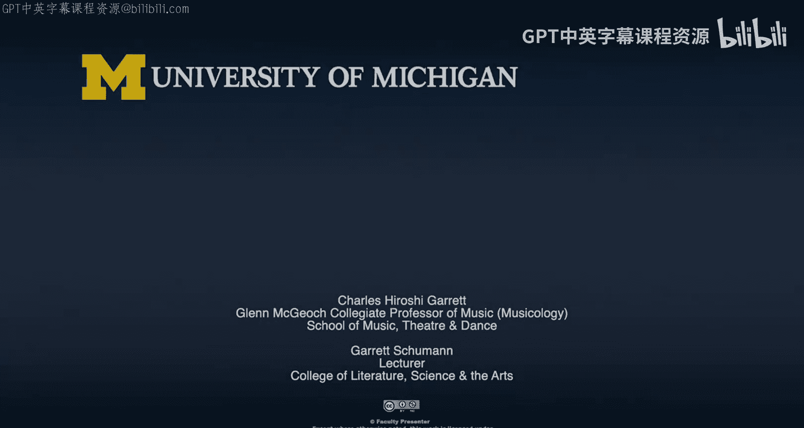

# 密歇根大学《AI用于创意工作｜AI for Creative Work》中英字幕 p03 2_BandLab音乐特效演示.zh_en -BV1DXNiznEXk_p3-

I'm a musician， and I want to see how an AI music generation tool can help me in my work。

Google's music Fx is free and highly publicized。 So that's where I begin。

I input a very specific prompt with some clues about the style and sonic characteristics of the music I'm looking for。

The potential benefits of this tool are enormous because even though I am skilled enough to create original music。

 doinging so is much more thought intensive in time consuming than writing a prompt for music Fx。

You can see I've decided to prompt quiet rhythmic electronic music suitable to be in the background of a business video。

 commercial for a tech product， or an online course lecture。

I asked it to start generating the examples。And after a moment or two。

 the program will create two tracks based on my specifications。And when it finishes。

 the first one will start playing。

Yeah。🎼。🎼，🎼，🎼，🎼，🎼，Now， let's listen to the second track。🎼，は。🎼。

Music Fex allows me to download these tracks， which is essential to me。

 so I can work with them flexexibly in a creative project。

 But the software has some important limitations that。

 as a professional musician will make me want to look elsewhere。 First。

 the pieces music F creates are all 30 seconds long， which is very short。🎼Second。

 I can only download the audio in one file format MP3。 I would love to have some choices。

 especially higher fidelity options， but music effects doesn't offer them to me。

 at least in its free to use version。

🎼Finally， I can't customize or transform anything about the tracks music effects created in response to my prompt without relying on other software。

🎼Such a complicated workflow is no more useful to me than starting from scratch with my own musical ideas。

 and my personal creative voice is not noticeably present in the tracks I export from music Eex。

 which is discouraging。🎼But there are AI music tools I'm more likely to find useful and feel better about bringing into my work。

 For example， we're listening to AI generated music right now。

 This comes from the free to use browserbased digital audio workstation band Lab。

 which has an AI powered function called Songstarer that generates around a minute of music based on style suggestions I select。

🎼Unlike Music Fx， Song startter allows me to further edit the music it has generated in Bandlab's normal studio workspace。

 In addition to giving me an opportunity to express myself with the support of Gen AI。

 this extended feature means using an AI tool won't cause major changes to my workflow。

Moreover。Bandlab comes with its own comprehensive set of software instruments and effects。

 unlike music Es and other simplistic AI music generators trained on audio recordings taken from all corners of the internet。

🎼Bandlab uses its own onboard sound sweep to perform the tracks Songstarer generates。

This adds to the ease of editing and also makes me more comfortable using AI generated material in my creative project。

My experience comparing music effectsX and song starters shows that with the right tools。

 creative professionals can still showcase their unique skills and individual perspectives while using generative AI to enhance。

