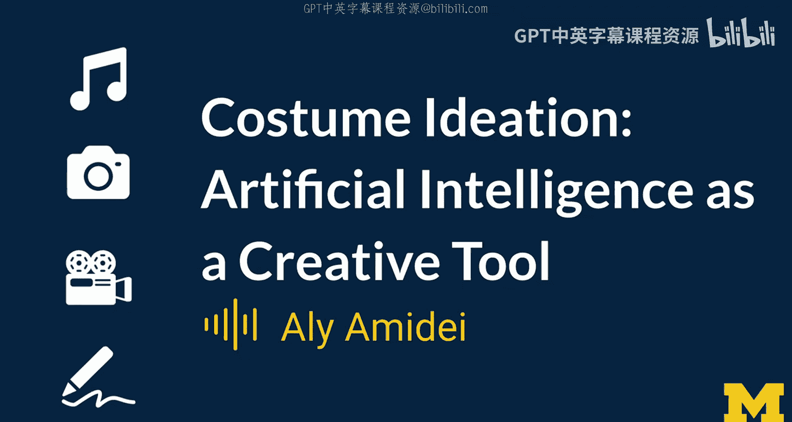
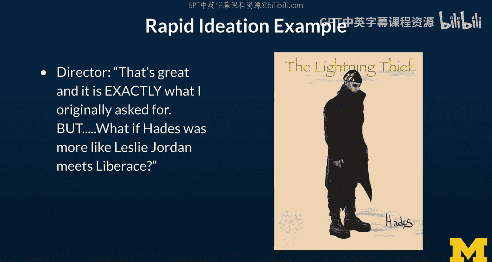
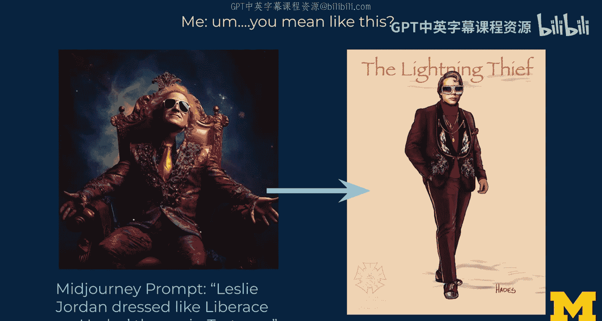
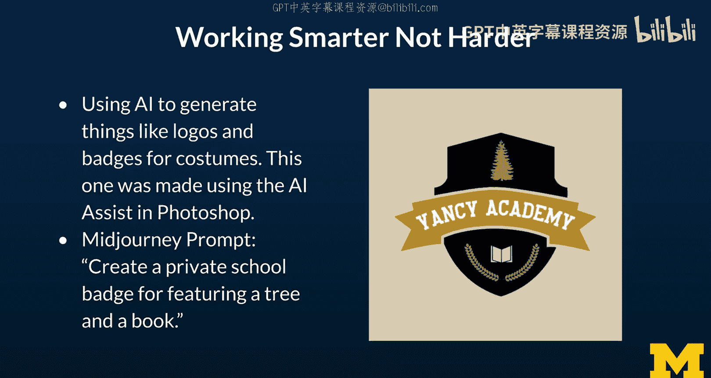
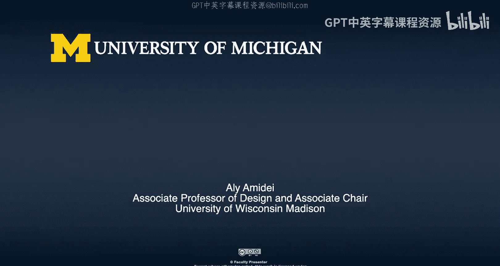

# 密歇根大学《AI用于创意工作｜AI for Creative Work》中英字幕 p04 3_艾丽·阿米迪的专题讲座.zh_en -BV1DXNiznEXk_p4-

Hi， my name is Aamade and I'm speaking about costume ideation。

 artificial intelligence as a creative tool。I am a costume designer for the theater。

 Co designers create the clothes that actors wear on stage。

These clothes are more specifically referred to as the costumes。

 The costumes give us information about the character wearing the costume。

 and they support the story of the script。 My work involves a great deal of research。

 problem solving， Prototyping， communication and handson creative and technical labor to bring a costume from an idea on the page to a garment on the stage。

 Co design is a part of a team effort that includes designers， the director， actors。

 Techs and others， all working together to bring a play or show to life for an audience。 Now。

 I use a lot of tools both digital and analog in my work as a costume designer。

 I only started incorporating AI tools like Cha E Bt and midjoney into my teaching and art making practice in 2023。

 Right now， I am turning to an image generator tool like midjoney。 when I need to do three things。

 Rad ideation。 Real research and working smarter， not harder for rapidd ideation。

 a tool like mid journeyney is well suited to experimentation。 I can road test a wacky idea。😊。

With a carefully curated prompt in a short amount of time and get immediate feedback from my collaborators on whether I am headed in the right direction。

 the AI image becomes the first proof of concept upon which I can then run with my more traditional non AI art practice as a designer。

 having greatly reduced the amount of time and labor that it would have taken to get to that point without the AI assist。

😊，As a costume designer， I am creating costumes for the character。

 but also need to keep in mind the identities of both the character and the actor as I create the costumes。

 I place a high importance on finding research images that are representative of the actor and the character identities。

 depending on the nature of the play， finding representational research can be challenging。

 Here is an example where I was having difficulty finding an image of a young black teenager with a mobility disability in modern stylish clothing with the kind of dramatic lighting typical to a theatrical production So I created one using this prompt on midjoney used as a supplement to actual primary image resources within a costume research presentation an image like this serves as a strong visual that helps tell the story better。

 It also communicates my designs better and can guarantee that the research images that I present are taking into consideration the intersectional identities of the characters and actors in a cultural。

Responsive manner。However， AI as a tool is far from perfect。 Despite multiple prompt attempts。

 I was not able to get even one usable image for this delightfully silly design concept about a tween girl obsessed with A0s Jaer eyes and the Roman Empire。

 The limitations of AI here were clear after one prompt and the best option was to create a quick collage manually。

 rather than keep flailing with AI here， I learned mid journey as less than helpful when whimsy and humor are needed。

 along with a design eye。😊，But again， for every failure。

 there are times when the big asks are so big that it is just worth a try to see if midjo can cut down on that prototyping time to come up with a successful draft of an idea that is agreed upon by the team when asked about a chorus for a musical all wearing a similar pink suit rather than reing the suits and creating them in Photoshop。

 I am able to quickly generate this to get the yes or the no on the pink suited chorus right there。😊。

As a practical example， I recently designed costumes for Percy Jackson musical called the Lightning thief for Children's Theater of Madison。

 The director， Brian Cowing， had initially asked for Hades to be a cyberpunk gath sad emo guy。

 However， he came back to me after a week of rehearsal with the actor and said that he was all wrong and that we needed to go in a different direction。

 the original costume had already been purchased， and we were only three weeks from dress rehearsals。

 So changing a costume for a major character like this was a big concern。 He asked。

 what if Hades was more like Leslie Jordan meets Liberchi。

 So this felt like just the right moment for midjoney to come to the rescue using this prompt I was able to create the image that you see here and the dch was like。

 yes， this is perfect。 So then I then used this image to do new primary research and create a new costume rendering for the character。

 I sourced the costume to buy andvoila。 The costume was a huge success and allowed for。😊。

Fal time collaboration and problem solving in a manner which minimize the negative impact to my creative workflow on the project。

 And finally， AI can help me work smarter， not harder and another example from lightning thief production。

 I needed badges for the Yanceze Academy School uniforms。 using AI tools in Photoshop。

 I was able to rapidly generate this image that worked well for our needs and took less than five minutes to create to wrap up。

 These are three of the ways that I've been using AI generation in my creative practice。

 considering the negative impacts that I am aware of。

 especially on the environment and copyright infringement。 I still feel conflicted。

 but ultimately try to use it responsibly and a way that helps me maintain as semblance of work life balance。

 Thank you。😊。

