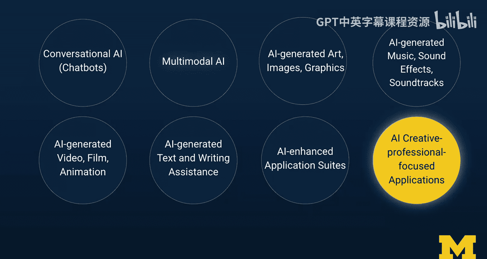
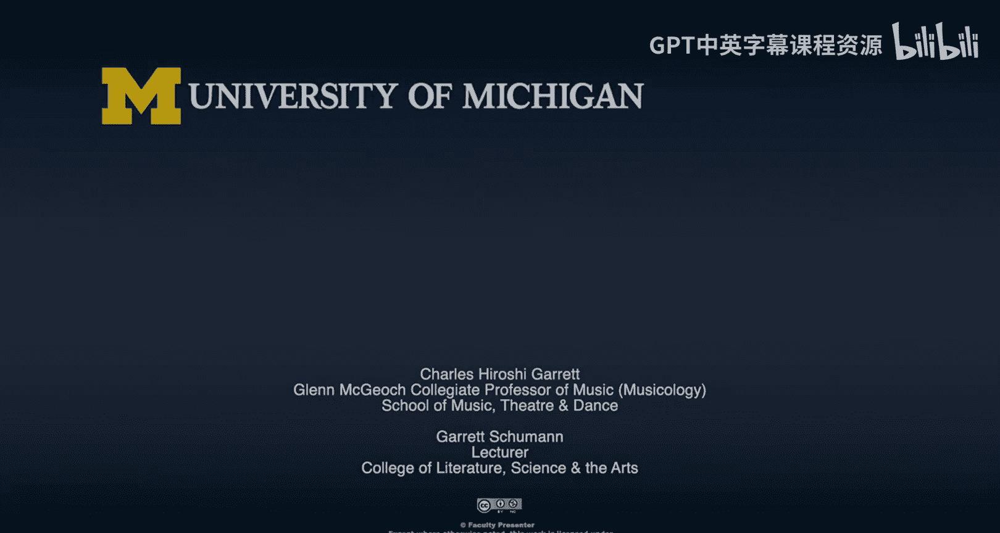

# 密歇根大学《AI用于创意工作｜AI for Creative Work》中英字幕 p05 4_生成式AI工具综述.zh_en -BV1DXNiznEXk_p5-

Because the AI industry has poured so much energy into developing applications seeking to mimic。

 replace or boost creativity， Gen AI tools are becoming increasingly available to assist with creative work。

Some tools promise to help us work more efficiently by automating tasks。

Others are designed to help us brainstorm， explore ideas and inspire our curiosity。

Popular Gen AI tools use models trained on large amounts of data and therefore are capable of generating content。

 text and visual images， eye catching illustrations and graphic designs， music。

 high definition video and 3D animation， and many other types of media。

Many creative workers are now accessing generative AI using various software programs and application suites。

Here are eight ways in which AI already is making a difference to creative work。

Please note that these categories may overlap。For instance。

 advanced multimodal AI programs like G 4 from Open AI and Gemini from Google are capable of generating AI images。

 AI music， AI video and AI text。Conversational AI in the form of Gin AI chatbots began reshaping our world when Open AI introduced Chat G 3。

5 in November 2022。Creative workers across many industries now draw on the advanced natural language processing and machine learning capabilities of chatbots to brainstorm。

 learn， research， analyze， manage， and assist with their professional work and everyday lives。

By 2023， most advanced chatbots， including Chay B T， as well as Google's Gemini， became multimodal。

 meaning they can do more than chat by exchanging words and conducting written conversations。

Multimodal AI not only can generate various forms of content， including text， images。

 audio and video， but it can accept voice commands， analyze images and understand sounds and videos。

 In other words， multimodal AI continues to be able to write。 but can also hear， see and speak。

Some multimodal AI tools are free to use， but the most advanced multimodal platforms typically require a paid plan for individuals or root groups to access their most advanced features。

The ability to generate AI art and other types of visual images is transforming creative work across many professions。

Applications such as mid journeyney， stable diffusion。

 and Open AI's daily software respond to user prompts to produce high quality visual images at your specified dimension。

 resolution， style and perspective。Many stock image services such as Sterstock and Getty images now feature AI enhancements that allow you to generate new AI images based solely on their extensive image collections。

AI generated music is advancing quickly across creative industries。 AI apps such as bandlab， Ava。

 Uio and So allow users to create various types of music without having to pay royalties。

 Some programs are especially good at creating songs in response to written prompts。 For example。

 you can write， composeose a song that mixes folk and country elements and expresses nostalgia from my rural hometown。

😊，While other programs allow users to fine tune their requests， specifying the exact genre。

 instrumentation， and tempo。Most multimodal AI packages are capable of generating AI video footage。

 film， animation and other visual images。There also exist many targeted software packages dedicated to generating specific types of media。

 including applications such as puppetry， which generates AI cartoons with puppets and VDIO。

 which turns digital portraits into animated talking avatars。

Conversational AI chat bots and multimodal AI applications have gained traction in the business world because they can generate new text and assist with writing tasks。

 drafting email， summarizing meeting notes， or adjusting the tone of one's writing to suit different consumer bases。

AI Writ software is also available to help with specialized tasks。

Copy AI is designed to create ad copy and other kinds of marketing content。

 while the text completion application Bloom， aims to round out written phrases and fill out sentences。

If you are a long time user of Microsoft or Adobe applications。

 you're likely already accessing generative AI。 Microsoft Copit is an AI tool integrated into their business software platform that seeks to boost creativity。

 private producing written content， organizing one's day， summarizing meeting notes and more。

Adobe's creative suite of applications now includes automated Gen AI capabilities that enable users to generate。

 retouch， recol and transform images。😊，Adobe's Aion software has enhanced its audio mixing capabilities with Jen AI。

 While Adobe Premiere uses AI to synchronize subtitles for videos。

AI features in Adobe Acrobat now can help to analyze。

 summarize or extract specific information from lengthy PDF documents。

While creative professionals can explore many popular Gen AI applications。

 the AI software industry has advanced to the point of developing focused applications for very specific purposes。

 For instance， synthesia seeks to create training tutorials and how to videos with AI avatars。

 TheMrf AI tool generates voiceovers for presentations and videos。

 and the text creation application Jasper is designed to help marketers generate web copy， blogs。

 sales pitches and social media posts。😊。

As creative professionals， you can explore a wide array of Gen AI tools that seek to help you enhance。

 expand and transform the way you work。

