# AI用于创意工作：P06：AI工具的极限测试 🧪

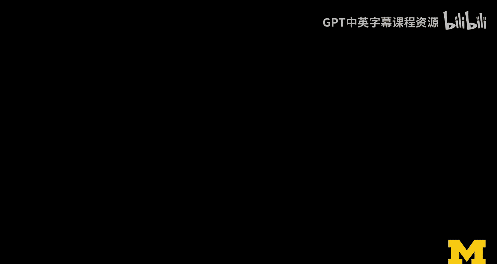

在本节课中，我们将探讨生成式AI工具在提升职场创造力方面的局限性。我们将通过直接向AI工具提问和实际测试，来了解它们的优势、弱点以及如何为特定类型的创意工作提供最佳协助。

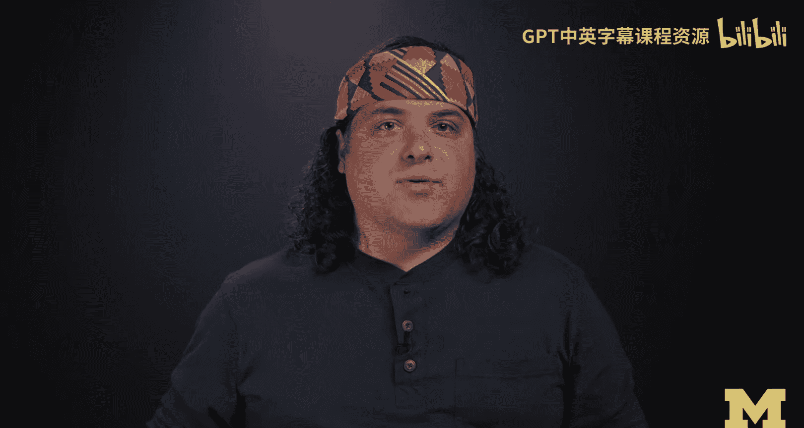

## 评估AI工具的局限性

上一节我们介绍了AI工具在创意领域的潜力，本节中我们来看看如何评估这些工具自身的局限性。一个有效的方法是直接询问AI程序它擅长什么、不擅长什么，以及它如何协助特定工作。

例如，当我们询问ChatGPT它不擅长做什么时，它的回答很有趣。

> 有趣的是，ChatGPT将生成高度创意或原创内容列为它的弱点之一。程序的回复明确指出，真正原创和突破性的想法最好留给人类的创造力。

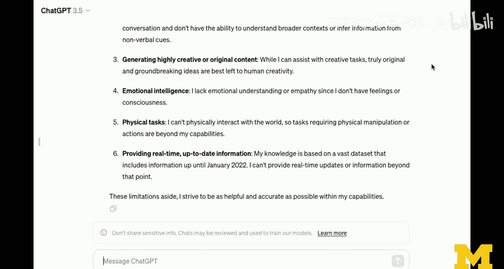

这告诉我们，寻求创意工作的专业人士或企业不应完全依赖生成式AI，创意工作者个人的声音和判断力仍然至关重要。

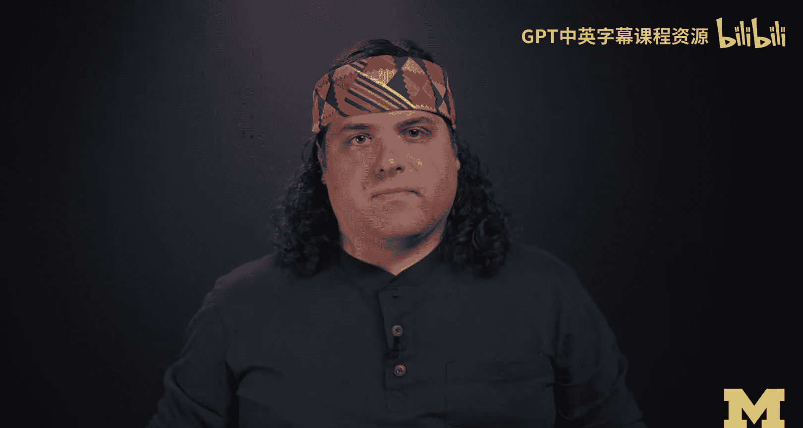

如果我们用更具体的问题评估另一个面向公众的生成式AI工具——微软的Copilot，也会看到类似的结果。

## 探索特定创意工作的应用

假设你是一名平面设计师，想了解Copilot能如何协助你的工作。你可以直接提问：“平面设计师如何使用生成式AI？”

除了生成文本和图像内容，Copilot还推荐使用生成式AI进行以下操作：

以下是Copilot推荐的具体应用方向：
*   **定制艺术风格**：它建议你尝试不同的提示词。
*   **概念探索**：它建议你使用生成式AI来帮助头脑风暴。
*   **自动生成变体**：它建议，例如，如果你在设计一个标志，可以使用生成式AI根据你的输入创建许多不同的版本。

如果你担心生成的图像基于受版权保护的材料，Copilot建议：

以下是关于避免版权问题的建议：
*   为图像生成使用抽象的描述。如果你描述得太具体或想要太逼真的东西，生成式AI可能会侵犯版权。
*   同时，它建议你审查并筛选它给出的输出。这便将责任放在了创意工作者——你的身上，以确保你没有侵犯版权。

在没有额外提示和优化的情况下，Copilot的建议就到此为止。需要注意的是，它没有解释如何在特定程序中执行这些建议。此外，和ChatGPT一样，微软Copilot也强调了人类判断力和辨别力在创意过程中的重要性。

> 来自微软Copilot的引用：“请记住，虽然生成式AI可以协助内容创作，但人类的筛选和质量控制仍然至关重要。”

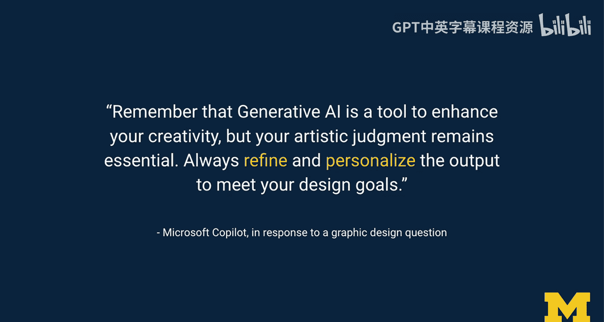

> 另一条引用：“请记住，虽然生成式AI可以是一个强大的工具，但筛选和优化输出以符合你的设计愿景至关重要。作为设计师，你的创意判断力对于塑造最终结果仍然至关重要。”

> 最后一条引用：“请记住，生成式AI是增强你创造力的工具，但你的艺术判断力仍然必不可少。始终优化和个性化输出，以实现你的设计目标。”

## 通过实践测试工具极限

考虑到这一点，并且因为你可能无法总是直接询问你的生成式AI工具其优缺点，所以通过实验来测试工具的极限并判断它如何满足你的需求总是很重要。

这里，我计划向ChatGPT提出一个基本的营销问题，以支持我领导一个古典音乐非营利组织的工作。我从早先与微软Copilot的交流中了解到，精心设计详细的提示词会产生更具体、更有用的结果。

因此，我花了一点时间，尽可能清晰地表达我对新口号的需求。这个提示词的灵感来自Copilot关于让生成式AI协助进行营销材料A/B测试的建议。

我的提示词是：“我经营一家古典音乐非营利组织。我们专注于呈现鲜少演出且未被充分代表的20世纪和21世纪作曲家的作品。我们目前的口号是‘Here, Different’。你能帮我想出一些符合我们品牌标识、并且像‘Here, Different’一样简洁的额外营销口号吗？”

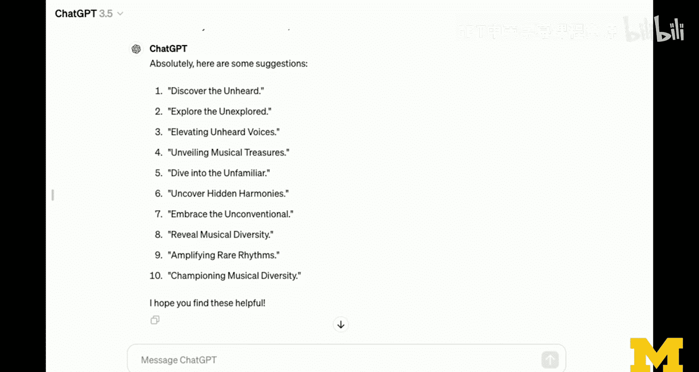

ChatGPT工作得非常快，并给出了许多结果——可能太多了。我将需要处理这些建议，以找到一个既符合我组织需求，又符合我作为营销人员个人声音的口号。可能ChatGPT更适合其他营销任务，例如在头脑风暴大量想法时提供一个起点，而不是在所有情况下都能交付最终产品。

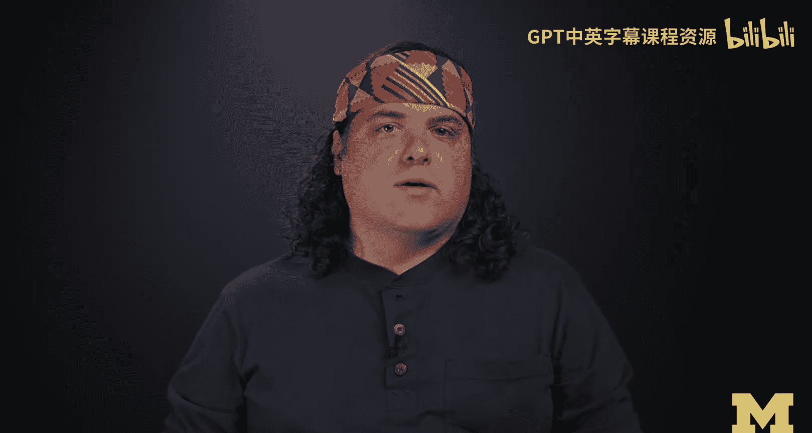

## 比较不同AI工具的特性

在结束之前，我想指出ChatGPT和微软Copilot之间的一个重要区别。

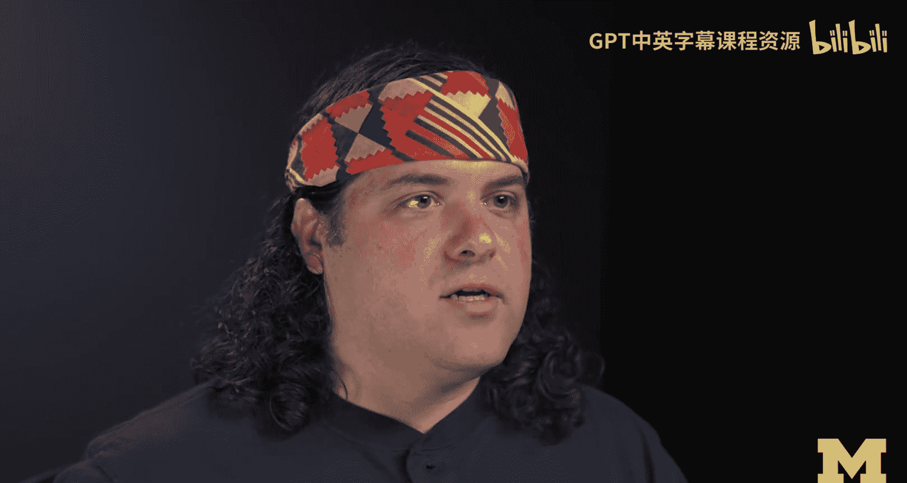

两个程序都是免费的、知名的，并且定位为对初学者友好且可供其使用。我在这里使用的基本版ChatGPT是一个简单的文本生成器。更高级的ChatGPT版本可以看、听和说。而微软Copilot是多模态的，可以生成文本和图像，并协助完成其他生成式AI任务。在本系列课程的后面，你将有机会观看一个更长的演示视频，了解Copilot的高级功能。

与许多其他早期AI引擎相比，微软Copilot的另一个显著特点是，它会在生成对你的提示词的回复时，分享它所访问的任何网站的链接。这种来源处理方式比我们在基本版ChatGPT中看到的更加透明，它的来源列表也给了你自行进一步探索的选项。

以下是微软Copilot在回答我关于营销人员和平面设计师在工作中使用AI（特别是以避免侵犯版权材料为目标）的问题时，引用的一些网站。

需要注意的是，与任何生成式AI输出一样，生成的来源列表中偶尔也可能存在错误。例如，有些来源可能被遗漏或过度引用。

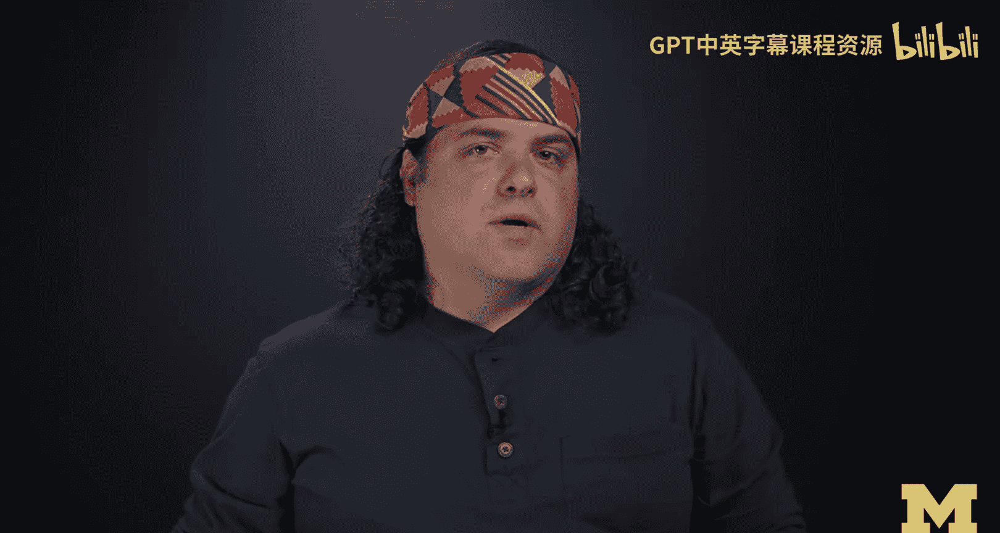

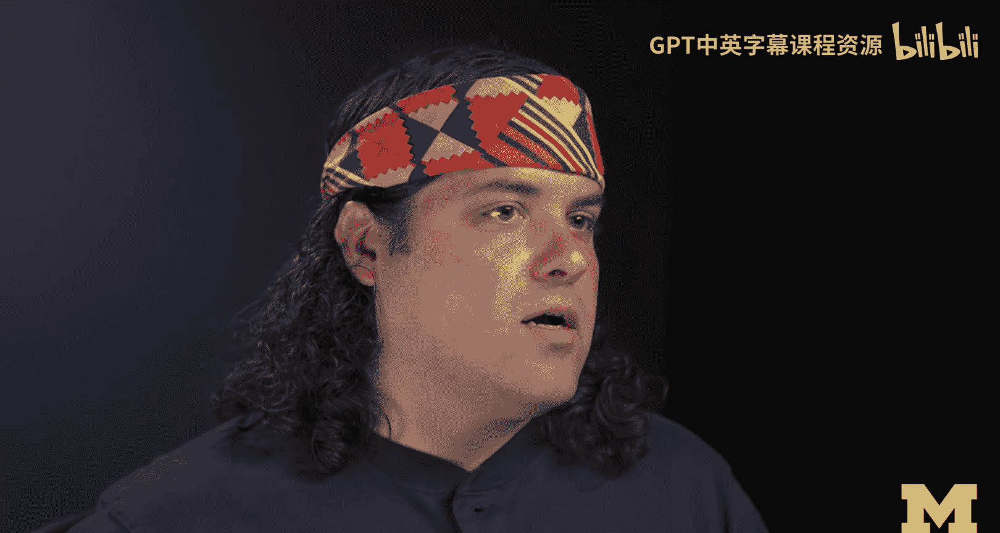

## 课程总结

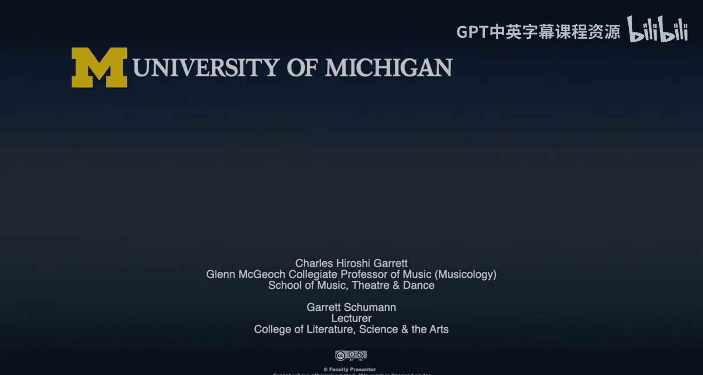

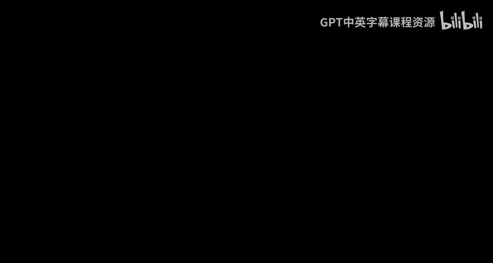

本节课中，我们一起学习了如何评估生成式AI工具在创意工作中的局限性。关键要点包括：直接向AI工具提问以了解其能力边界；通过具体案例（如平面设计、营销口号生成）进行实际测试；认识到人类创意判断和审查在AI辅助工作流程中的核心重要性；以及比较不同工具（如ChatGPT与Copilot）在功能、透明度和适用场景上的差异。记住，生成式AI是增强创造力的强大工具，而非替代品，善用它们需要结合人类的智慧、批判性思维和不断的实践探索。