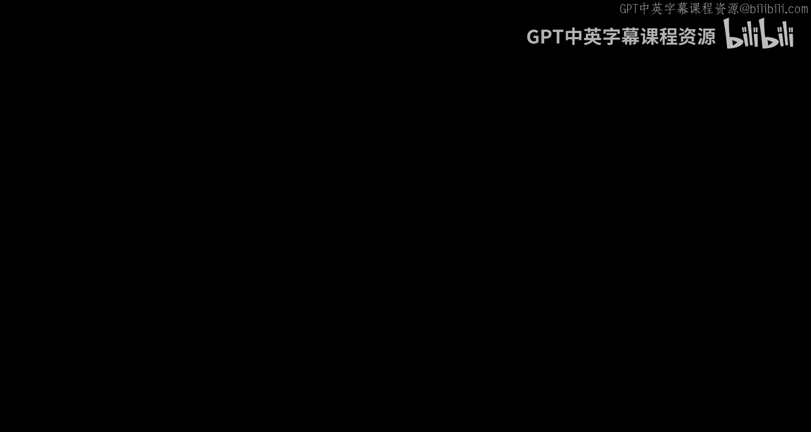
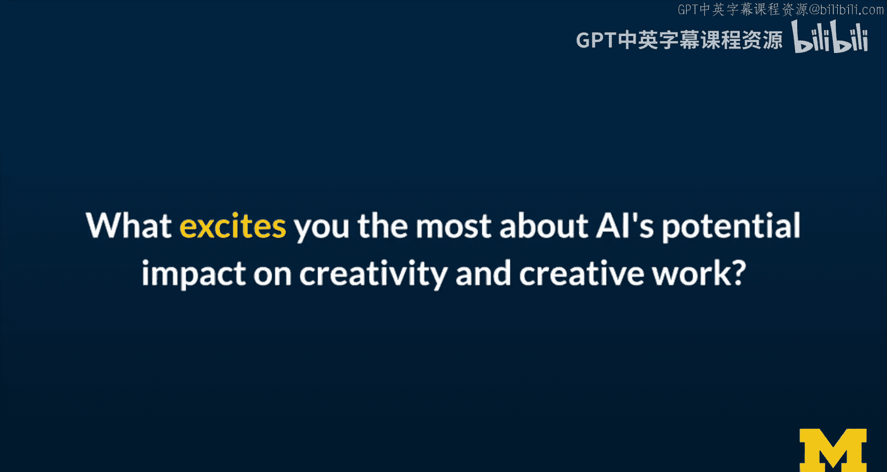
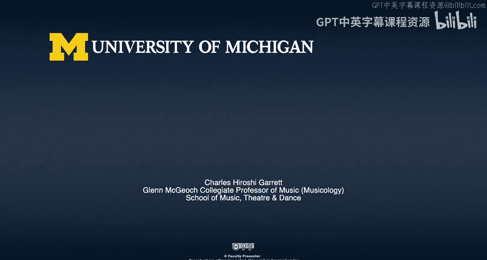

# 密歇根大学《AI用于创意工作｜AI for Creative Work》中英字幕 p08 7_领域之声：查尔斯·浩石·加勒特.zh_en -BV1DXNiznEXk_p8-

I'm currently exploring various AI tools designed to assist with what I think of as my creative work as a professor。

These are all recent tools that promise to help me with my own research and my writing。

I'm most intrigued by their potential to help me learn more about myself， my creative habits。

 my intellectual tendencies， and also my creative weaknesses or limitations。😊，For example。

 it's now possible for me to train an AI chatt to learn from my published writing。

 and I can then ask that chatbo questions about my work。About what I accomplished。

 about what I overlooked and about what I might do next。

I can also get advice from AI writing tools about how I can improve my written communication。

 how I can write more clearly and effectively。I don't know the answers yet。

 but I am hoping that AI will help me learn more about who I am。

 what I have done and how I might expand my creative work going forward。

